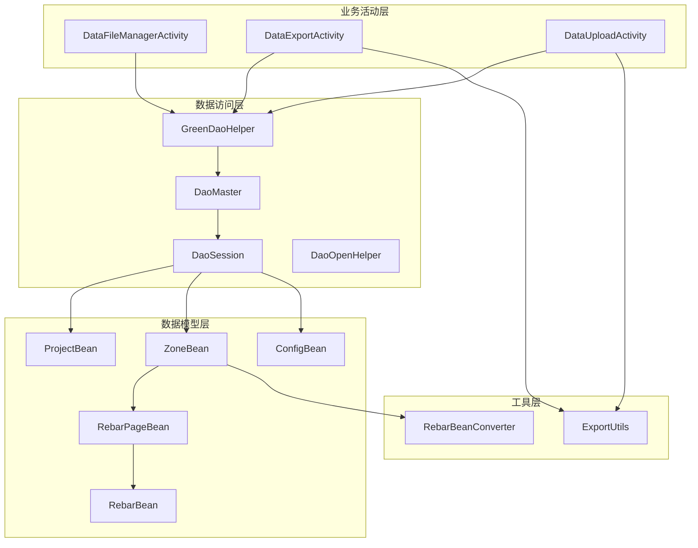
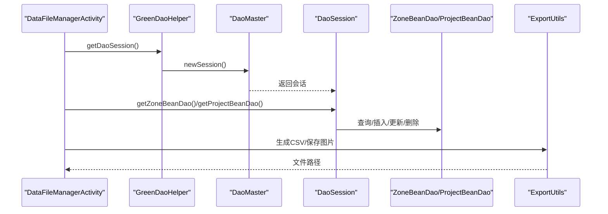
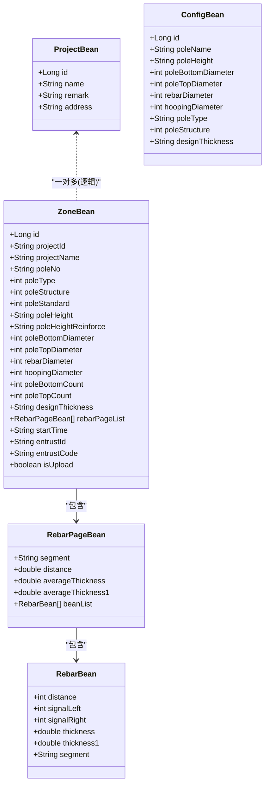
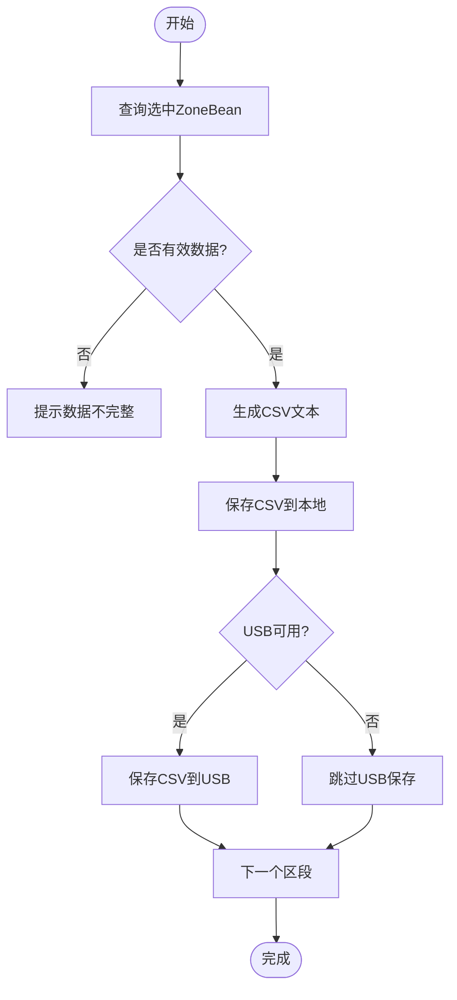
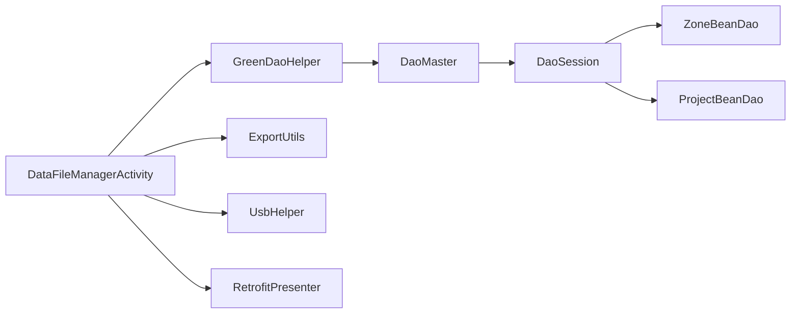

# 数据管理

<cite>
**本文引用的文件**
- [DaoMaster.java](file://app/src/main/java/com/example/gtj_sd_dg240/functions/database/greenDao/db/DaoMaster.java)
- [DaoSession.java](file://app/src/main/java/com/example/gtj_sd_dg240/functions/database/greenDao/db/DaoSession.java)
- [GreenDaoHelper.java](file://app/src/main/java/com/example/gtj_sd_dg240/storage/GreenDaoHelper.java)
- [DaoOpenHelper.java](file://app/src/main/java/com/example/gtj_sd_dg240/storage/DaoOpenHelper.java)
- [ProjectBean.java](file://app/src/main/java/com/example/gtj_sd_dg240/model/ProjectBean.java)
- [ZoneBean.java](file://app/src/main/java/com/example/gtj_sd_dg240/model/ZoneBean.java)
- [ConfigBean.java](file://app/src/main/java/com/example/gtj_sd_dg240/model/ConfigBean.java)
- [RebarPageBean.java](file://app/src/main/java/com/example/gtj_sd_dg240/model/RebarPageBean.java)
- [RebarBean.java](file://app/src/main/java/com/example/gtj_sd_dg240/model/RebarBean.java)
- [RebarBeanConverter.java](file://app/src/main/java/com/example/gtj_sd_dg240/storage/RebarBeanConverter.java)
- [DataFileManagerActivity.java](file://app/src/main/java/com/example/gtj_sd_dg240/activity/data/DataFileManagerActivity.java)
- [DataExportActivity.java](file://app/src/main/java/com/example/gtj_sd_dg240/activity/data/DataExportActivity.java)
- [DataUploadActivity.java](file://app/src/main/java/com/example/gtj_sd_dg240/activity/data/DataUploadActivity.java)
- [ExportUtils.java](file://app/src/main/java/com/example/gtj_sd_dg240/utils/ExportUtils.java)
</cite>

## 目录
1. [简介](#简介)
2. [项目结构](#项目结构)
3. [核心组件](#核心组件)
4. [架构总览](#架构总览)
5. [详细组件分析](#详细组件分析)
6. [依赖关系分析](#依赖关系分析)
7. [性能与优化](#性能与优化)
8. [故障排查指南](#故障排查指南)
9. [结论](#结论)
10. [附录](#附录)

## 简介
本文件面向GTJ-SD-DG240应用的数据管理功能，围绕GreenDAO数据库的架构设计、表结构与数据模型映射、数据导入导出（CSV）、文件管理系统、备份恢复与版本迁移、完整性校验以及查询与事务管理等主题进行系统化说明。文档以代码为依据，提供可追溯的文件来源与图示，帮助开发者快速理解并扩展数据层能力。

## 项目结构
数据管理相关代码主要分布在以下模块：
- 数据库访问层：greenDAO生成的DaoMaster、DaoSession与各实体Dao；自定义DaoOpenHelper用于升级迁移；GreenDaoHelper作为单例入口。
- 数据模型层：ProjectBean、ZoneBean、ConfigBean等实体及RebarPageBean、RebarBean等复杂对象。
- 业务活动层：DataFileManagerActivity（数据管理主界面）、DataExportActivity（导出CSV与截图）、DataUploadActivity（上传至服务器）。
- 工具层：ExportUtils负责CSV文本生成与文件写入；RebarBeanConverter实现复杂对象的序列化存储。

图表来源
- [DaoMaster.java:15-69](file://app/src/main/java/com/example/gtj_sd_dg240/functions/database/greenDao/db/DaoMaster.java#L15-L69)
- [DaoSession.java:30-74](file://app/src/main/java/com/example/gtj_sd_dg240/functions/database/greenDao/db/DaoSession.java#L30-L74)
- [GreenDaoHelper.java:10-41](file://app/src/main/java/com/example/gtj_sd_dg240/storage/GreenDaoHelper.java#L10-L41)
- [DaoOpenHelper.java:14-34](file://app/src/main/java/com/example/gtj_sd_dg240/storage/DaoOpenHelper.java#L14-L34)
- [ProjectBean.java:14-27](file://app/src/main/java/com/example/gtj_sd_dg240/model/ProjectBean.java#L14-L27)
- [ZoneBean.java:15-55](file://app/src/main/java/com/example/gtj_sd_dg240/model/ZoneBean.java#L15-L55)
- [ConfigBean.java:13-37](file://app/src/main/java/com/example/gtj_sd_dg240/model/ConfigBean.java#L13-L37)
- [RebarPageBean.java:9-20](file://app/src/main/java/com/example/gtj_sd_dg240/model/RebarPageBean.java#L9-L20)
- [RebarBean.java:5-12](file://app/src/main/java/com/example/gtj_sd_dg240/model/RebarBean.java#L5-L12)
- [RebarBeanConverter.java:12-28](file://app/src/main/java/com/example/gtj_sd_dg240/storage/RebarBeanConverter.java#L12-L28)
- [DataFileManagerActivity.java:44-81](file://app/src/main/java/com/example/gtj_sd_dg240/activity/data/DataFileManagerActivity.java#L44-L81)
- [DataExportActivity.java:40-62](file://app/src/main/java/com/example/gtj_sd_dg240/activity/data/DataExportActivity.java#L40-L62)
- [DataUploadActivity.java:45-66](file://app/src/main/java/com/example/gtj SD-DG240/app/src/main/java/com/example/gtj_sd_dg240/activity/data/DataUploadActivity.java#L45-L66)
- [ExportUtils.java:20-66](file://app/src/main/java/com/example/gtj_sd_dg240/utils/ExportUtils.java#L20-L66)

章节来源
- [DaoMaster.java:15-69](file://app/src/main/java/com/example/gtj_sd_dg240/functions/database/greenDao/db/DaoMaster.java#L15-L69)
- [DaoSession.java:30-74](file://app/src/main/java/com/example/gtj_sd_dg240/functions/database/greenDao/db/DaoSession.java#L30-L74)
- [GreenDaoHelper.java:10-41](file://app/src/main/java/com/example/gtj_sd_dg240/storage/GreenDaoHelper.java#L10-L41)
- [DaoOpenHelper.java:14-34](file://app/src/main/java/com/example/gtj_sd_dg240/storage/DaoOpenHelper.java#L14-L34)

## 核心组件
- 数据库初始化与访问入口
  - GreenDaoHelper：封装DaoMaster/DaoSession生命周期，提供全局单例访问点。
  - DaoMaster：维护schema版本、注册所有Dao、创建/销毁表。
  - DaoSession：持有各实体Dao实例，提供统一会话与缓存控制。
  - DaoOpenHelper：继承OpenHelper，重写onUpgrade使用MigrationHelper进行重建迁移。
- 数据模型
  - ProjectBean：工程信息，含名称、备注、地址等。
  - ZoneBean：检测记录主体，包含电杆参数、钢筋分页数据（通过转换器持久化）、委托信息等。
  - ConfigBean：配置模板，如电杆类型、尺寸、保护层厚度等。
  - RebarPageBean/RebarBean：钢筋测量结果的分页与逐点数据。
- 数据导入导出与文件管理
  - DataFileManagerActivity：项目与区段列表展示、批量选择、删除、查看、导出、上传入口。
  - DataExportActivity：按选中区段生成CSV与截图，落盘到内部存储与USB。
  - DataUploadActivity：将选中区段数据打包为JSON并上传，成功后标记已上传。
  - ExportUtils：CSV文本组装、图片与数据文件保存。
  - RebarBeanConverter：将List<RebarPageBean>序列化为字符串存储，读取时反序列化。

章节来源
- [GreenDaoHelper.java:10-41](file://app/src/main/java/com/example/gtj_sd_dg240/storage/GreenDaoHelper.java#L10-L41)
- [DaoMaster.java:15-69](file://app/src/main/java/com/example/gtj_sd_dg240/functions/database/greenDao/db/DaoMaster.java#L15-L69)
- [DaoSession.java:30-74](file://app/src/main/java/com/example/gtj_sd_dg240/functions/database/greenDao/db/DaoSession.java#L30-L74)
- [DaoOpenHelper.java:14-34](file://app/src/main/java/com/example/gtj_sd_dg240/storage/DaoOpenHelper.java#L14-L34)
- [ProjectBean.java:14-27](file://app/src/main/java/com/example/gtj_sd_dg240/model/ProjectBean.java#L14-L27)
- [ZoneBean.java:15-55](file://app/src/main/java/com/example/gtj_sd_dg240/model/ZoneBean.java#L15-L55)
- [ConfigBean.java:13-37](file://app/src/main/java/com/example/gtj_sd_dg240/model/ConfigBean.java#L13-L37)
- [RebarPageBean.java:9-20](file://app/src/main/java/com/example/gtj_sd_dg240/model/RebarPageBean.java#L9-L20)
- [RebarBean.java:5-12](file://app/src/main/java/com/example/gtj_sd_dg240/model/RebarBean.java#L5-L12)
- [RebarBeanConverter.java:12-28](file://app/src/main/java/com/example/gtj_sd_dg240/storage/RebarBeanConverter.java#L12-L28)
- [DataFileManagerActivity.java:44-81](file://app/src/main/java/com/example/gtj_sd_dg240/activity/data/DataFileManagerActivity.java#L44-L81)
- [DataExportActivity.java:40-62](file://app/src/main/java/com/example/gtj_sd_dg240/activity/data/DataExportActivity.java#L40-L62)
- [DataUploadActivity.java:45-66](file://app/src/main/java/com/example/gtj_sd_dg240/activity/data/DataUploadActivity.java#L45-L66)
- [ExportUtils.java:20-66](file://app/src/main/java/com/example/gtj_sd_dg240/utils/ExportUtils.java#L20-L66)

## 架构总览
数据流从UI层发起，经GreenDaoHelper获取DaoSession，调用具体Dao完成CRUD；导出/上传流程在业务活动中编排，结合ExportUtils完成CSV与图片的生成与落盘；复杂对象通过转换器完成持久化。

图表来源
- [GreenDaoHelper.java:16-41](file://app/src/main/java/com/example/gtj_sd_dg240/storage/GreenDaoHelper.java#L16-L41)
- [DaoMaster.java:50-69](file://app/src/main/java/com/example/gtj_sd_dg240/functions/database/greenDao/db/DaoMaster.java#L50-L69)
- [DaoSession.java:44-74](file://app/src/main/java/com/example/gtj_sd_dg240/functions/database/greenDao/db/DaoSession.java#L44-L74)
- [DataFileManagerActivity.java:157-186](file://app/src/main/java/com/example/gtj_sd_dg240/activity/data/DataFileManagerActivity.java#L157-L186)
- [ExportUtils.java:20-66](file://app/src/main/java/com/example/gtj_sd_dg240/utils/ExportUtils.java#L20-L66)

## 详细组件分析

### 数据库架构与表结构
- 表清单与职责
  - ProjectBean：工程项目元数据。
  - ZoneBean：检测记录主表，关联ProjectBean（projectId），内嵌钢筋分页数据。
  - ConfigBean：设备/规范配置模板。
  - RebarMinMaxBean、StandardCurveBean、ZoneBeanDao等由greenDAO生成，分别对应最小/最大钢筋值、标准曲线等。
- 版本与迁移
  - DaoMaster定义SCHEMA_VERSION=1，并在onCreate中创建全部表。
  - DevOpenHelper在升级时直接drop all再create（仅开发环境）。
  - 生产环境使用DaoOpenHelper.onUpgrade，借助MigrationHelper重建表结构，确保字段变更安全。
- 复杂字段映射
  - ZoneBean.rebarPageList通过@Convert注解与RebarBeanConverter配合，以JSON字符串形式持久化，读取时自动反序列化为List<RebarPageBean>。

图表来源
- [ProjectBean.java:14-27](file://app/src/main/java/com/example/gtj_sd_dg240/model/ProjectBean.java#L14-L27)
- [ZoneBean.java:15-55](file://app/src/main/java/com/example/gtj_sd_dg240/model/ZoneBean.java#L15-L55)
- [ConfigBean.java:13-37](file://app/src/main/java/com/example/gtj_sd_dg240/model/ConfigBean.java#L13-L37)
- [RebarPageBean.java:9-20](file://app/src/main/java/com/example/gtj_sd_dg240/model/RebarPageBean.java#L9-L20)
- [RebarBean.java:5-12](file://app/src/main/java/com/example/gtj_sd_dg240/model/RebarBean.java#L5-L12)

章节来源
- [DaoMaster.java:15-69](file://app/src/main/java/com/example/gtj_sd_dg240/functions/database/greenDao/db/DaoMaster.java#L15-L69)
- [DaoOpenHelper.java:14-34](file://app/src/main/java/com/example/gtj_sd_dg240/storage/DaoOpenHelper.java#L14-L34)
- [ZoneBean.java:41-55](file://app/src/main/java/com/example/gtj_sd_dg240/model/ZoneBean.java#L41-L55)
- [RebarBeanConverter.java:12-28](file://app/src/main/java/com/example/gtj_sd_dg240/storage/RebarBeanConverter.java#L12-L28)

### 数据导入导出与文件格式
- CSV格式与内容
  - 头部包含应用名与“检测记录”。
  - 工程信息：工程名称、电杆编号、适用规范。
  - 试验参数：电杆类型、结构、长度、根径、梢径、纵筋直径、螺旋筋直径、设计保护层厚度。
  - 表格行：位置|数量列头，随后按区段输出每根钢筋厚度（两层数据）与平均值。
- 导出流程
  - DataExportActivity根据选中的zoneId集合查询ZoneBean，生成CSV与截图，保存到内部存储与USB（若存在）。
  - ExportUtils.getExportString组装CSV文本；saveDataFile/saveBitmapFile写入文件。
- 上传流程
  - DataUploadActivity校验委托单号绑定，构造JSON（含设备SN、工程名、电杆编号、参数、点数据、Base64截图），调用RetrofitPresenter上传，成功后更新isUpload标志。

图表来源
- [DataExportActivity.java:346-471](file://app/src/main/java/com/example/gtj_sd_dg240/activity/data/DataExportActivity.java#L346-L471)
- [ExportUtils.java:20-133](file://app/src/main/java/com/example/gtj_sd_dg240/utils/ExportUtils.java#L20-L133)

章节来源
- [DataExportActivity.java:346-471](file://app/src/main/java/com/example/gtj_sd_dg240/activity/data/DataExportActivity.java#L346-L471)
- [ExportUtils.java:20-133](file://app/src/main/java/com/example/gtj_sd_dg240/utils/ExportUtils.java#L20-L133)
- [DataUploadActivity.java:404-458](file://app/src/main/java/com/example/gtj_sd_dg240/activity/data/DataUploadActivity.java#L404-L458)

### 文件管理系统
- 组织方式
  - 内部存储：/sdcard/<应用名>/<项目名称>/<电杆编号>/ 下存放.csv与.jpg。
  - USB存储：应用名目录下相同层级结构，便于U盘拷贝。
- 权限与识别
  - 通过UsbHelper监听U盘插拔，识别FAT32或Pad格式U盘，授予读写权限后写入。
- 空间管理
  - 导出前清理同名项目文件夹，避免重复文件占用空间。
  - 写入失败时记录异常日志并提示用户。

章节来源
- [DataExportActivity.java:105-107](file://app/src/main/java/com/example/gtj_sd_dg240/activity/data/DataExportActivity.java#L105-L107)
- [DataExportActivity.java:368-372](file://app/src/main/java/com/example/gtj_sd_dg240/activity/data/DataExportActivity.java#L368-L372)
- [DataFileManagerActivity.java:342-386](file://app/src/main/java/com/example/gtj_sd_dg240/activity/data/DataFileManagerActivity.java#L342-L386)
- [ExportUtils.java:75-133](file://app/src/main/java/com/example/gtj_sd_dg240/utils/ExportUtils.java#L75-L133)

### 数据备份恢复与版本迁移
- 备份
  - 导出CSV与截图即为离线备份；建议定期导出并按项目归档。
- 恢复
  - 当前未提供导入CSV回写数据库的功能；如需恢复，可在服务端解析CSV后下发或通过其他机制重建数据。
- 版本迁移
  - 使用DaoOpenHelper.onUpgrade与MigrationHelper进行全量重建迁移，保证字段变更安全。
  - 开发环境可使用DevOpenHelper直接重建表。

章节来源
- [DaoOpenHelper.java:14-34](file://app/src/main/java/com/example/gtj_sd_dg240/storage/DaoOpenHelper.java#L14-L34)
- [DaoMaster.java:90-106](file://app/src/main/java/com/example/gtj_sd_dg240/functions/database/greenDao/db/DaoMaster.java#L90-L106)

### 数据完整性校验
- 导出前校验
  - DataExportActivity检查rebarPageList是否为空，为空则提示无法导出。
- 上传前校验
  - DataUploadActivity要求entrustId与entrustCode非空，否则拒绝上传。
- 文件写入校验
  - ExportUtils写入失败捕获异常并返回null，上层据此判断失败。

章节来源
- [DataExportActivity.java:411-419](file://app/src/main/java/com/example/gtj_sd_dg240/activity/data/DataExportActivity.java#L411-L419)
- [DataUploadActivity.java:404-416](file://app/src/main/java/com/example/gtj_sd_dg240/activity/data/DataUploadActivity.java#L404-L416)
- [ExportUtils.java:75-116](file://app/src/main/java/com/example/gtj_sd_dg240/utils/ExportUtils.java#L75-L116)

### API与CRUD、复杂查询、事务管理
- CRUD
  - 通过DaoSession获取各Dao，执行insert、update、delete、query等操作。
  - 示例：DataFileManagerActivity中批量删除ZoneBean使用deleteByKeyInTx，体现事务语义。
- 复杂查询
  - 使用QueryBuilder按条件筛选，如按projectId查询ZoneBean列表。
- 事务管理
  - 批量删除使用事务方法，保证一致性。
  - 上传成功后更新isUpload标志，属于简单更新事务。

章节来源
- [DataFileManagerActivity.java:277-316](file://app/src/main/java/com/example/gtj_sd_dg240/activity/data/DataFileManagerActivity.java#L277-L316)
- [DataFileManagerActivity.java:157-186](file://app/src/main/java/com/example/gtj_sd_dg240/activity/data/DataFileManagerActivity.java#L157-L186)
- [DataUploadActivity.java:443-458](file://app/src/main/java/com/example/gtj_sd_dg240/activity/data/DataUploadActivity.java#L443-L458)

## 依赖关系分析
- 低耦合高内聚
  - GreenDaoHelper集中管理数据库会话，降低调用方复杂度。
  - ExportUtils独立处理文件IO，与UI解耦。
  - RebarBeanConverter屏蔽复杂对象序列化细节。
- 外部依赖
  - greenDAO：ORM框架，自动生成Dao与Schema。
  - Retrofit网络库：用于数据上传。
  - UsbHelper：U盘读写。
  - Gson：JSON序列化。

图表来源
- [DataFileManagerActivity.java:44-81](file://app/src/main/java/com/example/gtj_sd_dg240/activity/data/DataFileManagerActivity.java#L44-L81)
- [GreenDaoHelper.java:10-41](file://app/src/main/java/com/example/gtj_sd_dg240/storage/GreenDaoHelper.java#L10-L41)
- [DaoMaster.java:50-69](file://app/src/main/java/com/example/gtj_sd_dg240/functions/database/greenDao/db/DaoMaster.java#L50-L69)
- [DaoSession.java:44-74](file://app/src/main/java/com/example/gtj_sd_dg240/functions/database/greenDao/db/DaoSession.java#L44-L74)
- [ExportUtils.java:20-66](file://app/src/main/java/com/example/gtj_sd_dg240/utils/ExportUtils.java#L20-L66)
- [DataUploadActivity.java:418-458](file://app/src/main/java/com/example/gtj_sd_dg240/activity/data/DataUploadActivity.java#L418-L458)

章节来源
- [DataFileManagerActivity.java:44-81](file://app/src/main/java/com/example/gtj_sd_dg240/activity/data/DataFileManagerActivity.java#L44-L81)
- [DataUploadActivity.java:418-458](file://app/src/main/java/com/example/gtj_sd_dg240/activity/data/DataUploadActivity.java#L418-L458)

## 性能与优化
- 查询优化
  - 使用QueryBuilder精确过滤（如按projectId），减少内存占用。
  - 分页展示：ZoneBean.rebarPageList已按区段分页，避免一次性加载大量数据。
- 缓存策略
  - DaoSession内置IdentityScope，合理使用clear()释放内存，避免长期持有大对象。
- I/O优化
  - 批量操作使用事务方法（如deleteByKeyInTx）减少磁盘同步次数。
  - 导出前先清理旧文件，避免冗余I/O。
- 网络优化
  - 上传前校验必要字段，减少无效请求。
  - 截图压缩后再转Base64，降低带宽消耗。

[本节为通用指导，不直接分析具体文件]

## 故障排查指南
- 导出失败
  - 检查rebarPageList是否为空；确认存储路径是否存在且可写；USB是否识别成功。
- 上传失败
  - 检查网络状态；确认委托单号是否绑定；查看错误回调信息。
- 数据库升级问题
  - 确认DaoOpenHelper.onUpgrade是否正确调用MigrationHelper；必要时回滚版本验证。
- 复杂对象读取异常
  - 检查RebarBeanConverter序列化/反序列化是否一致；确认数据库字段类型与注解匹配。

章节来源
- [DataExportActivity.java:346-471](file://app/src/main/java/com/example/gtj_sd_dg240/activity/data/DataExportActivity.java#L346-L471)
- [DataUploadActivity.java:404-458](file://app/src/main/java/com/example/gtj_sd_dg240/activity/data/DataUploadActivity.java#L404-L458)
- [DaoOpenHelper.java:14-34](file://app/src/main/java/com/example/gtj_sd_dg240/storage/DaoOpenHelper.java#L14-L34)
- [RebarBeanConverter.java:12-28](file://app/src/main/java/com/example/gtj_sd_dg240/storage/RebarBeanConverter.java#L12-L28)

## 结论
本项目采用greenDAO构建稳定可靠的数据层，通过清晰的模型设计与转换器机制，实现了检测数据的结构化存储与高效访问。数据导出与上传流程完善，支持CSV与截图双通道输出，满足现场作业与云端同步需求。通过合理的查询与事务策略，保障了数据一致性与性能。后续可考虑增加数据导入能力、增量迁移与更细粒度的索引优化，进一步提升系统能力。

[本节为总结性内容，不直接分析具体文件]

## 附录
- 常用API路径参考
  - 获取会话：GreenDaoHelper.getDaoSession()
  - 查询项目：ProjectBeanDao.loadAll()
  - 查询区段：ZoneBeanDao.queryBuilder().where(...).list()
  - 批量删除：ZoneBeanDao.deleteByKeyInTx(ids)
  - 生成CSV：ExportUtils.getExportString(appName, zoneBean)
  - 保存文件：ExportUtils.saveDataFile(fileName, data) / saveBitmapFile(context, fileName, data)

章节来源
- [GreenDaoHelper.java:32-41](file://app/src/main/java/com/example/gtj_sd_dg240/storage/GreenDaoHelper.java#L32-L41)
- [DataFileManagerActivity.java:157-186](file://app/src/main/java/com/example/gtj_sd_dg240/activity/data/DataFileManagerActivity.java#L157-L186)
- [DataFileManagerActivity.java:277-316](file://app/src/main/java/com/example/gtj_sd_dg240/activity/data/DataFileManagerActivity.java#L277-L316)
- [ExportUtils.java:20-133](file://app/src/main/java/com/example/gtj_sd_dg240/utils/ExportUtils.java#L20-L133)