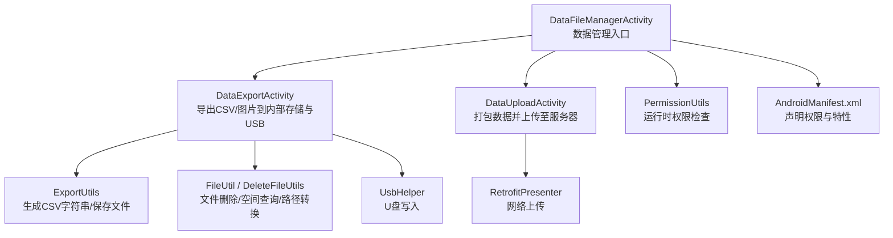
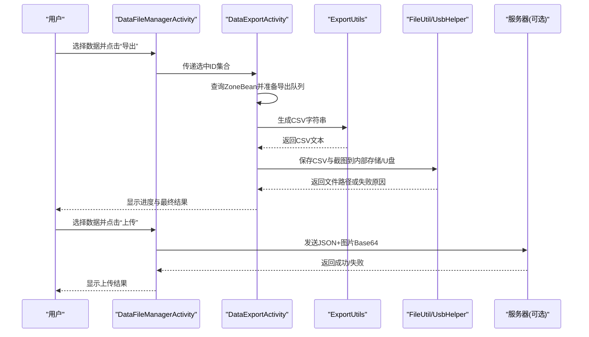
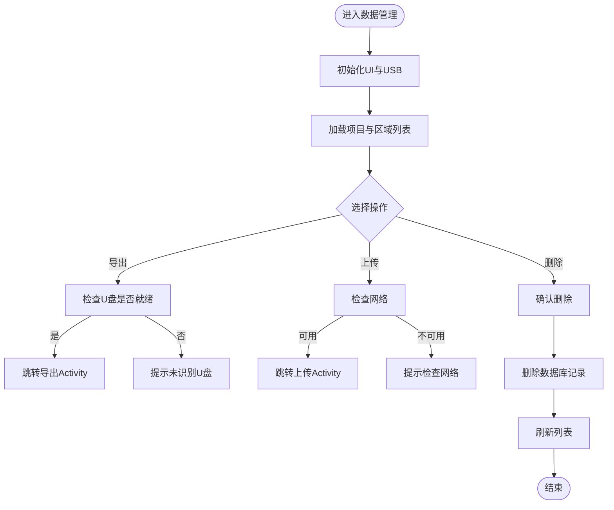
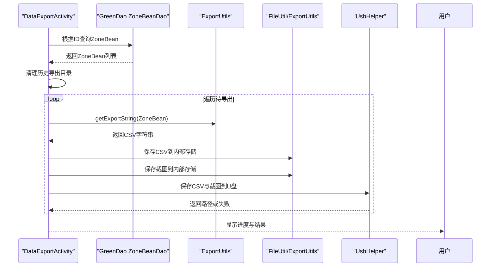
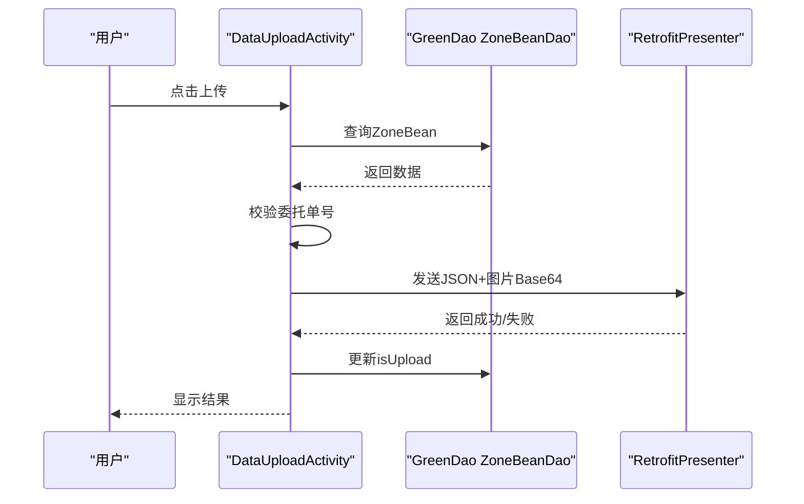
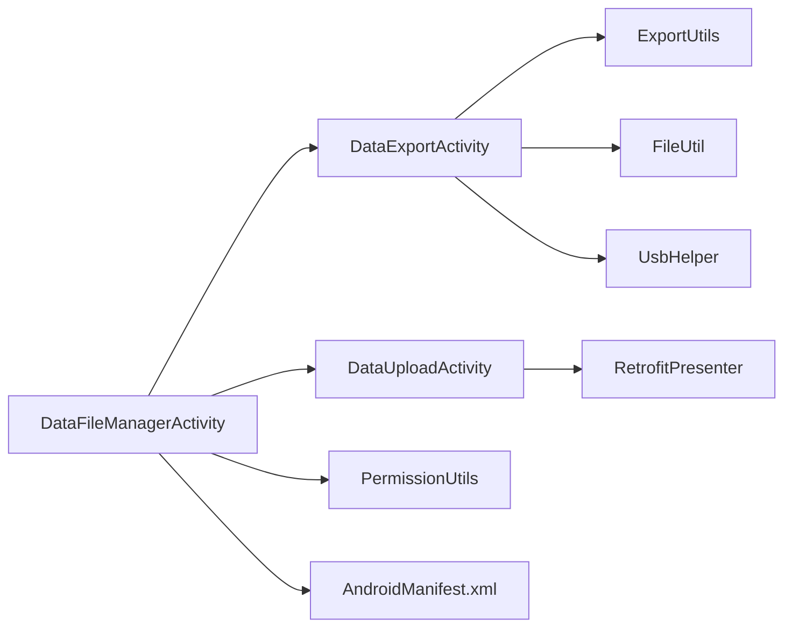

# 文件管理

<cite>
**本文引用的文件**
- [DataFileManagerActivity.java](file://app/src/main/java/com/example/gtj_sd_dg240/activity/data/DataFileManagerActivity.java)
- [DataExportActivity.java](file://app/src/main/java/com/example/gtj_sd_dg240/activity/data/DataExportActivity.java)
- [DataUploadActivity.java](file://app/src/main/java/com/example/gtj_sd_dg240/activity/data/DataUploadActivity.java)
- [ExportUtils.java](file://app/src/main/java/com/example/gtj_sd_dg240/utils/ExportUtils.java)
- [FileUtil.java](file://utillibrary/src/main/java/com/blackhao/utillibrary/file/FileUtil.java)
- [DeleteFileUtils.java](file://app/src/main/java/com/example/gtj_sd_dg240/utils/DeleteFileUtils.java)
- [PermissionUtils.java](file://app/src/main/java/com/example/gtj_sd_dg240/utils/PermissionUtils.java)
- [UsbHelper.java](file://utillibrary/src/main/java/com/blackhao/utillibrary/usbHelper/UsbHelper.java)
- [ZoneBean.java](file://app/src/main/java/com/example/gtj_sd_dg240/model/ZoneBean.java)
- [ExportMinMaxBeanUtils.java](file://app/src/main/java/com/example/gtj_sd_dg240/utils/ExportMinMaxBeanUtils.java)
- [AndroidManifest.xml](file://app/src/main/java/com/example/gtj_sd_dg240/AndroidManifest.xml)
</cite>

## 目录
1. [简介](#简介)
2. [项目结构](#项目结构)
3. [核心组件](#核心组件)
4. [架构总览](#架构总览)
5. [详细组件分析](#详细组件分析)
6. [依赖关系分析](#依赖关系分析)
7. [性能与内存优化](#性能与内存优化)
8. [安全与权限控制](#安全与权限控制)
9. [故障排查指南](#故障排查指南)
10. [结论](#结论)
11. [附录：CSV格式规范与导入导出流程](#附录csv格式规范与导入导出流程)

## 简介
本文件管理模块面向GTJ-SD-DG240应用，围绕检测数据的本地存储、导出（含CSV）、上传、USB设备读写、权限与安全、大文件处理与系统维护等能力进行系统化说明。文档从文件系统组织、存储策略、权限模型出发，深入解析CSV导入导出的数据转换逻辑与编码处理，并给出大文件流式处理、进度反馈、搜索过滤排序、备份恢复、版本与冲突解决、存储空间监控与清理压缩等实践建议。

## 项目结构
文件管理相关代码主要分布在以下位置：
- 数据管理入口与交互：activity/data 下的 DataFileManagerActivity、DataExportActivity、DataUploadActivity
- 导出与文件写入工具：utils/ExportUtils、utils/DeleteFileUtils、utillibrary/file/FileUtil
- USB设备读写：utillibrary/usbHelper/UsbHelper
- 权限与系统配置：utils/PermissionUtils、AndroidManifest.xml
- 数据模型：model/ZoneBean 及其关联的钢筋分页数据
- CSV导入：utils/ExportMinMaxBeanUtils（用于导入内置CSV）

图表来源
- [DataFileManagerActivity.java:63-81](file://app/src/main/java/com/example/gtj_sd_dg240/activity/data/DataFileManagerActivity.java#L63-L81)
- [DataExportActivity.java:54-62](file://app/src/main/java/com/example/gtj_sd_dg240/activity/data/DataExportActivity.java#L54-L62)
- [DataUploadActivity.java:58-66](file://app/src/main/java/com/example/gtj_sd_dg240/activity/data/DataUploadActivity.java#L58-L66)
- [ExportUtils.java:25-66](file://app/src/main/java/com/example/gtj_sd_dg240/utils/ExportUtils.java#L25-L66)
- [FileUtil.java:355-370](file://utillibrary/src/main/java/com/blackhao/utillibrary/file/FileUtil.java#L355-L370)
- [UsbHelper.java:180-219](file://utillibrary/src/main/java/com/blackhao/utillibrary/usbHelper/UsbHelper.java#L180-L219)
- [PermissionUtils.java:102-119](file://app/src/main/java/com/example/gtj_sd_dg240/utils/PermissionUtils.java#L102-L119)
- [AndroidManifest.xml:80-90](file://app/src/main/java/com/example/gtj_sd_dg240/AndroidManifest.xml#L80-L90)

章节来源
- [DataFileManagerActivity.java:63-81](file://app/src/main/java/com/example/gtj_sd_dg240/activity/data/DataFileManagerActivity.java#L63-L81)
- [DataExportActivity.java:54-62](file://app/src/main/java/com/example/gtj_sd_dg240/activity/data/DataExportActivity.java#L54-L62)
- [DataUploadActivity.java:58-66](file://app/src/main/java/com/example/gtj_sd_dg240/activity/data/DataUploadActivity.java#L58-L66)

## 核心组件
- 数据管理入口：DataFileManagerActivity 负责项目与区域（电杆）列表展示、选择、批量操作（打开、导出、上传、删除），以及USB设备识别与初始化。
- 导出：DataExportActivity 将选中的检测数据导出为CSV与截图，分别保存到平板内部存储与插入的U盘；提供进度提示与结果汇总。
- 上传：DataUploadActivity 将数据打包为JSON并上传图片Base64，调用网络接口上传，更新数据库状态。
- 导出工具：ExportUtils 负责生成CSV文本、保存图片与数据文件到指定路径。
- 文件工具：FileUtil 提供临时文件、文件拷贝、删除、URI转路径、可用空间查询等；DeleteFileUtils 提供递归删除目录与文件。
- USB工具：UsbHelper 封装U盘设备枚举、权限申请、目录创建与文件写入。
- 权限：PermissionUtils 统一处理存储、相机、蓝牙等权限申请与引导。
- 数据模型：ZoneBean 描述一次检测的区域数据，包含工程信息、试验参数、钢筋分页数据等。

章节来源
- [DataFileManagerActivity.java:44-81](file://app/src/main/java/com/example/gtj_sd_dg240/activity/data/DataFileManagerActivity.java#L44-L81)
- [DataExportActivity.java:40-62](file://app/src/main/java/com/example/gtj_sd_dg240/activity/data/DataExportActivity.java#L40-L62)
- [DataUploadActivity.java:45-66](file://app/src/main/java/com/example/gtj_sd_dg240/activity/data/DataUploadActivity.java#L45-L66)
- [ExportUtils.java:20-66](file://app/src/main/java/com/example/gtj_sd_dg240/utils/ExportUtils.java#L20-L66)
- [FileUtil.java:21-101](file://utillibrary/src/main/java/com/blackhao/utillibrary/file/FileUtil.java#L21-L101)
- [DeleteFileUtils.java:7-25](file://app/src/main/java/com/example/gtj_sd_dg240/utils/DeleteFileUtils.java#L7-L25)
- [UsbHelper.java:173-219](file://utillibrary/src/main/java/com/blackhao/utillibrary/usbHelper/UsbHelper.java#L173-L219)
- [PermissionUtils.java:19-30](file://app/src/main/java/com/example/gtj_sd_dg240/utils/PermissionUtils.java#L19-L30)
- [ZoneBean.java:15-55](file://app/src/main/java/com/example/gtj_sd_dg240/model/ZoneBean.java#L15-L55)

## 架构总览
文件管理采用“界面层 + 业务活动 + 工具库”的分层设计：
- 界面层：三个Activity分别承担数据管理、导出、上传职责，通过RecyclerView展示数据，使用对话框与进度提示交互。
- 业务层：ExportUtils、网络请求、数据库DAO（GreenDao）完成数据组装与持久化。
- 工具层：FileUtil、DeleteFileUtils、UsbHelper、PermissionUtils提供通用能力。

图表来源
- [DataFileManagerActivity.java:224-275](file://app/src/main/java/com/example/gtj_sd_dg240/activity/data/DataFileManagerActivity.java#L224-L275)
- [DataExportActivity.java:346-456](file://app/src/main/java/com/example/gtj_sd_dg240/activity/data/DataExportActivity.java#L346-L456)
- [ExportUtils.java:25-66](file://app/src/main/java/com/example/gtj_sd_dg240/utils/ExportUtils.java#L25-L66)
- [UsbHelper.java:180-219](file://utillibrary/src/main/java/com/blackhao/utillibrary/usbHelper/UsbHelper.java#L180-L219)
- [DataUploadActivity.java:404-458](file://app/src/main/java/com/example/gtj_sd_dg240/activity/data/DataUploadActivity.java#L404-L458)

## 详细组件分析

### 数据管理入口 DataFileManagerActivity
- 功能要点
  - 初始化UI、电池与蓝牙状态监听、USB设备识别与权限处理。
  - 项目与区域列表展示，支持全选/单选、批量勾选。
  - 打开详情、导出、上传、删除等操作。
  - 删除时校验当前检测中数据不可删，并同步更新数据库与UI。
- 关键流程
  - 初始化USB：通过UsbHelper注册广播监听插入/拔出事件，识别设备后读取根目录。
  - 导出/上传：校验网络与U盘可用性，弹出确认对话框后跳转对应Activity。
  - 删除：事务性删除ZoneBean与ProjectBean，刷新适配器。

图表来源
- [DataFileManagerActivity.java:63-81](file://app/src/main/java/com/example/gtj_sd_dg240/activity/data/DataFileManagerActivity.java#L63-L81)
- [DataFileManagerActivity.java:224-275](file://app/src/main/java/com/example/gtj_sd_dg240/activity/data/DataFileManagerActivity.java#L224-L275)
- [DataFileManagerActivity.java:342-386](file://app/src/main/java/com/example/gtj_sd_dg240/activity/data/DataFileManagerActivity.java#L342-L386)

章节来源
- [DataFileManagerActivity.java:63-81](file://app/src/main/java/com/example/gtj_sd_dg240/activity/data/DataFileManagerActivity.java#L63-L81)
- [DataFileManagerActivity.java:224-275](file://app/src/main/java/com/example/gtj_sd_dg240/activity/data/DataFileManagerActivity.java#L224-L275)
- [DataFileManagerActivity.java:342-386](file://app/src/main/java/com/example/gtj_sd_dg240/activity/data/DataFileManagerActivity.java#L342-L386)

### 导出 DataExportActivity
- 功能要点
  - 接收选中ID集合，查询ZoneBean构建导出队列。
  - 按项目分组清理历史导出目录，避免重复。
  - 逐条导出：生成CSV、截取界面为图片，分别保存到内部存储与U盘。
  - 进度提示与结果汇总。
- 关键实现
  - CSV生成：ExportUtils.getExportString 组装工程信息与厚度数据。
  - 编码处理：CSV以GBK编码写出，兼容部分外部系统。
  - 图片压缩：Bitmap压缩后写出，减少体积。
  - USB写入：通过UsbHelper.saveDataToUsb写入U盘。

图表来源
- [DataExportActivity.java:346-456](file://app/src/main/java/com/example/gtj_sd_dg240/activity/data/DataExportActivity.java#L346-L456)
- [ExportUtils.java:25-66](file://app/src/main/java/com/example/gtj_sd_dg240/utils/ExportUtils.java#L25-L66)
- [UsbHelper.java:180-219](file://utillibrary/src/main/java/com/blackhao/utillibrary/usbHelper/UsbHelper.java#L180-L219)

章节来源
- [DataExportActivity.java:346-456](file://app/src/main/java/com/example/gtj_sd_dg240/activity/data/DataExportActivity.java#L346-L456)
- [ExportUtils.java:25-66](file://app/src/main/java/com/example/gtj_sd_dg240/utils/ExportUtils.java#L25-L66)

### 上传 DataUploadActivity
- 功能要点
  - 校验委托单号绑定情况，确保可上传。
  - 截取界面为图片并转为Base64。
  - 构造JSON对象（含SN、项目名称、电杆编号、参数、点数据等）并通过Retrofit上传。
  - 成功后更新数据库isUpload标记。
- 关键流程
  - 数据处理：在后台线程查询ZoneBean，主线程更新UI。
  - 网络请求：使用RetrofitPresenter发起请求，回调处理成功/失败。

图表来源
- [DataUploadActivity.java:347-458](file://app/src/main/java/com/example/gtj_sd_dg240/activity/data/DataUploadActivity.java#L347-L458)

章节来源
- [DataUploadActivity.java:347-458](file://app/src/main/java/com/example/gtj_sd_dg240/activity/data/DataUploadActivity.java#L347-L458)

### 导出工具 ExportUtils
- 功能要点
  - getExportString：将ZoneBean转换为CSV文本，包含工程信息、试验参数、各位置厚度及平均值。
  - saveBitmapFile/saveDataFile：通过FileProvider或直接输出流保存文件。
  - createFilePath：创建目标目录并处理已存在文件覆盖。
- 注意事项
  - 编码：CSV以GBK编码写出，需确保下游系统兼容。
  - 异常：IO异常捕获并记录日志。

章节来源
- [ExportUtils.java:25-66](file://app/src/main/java/com/example/gtj_sd_dg240/utils/ExportUtils.java#L25-L66)
- [ExportUtils.java:75-116](file://app/src/main/java/com/example/gtj_sd_dg240/utils/ExportUtils.java#L75-L116)

### 文件工具 FileUtil 与 DeleteFileUtils
- FileUtil
  - 临时文件创建与清理：getTempFile、delTempFileBeforeTime。
  - 文件复制：copyFile/copyFolder，使用缓冲流提升效率。
  - URI转路径：convertUriToPath，兼容Android 10+分区存储。
  - 可用空间：getUseableSize，单位MB。
- DeleteFileUtils
  - 递归删除目录与文件：deleteDirectory，带日志记录。

章节来源
- [FileUtil.java:35-101](file://utillibrary/src/main/java/com/blackhao/utillibrary/file/FileUtil.java#L35-L101)
- [FileUtil.java:120-182](file://utillibrary/src/main/java/com/blackhao/utillibrary/file/FileUtil.java#L120-L182)
- [FileUtil.java:231-286](file://utillibrary/src/main/java/com/blackhao/utillibrary/file/FileUtil.java#L231-L286)
- [FileUtil.java:355-370](file://utillibrary/src/main/java/com/blackhao/utillibrary/file/FileUtil.java#L355-L370)
- [DeleteFileUtils.java:14-95](file://app/src/main/java/com/example/gtj_sd_dg240/utils/DeleteFileUtils.java#L14-L95)

### USB工具 UsbHelper
- 功能要点
  - 保存数据到U盘：saveDataToUsb，支持多级目录创建与文件写入。
  - 异常处理：IO异常捕获与资源关闭。
  - 设备识别：配合广播监听插入/拔出事件。

章节来源
- [UsbHelper.java:173-219](file://utillibrary/src/main/java/com/blackhao/utillibrary/usbHelper/UsbHelper.java#L173-L219)

### 权限 PermissionUtils
- 功能要点
  - 统一权限申请：存储、相机、蓝牙、位置等。
  - Android 11+特殊处理：引导开启“允许访问管理所有文件”。
  - 拒绝处理：提示设置页或继续流程。

章节来源
- [PermissionUtils.java:19-30](file://app/src/main/java/com/example/gtj_sd_dg240/utils/PermissionUtils.java#L19-L30)
- [PermissionUtils.java:80-119](file://app/src/main/java/com/example/gtj_sd_dg240/utils/PermissionUtils.java#L80-L119)
- [PermissionUtils.java:121-170](file://app/src/main/java/com/example/gtj_sd_dg240/utils/PermissionUtils.java#L121-L170)

### 数据模型 ZoneBean
- 字段说明
  - 工程信息：projectId、projectName、poleNo、标准、类型、结构等。
  - 试验参数：长度、直径、配筋、设计保护层厚度等。
  - 钢筋数据：rebarPageList（分页厚度数据）。
  - 其他：startTime、entrustId、entrustCode、isUpload。
- 用途
  - 作为导出与上传的核心数据载体，贯穿整个文件管理流程。

章节来源
- [ZoneBean.java:15-55](file://app/src/main/java/com/example/gtj_sd_dg240/model/ZoneBean.java#L15-L55)

## 依赖关系分析
- 活动间依赖：DataFileManagerActivity 启动 DataExportActivity/DataUploadActivity，传递选中ID集合。
- 工具依赖：DataExportActivity 依赖 ExportUtils、FileUtil、UsbHelper；DataUploadActivity 依赖 RetrofitPresenter。
- 权限依赖：所有涉及文件写操作的流程依赖 PermissionUtils 与 Manifest 声明。

图表来源
- [DataFileManagerActivity.java:224-275](file://app/src/main/java/com/example/gtj_sd_dg240/activity/data/DataFileManagerActivity.java#L224-L275)
- [DataExportActivity.java:346-456](file://app/src/main/java/com/example/gtj_sd_dg240/activity/data/DataExportActivity.java#L346-L456)
- [DataUploadActivity.java:404-458](file://app/src/main/java/com/example/gtj_sd_dg240/activity/data/DataUploadActivity.java#L404-L458)
- [PermissionUtils.java:102-119](file://app/src/main/java/com/example/gtj_sd_dg240/utils/PermissionUtils.java#L102-L119)
- [AndroidManifest.xml:80-90](file://app/src/main/java/com/example/gtj_sd_dg240/AndroidManifest.xml#L80-L90)

章节来源
- [DataFileManagerActivity.java:224-275](file://app/src/main/java/com/example/gtj_sd_dg240/activity/data/DataFileManagerActivity.java#L224-L275)
- [DataExportActivity.java:346-456](file://app/src/main/java/com/example/gtj_sd_dg240/activity/data/DataExportActivity.java#L346-L456)
- [DataUploadActivity.java:404-458](file://app/src/main/java/com/example/gtj_sd_dg240/activity/data/DataUploadActivity.java#L404-L458)

## 性能与内存优化
- 流式读取与写入
  - 文件拷贝使用固定大小缓冲（如10KB）循环读写，降低峰值内存占用。
  - 导出CSV与图片时，优先在后台线程执行，避免阻塞UI。
- 进度反馈
  - 使用ProgressiveDialog显示处理百分比，提升用户体验。
- 内存管理
  - 图片压缩后再写出，减少磁盘与内存压力。
  - 及时释放资源（如OutputStream、Cursor）。
- 批量处理
  - 对大量ZoneBean分批处理，避免一次性加载过多数据。

章节来源
- [FileUtil.java:120-149](file://utillibrary/src/main/java/com/blackhao/utillibrary/file/FileUtil.java#L120-L149)
- [DataExportActivity.java:346-456](file://app/src/main/java/com/example/gtj_sd_dg240/activity/data/DataExportActivity.java#L346-L456)

## 安全与权限控制
- 权限模型
  - 运行时权限：存储、相机、蓝牙、位置等通过PermissionUtils统一管理。
  - Android 11+：引导开启“允许访问管理所有文件”，确保可写入/sdcard/AppData/。
  - Manifest声明：启用legacy外部存储、允许明文网络等。
- 路径验证
  - 导出前检查U盘是否就绪，避免空指针与IO异常。
  - 文件路径创建前先判断目录是否存在，不存在则创建。
- 异常处理
  - IO异常捕获并记录日志，保证流程健壮性。
  - 上传失败时记录错误信息并回退状态。

章节来源
- [PermissionUtils.java:80-119](file://app/src/main/java/com/example/gtj_sd_dg240/utils/PermissionUtils.java#L80-L119)
- [ExportUtils.java:75-116](file://app/src/main/java/com/example/gtj_sd_dg240/utils/ExportUtils.java#L75-L116)
- [DataExportActivity.java:252-255](file://app/src/main/java/com/example/gtj_sd_dg240/activity/data/DataExportActivity.java#L252-L255)
- [AndroidManifest.xml:80-90](file://app/src/main/java/com/example/gtj_sd_dg240/AndroidManifest.xml#L80-L90)

## 故障排查指南
- 导出失败
  - 检查U盘是否识别：DataFileManagerActivity中USB初始化与提示。
  - 检查权限：PermissionUtils是否正确申请并授权。
  - 检查路径：ExportUtils.createFilePath是否成功创建目录。
- 上传失败
  - 检查网络：DataFileManagerActivity中网络可用性校验。
  - 检查委托单号：DataUploadActivity中必填字段校验。
  - 查看日志：Retrofit回调中的错误信息。
- 删除失败
  - 检查文件是否被占用：DeleteFileUtils递归删除时的日志。
  - 检查权限：是否有写权限。

章节来源
- [DataFileManagerActivity.java:342-386](file://app/src/main/java/com/example/gtj_sd_dg240/activity/data/DataFileManagerActivity.java#L342-L386)
- [DataUploadActivity.java:404-458](file://app/src/main/java/com/example/gtj_sd_dg240/activity/data/DataUploadActivity.java#L404-L458)
- [DeleteFileUtils.java:56-95](file://app/src/main/java/com/example/gtj_sd_dg240/utils/DeleteFileUtils.java#L56-L95)

## 结论
本文件管理模块以清晰的层次结构与完善的工具库支撑，实现了检测数据的本地导出、上传、USB读写与权限安全控制。通过流式处理、进度反馈与异常捕获，保障了在大文件场景下的稳定性与用户体验。后续可在此基础上扩展搜索过滤排序、备份恢复、版本管理与冲突解决等高级功能。

## 附录：CSV格式规范与导入导出流程

### CSV导出格式
- 头部信息：应用名称与“检测记录”，工程信息（工程名称、电杆编号、适用规范），试验参数（电杆类型、结构、长度、直径、配筋、设计保护层厚度）。
- 数据行：每段（梢部、根部、中间段）包含该段各位置的厚度值与平均值；平均值位于行末。
- 编码：以GBK编码写出，便于兼容部分外部系统。

章节来源
- [ExportUtils.java:25-66](file://app/src/main/java/com/example/gtj_sd_dg240/utils/ExportUtils.java#L25-L66)
- [DataExportActivity.java:438-455](file://app/src/main/java/com/example/gtj_sd_dg240/activity/data/DataExportActivity.java#L438-L455)

### CSV导入流程
- 内置CSV：ExportMinMaxBeanUtils从assets读取RebarMinMax.csv，解析为RebarMinMaxBean列表并入库。
- 解析规则：按逗号分隔，提取钢筋直径、电杆直径、间距、信号数组等字段。

章节来源
- [ExportMinMaxBeanUtils.java:34-69](file://app/src/main/java/com/example/gtj_sd_dg240/utils/ExportMinMaxBeanUtils.java#L34-L69)

### 高级功能建议
- 搜索与过滤
  - 基于ZoneBean的工程名称、电杆编号、时间段等字段进行过滤。
  - 使用RecyclerView的Filter机制实现实时搜索。
- 排序
  - 支持按检测时间、电杆编号、平均厚度等字段排序。
- 备份与恢复
  - 定期将导出目录打包为压缩包，上传至云端或复制到U盘。
  - 恢复时解压并校验文件完整性。
- 版本管理与冲突解决
  - 文件名加入版本号或时间戳，避免覆盖。
  - 冲突时保留多版本并提示用户合并。
- 存储空间监控与清理
  - 使用FileUtil.getUseableSize监控剩余空间，低于阈值时提示清理。
  - 定期清理过期导出文件与临时文件。
- 压缩优化
  - 对大文件进行分块压缩，减少传输与存储成本。
  - 图片导出时调整压缩比以平衡质量与体积。

[本节为概念性内容，不直接分析具体文件]