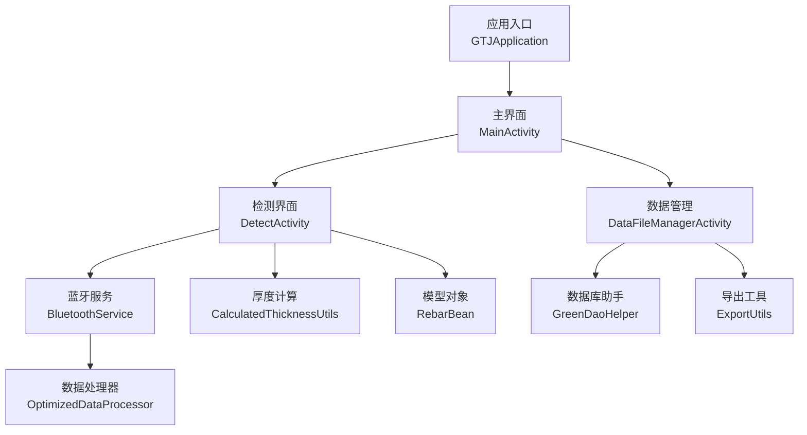
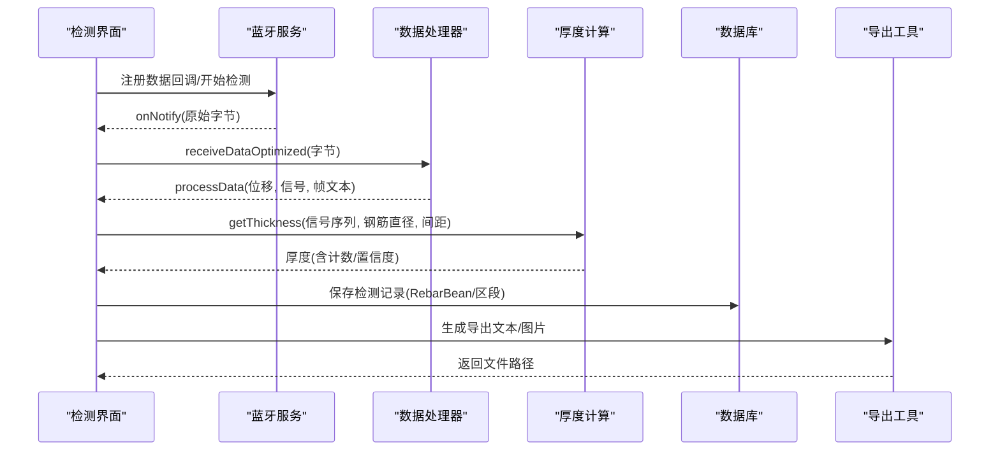
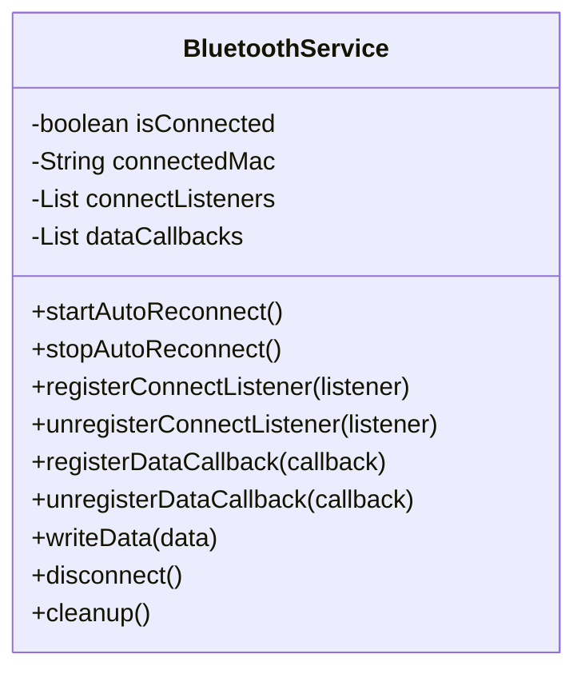
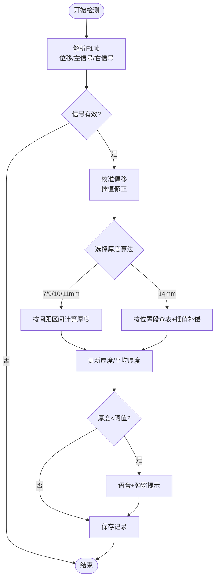
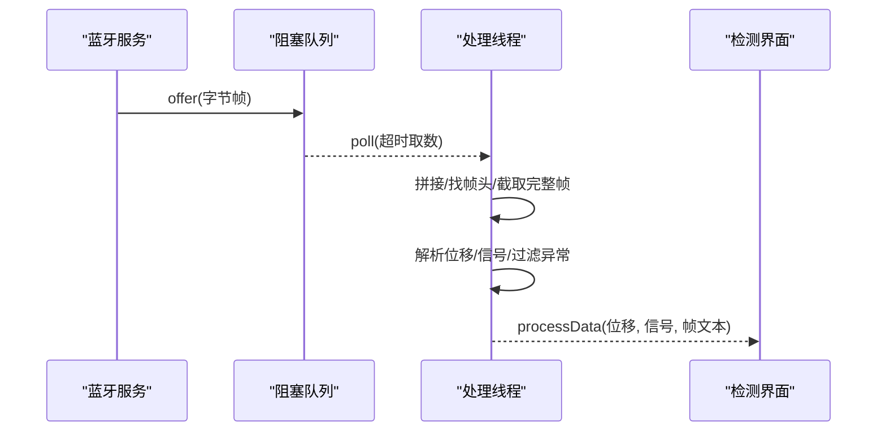
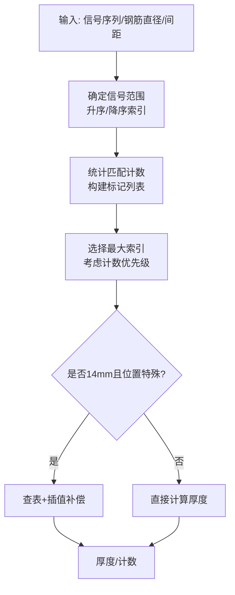
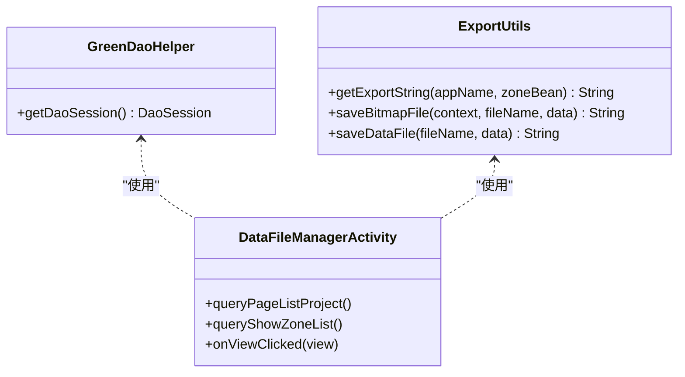
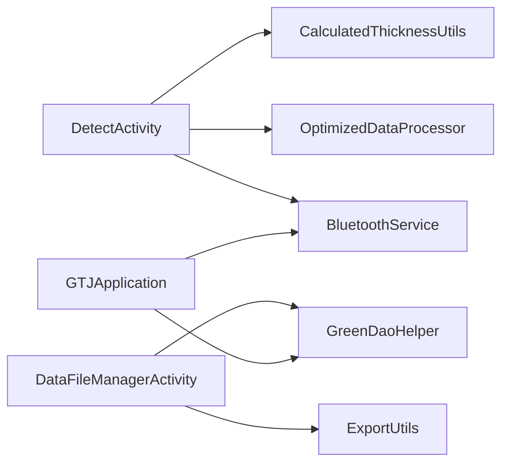

# 核心功能

<cite>
**本文引用的文件**
- [GTJApplication.java](file://app/src/main/java/com/example/gtj_sd_dg240/GTJApplication.java)
- [MainActivity.java](file://app/src/main/java/com/example/gtj_sd_dg240/activity/MainActivity.java)
- [BluetoothService.java](file://app/src/main/java/com/example/gtj_sd_dg240/bluetooth/BluetoothService.java)
- [DetectActivity.java](file://app/src/main/java/com/example/gtj_sd_dg240/activity/testing/DetectActivity.java)
- [OptimizedDataProcessor.java](file://app/src/main/java/com/example/gtj_sd_dg240/utils/OptimizedDataProcessor.java)
- [CalculatedThicknessUtils.java](file://app/src/main/java/com/example/gtj_sd_dg240/utils/CalculatedThicknessUtils.java)
- [RebarBean.java](file://app/src/main/java/com/example/gtj_sd_dg240/model/RebarBean.java)
- [GreenDaoHelper.java](file://app/src/main/java/com/example/gtj_sd_dg240/storage/GreenDaoHelper.java)
- [ExportUtils.java](file://app/src/main/java/com/example/gtj_sd_dg240/utils/ExportUtils.java)
- [DataFileManagerActivity.java](file://app/src/main/java/com/example/gtj_sd_dg240/activity/data/DataFileManagerActivity.java)
</cite>

## 目录
1. [简介](#简介)
2. [项目结构](#项目结构)
3. [核心组件](#核心组件)
4. [架构总览](#架构总览)
5. [详细组件分析](#详细组件分析)
6. [依赖关系分析](#依赖关系分析)
7. [性能考量](#性能考量)
8. [故障排查指南](#故障排查指南)
9. [结论](#结论)
10. [附录：学习路径与使用指导](#附录学习路径与使用指导)

## 简介
本文件面向GTJ-SD-DG240应用的核心功能，围绕设备连接管理、实时检测、数据处理、结果展示与数据管理等关键特性进行系统化说明。文档从系统架构、数据流、算法实现到用户操作流程进行全面梳理，帮助不同经验水平的用户快速理解并高效使用该应用。

## 项目结构
应用采用分层与模块化组织方式：
- 应用入口与全局初始化：Application层负责蓝牙、日志、数据库、定位等基础设施初始化
- 界面层（Activity）：主界面、检测界面、数据管理界面等
- 通信层：蓝牙服务统一管理连接、重连、数据通知
- 数据处理层：信号解析、厚度计算、补偿策略
- 存储层：GreenDAO持久化工程与检测数据
- 工具层：导出、加密、字符串、位图、网络等通用能力

图表来源
- [GTJApplication.java:18-41](file://app/src/main/java/com/example/gtj_sd_dg240/GTJApplication.java#L18-L41)
- [MainActivity.java:41-129](file://app/src/main/java/com/example/gtj_sd_dg240/activity/MainActivity.java#L41-L129)
- [BluetoothService.java:20-312](file://app/src/main/java/com/example/gtj_sd_dg240/bluetooth/BluetoothService.java#L20-L312)
- [DetectActivity.java:57-106](file://app/src/main/java/com/example/gtj_sd_dg240/activity/testing/DetectActivity.java#L57-L106)
- [OptimizedDataProcessor.java:7-135](file://app/src/main/java/com/example/gtj_sd_dg240/utils/OptimizedDataProcessor.java#L7-L135)
- [CalculatedThicknessUtils.java:9-131](file://app/src/main/java/com/example/gtj_sd_dg240/utils/CalculatedThicknessUtils.java#L9-L131)
- [RebarBean.java:5-26](file://app/src/main/java/com/example/gtj_sd_dg240/model/RebarBean.java#L5-L26)
- [GreenDaoHelper.java:10-42](file://app/src/main/java/com/example/gtj_sd_dg240/storage/GreenDaoHelper.java#L10-L42)
- [ExportUtils.java:20-133](file://app/src/main/java/com/example/gtj_sd_dg240/utils/ExportUtils.java#L20-L133)
- [DataFileManagerActivity.java:44-81](file://app/src/main/java/com/example/gtj_sd_dg240/activity/data/DataFileManagerActivity.java#L44-L81)

章节来源
- [GTJApplication.java:18-41](file://app/src/main/java/com/example/gtj_sd_dg240/GTJApplication.java#L18-L41)
- [MainActivity.java:41-129](file://app/src/main/java/com/example/gtj_sd_dg240/activity/MainActivity.java#L41-L129)

## 核心组件
- 设备连接管理：通过蓝牙服务统一封装连接、状态监听、自动重连、数据通知注册与取消，屏蔽底层蓝牙差异，提供稳定可靠的数据通道
- 实时检测：接收设备上报的位移与信号值，结合校准参数与钢筋直径策略，计算保护层厚度并实时更新UI
- 数据处理：对高频蓝牙数据进行缓冲、拼接、帧解析与过滤；依据钢筋间距与位置选择对应厚度计算算法，并进行分段补偿
- 结果展示：在检测界面以列表形式展示各部位厚度、平均值与异常提示；支持删除单条记录与刷新按钮状态
- 数据管理：工程与区段（Zone）的查询、勾选、导出、上传与删除；支持U盘识别与文件写入

章节来源
- [BluetoothService.java:20-312](file://app/src/main/java/com/example/gtj_sd_dg240/bluetooth/BluetoothService.java#L20-L312)
- [DetectActivity.java:171-710](file://app/src/main/java/com/example/gtj_sd_dg240/activity/testing/DetectActivity.java#L171-L710)
- [OptimizedDataProcessor.java:7-135](file://app/src/main/java/com/example/gtj_sd_dg240/utils/OptimizedDataProcessor.java#L7-L135)
- [CalculatedThicknessUtils.java:9-131](file://app/src/main/java/com/example/gtj_sd_dg240/utils/CalculatedThicknessUtils.java#L9-L131)
- [DataFileManagerActivity.java:44-395](file://app/src/main/java/com/example/gtj_sd_dg240/activity/data/DataFileManagerActivity.java#L44-L395)

## 架构总览
应用整体遵循“界面—服务—处理—存储”的分层架构：
- 界面层负责用户交互与状态展示
- 蓝牙服务作为通信中枢，提供连接管理与数据分发
- 数据处理层完成帧解析、信号校正、厚度计算与补偿
- 存储层通过GreenDAO持久化工程与检测数据，并提供导出能力

图表来源
- [DetectActivity.java:171-710](file://app/src/main/java/com/example/gtj_sd_dg240/activity/testing/DetectActivity.java#L171-L710)
- [BluetoothService.java:175-198](file://app/src/main/java/com/example/gtj_sd_dg240/bluetooth/BluetoothService.java#L175-L198)
- [OptimizedDataProcessor.java:34-135](file://app/src/main/java/com/example/gtj_sd_dg240/utils/OptimizedDataProcessor.java#L34-L135)
- [CalculatedThicknessUtils.java:22-59](file://app/src/main/java/com/example/gtj_sd_dg240/utils/CalculatedThicknessUtils.java#L22-L59)
- [ExportUtils.java:25-66](file://app/src/main/java/com/example/gtj_sd_dg240/utils/ExportUtils.java#L25-L66)

## 详细组件分析

### 设备连接管理（蓝牙服务）
- 单例模式管理连接生命周期，维护当前MAC与连接状态
- 自动重连机制：定时检查连接状态，断开后按固定间隔尝试重连
- 数据通知注册：连接成功后订阅特征值通知，将数据分发给所有已注册回调
- 线程安全：使用CopyOnWriteArrayList管理监听器集合，避免并发修改问题
- 资源清理：提供disconnect与cleanup方法，确保内存与句柄释放

图表来源
- [BluetoothService.java:20-312](file://app/src/main/java/com/example/gtj_sd_dg240/bluetooth/BluetoothService.java#L20-L312)

章节来源
- [BluetoothService.java:20-312](file://app/src/main/java/com/example/gtj_sd_dg240/bluetooth/BluetoothService.java#L20-L312)

### 实时检测（检测界面）
- 输入：设备上报的位移与左右信号值、校准表、钢筋直径、箍筋直径、电杆尺寸
- 处理：
  - 解析F1帧，提取位置与信号，去抖与阈值过滤
  - 根据钢筋直径与有效间距选择厚度计算策略
  - 计算最小间距角度与补偿厚度，更新当前厚度与平均厚度
  - 异常提示：当厚度低于阈值时语音与弹窗提醒
- 输出：实时显示厚度、刷新列表、更新按钮状态、保存检测结果

图表来源
- [DetectActivity.java:171-710](file://app/src/main/java/com/example/gtj_sd_dg240/activity/testing/DetectActivity.java#L171-L710)
- [CalculatedThicknessUtils.java:22-59](file://app/src/main/java/com/example/gtj_sd_dg240/utils/CalculatedThicknessUtils.java#L22-L59)

章节来源
- [DetectActivity.java:171-710](file://app/src/main/java/com/example/gtj_sd_dg240/activity/testing/DetectActivity.java#L171-L710)

### 数据处理（高频数据缓冲与解析）
- 生产者-消费者模式：使用阻塞队列缓存高频蓝牙数据，避免丢包与卡顿
- 帧拼接与完整性校验：查找帧头标志，截取完整帧，丢弃不完整数据
- 解析与过滤：提取位移与信号值，过滤异常高值，回调上层处理
- 线程控制：仅启动一个处理线程，空队列时退出循环，降低CPU占用

图表来源
- [OptimizedDataProcessor.java:34-135](file://app/src/main/java/com/example/gtj_sd_dg240/utils/OptimizedDataProcessor.java#L34-L135)
- [BluetoothService.java:175-198](file://app/src/main/java/com/example/gtj_sd_dg240/bluetooth/BluetoothService.java#L175-L198)

章节来源
- [OptimizedDataProcessor.java:34-135](file://app/src/main/java/com/example/gtj_sd_dg240/utils/OptimizedDataProcessor.java#L34-L135)

### 厚度计算与补偿策略
- 输入：三组信号点（左中右），钢筋直径，有效间距，电杆尺寸与位置
- 算法：
  - 根据钢筋直径选择对应厚度计算工具类
  - 基于信号范围与匹配计数确定厚度索引，考虑置信度（匹配数量）
  - 针对14mm钢筋在不同位置段（梢部/中部/根部）采用不同补偿表与插值
- 输出：厚度值与置信度计数，用于后续平均与展示

图表来源
- [CalculatedThicknessUtils.java:22-59](file://app/src/main/java/com/example/gtj_sd_dg240/utils/CalculatedThicknessUtils.java#L22-L59)
- [DetectActivity.java:513-640](file://app/src/main/java/com/example/gtj_sd_dg240/activity/testing/DetectActivity.java#L513-L640)

章节来源
- [CalculatedThicknessUtils.java:22-59](file://app/src/main/java/com/example/gtj_sd_dg240/utils/CalculatedThicknessUtils.java#L22-L59)
- [DetectActivity.java:513-640](file://app/src/main/java/com/example/gtj_sd_dg240/activity/testing/DetectActivity.java#L513-L640)

### 数据存储与导出
- 存储：通过GreenDAO会话访问数据库，增删改查工程与区段数据
- 导出：将区段信息、检测记录汇总为文本格式，支持保存到本地或U盘
- 管理：数据管理界面支持项目与区段的查询、勾选、导出、上传与删除

图表来源
- [GreenDaoHelper.java:10-42](file://app/src/main/java/com/example/gtj_sd_dg240/storage/GreenDaoHelper.java#L10-L42)
- [ExportUtils.java:25-133](file://app/src/main/java/com/example/gtj_sd_dg240/utils/ExportUtils.java#L25-L133)
- [DataFileManagerActivity.java:157-340](file://app/src/main/java/com/example/gtj_sd_dg240/activity/data/DataFileManagerActivity.java#L157-L340)

章节来源
- [GreenDaoHelper.java:10-42](file://app/src/main/java/com/example/gtj_sd_dg240/storage/GreenDaoHelper.java#L10-L42)
- [ExportUtils.java:25-133](file://app/src/main/java/com/example/gtj_sd_dg240/utils/ExportUtils.java#L25-L133)
- [DataFileManagerActivity.java:157-340](file://app/src/main/java/com/example/gtj_sd_dg240/activity/data/DataFileManagerActivity.java#L157-L340)

## 依赖关系分析
- 界面与服务的耦合：检测界面依赖蓝牙服务进行数据收发，服务通过回调解耦具体业务逻辑
- 数据处理与算法：厚度计算工具类被检测界面调用，形成稳定的算法接口
- 存储与导出：数据管理界面依赖数据库助手与导出工具，保证数据可追溯与可分享
- 外部依赖：百度定位、蓝牙库、GreenDAO、RxJava等第三方库

图表来源
- [DetectActivity.java:57-106](file://app/src/main/java/com/example/gtj_sd_dg240/activity/testing/DetectActivity.java#L57-L106)
- [BluetoothService.java:20-312](file://app/src/main/java/com/example/gtj_sd_dg240/bluetooth/BluetoothService.java#L20-L312)
- [OptimizedDataProcessor.java:7-135](file://app/src/main/java/com/example/gtj_sd_dg240/utils/OptimizedDataProcessor.java#L7-L135)
- [CalculatedThicknessUtils.java:9-131](file://app/src/main/java/com/example/gtj_sd_dg240/utils/CalculatedThicknessUtils.java#L9-L131)
- [DataFileManagerActivity.java:44-81](file://app/src/main/java/com/example/gtj_sd_dg240/activity/data/DataFileManagerActivity.java#L44-L81)
- [GreenDaoHelper.java:10-42](file://app/src/main/java/com/example/gtj_sd_dg240/storage/GreenDaoHelper.java#L10-L42)
- [ExportUtils.java:20-133](file://app/src/main/java/com/example/gtj_sd_dg240/utils/ExportUtils.java#L20-L133)
- [GTJApplication.java:18-41](file://app/src/main/java/com/example/gtj_sd_dg240/GTJApplication.java#L18-L41)

章节来源
- [DetectActivity.java:57-106](file://app/src/main/java/com/example/gtj_sd_dg240/activity/testing/DetectActivity.java#L57-L106)
- [DataFileManagerActivity.java:44-81](file://app/src/main/java/com/example/gtj_sd_dg240/activity/data/DataFileManagerActivity.java#L44-L81)
- [GTJApplication.java:18-41](file://app/src/main/java/com/example/gtj_sd_dg240/GTJApplication.java#L18-L41)

## 性能考量
- 高频数据处理：采用阻塞队列与单处理线程，减少主线程压力与丢包风险
- 连接稳定性：自动重连与状态监听，提升弱网或设备断连场景下的可用性
- 算法复杂度：厚度计算基于信号范围与匹配计数，时间复杂度与信号点数线性相关，满足实时性要求
- 存储效率：GreenDAO批量插入与事务操作，提高写入性能
- 导出优化：文本导出按需生成，避免大对象频繁创建

[本节为通用性能讨论，不直接分析具体代码文件]

## 故障排查指南
- 蓝牙连接失败：检查设备MAC是否保存、权限是否授予、是否开启蓝牙；查看连接状态回调与重连定时器
- 数据解析异常：确认帧头标志与长度，检查信号阈值过滤逻辑；核对校准表与钢筋直径配置
- 厚度计算偏差：验证有效间距选择与补偿表是否正确；检查电杆尺寸与位置段判断
- 数据导出失败：确认U盘识别与文件系统格式；检查文件路径与权限
- 定位异常：检查定位权限与服务状态；查看诊断信息与SDK版本

章节来源
- [BluetoothService.java:127-170](file://app/src/main/java/com/example/gtj_sd_dg240/bluetooth/BluetoothService.java#L127-L170)
- [DetectActivity.java:647-687](file://app/src/main/java/com/example/gtj_sd_dg240/activity/testing/DetectActivity.java#L647-L687)
- [DataFileManagerActivity.java:343-386](file://app/src/main/java/com/example/gtj_sd_dg240/activity/data/DataFileManagerActivity.java#L343-L386)

## 结论
GTJ-SD-DG240应用围绕混凝土电杆保护层检测的核心需求，构建了从设备连接到数据处理、结果展示与数据管理的完整闭环。通过蓝牙服务的高可用设计、高频数据的稳健处理、科学的厚度计算与补偿策略，以及便捷的导出与管理能力，满足了现场检测的高效与准确要求。建议在实际使用中严格校准设备、合理设置参数，并结合数据管理功能进行质量追溯与分析。

[本节为总结性内容，不直接分析具体代码文件]

## 附录：学习路径与使用指导
- 初学者
  - 了解应用入口与初始化流程，熟悉主界面导航
  - 掌握设备连接与校准步骤，确保蓝牙通信正常
  - 学习检测界面的基本操作：开始检测、查看结果、异常提示处理
- 进阶用户
  - 深入理解蓝牙服务的工作机制与重连策略
  - 研究数据处理流程与帧解析规则，掌握信号过滤与校准方法
  - 学习厚度计算算法与补偿策略，针对不同钢筋直径与位置段进行参数调优
- 高级用户
  - 分析数据管理模块，掌握工程与区段数据的导出、上传与删除
  - 评估性能瓶颈与优化空间，如队列大小、线程调度与存储策略
  - 扩展功能：自定义导出格式、集成更多传感器或云端同步

[本节为概念性指导，不直接分析具体代码文件]