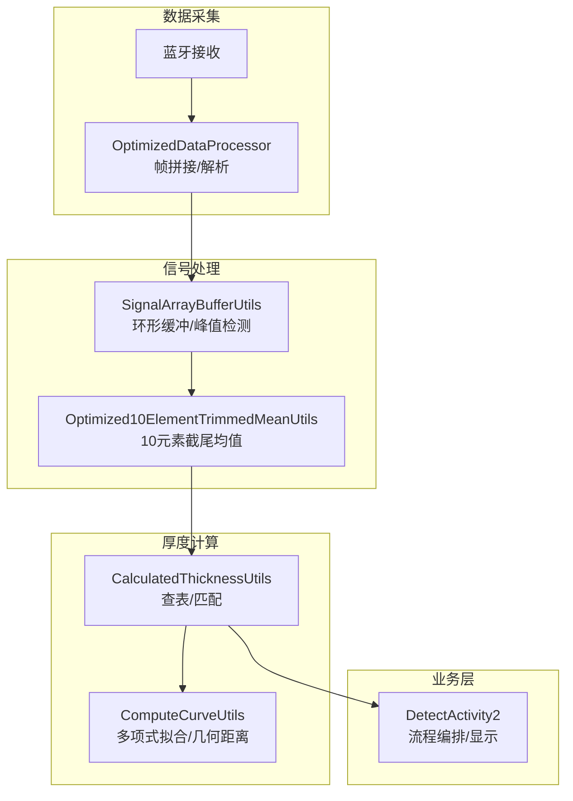
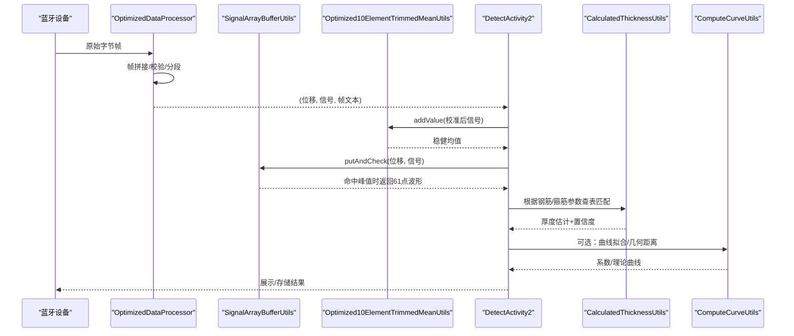
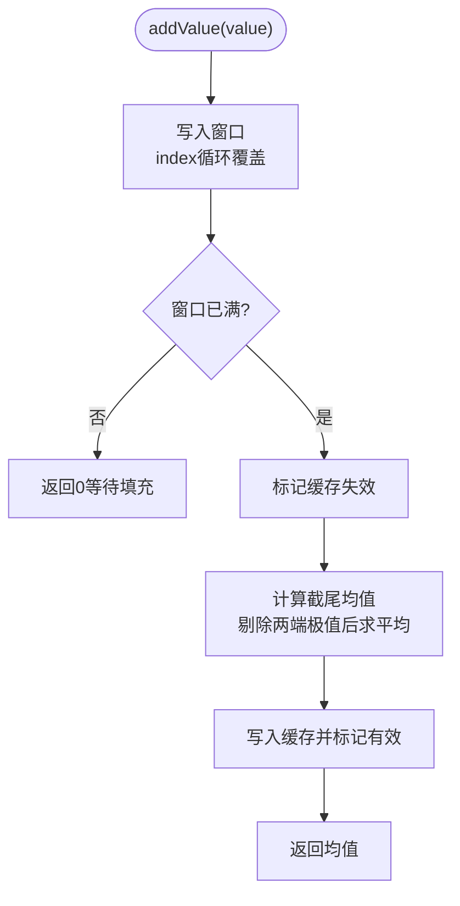
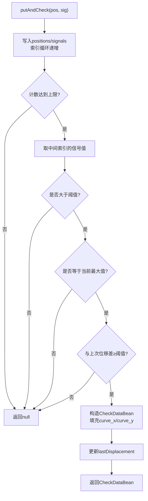
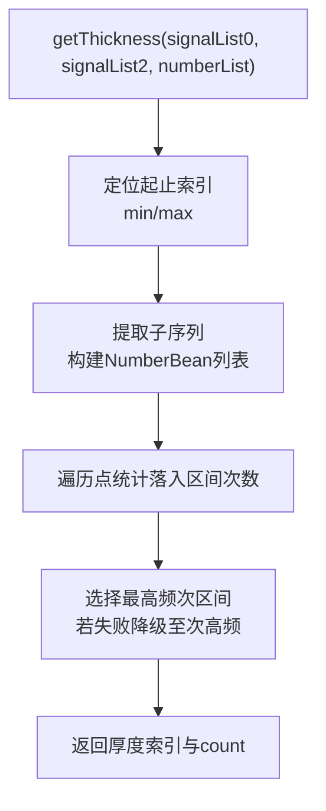
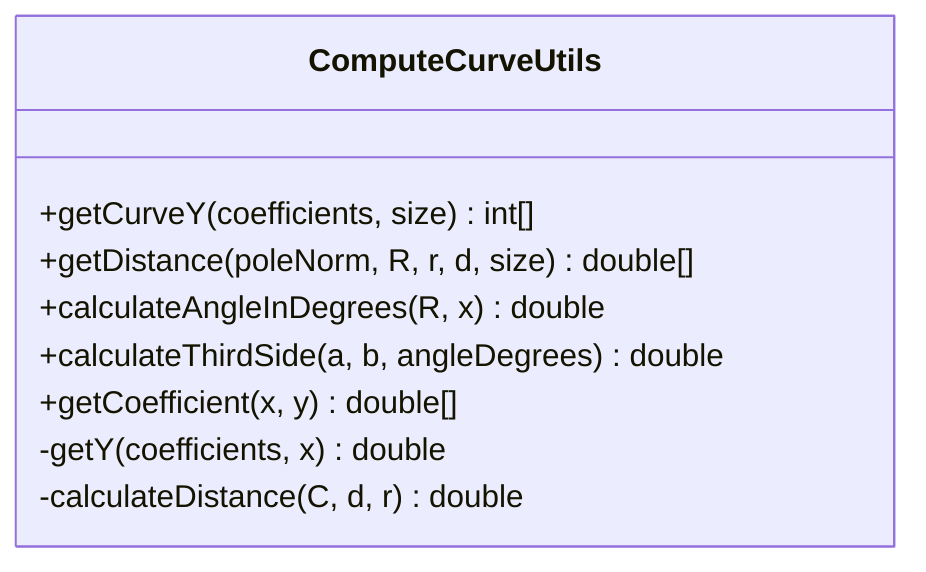
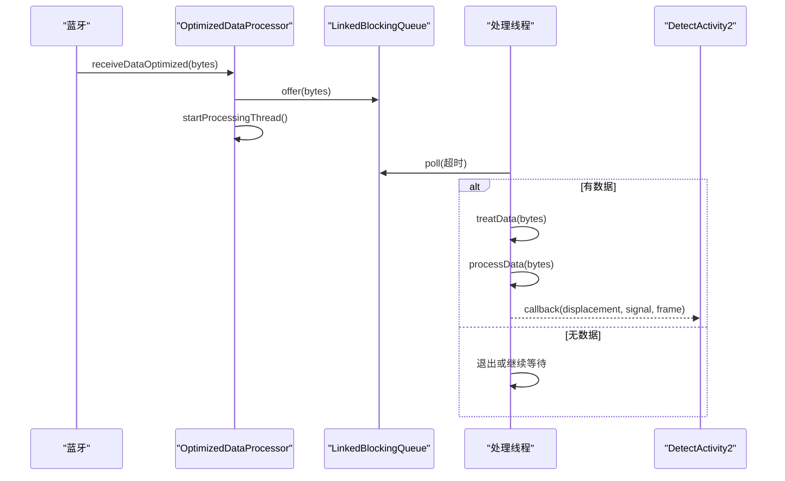
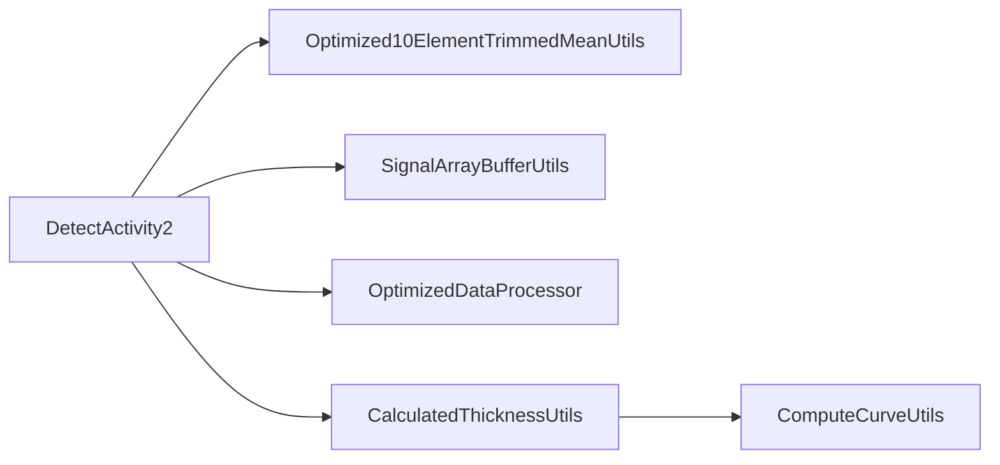

# 检测算法

<cite>
**本文引用的文件**
- [Optimized10ElementTrimmedMeanUtils.java](file://app/src/main/java/com/example/gtj_sd_dg240/utils/Optimized10ElementTrimmedMeanUtils.java)
- [CalculatedThicknessUtils.java](file://app/src/main/java/com/example/gtj_sd_dg240/utils/CalculatedThicknessUtils.java)
- [ComputeCurveUtils.java](file://app/src/main/java/com/example/gtj_sd_dg240/utils/ComputeCurveUtils.java)
- [OptimizedDataProcessor.java](file://app/src/main/java/com/example/gtj_sd_dg240/utils/OptimizedDataProcessor.java)
- [SignalArrayBufferUtils.java](file://app/src/main/java/com/example/gtj_sd_dg240/utils/SignalArrayBufferUtils.java)
- [DetectActivity2.java](file://app/src/main/java/com/example/gtj_sd_dg240/activity/testing/DetectActivity2.java)
- [CheckDataBean.java](file://app/src/main/java/com/example/gtj_sd_dg240/model/CheckDataBean.java)
- [StandardCurveBean.java](file://app/src/main/java/com/example/gtj_sd_dg240/model/StandardCurveBean.java)
- [StaticConstant.java](file://app/src/main/java/com/example/gtj_sd_dg240/StaticConstant.java)
</cite>

## 目录
1. [简介](#简介)
2. [项目结构](#项目结构)
3. [核心组件](#核心组件)
4. [架构总览](#架构总览)
5. [详细组件分析](#详细组件分析)
6. [依赖关系分析](#依赖关系分析)
7. [性能考虑](#性能考虑)
8. [故障排查指南](#故障排查指南)
9. [结论](#结论)
10. [附录](#附录)

## 简介
本技术文档面向GTJ-SD-DG240应用的检测算法，重点阐述以下数学与工程实现：
- 10元素截尾均值算法（剔除异常值、提升稳定性）
- 信号滤波与缓冲策略（实时数据流处理）
- 插值与曲线拟合（最小二乘多项式拟合）
- 厚度计算与校准曲线匹配（查表+补偿）
- 精度优化与参数调优（内存、并发、实时性）
- 测试与基准、监控指标建议

该应用通过蓝牙采集传感器位移与信号，经数据拼接、去噪、窗口统计后，结合标准曲线或经验表进行厚度估算，并输出结果。

## 项目结构
围绕检测算法的核心代码主要分布在 utils 与 activity/testing 包中，关键模块如下：
- 数据接入与解析：OptimizedDataProcessor
- 信号缓冲与峰值判定：SignalArrayBufferUtils
- 噪声抑制与稳健平均：Optimized10ElementTrimmedMeanUtils
- 厚度计算与查表匹配：CalculatedThicknessUtils 及其变体
- 曲线拟合与几何距离计算：ComputeCurveUtils
- 业务编排与流程控制：DetectActivity2
- 数据模型：CheckDataBean、StandardCurveBean
- 全局常量与配置：StaticConstant

图表来源
- [OptimizedDataProcessor.java:1-47](file://app/src/main/java/com/example/gtj_sd_dg240/utils/OptimizedDataProcessor.java#L1-L47)
- [SignalArrayBufferUtils.java:1-66](file://app/src/main/java/com/example/gtj_sd_dg240/utils/SignalArrayBufferUtils.java#L1-L66)
- [Optimized10ElementTrimmedMeanUtils.java:1-131](file://app/src/main/java/com/example/gtj_sd_dg240/utils/Optimized10ElementTrimmedMeanUtils.java#L1-L131)
- [CalculatedThicknessUtils.java:1-131](file://app/src/main/java/com/example/gtj_sd_dg240/utils/CalculatedThicknessUtils.java#L1-L131)
- [ComputeCurveUtils.java:1-141](file://app/src/main/java/com/example/gtj_sd_dg240/utils/ComputeCurveUtils.java#L1-L141)
- [DetectActivity2.java:188-210](file://app/src/main/java/com/example/gtj_sd_dg240/activity/testing/DetectActivity2.java#L188-L210)

章节来源
- [OptimizedDataProcessor.java:1-135](file://app/src/main/java/com/example/gtj_sd_dg240/utils/OptimizedDataProcessor.java#L1-L135)
- [SignalArrayBufferUtils.java:1-114](file://app/src/main/java/com/example/gtj_sd_dg240/utils/SignalArrayBufferUtils.java#L1-L114)
- [Optimized10ElementTrimmedMeanUtils.java:1-131](file://app/src/main/java/com/example/gtj_sd_dg240/utils/Optimized10ElementTrimmedMeanUtils.java#L1-L131)
- [CalculatedThicknessUtils.java:1-131](file://app/src/main/java/com/example/gtj_sd_dg240/utils/CalculatedThicknessUtils.java#L1-L131)
- [ComputeCurveUtils.java:1-141](file://app/src/main/java/com/example/gtj_sd_dg240/utils/ComputeCurveUtils.java#L1-L141)
- [DetectActivity2.java:188-210](file://app/src/main/java/com/example/gtj_sd_dg240/activity/testing/DetectActivity2.java#L188-L210)

## 核心组件
- 10元素截尾均值：在长度为10的滑动窗口内，剔除两端各若干极端值后对中间段求均值，增强抗噪能力。
- 信号缓冲与峰值检测：环形缓冲区维护最近N个采样点，定位最大信号位置并判断有效间隔，触发一次厚度计算。
- 厚度计算：基于钢筋直径与箍筋间距等先验信息，使用预置信号范围表进行区间匹配，得到厚度估计及置信度。
- 曲线拟合：使用最小二乘法对已知厚度-信号曲线进行二次多项式拟合，用于生成理论曲线或反推厚度。
- 数据处理流水线：生产者-消费者模式解耦蓝牙接收与算法处理，保证高吞吐与低延迟。

章节来源
- [Optimized10ElementTrimmedMeanUtils.java:1-131](file://app/src/main/java/com/example/gtj_sd_dg240/utils/Optimized10ElementTrimmedMeanUtils.java#L1-L131)
- [SignalArrayBufferUtils.java:1-114](file://app/src/main/java/com/example/gtj_sd_dg240/utils/SignalArrayBufferUtils.java#L1-L114)
- [CalculatedThicknessUtils.java:1-131](file://app/src/main/java/com/example/gtj_sd_dg240/utils/CalculatedThicknessUtils.java#L1-L131)
- [ComputeCurveUtils.java:1-141](file://app/src/main/java/com/example/gtj_sd_dg240/utils/ComputeCurveUtils.java#L1-L141)
- [OptimizedDataProcessor.java:1-135](file://app/src/main/java/com/example/gtj_sd_dg240/utils/OptimizedDataProcessor.java#L1-L135)

## 架构总览
从数据采集到厚度输出的端到端流程如下：

图表来源
- [OptimizedDataProcessor.java:34-133](file://app/src/main/java/com/example/gtj_sd_dg240/utils/OptimizedDataProcessor.java#L34-L133)
- [SignalArrayBufferUtils.java:26-66](file://app/src/main/java/com/example/gtj_sd_dg240/utils/SignalArrayBufferUtils.java#L26-L66)
- [Optimized10ElementTrimmedMeanUtils.java:93-129](file://app/src/main/java/com/example/gtj_sd_dg240/utils/Optimized10ElementTrimmedMeanUtils.java#L93-L129)
- [DetectActivity2.java:188-210](file://app/src/main/java/com/example/gtj_sd_dg240/activity/testing/DetectActivity2.java#L188-L210)
- [CalculatedThicknessUtils.java:22-59](file://app/src/main/java/com/example/gtj_sd_dg240/utils/CalculatedThicknessUtils.java#L22-L59)
- [ComputeCurveUtils.java:121-139](file://app/src/main/java/com/example/gtj_sd_dg240/utils/ComputeCurveUtils.java#L121-L139)

## 详细组件分析

### 10元素截尾均值算法（Optimized10ElementTrimmedMeanUtils）
- 设计目标：在高频采样下快速剔除异常值，提供稳定的局部均值。
- 窗口与裁剪：固定窗口大小，按规则剔除两端极端值，对剩余中间段求均值。
- 缓存机制：计算结果缓存，避免重复计算；写入新值后失效。
- 线程安全：使用可重入锁保护窗口更新与读取。
- 复杂度：每次插入为常数级操作（窗口固定），内部选择/排序针对小数组优化。

图表来源
- [Optimized10ElementTrimmedMeanUtils.java:93-129](file://app/src/main/java/com/example/gtj_sd_dg240/utils/Optimized10ElementTrimmedMeanUtils.java#L93-L129)

章节来源
- [Optimized10ElementTrimmedMeanUtils.java:1-131](file://app/src/main/java/com/example/gtj_sd_dg240/utils/Optimized10ElementTrimmedMeanUtils.java#L1-L131)

### 信号缓冲与峰值检测（SignalArrayBufferUtils）
- 环形缓冲：维护固定长度数组，记录位移与信号，支持循环写入。
- 峰值判定：当缓冲区满时，检查中间点是否为最大值且满足最小间隔阈值，则视为有效峰值。
- 数据产出：返回包含完整波形（x,y）的结构体，供后续厚度计算使用。
- 线程安全：同步块保护状态一致性。

图表来源
- [SignalArrayBufferUtils.java:26-66](file://app/src/main/java/com/example/gtj_sd_dg240/utils/SignalArrayBufferUtils.java#L26-L66)

章节来源
- [SignalArrayBufferUtils.java:1-114](file://app/src/main/java/com/example/gtj_sd_dg240/utils/SignalArrayBufferUtils.java#L1-L114)
- [CheckDataBean.java:1-33](file://app/src/main/java/com/example/gtj_sd_dg240/model/CheckDataBean.java#L1-L33)

### 厚度计算与查表匹配（CalculatedThicknessUtils）
- 输入：左右两侧信号序列与钢筋/箍筋相关参数列表。
- 区间定位：根据参数在信号序列中确定起止索引，提取子序列。
- 匹配计数：对每个点统计落入不同参数区间的次数，选择出现次数最多的区间作为候选。
- 结果：返回厚度索引与置信度（匹配次数）。
- 扩展：针对不同钢筋直径与箍筋间距提供专用入口，内部调用通用匹配逻辑。

图表来源
- [CalculatedThicknessUtils.java:22-59](file://app/src/main/java/com/example/gtj_sd_dg240/utils/CalculatedThicknessUtils.java#L22-L59)

章节来源
- [CalculatedThicknessUtils.java:1-131](file://app/src/main/java/com/example/gtj_sd_dg240/utils/CalculatedThicknessUtils.java#L1-L131)

### 曲线拟合与几何距离（ComputeCurveUtils）
- 多项式拟合：使用加权观测点集合与二次多项式拟合器，求解系数。
- 曲线生成：根据系数计算指定长度的Y序列。
- 几何距离：依据电杆半径、钢筋半径、保护层厚度与行走角度，利用余弦定理与勾股关系计算直线行走距离。
- 用途：生成理论曲线、辅助厚度反算或可视化对比。

图表来源
- [ComputeCurveUtils.java:15-139](file://app/src/main/java/com/example/gtj_sd_dg240/utils/ComputeCurveUtils.java#L15-L139)

章节来源
- [ComputeCurveUtils.java:1-141](file://app/src/main/java/com/example/gtj_sd_dg240/utils/ComputeCurveUtils.java#L1-L141)

### 数据处理器（OptimizedDataProcessor）
- 生产者-消费者：蓝牙数据进入阻塞队列，单线程消费，避免竞争。
- 帧拼接：累积字节流，查找帧头标志位，按固定长度切分。
- 解析：将每帧解析为位移与信号值，过滤异常信号。
- 回调：将解析结果回传给上层进行后续处理。

图表来源
- [OptimizedDataProcessor.java:34-133](file://app/src/main/java/com/example/gtj_sd_dg240/utils/OptimizedDataProcessor.java#L34-L133)
- [DetectActivity2.java:188-210](file://app/src/main/java/com/example/gtj_sd_dg240/activity/testing/DetectActivity2.java#L188-L210)

章节来源
- [OptimizedDataProcessor.java:1-135](file://app/src/main/java/com/example/gtj_sd_dg240/utils/OptimizedDataProcessor.java#L1-L135)
- [DetectActivity2.java:188-210](file://app/src/main/java/com/example/gtj_sd_dg240/activity/testing/DetectActivity2.java#L188-L210)

## 依赖关系分析
- 数据流向：蓝牙→OptimizedDataProcessor→DetectActivity2→Optimized10ElementTrimmedMeanUtils/SignalArrayBufferUtils→CalculatedThicknessUtils→ComputeCurveUtils（可选）。
- 耦合点：
  - DetectActivity2 协调数据流与UI更新。
  - CalculatedThicknessUtils 依赖钢筋/箍筋参数与信号序列。
  - ComputeCurveUtils 依赖几何参数与拟合库。
- 外部依赖：Apache Commons Math（多项式拟合）。

图表来源
- [DetectActivity2.java:188-210](file://app/src/main/java/com/example/gtj_sd_dg240/activity/testing/DetectActivity2.java#L188-L210)
- [CalculatedThicknessUtils.java:22-59](file://app/src/main/java/com/example/gtj_sd_dg240/utils/CalculatedThicknessUtils.java#L22-L59)
- [ComputeCurveUtils.java:121-139](file://app/src/main/java/com/example/gtj_sd_dg240/utils/ComputeCurveUtils.java#L121-L139)

章节来源
- [DetectActivity2.java:188-210](file://app/src/main/java/com/example/gtj_sd_dg240/activity/testing/DetectActivity2.java#L188-L210)
- [CalculatedThicknessUtils.java:1-131](file://app/src/main/java/com/example/gtj_sd_dg240/utils/CalculatedThicknessUtils.java#L1-L131)
- [ComputeCurveUtils.java:1-141](file://app/src/main/java/com/example/gtj_sd_dg240/utils/ComputeCurveUtils.java#L1-L141)

## 性能考虑
- 内存管理
  - 使用固定大小环形缓冲与窗口，避免频繁分配。
  - 帧拼接采用原地切片与复用，减少对象创建。
- 计算效率
  - 10元素窗口内采用小数组优化排序/选择，降低开销。
  - 仅对峰值触发厚度计算，减少不必要运算。
- 实时性
  - 生产者-消费者队列解耦I/O与计算，设置合理超时避免阻塞。
  - 非阻塞offer丢弃溢出数据，确保低延迟。
- 并发安全
  - 关键临界区使用锁或同步块，避免竞态条件。
- 建议
  - 调整窗口大小与剔除比例以平衡响应速度与鲁棒性。
  - 根据设备性能调节队列容量与轮询间隔。
  - 对曲线拟合仅在离线或低频场景启用，避免影响实时性。

[本节为通用性能指导，不直接分析具体文件]

## 故障排查指南
- 数据丢失或卡顿
  - 检查队列是否持续满导致丢帧；适当增大队列容量或提高消费速率。
  - 确认帧头标志位是否正确识别，必要时增加容错扫描。
- 厚度结果异常
  - 验证钢筋/箍筋参数输入是否正确。
  - 检查峰值检测阈值与最小间隔是否合适。
  - 查看匹配区间计数是否过低，必要时放宽匹配范围或增加样本。
- 曲线拟合不稳定
  - 确保输入点数足够且分布合理。
  - 检查数值范围与舍入误差，必要时标准化输入。
- 日志与调试
  - 在DetectActivity2中打印匹配结果与中间变量，定位问题环节。
  - 使用静态常量与配置项切换不同模式进行对比测试。

章节来源
- [DetectActivity2.java:379-487](file://app/src/main/java/com/example/gtj_sd_dg240/activity/testing/DetectActivity2.java#L379-L487)
- [StaticConstant.java:1-87](file://app/src/main/java/com/example/gtj_sd_dg240/StaticConstant.java#L1-L87)

## 结论
本方案通过“稳健平均+峰值检测+查表匹配+可选曲线拟合”的组合，实现了混凝土电杆保护层厚度的实时、稳定估算。核心优势在于：
- 抗噪能力强：10元素截尾均值有效抑制异常波动。
- 实时性好：生产者-消费者与环形缓冲保障低延迟。
- 可扩展性强：查表与曲线拟合并存，适配不同场景与精度需求。
建议在工程中持续收集现场数据，迭代校准参数与匹配规则，以提升整体精度与鲁棒性。

[本节为总结性内容，不直接分析具体文件]

## 附录

### 算法参数调优指南
- 窗口与剔除比例
  - 窗口大小：可根据采样频率与噪声特性调整，常见为8-16。
  - 剔除比例：两端各剔除1-3个极端值，视噪声分布而定。
- 峰值检测阈值与间隔
  - 阈值：根据设备标定与工况设定，避免误检。
  - 最小间隔：防止连续误触发，通常与移动速度相关。
- 查表匹配
  - 区间宽度：根据钢筋/箍筋变化范围设定。
  - 置信度阈值：低于阈值时提示重新测量。
- 曲线拟合
  - 多项式阶数：常用二次，过高易过拟合。
  - 权重：可为近点赋予更高权重，提升局部拟合质量。

[本节为通用指导，不直接分析具体文件]

### 精度验证方法与误差分析工具
- 交叉验证
  - 使用多组标准试件，比较算法输出与真实厚度偏差。
- 残差分析
  - 对拟合曲线计算残差，评估拟合质量与系统误差。
- 统计指标
  - 计算MAE、RMSE、最大绝对误差等指标，跟踪改进效果。
- 可视化
  - 绘制实测曲线与理论曲线对比图，直观观察偏差。

[本节为通用指导，不直接分析具体文件]

### 测试用例与基准测试结果建议
- 单元测试
  - 截尾均值：构造含异常值的窗口，验证剔除与均值正确性。
  - 峰值检测：构造单调上升/下降/带尖峰序列，验证触发时机。
  - 查表匹配：构造边界情况（刚好落在区间边缘），验证归属。
- 集成测试
  - 模拟蓝牙数据流，端到端验证厚度输出是否符合预期。
- 基准测试
  - 记录单次厚度计算耗时、内存占用、CPU使用率。
  - 在高负载下观察丢帧率与延迟分布。

[本节为通用指导，不直接分析具体文件]

### 性能监控指标
- 数据链路
  - 队列长度、丢弃率、消费延迟。
- 算法层
  - 窗口更新耗时、峰值检测耗时、匹配耗时。
- 系统层
  - CPU/内存占用、GC频率、主线程卡顿。

[本节为通用指导，不直接分析具体文件]