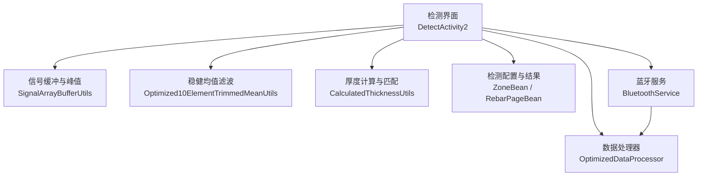
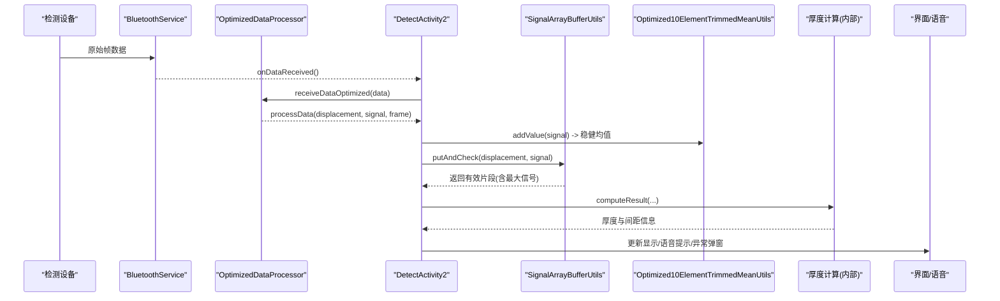
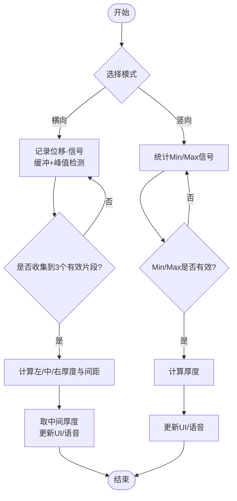
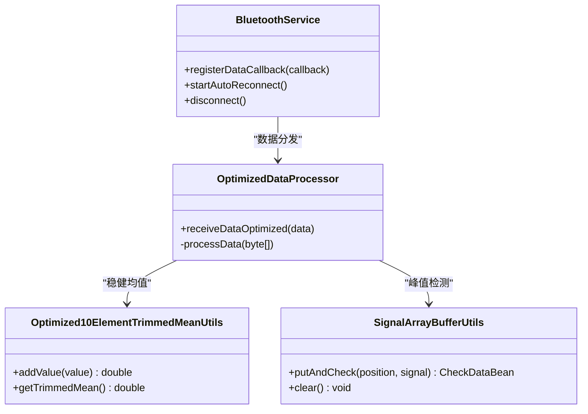
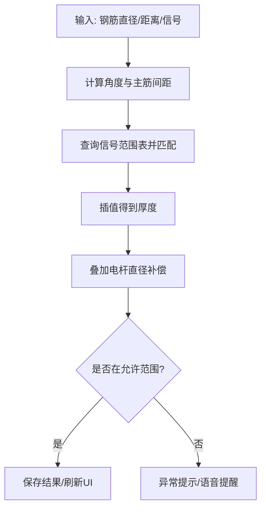
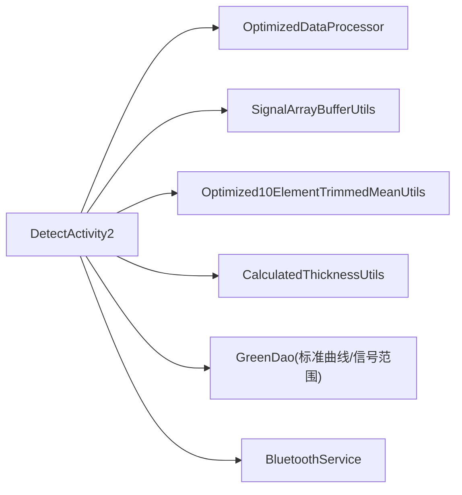

# 检测系统

<cite>
**本文引用的文件**
- [DetectActivity2.java](file://app/src/main/java/com/example/gtj_sd_dg240/activity/testing/DetectActivity2.java)
- [DetectActivity1.java](file://app/src/main/java/com/example/gtj_sd_dg240/activity/testing/DetectActivity1.java)
- [DetectActivity.java](file://app/src/main/java/com/example/gtj_sd_dg240/activity/testing/DetectActivity.java)
- [OptimizedDataProcessor.java](file://app/src/main/java/com/example/gtj_sd_dg240/utils/OptimizedDataProcessor.java)
- [SignalArrayBufferUtils.java](file://app/src/main/java/com/example/gtj_sd_dg240/utils/SignalArrayBufferUtils.java)
- [Optimized10ElementTrimmedMeanUtils.java](file://app/src/main/java/com/example/gtj_sd_dg240/utils/Optimized10ElementTrimmedMeanUtils.java)
- [CalculatedThicknessUtils.java](file://app/src/main/java/com/example/gtj_sd_dg240/utils/CalculatedThicknessUtils.java)
- [BluetoothService.java](file://app/src/main/java/com/example/gtj_sd_dg240/bluetooth/BluetoothService.java)
- [ZoneBean.java](file://app/src/main/java/com/example/gtj_sd_dg240/model/ZoneBean.java)
- [RebarPageBean.java](file://app/src/main/java/com/example/gtj_sd_dg240/model/RebarPageBean.java)
</cite>

## 目录
1. [简介](#简介)
2. [项目结构](#项目结构)
3. [核心组件](#核心组件)
4. [架构总览](#架构总览)
5. [详细组件分析](#详细组件分析)
6. [依赖关系分析](#依赖关系分析)
7. [性能与精度](#性能与精度)
8. [故障排查指南](#故障排查指南)
9. [结论](#结论)
10. [附录：使用指南](#附录使用指南)

## 简介
本文件为GTJ-SD-DG240应用的检测系统综合文档，聚焦横向检测与竖向检测两种模式的工作原理、算法实现与用户交互流程。重点解析DetectActivity2的核心检测逻辑，涵盖信号采集、实时处理、厚度计算、结果验证等关键步骤；并说明检测参数配置、校准流程、精度控制与质量保证措施；同时覆盖界面反馈、语音提示、进度显示、数据展示、历史记录查看与结果导出等功能的使用指南。文末提供算法技术细节（信号滤波、插值计算、异常值处理）与常见问题排查建议。

## 项目结构
应用采用分层组织：
- 活动层（UI与流程控制）：DetectActivity2（主检测）、DetectActivity1（备用/历史版本）、DetectActivity（旧版单点检测）
- 工具层（数据处理与算法）：OptimizedDataProcessor（高吞吐数据解析）、SignalArrayBufferUtils（滑动窗口缓冲与峰值检测）、Optimized10ElementTrimmedMeanUtils（稳健均值滤波）、CalculatedThicknessUtils（厚度匹配与补偿）
- 设备通信层：BluetoothService（蓝牙连接、自动重连、数据分发）
- 数据模型层：ZoneBean（检测区段与配置）、RebarPageBean（按位置分段的数据集合）

图表来源
- [DetectActivity2.java:166-203](file://app/src/main/java/com/example/gtj_sd_dg240/activity/testing/DetectActivity2.java#L166-L203)
- [OptimizedDataProcessor.java:34-133](file://app/src/main/java/com/example/gtj_sd_dg240/utils/OptimizedDataProcessor.java#L34-L133)
- [SignalArrayBufferUtils.java:26-66](file://app/src/main/java/com/example/gtj_sd_dg240/utils/SignalArrayBufferUtils.java#L26-L66)
- [Optimized10ElementTrimmedMeanUtils.java:93-114](file://app/src/main/java/com/example/gtj_sd_dg240/utils/Optimized10ElementTrimmedMeanUtils.java#L93-L114)
- [CalculatedThicknessUtils.java:22-59](file://app/src/main/java/com/example/gtj_sd_dg240/utils/CalculatedThicknessUtils.java#L22-L59)
- [BluetoothService.java:175-198](file://app/src/main/java/com/example/gtj_sd_dg240/bluetooth/BluetoothService.java#L175-L198)

章节来源
- [DetectActivity2.java:71-116](file://app/src/main/java/com/example/gtj_sd_dg240/activity/testing/DetectActivity2.java#L71-L116)
- [ZoneBean.java:15-49](file://app/src/main/java/com/example/gtj_sd_dg240/model/ZoneBean.java#L15-L49)
- [RebarPageBean.java:9-20](file://app/src/main/java/com/example/gtj_sd_dg240/model/RebarPageBean.java#L9-L20)

## 核心组件
- DetectActivity2：检测主界面与流程编排，负责横向/竖向模式切换、数据采集回调、厚度计算、结果校验与UI更新。
- OptimizedDataProcessor：生产者-消费者模式的高频数据解析器，负责帧拼接、完整性检查、分帧解析与回调。
- SignalArrayBufferUtils：循环缓冲区维护最近N个位移-信号对，检测中间最大值并输出完整曲线片段。
- Optimized10ElementTrimmedMeanUtils：稳健均值滤波器，剔除极端值后计算稳定信号值。
- CalculatedThicknessUtils：基于信号区间匹配与插值的厚度计算工具，支持不同钢筋直径与箍筋间距的补偿策略。
- BluetoothService：统一蓝牙连接管理、自动重连、数据通知分发。
- ZoneBean/RebarPageBean：检测区段配置与分段结果存储。

章节来源
- [DetectActivity2.java:188-211](file://app/src/main/java/com/example/gtj_sd_dg240/activity/testing/DetectActivity2.java#L188-L211)
- [OptimizedDataProcessor.java:34-133](file://app/src/main/java/com/example/gtj_sd_dg240/utils/OptimizedDataProcessor.java#L34-L133)
- [SignalArrayBufferUtils.java:26-66](file://app/src/main/java/com/example/gtj_sd_dg240/utils/SignalArrayBufferUtils.java#L26-L66)
- [Optimized10ElementTrimmedMeanUtils.java:93-114](file://app/src/main/java/com/example/gtj_sd_dg240/utils/Optimized10ElementTrimmedMeanUtils.java#L93-L114)
- [CalculatedThicknessUtils.java:22-59](file://app/src/main/java/com/example/gtj_sd_dg240/utils/CalculatedThicknessUtils.java#L22-L59)
- [BluetoothService.java:175-198](file://app/src/main/java/com/example/gtj_sd_dg240/bluetooth/BluetoothService.java#L175-L198)

## 架构总览
检测系统以“设备-解析-处理-计算-展示”流水线组织：
- 设备侧通过蓝牙发送原始帧数据
- BluetoothService接收并分发到各模块
- OptimizedDataProcessor进行帧拼接与解析，提取位移与信号
- DetectActivity2调用稳健均值滤波与缓冲峰值检测，得到稳定信号与有效曲线片段
- 根据当前模式（横向/竖向）执行厚度计算与结果校验
- 结果写入RebarPageBean并刷新UI，支持语音提示与异常告警

图表来源
- [BluetoothService.java:175-198](file://app/src/main/java/com/example/gtj_sd_dg240/bluetooth/BluetoothService.java#L175-L198)
- [OptimizedDataProcessor.java:82-133](file://app/src/main/java/com/example/gtj_sd_dg240/utils/OptimizedDataProcessor.java#L82-L133)
- [DetectActivity2.java:166-211](file://app/src/main/java/com/example/gtj_sd_dg240/activity/testing/DetectActivity2.java#L166-L211)
- [SignalArrayBufferUtils.java:26-66](file://app/src/main/java/com/example/gtj_sd_dg240/utils/SignalArrayBufferUtils.java#L26-L66)
- [Optimized10ElementTrimmedMeanUtils.java:93-114](file://app/src/main/java/com/example/gtj_sd_dg240/utils/Optimized10ElementTrimmedMeanUtils.java#L93-L114)

## 详细组件分析

### DetectActivity2：核心检测逻辑
- 信号采集与预处理
  - 蓝牙数据回调进入onBluetoothDataReceived，交由OptimizedDataProcessor.receiveDataOptimized处理
  - 在回调中先做信号校准（getSignalValue），再通过Optimized10ElementTrimmedMeanUtils求稳健均值
- 横向检测模式
  - 将位移-信号对加入SignalArrayBufferUtils，当满足条件（中间值为最大值且间隔足够）时输出完整曲线片段
  - 收集3个有效片段后，计算左右/中间厚度与主筋间距，最终取中间厚度作为该位置厚度
  - 每获得一个有效结果，触发语音提示并刷新UI
- 竖向检测模式
  - 统计一段时间内的最小/最大信号，达到阈值后计算厚度
  - 若信号为0或无有效数据，给出提示并重置状态
- 厚度计算与结果验证
  - computeResult根据钢筋直径、电杆半径、距离与信号，查询数据库中的信号范围表，进行插值得到厚度
  - 结合电杆直径补偿poleCompensation得到最终厚度
  - 若厚度超出设计范围（thicknessMin/thicknessMax），弹出异常提示并语音提醒
- 用户交互
  - 支持横向/竖向模式切换、开始/结束预估直径、保存数据、查看文件、完成退出
  - 输入距离用于定位与补偿计算，界面实时显示信号、最小/最大信号、结果与进度

图表来源
- [DetectActivity2.java:213-335](file://app/src/main/java/com/example/gtj_sd_dg240/activity/testing/DetectActivity2.java#L213-L335)
- [DetectActivity2.java:339-488](file://app/src/main/java/com/example/gtj_sd_dg240/activity/testing/DetectActivity2.java#L339-L488)

章节来源
- [DetectActivity2.java:166-211](file://app/src/main/java/com/example/gtj_sd_dg240/activity/testing/DetectActivity2.java#L166-L211)
- [DetectActivity2.java:213-335](file://app/src/main/java/com/example/gtj_sd_dg240/activity/testing/DetectActivity2.java#L213-L335)
- [DetectActivity2.java:339-488](file://app/src/main/java/com/example/gtj_sd_dg240/activity/testing/DetectActivity2.java#L339-L488)
- [DetectActivity2.java:515-531](file://app/src/main/java/com/example/gtj_sd_dg240/activity/testing/DetectActivity2.java#L515-L531)
- [DetectActivity2.java:587-597](file://app/src/main/java/com/example/gtj_sd_dg240/activity/testing/DetectActivity2.java#L587-L597)

### 信号采集与实时处理
- 高频数据接入
  - BluetoothService统一管理连接与数据通知，确保多监听者安全分发
  - OptimizedDataProcessor使用阻塞队列与后台线程，避免丢包与卡顿
- 帧解析与有效性过滤
  - 帧头识别（F1 00...），按固定长度分帧，解析位移与信号
  - 信号过大（>30000）视为无效，直接丢弃
- 稳健均值滤波
  - Optimized10ElementTrimmedMeanUtils维护小窗口，剔除极值后计算平均值，降低噪声影响
- 缓冲与峰值检测
  - SignalArrayBufferUtils维护循环缓冲区，检测中间最大值并保证相邻峰值间隔，输出完整曲线片段供后续计算

图表来源
- [BluetoothService.java:239-268](file://app/src/main/java/com/example/gtj_sd_dg240/bluetooth/BluetoothService.java#L239-L268)
- [OptimizedDataProcessor.java:34-133](file://app/src/main/java/com/example/gtj_sd_dg240/utils/OptimizedDataProcessor.java#L34-L133)
- [Optimized10ElementTrimmedMeanUtils.java:93-114](file://app/src/main/java/com/example/gtj_sd_dg240/utils/Optimized10ElementTrimmedMeanUtils.java#L93-L114)
- [SignalArrayBufferUtils.java:26-66](file://app/src/main/java/com/example/gtj_sd_dg240/utils/SignalArrayBufferUtils.java#L26-L66)

章节来源
- [BluetoothService.java:175-198](file://app/src/main/java/com/example/gtj_sd_dg240/bluetooth/BluetoothService.java#L175-L198)
- [OptimizedDataProcessor.java:82-133](file://app/src/main/java/com/example/gtj_sd_dg240/utils/OptimizedDataProcessor.java#L82-L133)
- [SignalArrayBufferUtils.java:26-66](file://app/src/main/java/com/example/gtj_sd_dg240/utils/SignalArrayBufferUtils.java#L26-L66)
- [Optimized10ElementTrimmedMeanUtils.java:93-114](file://app/src/main/java/com/example/gtj_sd_dg240/utils/Optimized10ElementTrimmedMeanUtils.java#L93-L114)

### 厚度计算与结果验证
- 主筋间距与角度计算
  - 根据三个有效片段的位移差，换算为角度，再计算主筋间距的最小/最大值
- 数据库匹配与插值
  - 根据钢筋直径与箍筋间距，查询信号范围表，找到匹配的区间并进行线性插值得到厚度
- 补偿与最终厚度
  - 叠加电杆直径补偿poleCompensation，得到最终厚度
- 结果验证
  - 若厚度超出设计范围，触发异常提示与语音提醒
  - 更新RebarPageBean并刷新列表，计算平均厚度

图表来源
- [DetectActivity2.java:339-488](file://app/src/main/java/com/example/gtj_sd_dg240/activity/testing/DetectActivity2.java#L339-L488)
- [CalculatedThicknessUtils.java:22-59](file://app/src/main/java/com/example/gtj_sd_dg240/utils/CalculatedThicknessUtils.java#L22-L59)

章节来源
- [DetectActivity2.java:339-488](file://app/src/main/java/com/example/gtj_sd_dg240/activity/testing/DetectActivity2.java#L339-L488)
- [CalculatedThicknessUtils.java:22-59](file://app/src/main/java/com/example/gtj_sd_dg240/utils/CalculatedThicknessUtils.java#L22-L59)

### 用户交互流程
- 模式切换：横向/竖向按钮切换，界面图标与颜色变化
- 输入距离：用于定位与补偿计算，双向同步两个输入框
- 开始检测：添加检测部位（RebarPageBean），禁用相关按钮防止重复操作
- 实时反馈：显示信号、最小/最大信号、结果文本；语音提示每次有效结果
- 异常处理：数据异常弹窗，提示重复测量或剔凿验证
- 保存与导出：保存检测结果，进入文件管理查看历史数据

章节来源
- [DetectActivity2.java:735-745](file://app/src/main/java/com/example/gtj_sd_dg240/activity/testing/DetectActivity2.java#L735-L745)
- [DetectActivity2.java:766-800](file://app/src/main/java/com/example/gtj_sd_dg240/activity/testing/DetectActivity2.java#L766-L800)
- [DetectActivity2.java:508-513](file://app/src/main/java/com/example/gtj_sd_dg240/activity/testing/DetectActivity2.java#L508-L513)

## 依赖关系分析
- 低耦合模块化
  - 数据解析与业务逻辑分离：OptimizedDataProcessor仅负责解析，DetectActivity2专注业务编排
  - 滤波与缓冲独立：Optimized10ElementTrimmedMeanUtils与SignalArrayBufferUtils可复用
- 外部依赖
  - 蓝牙库：通过BluetoothService封装连接与通知，屏蔽底层差异
  - 数据库：GreenDao用于标准曲线与信号范围表的查询
- 潜在风险
  - 高频数据下队列满导致丢帧：已采用非阻塞offer与后台线程处理，需监控队列深度
  - 信号异常值：通过稳健均值与阈值过滤降低影响

图表来源
- [DetectActivity2.java:188-211](file://app/src/main/java/com/example/gtj_sd_dg240/activity/testing/DetectActivity2.java#L188-L211)
- [OptimizedDataProcessor.java:34-133](file://app/src/main/java/com/example/gtj_sd_dg240/utils/OptimizedDataProcessor.java#L34-L133)
- [SignalArrayBufferUtils.java:26-66](file://app/src/main/java/com/example/gtj_sd_dg240/utils/SignalArrayBufferUtils.java#L26-L66)
- [Optimized10ElementTrimmedMeanUtils.java:93-114](file://app/src/main/java/com/example/gtj_sd_dg240/utils/Optimized10ElementTrimmedMeanUtils.java#L93-L114)
- [CalculatedThicknessUtils.java:22-59](file://app/src/main/java/com/example/gtj_sd_dg240/utils/CalculatedThicknessUtils.java#L22-L59)
- [BluetoothService.java:175-198](file://app/src/main/java/com/example/gtj_sd_dg240/bluetooth/BluetoothService.java#L175-L198)

章节来源
- [DetectActivity2.java:188-211](file://app/src/main/java/com/example/gtj_sd_dg240/activity/testing/DetectActivity2.java#L188-L211)
- [BluetoothService.java:175-198](file://app/src/main/java/com/example/gtj_sd_dg240/bluetooth/BluetoothService.java#L175-L198)

## 性能与精度
- 性能优化
  - 生产者-消费者模式：OptimizedDataProcessor使用阻塞队列与后台线程，减少主线程压力
  - 非阻塞入队：队列满时直接丢弃，避免阻塞导致的卡顿
  - 稳健均值滤波：小窗口快速排序与部分选择算法，降低计算开销
  - 循环缓冲区：SignalArrayBufferUtils以固定大小维护数据，避免频繁分配
- 精度控制
  - 信号校准：基于校准表进行线性插值，消除系统偏差
  - 稳健均值：剔除极值，提高信号稳定性
  - 插值计算：厚度计算采用线性插值，结合数据库匹配提升准确性
  - 补偿机制：电杆直径补偿与箍筋间距补偿，修正几何与结构影响
- 质量保证
  - 异常值过滤：信号过大直接丢弃，竖向模式检查Min/Max是否为0
  - 结果验证：厚度超出设计范围触发异常提示
  - 多次采样：横向模式要求3个有效片段，降低单次误差影响

章节来源
- [OptimizedDataProcessor.java:34-133](file://app/src/main/java/com/example/gtj_sd_dg240/utils/OptimizedDataProcessor.java#L34-L133)
- [Optimized10ElementTrimmedMeanUtils.java:93-114](file://app/src/main/java/com/example/gtj_sd_dg240/utils/Optimized10ElementTrimmedMeanUtils.java#L93-L114)
- [SignalArrayBufferUtils.java:26-66](file://app/src/main/java/com/example/gtj_sd_dg240/utils/SignalArrayBufferUtils.java#L26-L66)
- [DetectActivity2.java:339-488](file://app/src/main/java/com/example/gtj_sd_dg240/activity/testing/DetectActivity2.java#L339-L488)

## 故障排查指南
- 蓝牙连接问题
  - 检查BluetoothService是否启动自动重连，确认MAC地址是否正确
  - 观察连接状态回调，确认数据通知是否注册成功
- 数据丢失或卡顿
  - 检查OptimizedDataProcessor队列是否频繁满，必要时调整队列大小或降低采样频率
  - 确认后台线程是否正常处理，避免主线程阻塞
- 信号异常
  - 检查信号校准表是否正确加载，校准偏移计算是否合理
  - 稳健均值窗口是否过小或过大，适当调整窗口大小
- 厚度计算错误
  - 核对钢筋直径与箍筋间距配置，确认数据库匹配表是否完整
  - 检查电杆直径补偿计算是否正确，距离输入是否准确
- 结果验证失败
  - 确认设计厚度范围设置，检查异常提示逻辑是否触发
  - 重新采集数据，确保至少3个有效片段（横向模式）

章节来源
- [BluetoothService.java:175-198](file://app/src/main/java/com/example/gtj_sd_dg240/bluetooth/BluetoothService.java#L175-L198)
- [OptimizedDataProcessor.java:82-133](file://app/src/main/java/com/example/gtj_sd_dg240/utils/OptimizedDataProcessor.java#L82-L133)
- [DetectActivity2.java:508-513](file://app/src/main/java/com/example/gtj_sd_dg240/activity/testing/DetectActivity2.java#L508-L513)

## 结论
DetectActivity2实现了完整的横向与竖向检测流程，具备高吞吐数据处理、稳健信号滤波、精确厚度计算与完善的结果验证机制。通过模块化设计与性能优化，系统在实时性与准确性之间取得良好平衡。配合清晰的UI反馈与语音提示，提升了用户体验与操作效率。建议在后续迭代中进一步优化队列容量与窗口大小，增强异常恢复能力，并扩展更多钢筋类型与结构的适配。

## 附录：使用指南
- 检测参数配置
  - 在检测前设置电杆编号、尺寸、钢筋直径、箍筋直径与设计厚度
  - 输入检测距离，用于定位与补偿计算
- 校准流程
  - 加载校准表（标准值与实际值），系统进行信号偏移校正
  - 校准完成后进行试测，确认信号稳定
- 精度控制
  - 启用稳健均值滤波与缓冲峰值检测
  - 根据现场情况调整窗口大小与阈值
- 质量保证
  - 每次有效结果进行语音提示与异常检查
  - 保存结果并查看历史记录，必要时导出数据
- 界面反馈
  - 实时显示信号、最小/最大信号、结果文本
  - 进度指示与按钮状态变化，防止误操作
- 数据展示与导出
  - 查看每个位置的检测数据与平均厚度
  - 进入文件管理查看历史数据，支持导出与分析

章节来源
- [DetectActivity2.java:735-800](file://app/src/main/java/com/example/gtj_sd_dg240/activity/testing/DetectActivity2.java#L735-L800)
- [ZoneBean.java:15-49](file://app/src/main/java/com/example/gtj_sd_dg240/model/ZoneBean.java#L15-L49)
- [RebarPageBean.java:9-20](file://app/src/main/java/com/example/gtj_sd_dg240/model/RebarPageBean.java#L9-L20)