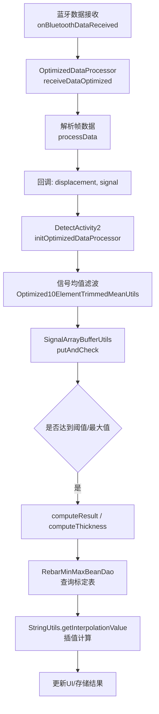
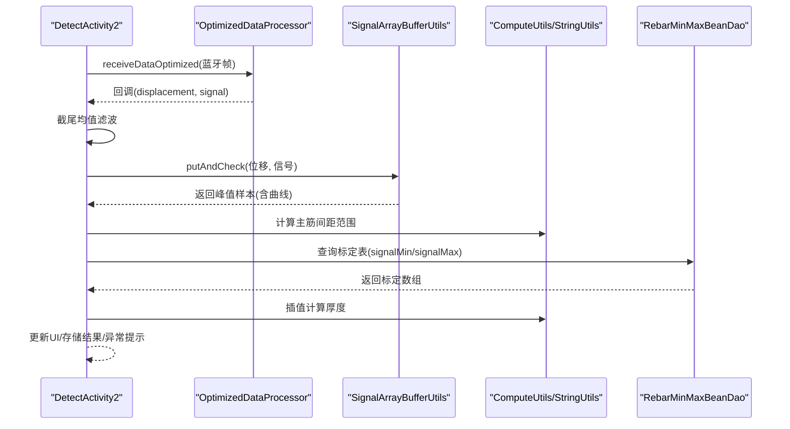
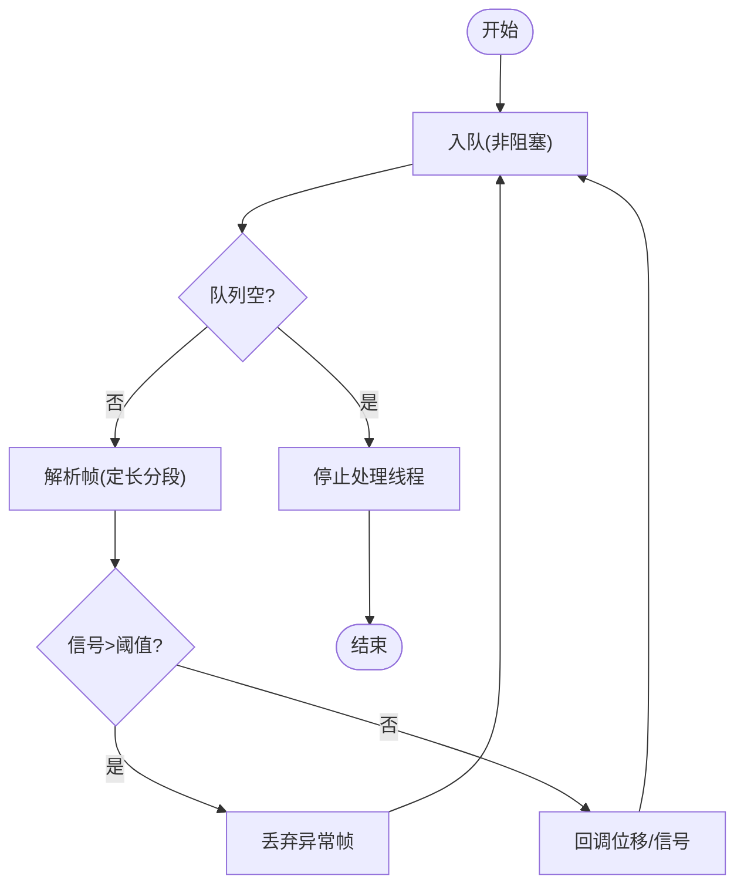
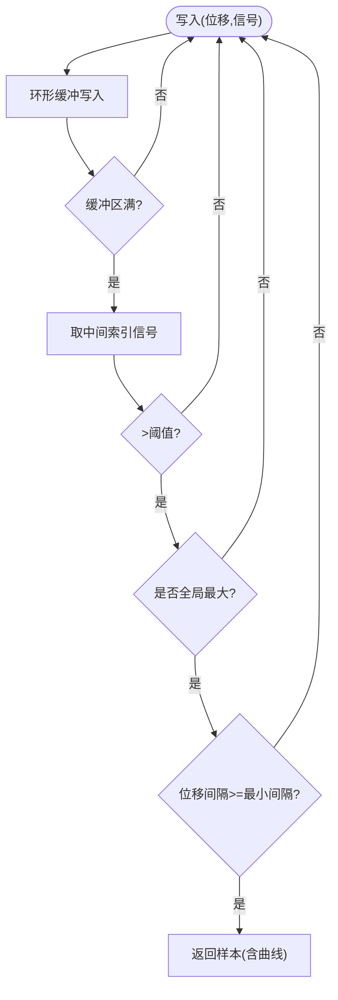
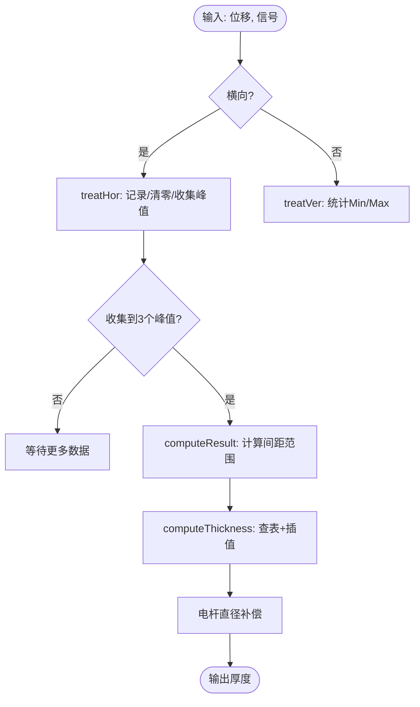
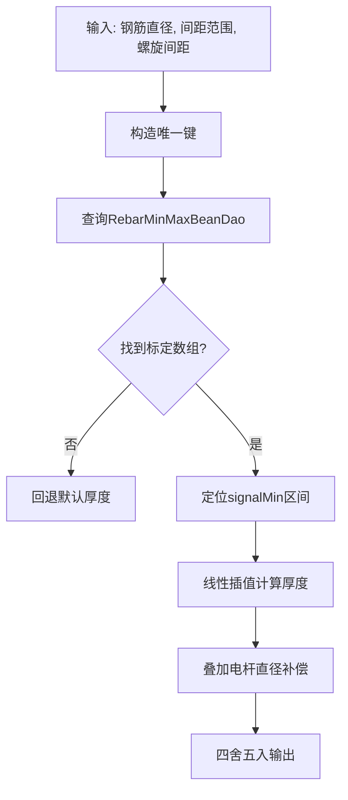
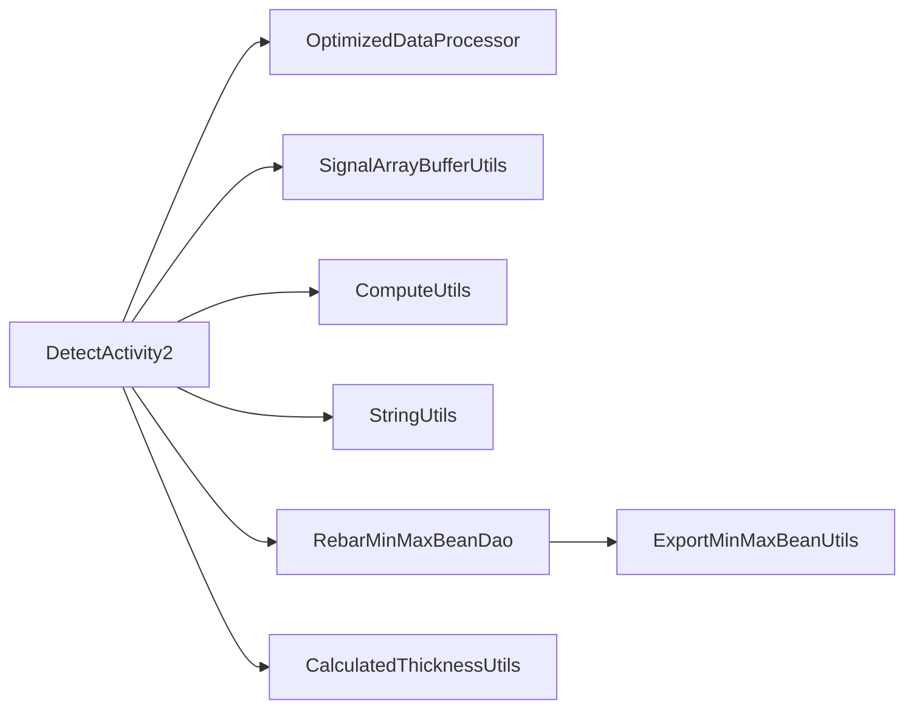

# 横向检测

<cite>
**本文引用的文件**
- [DetectActivity2.java](file://app/src/main/java/com/example/gtj_sd_dg240/activity/testing/DetectActivity2.java)
- [OptimizedDataProcessor.java](file://app/src/main/java/com/example/gtj_sd_dg240/utils/OptimizedDataProcessor.java)
- [SignalArrayBufferUtils.java](file://app/src/main/java/com/example/gtj_sd_dg240/utils/SignalArrayBufferUtils.java)
- [ComputeUtils.java](file://app/src/main/java/com/example/gtj_sd_dg240/utils/ComputeUtils.java)
- [StringUtils.java](file://app/src/main/java/com/example/gtj_sd_dg240/utils/StringUtils.java)
- [RebarMinMaxBeanDao.java](file://app/src/main/java/com/example/gtj_sd_dg240/functions/database/greenDao/db/RebarMinMaxBeanDao.java)
- [ExportMinMaxBeanUtils.java](file://app/src/main/java/com/example/gtj_sd_dg240/utils/ExportMinMaxBeanUtils.java)
- [CalculatedThicknessUtils.java](file://app/src/main/java/com/example/gtj_sd_dg240/utils/CalculatedThicknessUtils.java)
- [CheckDataBean.java](file://app/src/main/java/com/example/gtj_sd_dg240/model/CheckDataBean.java)
</cite>

## 目录
1. [简介](#简介)
2. [项目结构](#项目结构)
3. [核心组件](#核心组件)
4. [架构总览](#架构总览)
5. [详细组件分析](#详细组件分析)
6. [依赖关系分析](#依赖关系分析)
7. [性能考量](#性能考量)
8. [故障排查指南](#故障排查指南)
9. [结论](#结论)
10. [附录](#附录)

## 简介
本文件面向GTJ-SD-DG240应用的“横向检测”功能，聚焦单点厚度测量模式。文档从系统架构、数据流、算法实现与UI交互等维度，完整说明：
- 横向检测的工作原理与信号采集处理流程
- DetectActivity2中checkThickness及相关方法的实现细节
- 位移数据处理、信号值转换、厚度计算过程
- 校准曲线拟合与插值方法、精度控制策略与质量保证措施
- 用户界面交互设计（实时展示、进度反馈、错误提示）
- 检测参数配置、校准流程与异常处理机制
- 信号滤波、噪声抑制、数据验证等高级特性

## 项目结构
横向检测的核心代码位于activity层与utils工具层，配合数据库DAO与模型完成数据存取与结果展示。关键路径如下：
- 活动入口与业务编排：DetectActivity2
- 数据采集与解析：OptimizedDataProcessor
- 信号缓冲与峰值提取：SignalArrayBufferUtils
- 几何与匹配算法：ComputeUtils
- 插值与数值工具：StringUtils
- 厚度查表与数据库：RebarMinMaxBeanDao、ExportMinMaxBeanUtils
- 厚度估算辅助：CalculatedThicknessUtils
- 数据载体：CheckDataBean

**图表来源**
- [DetectActivity2.java:165-203](file://app/src/main/java/com/example/gtj_sd_dg240/activity/testing/DetectActivity2.java#L165-L203)
- [OptimizedDataProcessor.java:34-133](file://app/src/main/java/com/example/gtj_sd_dg240/utils/OptimizedDataProcessor.java#L34-L133)
- [SignalArrayBufferUtils.java:26-66](file://app/src/main/java/com/example/gtj_sd_dg240/utils/SignalArrayBufferUtils.java#L26-L66)
- [ComputeUtils.java:39-61](file://app/src/main/java/com/example/gtj_sd_dg240/utils/ComputeUtils.java#L39-L61)
- [StringUtils.java:228-236](file://app/src/main/java/com/example/gtj_sd_dg240/utils/StringUtils.java#L228-L236)
- [RebarMinMaxBeanDao.java:52-64](file://app/src/main/java/com/example/gtj_sd_dg240/functions/database/greenDao/db/RebarMinMaxBeanDao.java#L52-L64)

**章节来源**
- [DetectActivity2.java:71-116](file://app/src/main/java/com/example/gtj_sd_dg240/activity/testing/DetectActivity2.java#L71-L116)
- [OptimizedDataProcessor.java:1-135](file://app/src/main/java/com/example/gtj_sd_dg240/utils/OptimizedDataProcessor.java#L1-L135)
- [SignalArrayBufferUtils.java:1-114](file://app/src/main/java/com/example/gtj_sd_dg240/utils/SignalArrayBufferUtils.java#L1-L114)

## 核心组件
- DetectActivity2：横向检测的主控页面，负责初始化、数据回调、厚度计算、UI刷新与结果保存。
- OptimizedDataProcessor：高吞吐蓝牙数据的生产者-消费者处理，负责帧拼接、完整性校验、解析位移与信号。
- SignalArrayBufferUtils：环形缓冲区维护最近N个采样点，识别有效峰值并输出带曲线的样本。
- ComputeUtils：根据主筋间距范围匹配预设空间组合，使用余弦定理计算第三边。
- StringUtils：提供线性插值、四舍五入、字符串/字节转换等基础工具。
- RebarMinMaxBeanDao/ExportMinMaxBeanUtils：厚度标定表的导入与查询，支撑厚度反算。
- CalculatedThicknessUtils：基于多通道信号区间匹配的厚度估算辅助（在其它模式中可能使用）。
- CheckDataBean：单次检测的载体，包含位移、信号、曲线等。

**章节来源**
- [DetectActivity2.java:55-116](file://app/src/main/java/com/example/gtj_sd_dg240/activity/testing/DetectActivity2.java#L55-L116)
- [OptimizedDataProcessor.java:7-23](file://app/src/main/java/com/example/gtj_sd_dg240/utils/OptimizedDataProcessor.java#L7-L23)
- [SignalArrayBufferUtils.java:5-21](file://app/src/main/java/com/example/gtj_sd_dg240/utils/SignalArrayBufferUtils.java#L5-L21)
- [ComputeUtils.java:8-26](file://app/src/main/java/com/example/gtj_sd_dg240/utils/ComputeUtils.java#L8-L26)
- [StringUtils.java:228-236](file://app/src/main/java/com/example/gtj_sd_dg240/utils/StringUtils.java#L228-L236)
- [RebarMinMaxBeanDao.java:52-64](file://app/src/main/java/com/example/gtj_sd_dg240/functions/database/greenDao/db/RebarMinMaxBeanDao.java#L52-L64)
- [ExportMinMaxBeanUtils.java:34-70](file://app/src/main/java/com/example/gtj_sd_dg240/utils/ExportMinMaxBeanUtils.java#L34-L70)
- [CalculatedThicknessUtils.java:22-59](file://app/src/main/java/com/example/gtj_sd_dg240/utils/CalculatedThicknessUtils.java#L22-L59)
- [CheckDataBean.java:1-32](file://app/src/main/java/com/example/gtj_sd_dg240/model/CheckDataBean.java#L1-L32)

## 架构总览
横向检测采用“采集-处理-计算-展示”的分层架构：
- 采集层：蓝牙接收后进入OptimizedDataProcessor进行帧拼接与解析，产出位移与信号。
- 处理层：对信号做去噪（滑动窗口截尾均值）、峰值检测（环形缓冲+最大信号判定），得到稳定样本。
- 计算层：依据钢筋直径、电杆半径、主筋间距范围匹配标定表，通过插值计算厚度，并进行电杆直径补偿。
- 展示层：实时更新信号、最小/最大信号、厚度结果与列表；异常时弹窗提示。

**图表来源**
- [DetectActivity2.java:165-203](file://app/src/main/java/com/example/gtj_sd_dg240/activity/testing/DetectActivity2.java#L165-L203)
- [OptimizedDataProcessor.java:34-133](file://app/src/main/java/com/example/gtj_sd_dg240/utils/OptimizedDataProcessor.java#L34-L133)
- [SignalArrayBufferUtils.java:26-66](file://app/src/main/java/com/example/gtj_sd_dg240/utils/SignalArrayBufferUtils.java#L26-L66)
- [ComputeUtils.java:39-61](file://app/src/main/java/com/example/gtj_sd_dg240/utils/ComputeUtils.java#L39-L61)
- [RebarMinMaxBeanDao.java:52-64](file://app/src/main/java/com/example/gtj_sd_dg240/functions/database/greenDao/db/RebarMinMaxBeanDao.java#L52-L64)

## 详细组件分析

### 数据采集与处理（OptimizedDataProcessor）
- 生产者-消费者模型：高频蓝牙数据通过无阻塞队列入队，后台线程消费并解析。
- 帧完整性：按固定长度分段解析，定位帧头标志，丢弃不完整前缀。
- 解析字段：位移与信号值，过滤异常大信号。
- 回调：将位移、信号与原始帧信息回传给上层。

**图表来源**
- [OptimizedDataProcessor.java:34-133](file://app/src/main/java/com/example/gtj_sd_dg240/utils/OptimizedDataProcessor.java#L34-L133)

**章节来源**
- [OptimizedDataProcessor.java:1-135](file://app/src/main/java/com/example/gtj_sd_dg240/utils/OptimizedDataProcessor.java#L1-L135)

### 信号缓冲与峰值检测（SignalArrayBufferUtils）
- 环形缓冲区：固定容量记录最近位移与信号，支持循环覆盖。
- 峰值判定：取中间位置信号，判断是否为全局最大值且大于阈值，同时要求位移间隔满足最小距离，避免重复触发。
- 输出：返回包含完整曲线数据的样本对象，供后续厚度计算。

**图表来源**
- [SignalArrayBufferUtils.java:26-66](file://app/src/main/java/com/example/gtj_sd_dg240/utils/SignalArrayBufferUtils.java#L26-L66)

**章节来源**
- [SignalArrayBufferUtils.java:1-114](file://app/src/main/java/com/example/gtj_sd_dg240/utils/SignalArrayBufferUtils.java#L1-L114)

### 厚度计算核心（DetectActivity2.checkThickness 及关联方法）
- checkThickness：根据当前模式（横向/竖向）分派处理逻辑。
- treatHor：横向模式下，记录位移与信号，超过2秒清空缓存，收集三次有效峰值用于后续计算。
- computeResult：基于钢筋直径、电杆半径与三次峰值位移，计算主筋间距范围（角度到弧长换算，余弦定理求第三边）。
- computeThickness：根据间距范围匹配标定表，查找对应signalMin序列，定位区间并插值得到厚度，叠加电杆直径补偿。
- 校准信号值：getSignalValue使用标定列表与标准列表进行分段线性插值，修正原始信号偏移。

**图表来源**
- [DetectActivity2.java:205-488](file://app/src/main/java/com/example/gtj_sd_dg240/activity/testing/DetectActivity2.java#L205-L488)
- [ComputeUtils.java:17-26](file://app/src/main/java/com/example/gtj_sd_dg240/utils/ComputeUtils.java#L17-L26)
- [StringUtils.java:228-236](file://app/src/main/java/com/example/gtj_sd_dg240/utils/StringUtils.java#L228-L236)

**章节来源**
- [DetectActivity2.java:205-488](file://app/src/main/java/com/example/gtj_sd_dg240/activity/testing/DetectActivity2.java#L205-L488)
- [ComputeUtils.java:17-26](file://app/src/main/java/com/example/gtj_sd_dg240/utils/ComputeUtils.java#L17-L26)
- [StringUtils.java:228-236](file://app/src/main/java/com/example/gtj_sd_dg240/utils/StringUtils.java#L228-L236)

### 标定与插值（校准曲线拟合与插值计算）
- 标定数据：通过ExportMinMaxBeanUtils从资源文件导入标定表（signalMin/signalMax数组），存入数据库。
- 查询匹配：根据钢筋直径、主筋间距范围、螺旋筋间距生成唯一键，查询RebarMinMaxBeanDao获取标定数组。
- 插值计算：在signalMin序列中找到落入的区间，使用线性插值计算厚度；若未命中则回退为默认值。
- 精度控制：所有中间结果与最终厚度均进行四舍五入，保证显示与存储的一致性。

**图表来源**
- [ExportMinMaxBeanUtils.java:34-70](file://app/src/main/java/com/example/gtj_sd_dg240/utils/ExportMinMaxBeanUtils.java#L34-L70)
- [RebarMinMaxBeanDao.java:52-64](file://app/src/main/java/com/example/gtj_sd_dg240/functions/database/greenDao/db/RebarMinMaxBeanDao.java#L52-L64)
- [DetectActivity2.java:405-488](file://app/src/main/java/com/example/gtj_sd_dg240/activity/testing/DetectActivity2.java#L405-L488)
- [StringUtils.java:228-236](file://app/src/main/java/com/example/gtj_sd_dg240/utils/StringUtils.java#L228-L236)

**章节来源**
- [ExportMinMaxBeanUtils.java:34-70](file://app/src/main/java/com/example/gtj_sd_dg240/utils/ExportMinMaxBeanUtils.java#L34-L70)
- [RebarMinMaxBeanDao.java:52-64](file://app/src/main/java/com/example/gtj_sd_dg240/functions/database/greenDao/db/RebarMinMaxBeanDao.java#L52-L64)
- [DetectActivity2.java:405-488](file://app/src/main/java/com/example/gtj_sd_dg240/activity/testing/DetectActivity2.java#L405-L488)
- [StringUtils.java:228-236](file://app/src/main/java/com/example/gtj_sd_dg240/utils/StringUtils.java#L228-L236)

### 用户界面交互设计
- 实时数据展示：信号值、最小/最大信号、厚度结果实时刷新。
- 进度反馈：三个峰值指示器逐步显示，提示当前采集进度。
- 错误提示：当厚度超出设计范围或信号异常时，弹出对话框并语音提示。
- 配置入口：支持进入配置页设置检测部位、钢筋直径、电杆尺寸等。

**章节来源**
- [DetectActivity2.java:213-335](file://app/src/main/java/com/example/gtj_sd_dg240/activity/testing/DetectActivity2.java#L213-L335)
- [DetectActivity2.java:508-513](file://app/src/main/java/com/example/gtj_sd_dg240/activity/testing/DetectActivity2.java#L508-L513)
- [DetectActivity2.java:651-745](file://app/src/main/java/com/example/gtj_sd_dg240/activity/testing/DetectActivity2.java#L651-L745)

### 检测参数配置与校准流程
- 参数配置：通过配置活动设置钢筋直径、电杆上下径、高度等，用于半径与补偿计算。
- 校准流程：读取本地标定列表与标准列表，对原始信号进行分段线性插值校正，消除系统偏差。
- 质量保障：每次测量前检查参数与检测部位是否完整；采集过程中限制最大信号范围；结果落库前进行有效性校验。

**章节来源**
- [DetectActivity2.java:156-163](file://app/src/main/java/com/example/gtj_sd_dg240/activity/testing/DetectActivity2.java#L156-L163)
- [DetectActivity2.java:515-531](file://app/src/main/java/com/example/gtj_sd_dg240/activity/testing/DetectActivity2.java#L515-L531)
- [DetectActivity2.java:587-597](file://app/src/main/java/com/example/gtj_sd_dg240/activity/testing/DetectActivity2.java#L587-L597)

### 高级技术特性
- 信号滤波：采用10元素截尾均值滤波器，去除极端值影响，提升稳定性。
- 噪声抑制：峰值检测要求信号大于阈值且为全局最大，结合位移间隔约束，降低误检。
- 数据验证：采集前校验参数与部位；结果超出设计范围时提示异常；存储前进行一致性检查。

**章节来源**
- [DetectActivity2.java:109-116](file://app/src/main/java/com/example/gtj_sd_dg240/activity/testing/DetectActivity2.java#L109-L116)
- [SignalArrayBufferUtils.java:42-61](file://app/src/main/java/com/example/gtj_sd_dg240/utils/SignalArrayBufferUtils.java#L42-L61)
- [DetectActivity2.java:237-249](file://app/src/main/java/com/example/gtj_sd_dg240/activity/testing/DetectActivity2.java#L237-L249)
- [DetectActivity2.java:331-334](file://app/src/main/java/com/example/gtj_sd_dg240/activity/testing/DetectActivity2.java#L331-L334)

## 依赖关系分析
- DetectActivity2依赖OptimizedDataProcessor进行数据解耦与线程安全处理。
- SignalArrayBufferUtils为峰值检测提供高效数据结构与并发保护。
- ComputeUtils提供几何计算与匹配规则，支撑厚度反算。
- StringUtils提供插值与数值处理，贯穿标定与厚度计算。
- RebarMinMaxBeanDao与ExportMinMaxBeanUtils构成标定数据源，确保厚度计算的准确性。
- CalculatedThicknessUtils作为厚度估算的补充工具，可用于其他检测模式。

**图表来源**
- [DetectActivity2.java:165-203](file://app/src/main/java/com/example/gtj_sd_dg240/activity/testing/DetectActivity2.java#L165-L203)
- [OptimizedDataProcessor.java:34-133](file://app/src/main/java/com/example/gtj_sd_dg240/utils/OptimizedDataProcessor.java#L34-L133)
- [SignalArrayBufferUtils.java:26-66](file://app/src/main/java/com/example/gtj_sd_dg240/utils/SignalArrayBufferUtils.java#L26-L66)
- [ComputeUtils.java:39-61](file://app/src/main/java/com/example/gtj_sd_dg240/utils/ComputeUtils.java#L39-L61)
- [StringUtils.java:228-236](file://app/src/main/java/com/example/gtj_sd_dg240/utils/StringUtils.java#L228-L236)
- [RebarMinMaxBeanDao.java:52-64](file://app/src/main/java/com/example/gtj_sd_dg240/functions/database/greenDao/db/RebarMinMaxBeanDao.java#L52-L64)
- [ExportMinMaxBeanUtils.java:34-70](file://app/src/main/java/com/example/gtj_sd_dg240/utils/ExportMinMaxBeanUtils.java#L34-L70)
- [CalculatedThicknessUtils.java:22-59](file://app/src/main/java/com/example/gtj_sd_dg240/utils/CalculatedThicknessUtils.java#L22-L59)

**章节来源**
- [DetectActivity2.java:165-203](file://app/src/main/java/com/example/gtj_sd_dg240/activity/testing/DetectActivity2.java#L165-L203)
- [OptimizedDataProcessor.java:34-133](file://app/src/main/java/com/example/gtj_sd_dg240/utils/OptimizedDataProcessor.java#L34-L133)
- [SignalArrayBufferUtils.java:26-66](file://app/src/main/java/com/example/gtj_sd_dg240/utils/SignalArrayBufferUtils.java#L26-L66)
- [ComputeUtils.java:39-61](file://app/src/main/java/com/example/gtj_sd_dg240/utils/ComputeUtils.java#L39-L61)
- [StringUtils.java:228-236](file://app/src/main/java/com/example/gtj_sd_dg240/utils/StringUtils.java#L228-L236)
- [RebarMinMaxBeanDao.java:52-64](file://app/src/main/java/com/example/gtj_sd_dg240/functions/database/greenDao/db/RebarMinMaxBeanDao.java#L52-L64)
- [ExportMinMaxBeanUtils.java:34-70](file://app/src/main/java/com/example/gtj_sd_dg240/utils/ExportMinMaxBeanUtils.java#L34-L70)
- [CalculatedThicknessUtils.java:22-59](file://app/src/main/java/com/example/gtj_sd_dg240/utils/CalculatedThicknessUtils.java#L22-L59)

## 性能考量
- 高吞吐数据接入：无阻塞队列与后台线程处理，避免UI卡顿。
- 内存友好：环形缓冲区固定大小，减少频繁分配。
- 计算优化：截尾均值滤波缓存结果，减少重复计算；插值计算轻量高效。
- I/O优化：标定表批量导入与一次性查询，降低数据库压力。

[本节为通用指导，不直接分析具体文件]

## 故障排查指南
- 信号值为0：竖向模式下若最小/最大信号为0，会提示并重置状态，需重新采集。
- 数据异常：厚度超出设计范围时弹出提示，建议重复测量或剔凿验证。
- 参数缺失：未设置参数或未添加检测部位时，阻止继续检测并提示。
- 蓝牙连接：确保设备已连接，数据回调正常触发。

**章节来源**
- [DetectActivity2.java:287-311](file://app/src/main/java/com/example/gtj_sd_dg240/activity/testing/DetectActivity2.java#L287-L311)
- [DetectActivity2.java:508-513](file://app/src/main/java/com/example/gtj_sd_dg240/activity/testing/DetectActivity2.java#L508-L513)
- [DetectActivity2.java:237-249](file://app/src/main/java/com/example/gtj_sd_dg240/activity/testing/DetectActivity2.java#L237-L249)

## 结论
横向检测功能通过稳定的数据采集、高效的信号处理与精确的厚度计算，实现了混凝土电杆保护层厚度的可靠测量。其模块化设计与完善的异常处理机制，确保了在实际作业中的鲁棒性与易用性。建议持续优化标定表覆盖范围与匹配规则，进一步提升复杂工况下的测量精度。

[本节为总结性内容，不直接分析具体文件]

## 附录
- 关键类与方法路径参考：
  - 数据采集与解析：[OptimizedDataProcessor.java](file://app/src/main/java/com/example/gtj_sd_dg240/utils/OptimizedDataProcessor.java)
  - 峰值检测：[SignalArrayBufferUtils.java](file://app/src/main/java/com/example/gtj_sd_dg240/utils/SignalArrayBufferUtils.java)
  - 厚度计算：[DetectActivity2.java](file://app/src/main/java/com/example/gtj_sd_dg240/activity/testing/DetectActivity2.java)
  - 几何与匹配：[ComputeUtils.java](file://app/src/main/java/com/example/gtj_sd_dg240/utils/ComputeUtils.java)
  - 插值工具：[StringUtils.java](file://app/src/main/java/com/example/gtj_sd_dg240/utils/StringUtils.java)
  - 标定表管理：[RebarMinMaxBeanDao.java](file://app/src/main/java/com/example/gtj_sd_dg240/functions/database/greenDao/db/RebarMinMaxBeanDao.java)、[ExportMinMaxBeanUtils.java](file://app/src/main/java/com/example/gtj_sd_dg240/utils/ExportMinMaxBeanUtils.java)
  - 厚度估算辅助：[CalculatedThicknessUtils.java](file://app/src/main/java/com/example/gtj_sd_dg240/utils/CalculatedThicknessUtils.java)
  - 数据载体：[CheckDataBean.java](file://app/src/main/java/com/example/gtj_sd_dg240/model/CheckDataBean.java)

[本节为附录信息，不直接分析具体文件]