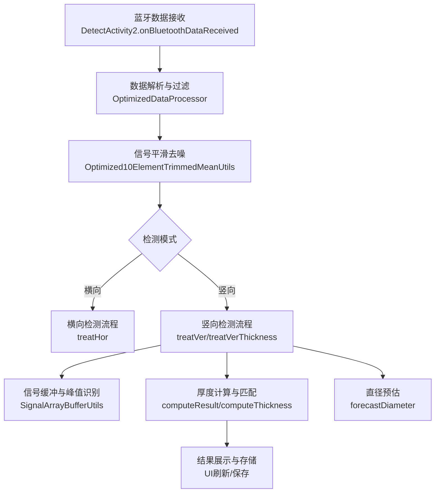
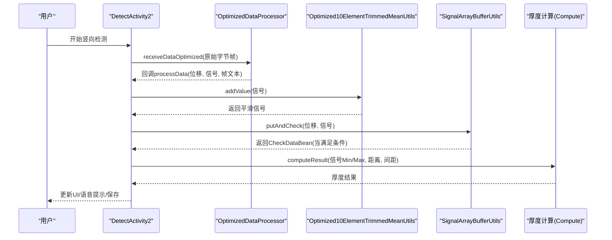
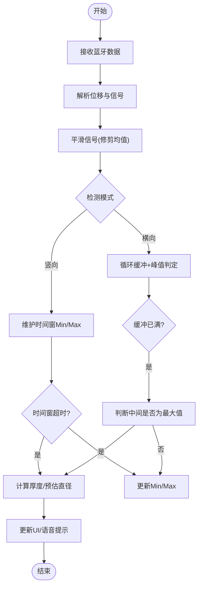
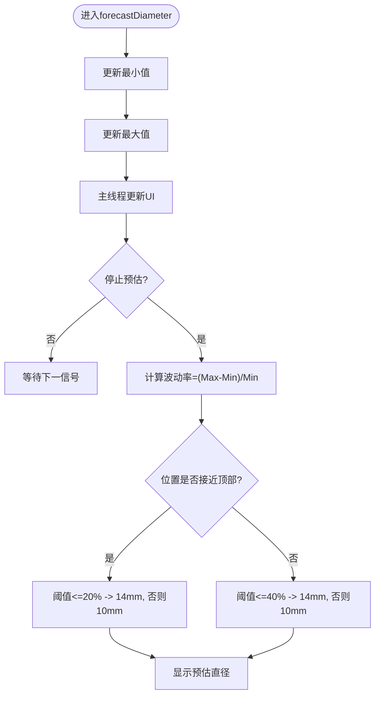
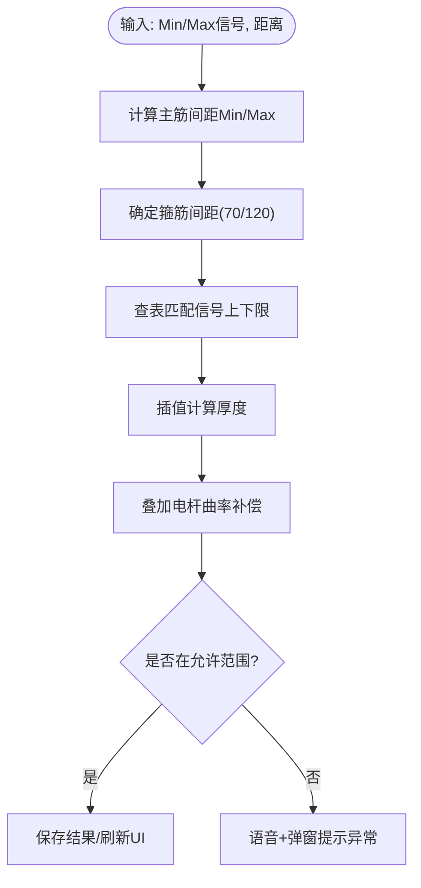
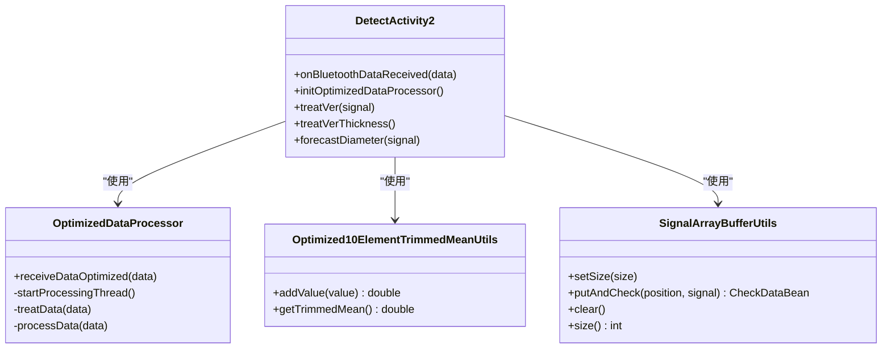
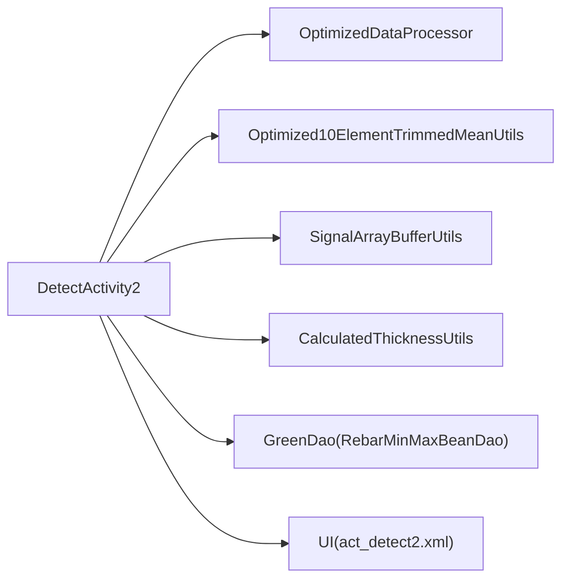

# 竖向检测

<cite>
**本文引用的文件**
- [DetectActivity2.java](file://app/src/main/java/com/example/gtj_sd_dg240/activity/testing/DetectActivity2.java)
- [OptimizedDataProcessor.java](file://app/src/main/java/com/example/gtj_sd_dg240/utils/OptimizedDataProcessor.java)
- [SignalArrayBufferUtils.java](file://app/src/main/java/com/example/gtj_sd_dg240/utils/SignalArrayBufferUtils.java)
- [Optimized10ElementTrimmedMeanUtils.java](file://app/src/main/java/com/example/gtj_sd_dg240/utils/Optimized10ElementTrimmedMeanUtils.java)
- [CheckDataBean.java](file://app/src/main/java/com/example/gtj_sd_dg240/model/CheckDataBean.java)
- [CalculatedThicknessUtils.java](file://app/src/main/java/com/example/gtj_sd_dg240/utils/CalculatedThicknessUtils.java)
- [act_detect2.xml](file://app/src/main/res/layout/act_detect2.xml)
- [DetectConfigActivity.java](file://app/src/main/java/com/example/gtj_sd_dg240/activity/testing/DetectConfigActivity.java)
- [CalibrationDeviceActivity.java](file://app/src/main/java/com/example/gtj_sd_dg240/activity/setting/CalibrationDeviceActivity.java)
</cite>

## 目录
1. [简介](#简介)
2. [项目结构](#项目结构)
3. [核心组件](#核心组件)
4. [架构总览](#架构总览)
5. [详细组件分析](#详细组件分析)
6. [依赖关系分析](#依赖关系分析)
7. [性能与优化](#性能与优化)
8. [故障排查指南](#故障排查指南)
9. [结论](#结论)
10. [附录：操作指南](#附录操作指南)

## 简介
本文件面向GTJ-SD-DG240应用的“竖向检测”功能，系统性说明其工作原理、信号处理算法、直径预估逻辑、数据缓冲与多线程处理、精度优化与质量控制机制，以及用户界面交互与参数配置、校准与数据导出等操作流程。文档以代码为依据，提供可追溯的源码引用与可视化图示，帮助开发者与现场工程师快速理解并正确使用该功能。

## 项目结构
竖向检测的核心由以下模块组成：
- 数据采集与解析：蓝牙数据接收与帧解析（OptimizedDataProcessor）
- 信号预处理：去噪与平滑（Optimized10ElementTrimmedMeanUtils）
- 缓冲区管理：位移-信号对循环缓冲与峰值判定（SignalArrayBufferUtils）
- 业务逻辑：竖向检测流程、厚度计算、直径预估（DetectActivity2）
- 辅助工具：厚度计算工具（CalculatedThicknessUtils）、数据模型（CheckDataBean）
- UI与配置：检测界面布局（act_detect2.xml）、检测参数设置（DetectConfigActivity）、设备校准（CalibrationDeviceActivity）

图表来源
- [DetectActivity2.java:166-203](file://app/src/main/java/com/example/gtj_sd_dg240/activity/testing/DetectActivity2.java#L166-L203)
- [OptimizedDataProcessor.java:34-133](file://app/src/main/java/com/example/gtj_sd_dg240/utils/OptimizedDataProcessor.java#L34-L133)
- [SignalArrayBufferUtils.java:26-65](file://app/src/main/java/com/example/gtj_sd_dg240/utils/SignalArrayBufferUtils.java#L26-L65)
- [DetectActivity2.java:260-335](file://app/src/main/java/com/example/gtj_sd_dg240/activity/testing/DetectActivity2.java#L260-L335)

章节来源
- [DetectActivity2.java:71-116](file://app/src/main/java/com/example/gtj_sd_dg240/activity/testing/DetectActivity2.java#L71-L116)
- [OptimizedDataProcessor.java:1-135](file://app/src/main/java/com/example/gtj_sd_dg240/utils/OptimizedDataProcessor.java#L1-L135)

## 核心组件
- 数据处理器（OptimizedDataProcessor）
  - 生产者-消费者模式，使用阻塞队列缓存高频蓝牙数据，单线程消费，避免UI卡顿。
  - 帧拼接与完整性校验，按固定长度分段解析，提取位移与信号值，异常信号阈值过滤。
- 信号平滑器（Optimized10ElementTrimmedMeanUtils）
  - 滑动窗口修剪均值：去掉两端极值后求中间段平均值，降低噪声影响。
  - 线程安全，带缓存加速重复读取。
- 信号缓冲管理器（SignalArrayBufferUtils）
  - 固定容量循环缓冲区记录位移-信号对，达到阈值后判断中间位置是否为最大值且满足最小间距约束，输出完整曲线片段用于后续分析。
- 检测主流程（DetectActivity2）
  - 横向/竖向模式切换；竖向模式下维护时间窗内的信号最小/最大值，定时触发厚度计算。
  - 直径预估：统计信号波动范围，结合电杆高度区间给出预估直径等级。
  - 厚度计算：根据钢筋直径、间距、箍筋间距查表插值，叠加电杆曲率补偿得到最终保护层厚度。
- 厚度计算工具（CalculatedThicknessUtils）
  - 基于左右信号序列与位移信息定位有效区间，通过匹配计数确定厚度索引，支持多策略回退。

章节来源
- [OptimizedDataProcessor.java:34-133](file://app/src/main/java/com/example/gtj_sd_dg240/utils/OptimizedDataProcessor.java#L34-L133)
- [Optimized10ElementTrimmedMeanUtils.java:22-129](file://app/src/main/java/com/example/gtj_sd_dg240/utils/Optimized10ElementTrimmedMeanUtils.java#L22-L129)
- [SignalArrayBufferUtils.java:26-94](file://app/src/main/java/com/example/gtj_sd_dg240/utils/SignalArrayBufferUtils.java#L26-L94)
- [DetectActivity2.java:260-335](file://app/src/main/java/com/example/gtj_sd_dg240/activity/testing/DetectActivity2.java#L260-L335)
- [CalculatedThicknessUtils.java:22-129](file://app/src/main/java/com/example/gtj_sd_dg240/utils/CalculatedThicknessUtils.java#L22-L129)

## 架构总览
下图展示了从蓝牙数据到检测结果的关键调用链路与数据流向。

图表来源
- [DetectActivity2.java:166-203](file://app/src/main/java/com/example/gtj_sd_dg240/activity/testing/DetectActivity2.java#L166-L203)
- [OptimizedDataProcessor.java:34-133](file://app/src/main/java/com/example/gtj_sd_dg240/utils/OptimizedDataProcessor.java#L34-L133)
- [SignalArrayBufferUtils.java:26-65](file://app/src/main/java/com/example/gtj_sd_dg240/utils/SignalArrayBufferUtils.java#L26-L65)
- [DetectActivity2.java:260-335](file://app/src/main/java/com/example/gtj_sd_dg240/activity/testing/DetectActivity2.java#L260-L335)

## 详细组件分析

### 竖向检测模式的工作原理
- 数据采集策略
  - 蓝牙数据进入OptimizedDataProcessor进行帧拼接与解析，提取位移与信号值，过滤异常大信号。
  - 信号经Optimized10ElementTrimmedMeanUtils平滑后进入业务层。
- 信号最大值和最小值的分析方法
  - 竖向模式下，维护一个时间窗（默认约2秒），在时间窗内记录信号的最小值与最大值，超过时间窗自动清零重置，避免历史数据污染。
  - 横向模式采用SignalArrayBufferUtils循环缓冲，在缓冲区满时检查中间位置是否为最大值且满足最小位移间隔，从而输出稳定峰值对应的完整曲线片段。
- 直径预估算法的实现
  - 在预估模式下，持续记录信号的最小值与最大值，计算相对波动率（(Max-Min)/Min）。
  - 根据当前测量位置是否接近电杆顶部，设定不同阈值，将波动率映射为预估直径等级（如10mm或14mm）。
  - 预估结果实时显示于界面，便于现场快速判断。

图表来源
- [DetectActivity2.java:260-335](file://app/src/main/java/com/example/gtj_sd_dg240/activity/testing/DetectActivity2.java#L260-L335)
- [SignalArrayBufferUtils.java:26-65](file://app/src/main/java/com/example/gtj_sd_dg240/utils/SignalArrayBufferUtils.java#L26-L65)
- [OptimizedDataProcessor.java:122-133](file://app/src/main/java/com/example/gtj_sd_dg240/utils/OptimizedDataProcessor.java#L122-L133)

章节来源
- [DetectActivity2.java:260-335](file://app/src/main/java/com/example/gtj_sd_dg240/activity/testing/DetectActivity2.java#L260-L335)
- [SignalArrayBufferUtils.java:26-65](file://app/src/main/java/com/example/gtj_sd_dg240/utils/SignalArrayBufferUtils.java#L26-L65)
- [OptimizedDataProcessor.java:122-133](file://app/src/main/java/com/example/gtj_sd_dg240/utils/OptimizedDataProcessor.java#L122-L133)

### forecastDiameter方法的实现逻辑
- 信号数组缓冲处理
  - 在预估模式下，方法维护全局最小值与最大值变量，随新信号到来动态更新。
  - 通过Handler切换到主线程更新UI，显示当前信号、Min、Max。
- 数据统计分析与异常值识别
  - 统计信号波动率，结合当前测量位置（距根部距离）判断阈值分支。
  - 若Min或Max为0，视为无效信号，阻止预估并提示。
- 直径计算过程
  - 根据波动率与位置区间选择预估直径等级（例如10mm或14mm），并在界面展示。
  - 该方法不直接输出厚度，而是为现场快速判断提供依据。

图表来源
- [DetectActivity2.java:493-505](file://app/src/main/java/com/example/gtj_sd_dg240/activity/testing/DetectActivity2.java#L493-L505)
- [DetectActivity2.java:699-734](file://app/src/main/java/com/example/gtj_sd_dg240/activity/testing/DetectActivity2.java#L699-L734)

章节来源
- [DetectActivity2.java:493-505](file://app/src/main/java/com/example/gtj_sd_dg240/activity/testing/DetectActivity2.java#L493-L505)
- [DetectActivity2.java:699-734](file://app/src/main/java/com/example/gtj_sd_dg240/activity/testing/DetectActivity2.java#L699-L734)

### 厚度计算与质量控制
- 厚度计算步骤
  - 获取主筋直径与电杆半径，计算主筋间距Min/Max（基于三个采样点的位移差换算角度与弦长）。
  - 根据距离判断箍筋间距（顶部附近为70mm，其余为120mm）。
  - 查询数据库中的信号上下限表，按信号值区间匹配并插值得到厚度。
  - 叠加电杆曲率补偿，得到最终保护层厚度。
- 质量控制机制
  - 信号值为0或超出阈值时提示异常。
  - 厚度结果与设计厚度比较，超限时语音与弹窗提示“数据异常，请重复测量或剔凿验证”。
  - 多次测量取平均，减少随机误差。

图表来源
- [DetectActivity2.java:339-488](file://app/src/main/java/com/example/gtj_sd_dg240/activity/testing/DetectActivity2.java#L339-L488)

章节来源
- [DetectActivity2.java:339-488](file://app/src/main/java/com/example/gtj_sd_dg240/activity/testing/DetectActivity2.java#L339-L488)

### 信号缓冲区管理与多线程处理
- 缓冲区管理
  - SignalArrayBufferUtils使用固定大小循环数组记录位移与信号，满缓冲后检查中间位置是否为最大值且满足最小位移间隔，输出完整曲线片段。
- 多线程处理
  - OptimizedDataProcessor使用阻塞队列与独立线程处理数据，避免UI阻塞；仅在必要时切换到主线程更新UI。
  - Optimized10ElementTrimmedMeanUtils使用重入锁保证线程安全，并提供缓存提升性能。

图表来源
- [OptimizedDataProcessor.java:34-133](file://app/src/main/java/com/example/gtj_sd_dg240/utils/OptimizedDataProcessor.java#L34-L133)
- [Optimized10ElementTrimmedMeanUtils.java:22-129](file://app/src/main/java/com/example/gtj_sd_dg240/utils/Optimized10ElementTrimmedMeanUtils.java#L22-L129)
- [SignalArrayBufferUtils.java:26-94](file://app/src/main/java/com/example/gtj_sd_dg240/utils/SignalArrayBufferUtils.java#L26-L94)
- [DetectActivity2.java:166-203](file://app/src/main/java/com/example/gtj_sd_dg240/activity/testing/DetectActivity2.java#L166-L203)

章节来源
- [OptimizedDataProcessor.java:34-133](file://app/src/main/java/com/example/gtj_sd_dg240/utils/OptimizedDataProcessor.java#L34-L133)
- [Optimized10ElementTrimmedMeanUtils.java:22-129](file://app/src/main/java/com/example/gtj_sd_dg240/utils/Optimized10ElementTrimmedMeanUtils.java#L22-L129)
- [SignalArrayBufferUtils.java:26-94](file://app/src/main/java/com/example/gtj_sd_dg240/utils/SignalArrayBufferUtils.java#L26-L94)
- [DetectActivity2.java:166-203](file://app/src/main/java/com/example/gtj_sd_dg240/activity/testing/DetectActivity2.java#L166-L203)

## 依赖关系分析
- 组件耦合
  - DetectActivity2强依赖OptimizedDataProcessor与Optimized10ElementTrimmedMeanUtils完成数据流处理。
  - SignalArrayBufferUtils作为横向检测的峰值识别工具，与DetectActivity2解耦良好。
  - CalculatedThicknessUtils提供厚度计算辅助，被DetectActivity2在需要时调用。
- 外部依赖
  - 蓝牙数据源、GreenDao数据库（RebarMinMaxBeanDao）用于查表匹配。
  - UI资源（act_detect2.xml）用于展示实时信号、统计信息与检测结果。

图表来源
- [DetectActivity2.java:166-203](file://app/src/main/java/com/example/gtj_sd_dg240/activity/testing/DetectActivity2.java#L166-L203)
- [DetectActivity2.java:339-488](file://app/src/main/java/com/example/gtj_sd_dg240/activity/testing/DetectActivity2.java#L339-L488)
- [act_detect2.xml:88-101](file://app/src/main/res/layout/act_detect2.xml#L88-L101)

章节来源
- [DetectActivity2.java:166-203](file://app/src/main/java/com/example/gtj_sd_dg240/activity/testing/DetectActivity2.java#L166-L203)
- [DetectActivity2.java:339-488](file://app/src/main/java/com/example/gtj_sd_dg240/activity/testing/DetectActivity2.java#L339-L488)
- [act_detect2.xml:88-101](file://app/src/main/res/layout/act_detect2.xml#L88-L101)

## 性能与优化
- 高吞吐数据处理
  - 使用阻塞队列与单线程消费，避免频繁创建线程与上下文切换开销。
  - 帧拼接与分段解析减少重复计算，异常信号阈值过滤降低无效处理。
- 信号平滑与抗噪
  - 修剪均值去除极端值干扰，提高厚度计算稳定性。
- 内存与CPU优化
  - 循环缓冲区固定容量，避免动态扩容带来的GC压力。
  - 平滑器内部缓存最近一次平均值，减少重复排序与计算。
- UI更新节流
  - 通过Handler在主线程批量更新UI，避免频繁刷新导致卡顿。

[本节为通用性能讨论，无需具体文件引用]

## 故障排查指南
- 常见问题
  - 信号值为0：可能为传感器接触不良或环境干扰，需重新放置探头或剔除表面浮浆。
  - 数据异常提示：厚度超出设计范围，建议重复测量或进行剔凿验证。
  - 预估失败：Min或Max为0，无法计算波动率，需确保采集期间信号稳定。
- 排查步骤
  - 检查蓝牙连接状态与数据接收日志。
  - 确认校准参数是否正确加载（标准列表与偏移列表）。
  - 查看界面实时信号与Min/Max变化，确认时间窗是否按时清零。
  - 核对检测部位是否已添加，且满足最少采样点要求。

章节来源
- [DetectActivity2.java:508-513](file://app/src/main/java/com/example/gtj_sd_dg240/activity/testing/DetectActivity2.java#L508-L513)
- [DetectActivity2.java:287-315](file://app/src/main/java/com/example/gtj_sd_dg240/activity/testing/DetectActivity2.java#L287-L315)

## 结论
竖向检测功能通过稳健的数据采集、信号平滑、缓冲峰值识别与查表插值计算，实现了混凝土保护层厚度的高精度测量与直径的快速预估。系统采用多线程与缓冲技术保障高吞吐与低延迟，配合质量控制机制确保结果可靠性。用户界面提供实时反馈与便捷操作，满足现场高效作业需求。

[本节为总结性内容，无需具体文件引用]

## 附录：操作指南
- 检测参数设置
  - 进入“检测配置”，选择电杆规格、钢筋直径、螺旋筋直径等参数。
  - 参考路径：[DetectConfigActivity.java:129-155](file://app/src/main/java/com/example/gtj_sd_dg240/activity/testing/DetectConfigActivity.java#L129-L155)
- 设备校准
  - 在“设备校准”中录入标准信号与对应偏移量，确保信号转换准确。
  - 参考路径：[CalibrationDeviceActivity.java:73-93](file://app/src/main/java/com/example/gtj_sd_dg240/activity/setting/CalibrationDeviceActivity.java#L73-L93)
- 数据导出
  - 检测完成后，进入“数据文件管理”进行导出与上传。
  - 参考路径：[DetectActivity2.java:683-687](file://app/src/main/java/com/example/gtj_sd_dg240/activity/testing/DetectActivity2.java#L683-L687)
- 界面交互
  - 实时信号显示：当前位移与信号值。
  - 统计信息展示：Min/Max信号、预估直径、厚度结果。
  - 结果反馈：语音提示与弹窗异常提醒。
  - 参考路径：[act_detect2.xml:88-101](file://app/src/main/res/layout/act_detect2.xml#L88-L101)

章节来源
- [DetectConfigActivity.java:129-155](file://app/src/main/java/com/example/gtj_sd_dg240/activity/testing/DetectConfigActivity.java#L129-L155)
- [CalibrationDeviceActivity.java:73-93](file://app/src/main/java/com/example/gtj_sd_dg240/activity/setting/CalibrationDeviceActivity.java#L73-L93)
- [DetectActivity2.java:683-687](file://app/src/main/java/com/example/gtj_sd_dg240/activity/testing/DetectActivity2.java#L683-L687)
- [act_detect2.xml:88-101](file://app/src/main/res/layout/act_detect2.xml#L88-L101)