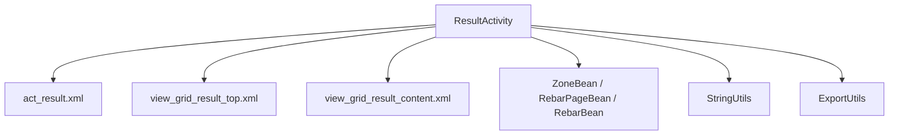
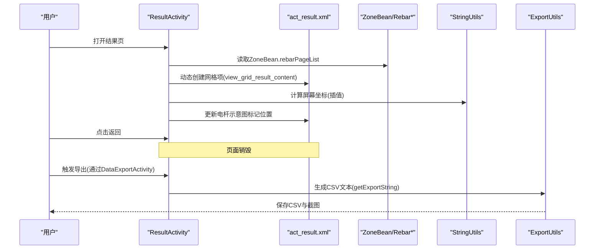
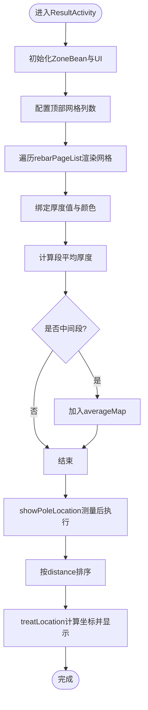
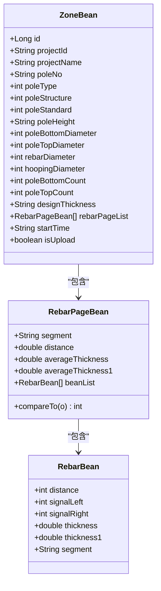
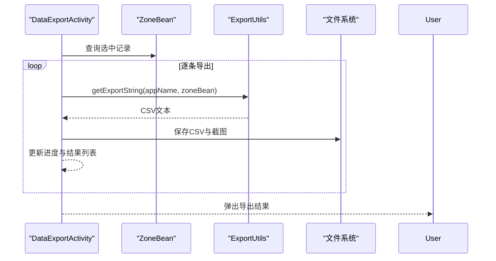
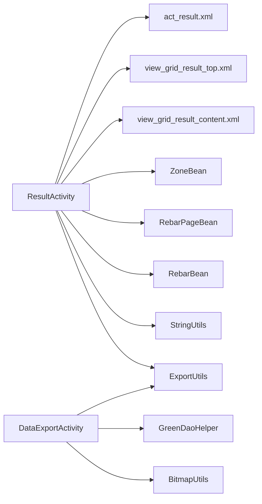

# 结果展示

<cite>
**本文引用的文件**
- [ResultActivity.java](file://app/src/main/java/com/example/gtj_sd_dg240/activity/testing/ResultActivity.java)
- [act_result.xml](file://app/src/main/res/layout/act_result.xml)
- [view_grid_result_content.xml](file://app/src/main/res/layout/view_grid_result_content.xml)
- [view_grid_result_top.xml](file://app/src/main/res/layout/view_grid_result_top.xml)
- [RebarBean.java](file://app/src/main/java/com/example/gtj_sd_dg240/model/RebarBean.java)
- [RebarPageBean.java](file://app/src/main/java/com/example/gtj_sd_dg240/model/RebarPageBean.java)
- [ZoneBean.java](file://app/src/main/java/com/example/gtj_sd_dg240/model/ZoneBean.java)
- [ExportUtils.java](file://app/src/main/java/com/example/gtj_sd_dg240/utils/ExportUtils.java)
- [DataExportActivity.java](file://app/src/main/java/com/example/gtj_sd_dg240/activity/data/DataExportActivity.java)
- [StringUtils.java](file://app/src/main/java/com/example/gtj_sd_dg240/utils/StringUtils.java)
</cite>

## 目录
1. [简介](#简介)
2. [项目结构](#项目结构)
3. [核心组件](#核心组件)
4. [架构总览](#架构总览)
5. [详细组件分析](#详细组件分析)
6. [依赖关系分析](#依赖关系分析)
7. [性能考虑](#性能考虑)
8. [故障排查指南](#故障排查指南)
9. [结论](#结论)
10. [附录](#附录)

## 简介
本章节面向GTJ-SD-DG240应用的结果展示功能，聚焦检测结果的可视化与交互：数据渲染、图表绘制（电杆截面与纵向位置示意）、状态指示（厚度越限高亮）、用户操作（查看、筛选、排序、搜索）以及结果导出（CSV生成与批量导出）。文档以ResultActivity为核心，结合布局模板、数据模型与导出工具类，系统阐述从数据到视图的完整链路。

## 项目结构
结果展示由“活动页 + 布局模板 + 数据模型 + 工具类”构成：
- 活动页：ResultActivity负责加载数据、计算统计、渲染网格与电杆示意图、处理交互。
- 布局模板：act_result.xml为主界面；view_grid_result_top.xml为表头；view_grid_result_content.xml为每行测区内容。
- 数据模型：ZoneBean聚合工程信息与钢筋分页数据；RebarPageBean表示一个测区的钢筋集合与平均厚度；RebarBean表示单根钢筋的厚度等属性。
- 工具类：ExportUtils提供CSV文本生成与文件保存；StringUtils提供数值插值与四舍五入等通用计算。

图示来源
- [ResultActivity.java:33-63](file://app/src/main/java/com/example/gtj_sd_dg240/activity/testing/ResultActivity.java#L33-L63)
- [act_result.xml:1-525](file://app/src/main/res/layout/act_result.xml#L1-L525)
- [view_grid_result_top.xml:1-297](file://app/src/main/res/layout/view_grid_result_top.xml#L1-L297)
- [view_grid_result_content.xml:1-230](file://app/src/main/res/layout/view_grid_result_content.xml#L1-L230)
- [ZoneBean.java:15-43](file://app/src/main/java/com/example/gtj_sd_dg240/model/ZoneBean.java#L15-L43)
- [RebarPageBean.java:9-33](file://app/src/main/java/com/example/gtj_sd_dg240/model/RebarPageBean.java#L9-L33)
- [RebarBean.java:5-26](file://app/src/main/java/com/example/gtj_sd_dg240/model/RebarBean.java#L5-L26)
- [StringUtils.java:228-257](file://app/src/main/java/com/example/gtj_sd_dg240/utils/StringUtils.java#L228-L257)
- [ExportUtils.java:20-66](file://app/src/main/java/com/example/gtj_sd_dg240/utils/ExportUtils.java#L20-L66)

章节来源
- [ResultActivity.java:33-63](file://app/src/main/java/com/example/gtj_sd_dg240/activity/testing/ResultActivity.java#L33-L63)
- [act_result.xml:1-525](file://app/src/main/res/layout/act_result.xml#L1-L525)

## 核心组件
- ResultActivity：接收ZoneBean，初始化导航栏、直径与高度信息，配置顶部网格列数，刷新网格列表，并在电杆示意图上标注各段平均厚度位置。
- 数据模型：
  - ZoneBean：包含工程基本信息与rebarPageList（按测区分段的钢筋数据），用于结果展示与导出。
  - RebarPageBean：表示某一段（如距根部X米）的钢筋集合、距离、平均厚度，并支持按distance排序。
  - RebarBean：单根钢筋的位移、信号、厚度等信息。
- 工具类：
  - StringUtils.getInterpolationValue：用于将物理距离映射到屏幕坐标，实现电杆纵向位置的可视化定位。
  - ExportUtils.getExportString：将ZoneBean转换为CSV文本，包含工程信息、试验参数与各测区厚度明细及平均值。

章节来源
- [ResultActivity.java:156-275](file://app/src/main/java/com/example/gtj_sd_dg240/activity/testing/ResultActivity.java#L156-L275)
- [ZoneBean.java:15-43](file://app/src/main/java/com/example/gtj_sd_dg240/model/ZoneBean.java#L15-L43)
- [RebarPageBean.java:9-33](file://app/src/main/java/com/example/gtj_sd_dg240/model/RebarPageBean.java#L9-L33)
- [RebarBean.java:5-26](file://app/src/main/java/com/example/gtj_sd_dg240/model/RebarBean.java#L5-L26)
- [StringUtils.java:228-257](file://app/src/main/java/com/example/gtj_sd_dg240/utils/StringUtils.java#L228-L257)
- [ExportUtils.java:20-66](file://app/src/main/java/com/example/gtj_sd_dg240/utils/ExportUtils.java#L20-L66)

## 架构总览
结果展示采用“数据驱动+模板渲染”的模式：
- 数据层：ZoneBean携带rebarPageList，每个RebarPageBean包含若干RebarBean。
- 渲染层：ResultActivity根据ZoneBean动态创建网格项，绑定RebarBean厚度值，并根据设计厚度范围进行颜色高亮。
- 可视化层：在act_result.xml中，通过相对布局绘制电杆示意图，利用插值算法将测区距离映射到屏幕坐标，显示平均厚度标记。
- 导出层：ExportUtils将ZoneBean序列化为CSV文本，DataExportActivity负责批量导出与截图保存。

图示来源
- [ResultActivity.java:33-130](file://app/src/main/java/com/example/gtj_sd_dg240/activity/testing/ResultActivity.java#L33-L130)
- [act_result.xml:58-489](file://app/src/main/res/layout/act_result.xml#L58-L489)
- [ExportUtils.java:20-66](file://app/src/main/java/com/example/gtj_sd_dg240/utils/ExportUtils.java#L20-L66)
- [DataExportActivity.java:389-455](file://app/src/main/java/com/example/gtj_sd_dg240/activity/data/DataExportActivity.java#L389-L455)

## 详细组件分析

### ResultActivity 结果展示逻辑
- 初始化与数据准备
  - 从Intent获取ZoneBean，设置导航栏标题与电杆尺寸信息。
  - 基于设计厚度计算允许范围（代码中已覆盖为固定范围），用于后续颜色判断。
- 网格渲染
  - configGridTop：根据poleBottomCount控制顶部表头列的可见性。
  - refreshGrid：遍历rebarPageList，动态inflate view_grid_result_content，调用configGrid绑定数据。
  - configGrid：对每个RebarBean设置厚度文本，计算该段平均值，区分“梢部/根部/中间段”，中间段加入averageMap用于后续定位。
  - setTextView：根据thickness1与厚度范围设置颜色，超出范围使用警示色。
- 电杆示意图标注
  - showPoleLocation：在视图测量完成后，计算vMark的起始点与宽度，取averageMap中的RebarPageBean列表并按distance排序，依次调用treatLocation设置标记位置与高度。
  - treatLocation：使用StringUtils.getInterpolationValue将物理距离映射到屏幕x坐标与高度，更新对应View的LayoutParams并显示文本。

图示来源
- [ResultActivity.java:33-130](file://app/src/main/java/com/example/gtj_sd_dg240/activity/testing/ResultActivity.java#L33-L130)
- [ResultActivity.java:156-275](file://app/src/main/java/com/example/gtj_sd_dg240/activity/testing/ResultActivity.java#L156-L275)
- [StringUtils.java:228-257](file://app/src/main/java/com/example/gtj_sd_dg240/utils/StringUtils.java#L228-L257)

章节来源
- [ResultActivity.java:33-130](file://app/src/main/java/com/example/gtj_sd_dg240/activity/testing/ResultActivity.java#L33-L130)
- [ResultActivity.java:156-275](file://app/src/main/java/com/example/gtj_sd_dg240/activity/testing/ResultActivity.java#L156-L275)

### 数据模型与存储结构
- ZoneBean
  - 字段：工程编号、名称、类型、结构、规范、长度、根径/梢径、配筋参数、设计厚度、rebarPageList、开始时间、委托信息等。
  - rebarPageList：通过自定义转换器序列化存储，承载检测结果的分页数据。
- RebarPageBean
  - 字段：segment（测区标识）、distance（距根部距离）、averageThickness（平均厚度）、beanList（钢筋集合）。
  - 实现Comparable：按distance排序，便于在电杆图上顺序标注。
- RebarBean
  - 字段：distance、signalLeft/Right、thickness/thickness1、segment。

图示来源
- [ZoneBean.java:15-43](file://app/src/main/java/com/example/gtj_sd_dg240/model/ZoneBean.java#L15-L43)
- [RebarPageBean.java:9-33](file://app/src/main/java/com/example/gtj_sd_dg240/model/RebarPageBean.java#L9-L33)
- [RebarBean.java:5-26](file://app/src/main/java/com/example/gtj_sd_dg240/model/RebarBean.java#L5-L26)

章节来源
- [ZoneBean.java:15-43](file://app/src/main/java/com/example/gtj_sd_dg240/model/ZoneBean.java#L15-L43)
- [RebarPageBean.java:9-33](file://app/src/main/java/com/example/gtj_sd_dg240/model/RebarPageBean.java#L9-L33)
- [RebarBean.java:5-26](file://app/src/main/java/com/example/gtj_sd_dg240/model/RebarBean.java#L5-L26)

### 展示模板与数据绑定
- act_result.xml
  - 顶部包含view_grid_result_top作为表头。
  - ScrollView内layout_grid_content用于动态添加view_grid_result_content。
  - 中部RelativeLayout绘制电杆示意图，包含多个v_middle_i与tv_middle_i用于标注平均厚度位置。
- view_grid_result_content.xml
  - 左侧显示测区标识（如“距根部Xm”），右侧为多列厚度单元格与平均值列。
- 数据绑定
  - ResultActivity在configGrid中为每个单元格设置厚度文本，并根据厚度范围着色。
  - 对于“梢部/根部”直接显示在顶部/底部标签；其他段加入averageMap用于后续定位。

章节来源
- [act_result.xml:1-525](file://app/src/main/res/layout/act_result.xml#L1-L525)
- [view_grid_result_content.xml:1-230](file://app/src/main/res/layout/view_grid_result_content.xml#L1-L230)
- [ResultActivity.java:177-275](file://app/src/main/java/com/example/gtj_sd_dg240/activity/testing/ResultActivity.java#L177-L275)

### 用户交互与响应机制
- 返回按钮：binding.btnCancel点击后finish()退出页面。
- 视图测量后定位：showPoleLocation在post回调中获取vMark位置与尺寸，确保布局稳定后再计算坐标。
- 颜色反馈：setTextView依据厚度范围设置颜色，超差时高亮提示。

章节来源
- [ResultActivity.java:33-63](file://app/src/main/java/com/example/gtj_sd_dg240/activity/testing/ResultActivity.java#L33-L63)
- [ResultActivity.java:65-130](file://app/src/main/java/com/example/gtj_sd_dg240/activity/testing/ResultActivity.java#L65-L130)
- [ResultActivity.java:272-275](file://app/src/main/java/com/example/gtj_sd_dg240/activity/testing/ResultActivity.java#L272-L275)

### 结果导出功能
- CSV生成
  - ExportUtils.getExportString：拼接工程信息、试验参数、各测区厚度明细与平均值，输出GBK编码文本。
- 批量导出
  - DataExportActivity：查询选中ZoneBean，循环导出，生成CSV与截图，保存到平板与USB（若可用）。
  - 进度与结果：progressiveDialog显示进度，完成后弹窗列出导出结果。

图示来源
- [DataExportActivity.java:345-455](file://app/src/main/java/com/example/gtj_sd_dg240/activity/data/DataExportActivity.java#L345-L455)
- [ExportUtils.java:20-66](file://app/src/main/java/com/example/gtj_sd_dg240/utils/ExportUtils.java#L20-L66)

章节来源
- [ExportUtils.java:20-66](file://app/src/main/java/com/example/gtj_sd_dg240/utils/ExportUtils.java#L20-L66)
- [DataExportActivity.java:345-455](file://app/src/main/java/com/example/gtj_sd_dg240/activity/data/DataExportActivity.java#L345-L455)

## 依赖关系分析
- ResultActivity依赖：
  - 布局资源：act_result.xml、view_grid_result_top.xml、view_grid_result_content.xml。
  - 数据模型：ZoneBean、RebarPageBean、RebarBean。
  - 工具类：StringUtils（插值计算）、ExportUtils（导出）。
- 导出流程依赖：
  - DataExportActivity依赖GreenDaoHelper查询ZoneBean，ExportUtils生成CSV，BitmapUtils截图压缩。

图示来源
- [ResultActivity.java:33-130](file://app/src/main/java/com/example/gtj_sd_dg240/activity/testing/ResultActivity.java#L33-L130)
- [DataExportActivity.java:345-455](file://app/src/main/java/com/example/gtj_sd_dg240/activity/data/DataExportActivity.java#L345-L455)

章节来源
- [ResultActivity.java:33-130](file://app/src/main/java/com/example/gtj_sd_dg240/activity/testing/ResultActivity.java#L33-L130)
- [DataExportActivity.java:345-455](file://app/src/main/java/com/example/gtj_sd_dg240/activity/data/DataExportActivity.java#L345-L455)

## 性能考虑
- 视图测量与布局：showPoleLocation在post回调中执行，避免在onCreate中直接测量导致坐标不准确。
- 动态列表渲染：refreshGrid按需inflate子项，减少不必要的视图创建。
- 插值计算：StringUtils.getInterpolationValue为O(1)，在多次定位时开销低。
- 导出流程：DataExportActivity使用后台线程处理查询与导出，避免阻塞UI。

[本节为通用性能建议，不直接分析具体文件]

## 故障排查指南
- 电杆标注未显示
  - 检查averageMap是否为空，确认非“梢部/根部”的数据是否正确加入。
  - 确认vMark测量成功且width>0，否则插值计算无效。
- 厚度颜色异常
  - 检查thicknessMin/thicknessMax设置是否符合预期，当前代码已覆盖为固定范围。
  - 确认RebarBean.thickness1取值正确。
- 导出失败
  - 检查ExportUtils.getExportString返回值是否为null（数据不完整）。
  - 确认存储路径可写，USB设备连接正常。

章节来源
- [ResultActivity.java:65-130](file://app/src/main/java/com/example/gtj_sd_dg240/activity/testing/ResultActivity.java#L65-L130)
- [ResultActivity.java:272-275](file://app/src/main/java/com/example/gtj_sd_dg240/activity/testing/ResultActivity.java#L272-L275)
- [ExportUtils.java:20-66](file://app/src/main/java/com/example/gtj_sd_dg240/utils/ExportUtils.java#L20-L66)
- [DataExportActivity.java:389-455](file://app/src/main/java/com/example/gtj_sd_dg240/activity/data/DataExportActivity.java#L389-L455)

## 结论
ResultActivity通过数据绑定与插值算法实现了检测结果的高效可视化：网格表格清晰展示各测区厚度，电杆示意图直观标注平均厚度位置，颜色高亮辅助识别超差区域。ExportUtils与DataExportActivity提供了完整的CSV导出与批量处理能力，满足现场数据归档需求。整体架构简洁、职责清晰，具备良好的可扩展性与维护性。

[本节为总结性内容，不直接分析具体文件]

## 附录
- 用户操作指南（基于现有实现）
  - 查看结果：进入ResultActivity，自动加载ZoneBean并渲染网格与示意图。
  - 筛选/排序：当前未提供内置筛选与排序控件；可通过外部选择ZoneBean或扩展接口实现。
  - 搜索：当前未提供搜索功能；可在网格层增加过滤逻辑。
  - 导出：通过DataExportActivity批量导出CSV与截图，支持平板与USB存储。
- 前端技术细节
  - 数据绑定：ResultActivity直接操作View，设置文本与可见性。
  - 视图更新：refreshGrid与configGrid按需重建与更新。
  - 动画效果：当前未引入显式动画；可通过过渡动画增强用户体验。

[本节为概念性说明，不直接分析具体文件]