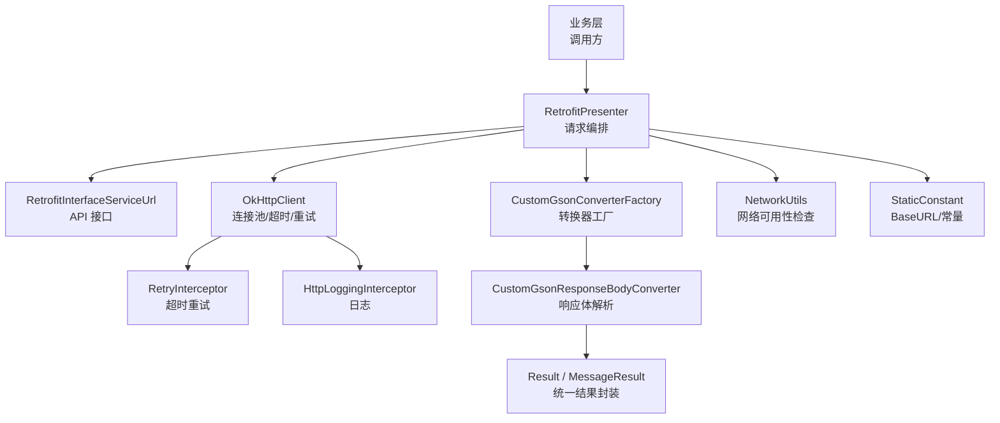
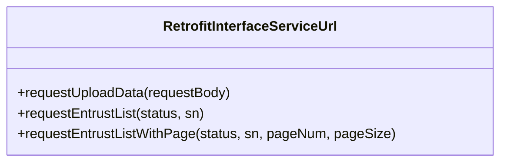
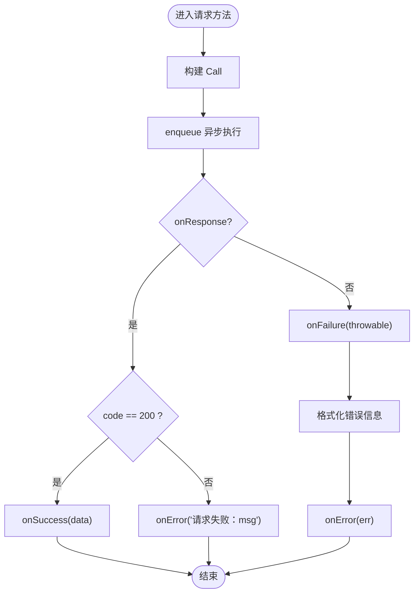
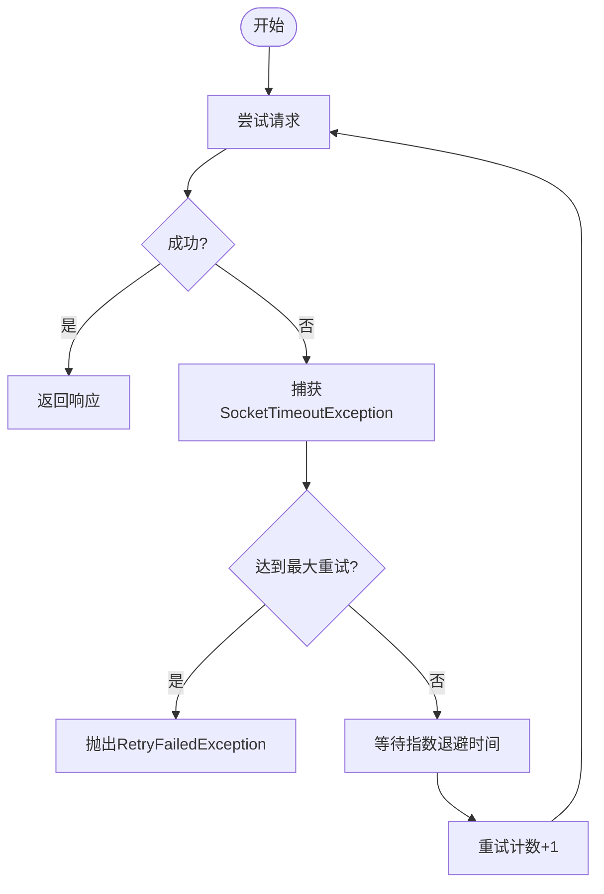
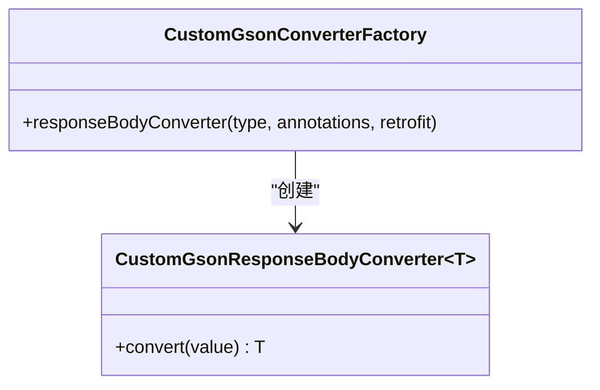
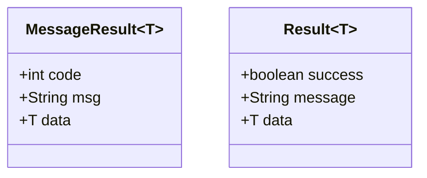
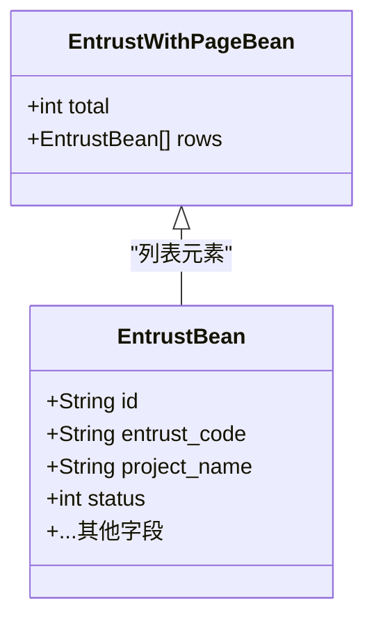
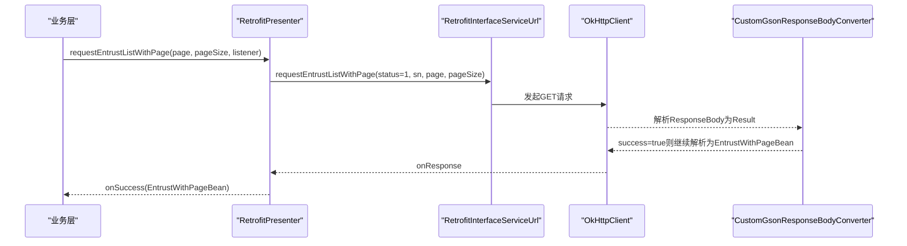
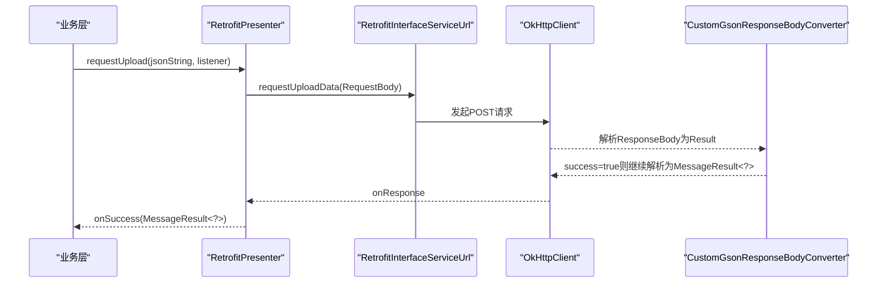
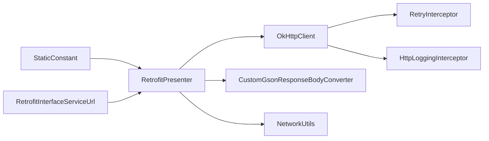

# 网络服务

<cite>
**本文引用的文件**
- [RetrofitInterfaceServiceUrl.java](file://app/src/main/java/com/example/gtj_sd_dg240/net/RetrofitInterfaceServiceUrl.java)
- [RetrofitPresenter.java](file://app/src/main/java/com/example/gtj_sd_dg240/net/RetrofitPresenter.java)
- [RetryInterceptor.java](file://app/src/main/java/com/example/gtj_sd_dg240/net/RetryInterceptor.java)
- [NetworkUtils.java](file://app/src/main/java/com/example/gtj_sd_dg240/net/NetworkUtils.java)
- [CustomGsonConverterFactory.java](file://app/src/main/java/com/example/gtj_sd_dg240/net/CustomGsonConverterFactory.java)
- [CustomGsonResponseBodyConverter.java](file://app/src/main/java/com/example/gtj_sd_dg240/net/CustomGsonResponseBodyConverter.java)
- [MessageResult.java](file://app/src/main/java/com/example/gtj_sd_dg240/net/MessageResult.java)
- [Result.java](file://app/src/main/java/com/example/gtj_sd_dg240/net/Result.java)
- [ApiException.java](file://app/src/main/java/com/example/gtj_sd_dg240/net/ApiException.java)
- [RetrofitPresenterResultListener.java](file://app/src/main/java/com/example/gtj_sd_dg240/net/RetrofitPresenterResultListener.java)
- [StaticConstant.java](file://app/src/main/java/com/example/gtj_sd_dg240/StaticConstant.java)
- [EntrustBean.java](file://app/src/main/java/com/example/gtj_sd_dg240/model/EntrustBean.java)
- [EntrustWithPageBean.java](file://app/src/main/java/com/example/gtj_sd_dg240/model/EntrustWithPageBean.java)
</cite>

## 目录
1. [简介](#简介)
2. [项目结构](#项目结构)
3. [核心组件](#核心组件)
4. [架构总览](#架构总览)
5. [详细组件分析](#详细组件分析)
6. [依赖关系分析](#依赖关系分析)
7. [性能与优化](#性能与优化)
8. [故障排查指南](#故障排查指南)
9. [结论](#结论)
10. [附录](#附录)

## 简介
本技术文档围绕 GTJ-SD-DG240 应用的网络服务模块，系统梳理基于 Retrofit 的网络请求框架实现。内容涵盖 API 接口定义、OkHttp 拦截器（重试、日志）、响应体转换与统一错误封装、数据上传、委托查询、远程配置同步等关键业务链路；并说明网络请求生命周期管理、超时控制、重试策略、错误处理机制，以及网络层与业务层的解耦设计（Presenter 模式、回调机制、异步处理）。同时提供安全认证、数据加密、缓存与离线支持等高级特性的实践建议。

## 项目结构
网络相关代码集中在 app 模块的 net 包中，配合 model 中的实体类完成数据契约。整体采用“接口定义 + Presenter 编排 + OkHttp 拦截器 + 自定义转换器”的分层组织方式：
- 接口定义：RetrofitInterfaceServiceUrl 声明 HTTP 端点与参数
- 请求编排：RetrofitPresenter 负责构建 Retrofit/OkHttpClient、发起请求、统一回调
- 拦截器：RetryInterceptor 实现超时重试；内置 HttpLoggingInterceptor 输出日志
- 响应转换：CustomGsonConverterFactory/CustomGsonResponseBodyConverter 将 ResponseBody 转为 Result 并校验业务码
- 工具与常量：NetworkUtils 检测网络状态；StaticConstant 维护基础 URL 等全局配置
- 模型：EntrustBean、EntrustWithPageBean 描述委托相关数据结构



图表来源
- [RetrofitPresenter.java:31-52](file://app/src/main/java/com/example/gtj_sd_dg240/net/RetrofitPresenter.java#L31-L52)
- [RetrofitInterfaceServiceUrl.java:16-30](file://app/src/main/java/com/example/gtj_sd_dg240/net/RetrofitInterfaceServiceUrl.java#L16-L30)
- [RetryInterceptor.java:23-51](file://app/src/main/java/com/example/gtj_sd_dg240/net/RetryInterceptor.java#L23-L51)
- [CustomGsonConverterFactory.java:29-33](file://app/src/main/java/com/example/gtj_sd_dg240/net/CustomGsonConverterFactory.java#L29-L33)
- [CustomGsonResponseBodyConverter.java:20-35](file://app/src/main/java/com/example/gtj_sd_dg240/net/CustomGsonResponseBodyConverter.java#L20-L35)
- [NetworkUtils.java:12-19](file://app/src/main/java/com/example/gtj_sd_dg240/net/NetworkUtils.java#L12-L19)
- [StaticConstant.java:26](file://app/src/main/java/com/example/gtj_sd_dg240/StaticConstant.java#L26)

章节来源
- [RetrofitInterfaceServiceUrl.java:16-30](file://app/src/main/java/com/example/gtj_sd_dg240/net/RetrofitInterfaceServiceUrl.java#L16-L30)
- [RetrofitPresenter.java:31-52](file://app/src/main/java/com/example/gtj_sd_dg240/net/RetrofitPresenter.java#L31-L52)
- [RetryInterceptor.java:23-51](file://app/src/main/java/com/example/gtj_sd_dg240/net/RetryInterceptor.java#L23-L51)
- [CustomGsonConverterFactory.java:29-33](file://app/src/main/java/com/example/gtj_sd_dg240/net/CustomGsonConverterFactory.java#L29-L33)
- [CustomGsonResponseBodyConverter.java:20-35](file://app/src/main/java/com/example/gtj_sd_dg240/net/CustomGsonResponseBodyConverter.java#L20-L35)
- [NetworkUtils.java:12-19](file://app/src/main/java/com/example/gtj_sd_dg240/net/NetworkUtils.java#L12-L19)
- [StaticConstant.java:26](file://app/src/main/java/com/example/gtj_sd_dg240/StaticConstant.java#L26)

## 核心组件
- API 接口定义：通过注解声明 GET/POST 路径、请求头、查询参数与请求体，返回统一包装类型
- 请求编排器：集中创建 Retrofit/OkHttpClient，设置超时、重试、日志，并提供面向业务的便捷方法
- 重试拦截器：针对 SocketTimeoutException 进行指数退避重试，失败后抛出自定义异常
- 响应转换器：在 Gson 解析前校验 Result.success，失败则抛出 ApiException，成功则继续解析为具体泛型
- 统一结果封装：MessageResult 用于业务层通用返回结构；Result 用于底层响应体校验
- 网络工具：检测当前网络是否可用
- 常量配置：BaseURL 等全局配置

章节来源
- [RetrofitInterfaceServiceUrl.java:16-30](file://app/src/main/java/com/example/gtj_sd_dg240/net/RetrofitInterfaceServiceUrl.java#L16-L30)
- [RetrofitPresenter.java:31-52](file://app/src/main/java/com/example/gtj_sd_dg240/net/RetrofitPresenter.java#L31-L52)
- [RetryInterceptor.java:23-51](file://app/src/main/java/com/example/gtj_sd_dg240/net/RetryInterceptor.java#L23-L51)
- [CustomGsonResponseBodyConverter.java:20-35](file://app/src/main/java/com/example/gtj_sd_dg240/net/CustomGsonResponseBodyConverter.java#L20-L35)
- [MessageResult.java:3-12](file://app/src/main/java/com/example/gtj_sd_dg240/net/MessageResult.java#L3-L12)
- [Result.java:3-12](file://app/src/main/java/com/example/gtj_sd_dg240/net/Result.java#L3-L12)
- [NetworkUtils.java:12-19](file://app/src/main/java/com/example/gtj_sd_dg240/net/NetworkUtils.java#L12-L19)
- [StaticConstant.java:26](file://app/src/main/java/com/example/gtj_sd_dg240/StaticConstant.java#L26)

## 架构总览
下图展示了从业务层到网络层的完整调用链，包括请求构造、拦截器链、响应转换与回调分发。

```mermaid
sequenceDiagram
participant UI as "业务层"
participant P as "RetrofitPresenter"
participant R as "RetrofitInterfaceServiceUrl"
participant O as "OkHttpClient"
participant LI as "HttpLoggingInterceptor"
participant RI as "RetryInterceptor"
participant GC as "CustomGsonResponseBodyConverter"
participant S as "服务端"
UI->>P : 调用 requestEntrustList()/requestUpload()
P->>O : 创建 Call 并 enqueue
O->>LI : 记录请求/响应
O->>RI : 执行重试逻辑(超时)
RI->>S : 发送HTTP请求
S-->>RI : 返回响应
RI-->>O : 传递响应
O->>GC : 解析ResponseBody为Result
GC-->>O : 若success=false抛ApiException;否则继续解析
O-->>P : Callback.onResponse/onFailure
P-->>UI : 回调 onSuccess/onError
```

图表来源
- [RetrofitPresenter.java:61-141](file://app/src/main/java/com/example/gtj_sd_dg240/net/RetrofitPresenter.java#L61-L141)
- [RetryInterceptor.java:23-51](file://app/src/main/java/com/example/gtj_sd_dg240/net/RetryInterceptor.java#L23-L51)
- [CustomGsonResponseBodyConverter.java:20-35](file://app/src/main/java/com/example/gtj_sd_dg240/net/CustomGsonResponseBodyConverter.java#L20-L35)
- [RetrofitInterfaceServiceUrl.java:16-30](file://app/src/main/java/com/example/gtj_sd_dg240/net/RetrofitInterfaceServiceUrl.java#L16-L30)

## 详细组件分析

### API 接口定义（RetrofitInterfaceServiceUrl）
- 数据上报：POST 接口，使用 RequestBody 承载 JSON 数据
- 委托列表查询：GET 接口，携带 clientId 请求头与查询参数
- 分页委托查询：GET 接口，增加分页参数



图表来源
- [RetrofitInterfaceServiceUrl.java:16-30](file://app/src/main/java/com/example/gtj_sd_dg240/net/RetrofitInterfaceServiceUrl.java#L16-L30)

章节来源
- [RetrofitInterfaceServiceUrl.java:16-30](file://app/src/main/java/com/example/gtj_sd_dg240/net/RetrofitInterfaceServiceUrl.java#L16-L30)

### 请求编排与生命周期（RetrofitPresenter）
- 单例化 Retrofit/OkHttpClient，避免重复创建
- 超时控制：读/写/连接均为 60 秒
- 重试：集成 RetryInterceptor，仅对超时异常进行重试
- 日志：启用 BODY 级别日志便于调试
- 统一回调：onResponse 中校验 code==200，否则走 onError；onFailure 统一格式化错误信息
- 业务方法：
  - 委托列表：读取蓝牙设备名作为 sn 参数
  - 分页委托列表：传入页码与页大小
  - 数据上传：将字符串序列化为 RequestBody 提交



图表来源
- [RetrofitPresenter.java:61-141](file://app/src/main/java/com/example/gtj_sd_dg240/net/RetrofitPresenter.java#L61-L141)

章节来源
- [RetrofitPresenter.java:31-52](file://app/src/main/java/com/example/gtj_sd_dg240/net/RetrofitPresenter.java#L31-L52)
- [RetrofitPresenter.java:61-141](file://app/src/main/java/com/example/gtj_sd_dg240/net/RetrofitPresenter.java#L61-L141)

### 重试策略（RetryInterceptor）
- 触发条件：捕获 SocketTimeoutException
- 重试次数与延迟：可配置最大重试次数与基础延迟时间
- 退避策略：指数退避（2^retryCount * retryDelayMs）
- 失败处理：超过最大重试次数抛出 RetryFailedException



图表来源
- [RetryInterceptor.java:23-51](file://app/src/main/java/com/example/gtj_sd_dg240/net/RetryInterceptor.java#L23-L51)

章节来源
- [RetryInterceptor.java:23-51](file://app/src/main/java/com/example/gtj_sd_dg240/net/RetryInterceptor.java#L23-L51)

### 响应体转换与统一错误（CustomGsonConverterFactory/CustomGsonResponseBodyConverter）
- 转换器工厂：为指定类型生成 TypeAdapter 并返回自定义 Converter
- 响应体解析：先以 Result 解析，若 success=false 则抛出 ApiException；否则继续解析为目标类型
- 资源释放：确保 ResponseBody 被正确关闭



图表来源
- [CustomGsonConverterFactory.java:29-33](file://app/src/main/java/com/example/gtj_sd_dg240/net/CustomGsonConverterFactory.java#L29-L33)
- [CustomGsonResponseBodyConverter.java:20-35](file://app/src/main/java/com/example/gtj_sd_dg240/net/CustomGsonResponseBodyConverter.java#L20-L35)

章节来源
- [CustomGsonConverterFactory.java:29-33](file://app/src/main/java/com/example/gtj_sd_dg240/net/CustomGsonConverterFactory.java#L29-L33)
- [CustomGsonResponseBodyConverter.java:20-35](file://app/src/main/java/com/example/gtj_sd_dg240/net/CustomGsonResponseBodyConverter.java#L20-L35)
- [ApiException.java:4-9](file://app/src/main/java/com/example/gtj_sd_dg240/net/ApiException.java#L4-L9)

### 统一结果封装（MessageResult/Result）
- MessageResult：包含 code、msg、data，用于业务层通用返回
- Result：包含 success、message、data，用于底层响应体校验



图表来源
- [MessageResult.java:3-12](file://app/src/main/java/com/example/gtj_sd_dg240/net/MessageResult.java#L3-L12)
- [Result.java:3-12](file://app/src/main/java/com/example/gtj_sd_dg240/net/Result.java#L3-L12)

章节来源
- [MessageResult.java:3-12](file://app/src/main/java/com/example/gtj_sd_dg240/net/MessageResult.java#L3-L12)
- [Result.java:3-12](file://app/src/main/java/com/example/gtj_sd_dg240/net/Result.java#L3-L12)

### 网络可用性检测（NetworkUtils）
- 通过系统 ConnectivityManager 判断当前网络是否可用
- 建议在发起请求前调用，减少无效网络开销

章节来源
- [NetworkUtils.java:12-19](file://app/src/main/java/com/example/gtj_sd_dg240/net/NetworkUtils.java#L12-L19)

### 业务模型（EntrustBean/EntrustWithPageBean）
- EntrustBean：委托单详情字段集合
- EntrustWithPageBean：继承 MessageResult，扩展 total 与 rows 分页字段



图表来源
- [EntrustBean.java:5-31](file://app/src/main/java/com/example/gtj_sd_dg240/model/EntrustBean.java#L5-L31)
- [EntrustWithPageBean.java:7-10](file://app/src/main/java/com/example/gtj_sd_dg240/model/EntrustWithPageBean.java#L7-L10)

章节来源
- [EntrustBean.java:5-31](file://app/src/main/java/com/example/gtj_sd_dg240/model/EntrustBean.java#L5-L31)
- [EntrustWithPageBean.java:7-10](file://app/src/main/java/com/example/gtj_sd_dg240/model/EntrustWithPageBean.java#L7-L10)

### 业务场景流程

#### 委托列表查询（含分页）


图表来源
- [RetrofitPresenter.java:88-113](file://app/src/main/java/com/example/gtj_sd_dg240/net/RetrofitPresenter.java#L88-L113)
- [RetrofitInterfaceServiceUrl.java:27-29](file://app/src/main/java/com/example/gtj_sd_dg240/net/RetrofitInterfaceServiceUrl.java#L27-L29)
- [CustomGsonResponseBodyConverter.java:20-35](file://app/src/main/java/com/example/gtj_sd_dg240/net/CustomGsonResponseBodyConverter.java#L20-L35)

章节来源
- [RetrofitPresenter.java:88-113](file://app/src/main/java/com/example/gtj_sd_dg240/net/RetrofitPresenter.java#L88-L113)
- [RetrofitInterfaceServiceUrl.java:27-29](file://app/src/main/java/com/example/gtj_sd_dg240/net/RetrofitInterfaceServiceUrl.java#L27-L29)

#### 数据上传


图表来源
- [RetrofitPresenter.java:115-141](file://app/src/main/java/com/example/gtj_sd_dg240/net/RetrofitPresenter.java#L115-L141)
- [RetrofitInterfaceServiceUrl.java:18-19](file://app/src/main/java/com/example/gtj_sd_dg240/net/RetrofitInterfaceServiceUrl.java#L18-L19)
- [CustomGsonResponseBodyConverter.java:20-35](file://app/src/main/java/com/example/gtj_sd_dg240/net/CustomGsonResponseBodyConverter.java#L20-L35)

章节来源
- [RetrofitPresenter.java:115-141](file://app/src/main/java/com/example/gtj_sd_dg240/net/RetrofitPresenter.java#L115-L141)
- [RetrofitInterfaceServiceUrl.java:18-19](file://app/src/main/java/com/example/gtj_sd_dg240/net/RetrofitInterfaceServiceUrl.java#L18-L19)

## 依赖关系分析
- RetrofitPresenter 依赖 StaticConstant 获取 BaseURL
- RetrofitPresenter 依赖 RetrofitInterfaceServiceUrl 定义 API
- OkHttpClient 链中包含 RetryInterceptor 与日志拦截器
- 响应体转换由 CustomGsonConverterFactory 与 CustomGsonResponseBodyConverter 协作完成
- NetworkUtils 提供网络可用性检查，供上层在发起请求前使用



图表来源
- [RetrofitPresenter.java:31-52](file://app/src/main/java/com/example/gtj_sd_dg240/net/RetrofitPresenter.java#L31-L52)
- [RetryInterceptor.java:23-51](file://app/src/main/java/com/example/gtj_sd_dg240/net/RetryInterceptor.java#L23-L51)
- [CustomGsonResponseBodyConverter.java:20-35](file://app/src/main/java/com/example/gtj_sd_dg240/net/CustomGsonResponseBodyConverter.java#L20-L35)
- [NetworkUtils.java:12-19](file://app/src/main/java/com/example/gtj_sd_dg240/net/NetworkUtils.java#L12-L19)
- [StaticConstant.java:26](file://app/src/main/java/com/example/gtj_sd_dg240/StaticConstant.java#L26)

章节来源
- [RetrofitPresenter.java:31-52](file://app/src/main/java/com/example/gtj_sd_dg240/net/RetrofitPresenter.java#L31-L52)
- [RetryInterceptor.java:23-51](file://app/src/main/java/com/example/gtj_sd_dg240/net/RetryInterceptor.java#L23-L51)
- [CustomGsonResponseBodyConverter.java:20-35](file://app/src/main/java/com/example/gtj_sd_dg240/net/CustomGsonResponseBodyConverter.java#L20-L35)
- [NetworkUtils.java:12-19](file://app/src/main/java/com/example/gtj_sd_dg240/net/NetworkUtils.java#L12-L19)
- [StaticConstant.java:26](file://app/src/main/java/com/example/gtj_sd_dg240/StaticConstant.java#L26)

## 性能与优化
- 超时控制：读/写/连接均设置为 60 秒，适合移动端弱网环境
- 重试策略：仅对超时异常进行重试，采用指数退避，降低瞬时抖动影响
- 日志级别：BODY 级别便于定位问题，生产环境建议降级或按需开启
- 连接复用：OkHttpClient 默认启用连接池，避免频繁握手开销
- 响应体尽早失败：在转换器中优先校验 Result.success，减少无用解析
- 网络可用性前置检查：发起请求前调用 NetworkUtils.isOpenNetwork，减少无效请求
- 建议的进一步优化（可选）：
  - 添加磁盘/内存缓存（如 OkHttp Cache），提升重复请求性能
  - 引入压缩（gzip）以减少传输体积
  - 根据业务重要性区分重试策略（幂等接口可重试，非幂等需谨慎）
  - 使用更细粒度的日志开关与采样率，降低 IO 压力

[本节为通用指导，不直接分析具体文件]

## 故障排查指南
- 网络连接问题：
  - 使用 NetworkUtils 检查网络可用性
  - 查看日志输出，确认请求是否发出及响应内容
- 超时与重试：
  - 关注 RetryInterceptor 的重试次数与退避时间
  - 若频繁超时，考虑调整超时阈值或优化服务端响应
- 业务错误：
  - onResponse 中 code != 200 会进入 onError，结合 msg 定位问题
  - 转换器中 Result.success=false 会抛出 ApiException，需在上层捕获
- 常见问题定位：
  - 域名解析失败：getStrMessage 会将特定异常映射为“检查网络连接”
  - 请求体为空或格式错误：检查 RequestBody 的 MediaType 与序列化

章节来源
- [NetworkUtils.java:12-19](file://app/src/main/java/com/example/gtj_sd_dg240/net/NetworkUtils.java#L12-L19)
- [RetryInterceptor.java:23-51](file://app/src/main/java/com/example/gtj_sd_dg240/net/RetryInterceptor.java#L23-L51)
- [RetrofitPresenter.java:54-59](file://app/src/main/java/com/example/gtj_sd_dg240/net/RetrofitPresenter.java#L54-L59)
- [CustomGsonResponseBodyConverter.java:20-35](file://app/src/main/java/com/example/gtj_sd_dg240/net/CustomGsonResponseBodyConverter.java#L20-L35)
- [ApiException.java:4-9](file://app/src/main/java/com/example/gtj_sd_dg240/net/ApiException.java#L4-L9)

## 结论
该网络服务模块以 Retrofit 为核心，结合 OkHttp 拦截器与自定义响应转换器，实现了统一的请求编排、重试、日志与错误处理。通过清晰的接口定义与 Presenter 编排，网络层与业务层有效解耦，便于扩展与维护。在此基础上，可按需引入缓存、离线队列、安全认证与数据加密等能力，进一步提升鲁棒性与用户体验。

[本节为总结性内容，不直接分析具体文件]

## 附录

### 安全与认证实践建议
- 认证：
  - 在拦截器中添加 Authorization 头或 Token 刷新逻辑
  - 敏感信息（如密钥）建议使用安全存储（如 Android Keystore）
- 传输安全：
  - 强制 HTTPS，配置证书校验与 HSTS
  - 如需双向认证，配置客户端证书与信任库
- 数据加密：
  - 对敏感字段进行前端加密后再提交
  - 使用标准算法（如 AES/GCM）并妥善管理密钥

[本节为通用指导，不直接分析具体文件]

### 缓存与离线支持实践建议
- 缓存：
  - 启用 OkHttp 磁盘缓存，设置合理的容量与过期策略
  - 对幂等 GET 请求启用缓存，减少重复请求
- 离线：
  - 本地持久化待上传数据，网络恢复后批量重试
  - 提供“离线模式”提示与降级功能

[本节为通用指导，不直接分析具体文件]

### 开发实践清单
- 请求封装：
  - 统一入口：通过 RetrofitPresenter 暴露业务方法
  - 统一回调：使用 RetrofitPresenterResultListener 接收结果
- 错误统一处理：
  - 网络异常：格式化错误信息并提示用户
  - 业务异常：依据 code/msg 给出明确提示
- 日志记录：
  - 调试阶段开启 BODY 级别日志
  - 生产环境按模块/级别控制日志输出

章节来源
- [RetrofitPresenterResultListener.java:3-8](file://app/src/main/java/com/example/gtj_sd_dg240/net/RetrofitPresenterResultListener.java#L3-L8)
- [RetrofitPresenter.java:61-141](file://app/src/main/java/com/example/gtj_sd_dg240/net/RetrofitPresenter.java#L61-L141)