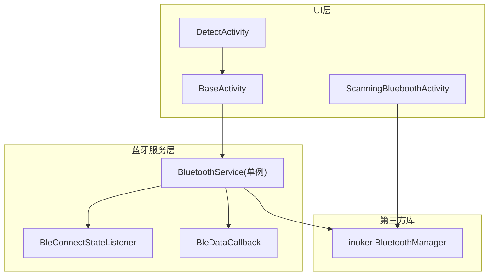
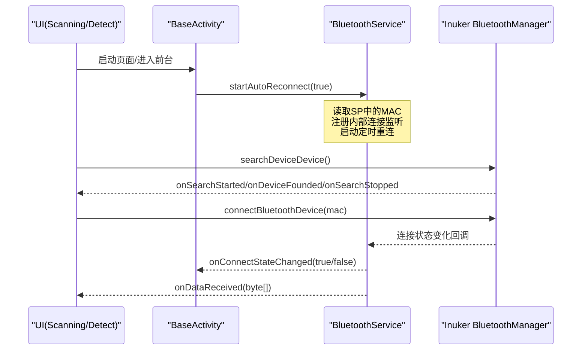
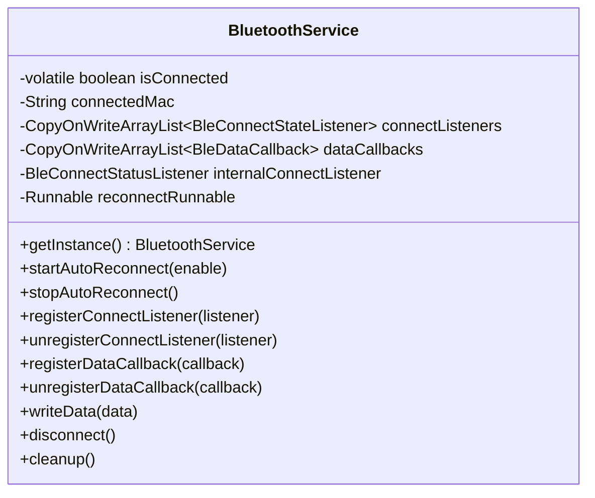
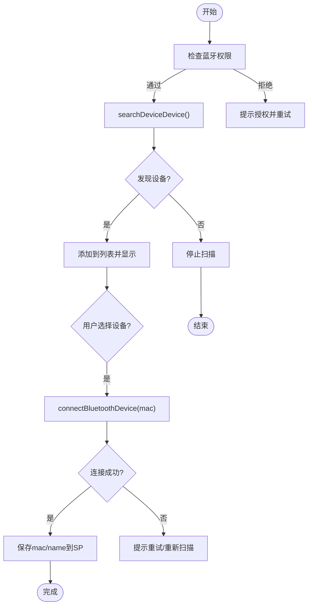
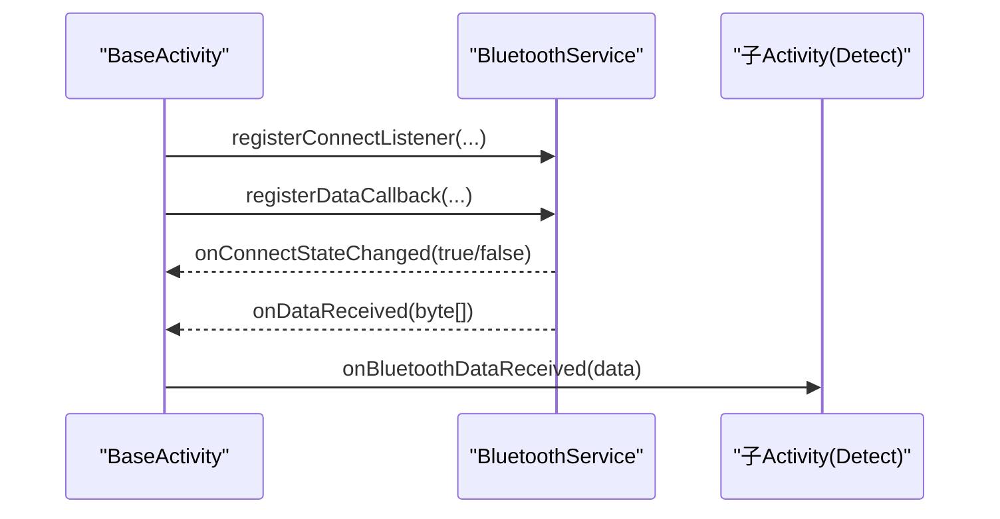
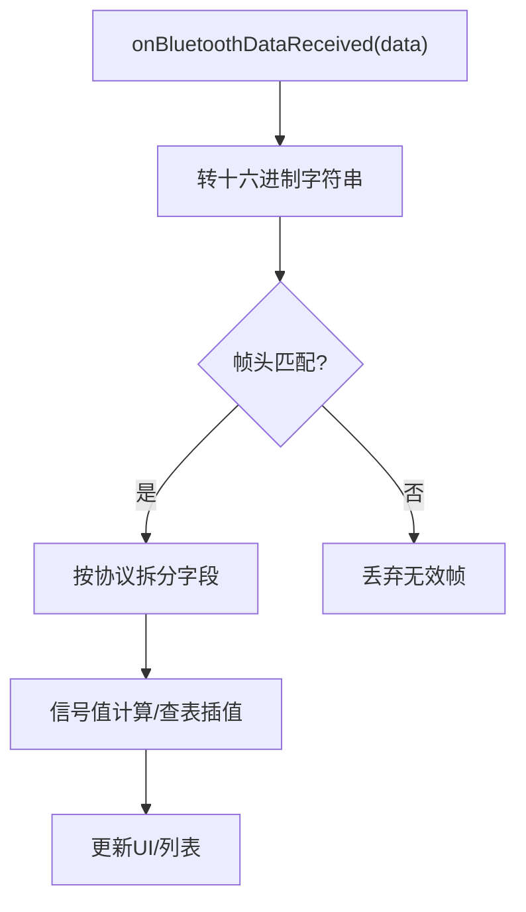
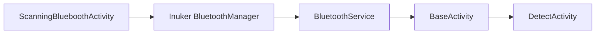

# 设备连接管理

<cite>
**本文引用的文件**
- [BluetoothService.java](file://app/src/main/java/com/example/gtj_sd_dg240/bluetooth/BluetoothService.java)
- [BleConnectStateListener.java](file://app/src/main/java/com/example/gtj_sd_dg240/bluetooth/BleConnectStateListener.java)
- [BleDataCallback.java](file://app/src/main/java/com/example/gtj_sd_dg240/bluetooth/BleDataCallback.java)
- [ScanningBlueboothActivity.java](file://app/src/main/java/com/example/gtj_sd_dg240/activity/setting/ScanningBlueboothActivity.java)
- [BaseActivity.java](file://app/src/main/java/com/example/gtj_sd_dg240/activity/start/BaseActivity.java)
- [DetectActivity.java](file://app/src/main/java/com/example/gtj_sd_dg240/activity/testing/DetectActivity.java)
- [BluetoothDeviceListAdapter.java](file://app/src/main/java/com/example/gtj_sd_dg240/adapter/BluetoothDeviceListAdapter.java)
- [BluetoothDeviceBean.java](file://app/src/main/java/com/example/gtj_sd_dg240/model/BluetoothDeviceBean.java)
</cite>

## 目录
1. [简介](#简介)
2. [项目结构](#项目结构)
3. [核心组件](#核心组件)
4. [架构总览](#架构总览)
5. [详细组件分析](#详细组件分析)
6. [依赖关系分析](#依赖关系分析)
7. [性能考虑](#性能考虑)
8. [故障排查指南](#故障排查指南)
9. [结论](#结论)
10. [附录：常见场景与最佳实践](#附录：常见场景与最佳实践)

## 简介
本文件面向GTJ-SD-DG240应用的“设备连接管理”能力，聚焦蓝牙设备的扫描、连接、状态监控与自动重连机制；深入说明BluetoothService单例模式的实现原理，涵盖BLE通信协议对接、数据接收处理、连接状态管理等核心功能。文档同时覆盖设备发现流程、配对（连接）过程、信号强度监测、连接质量评估等关键技术点，并提供设备连接生命周期管理、异常处理策略与性能优化方案。最后给出初始化连接、处理设备回调、多设备连接管理的实际使用示例路径，以及与检测功能的集成方式和数据流转过程。

## 项目结构
围绕设备连接管理的关键代码分布在以下模块：
- 蓝牙服务层：BluetoothService（单例）、BleConnectStateListener、BleDataCallback
- UI与设备发现：ScanningBlueboothActivity（扫描与连接）、BluetoothDeviceListAdapter（列表展示）、BluetoothDeviceBean（设备模型）
- 基类与生命周期：BaseActivity（统一蓝牙初始化、状态监听、数据回调注册）
- 业务集成：DetectActivity（检测业务中消费蓝牙数据）

图表来源
- [ScanningBlueboothActivity.java:89-164](file://app/src/main/java/com/example/gtj_sd_dg240/activity/setting/ScanningBlueboothActivity.java#L89-L164)
- [BaseActivity.java:187-279](file://app/src/main/java/com/example/gtj_sd_dg240/activity/start/BaseActivity.java#L187-L279)
- [BluetoothService.java:20-311](file://app/src/main/java/com/example/gtj_sd_dg240/bluetooth/BluetoothService.java#L20-L311)

章节来源
- [ScanningBlueboothActivity.java:89-164](file://app/src/main/java/com/example/gtj_sd_dg240/activity/setting/ScanningBlueboothActivity.java#L89-L164)
- [BaseActivity.java:187-279](file://app/src/main/java/com/example/gtj_sd_dg240/activity/start/BaseActivity.java#L187-L279)
- [BluetoothService.java:20-311](file://app/src/main/java/com/example/gtj_sd_dg240/bluetooth/BluetoothService.java#L20-L311)

## 核心组件
- BluetoothService：单例蓝牙服务，负责连接状态管理、自动重连、数据通知分发、写操作封装。
- BleConnectStateListener：连接状态变化回调接口，供上层订阅连接成功/断开事件。
- BleDataCallback：数据回调接口，用于接收BLE通知数据与注册失败回调。
- ScanningBlueboothActivity：设备扫描、选择并发起连接，持久化MAC与名称。
- BaseActivity：统一初始化蓝牙服务、注册状态监听与数据回调，提供onBluetoothDataReceived扩展点。
- DetectActivity：检测业务，重写onBluetoothDataReceived解析并处理蓝牙数据。

章节来源
- [BluetoothService.java:20-311](file://app/src/main/java/com/example/gtj_sd_dg240/bluetooth/BluetoothService.java#L20-L311)
- [BleConnectStateListener.java:1-13](file://app/src/main/java/com/example/gtj_sd_dg240/bluetooth/BleConnectStateListener.java#L1-L13)
- [BleDataCallback.java:1-19](file://app/src/main/java/com/example/gtj_sd_dg240/bluetooth/BleDataCallback.java#L1-L19)
- [ScanningBlueboothActivity.java:89-164](file://app/src/main/java/com/example/gtj_sd_dg240/activity/setting/ScanningBlueboothActivity.java#L89-L164)
- [BaseActivity.java:187-279](file://app/src/main/java/com/example/gtj_sd_dg240/activity/start/BaseActivity.java#L187-L279)
- [DetectActivity.java:171-191](file://app/src/main/java/com/example/gtj_sd_dg240/activity/testing/DetectActivity.java#L171-L191)

## 架构总览
系统采用“UI层 + 蓝牙服务层 + 第三方BLE库”的分层架构：
- UI层通过BaseActivity统一接入蓝牙服务，避免重复初始化与资源泄漏。
- BluetoothService作为单例集中管理连接、重连、数据通知分发，屏蔽底层细节。
- 第三方库inuker提供BLE底层能力（搜索、连接、读写、通知）。

图表来源
- [BaseActivity.java:187-279](file://app/src/main/java/com/example/gtj_sd_dg240/activity/start/BaseActivity.java#L187-L279)
- [ScanningBlueboothActivity.java:89-164](file://app/src/main/java/com/example/gtj_sd_dg240/activity/setting/ScanningBlueboothActivity.java#L89-L164)
- [BluetoothService.java:77-224](file://app/src/main/java/com/example/gtj_sd_dg240/bluetooth/BluetoothService.java#L77-L224)

## 详细组件分析

### BluetoothService 单例与连接管理
- 单例模式：双重检查锁定保证线程安全，全局唯一实例。
- 连接状态：维护isConnected与connectedMac，并通过内部BleConnectStatusListener监听底层连接状态变化。
- 自动重连：基于Handler.postDelayed周期性尝试连接，支持启停控制。
- 数据通知：连接成功后调用notifyBluetoothDevice注册通知，收到数据后通过BleDataCallback分发给所有已注册回调。
- 写数据：封装writeBluetooth调用，统一从SP读取目标MAC。
- 清理：停止重连、注销监听、清空回调集合，重置状态。

图表来源
- [BluetoothService.java:20-311](file://app/src/main/java/com/example/gtj_sd_dg240/bluetooth/BluetoothService.java#L20-L311)

章节来源
- [BluetoothService.java:20-311](file://app/src/main/java/com/example/gtj_sd_dg240/bluetooth/BluetoothService.java#L20-L311)

### 设备发现与连接流程（ScanningBlueboothActivity）
- 权限检查：在onStart或点击时请求必要权限。
- 设备扫描：调用searchDeviceDevice，收集搜索结果去重后展示到RecyclerView。
- 连接设备：用户选择设备后调用connectBluetoothDevice，成功后将MAC与名称写入SP，并更新UI选中状态。
- 自动回连：若存在历史MAC，可在扫描结束后尝试自动连接。

图表来源
- [ScanningBlueboothActivity.java:89-164](file://app/src/main/java/com/example/gtj_sd_dg240/activity/setting/ScanningBlueboothActivity.java#L89-L164)

章节来源
- [ScanningBlueboothActivity.java:89-164](file://app/src/main/java/com/example/gtj_sd_dg240/activity/setting/ScanningBlueboothActivity.java#L89-L164)

### 连接状态与数据回调（BaseActivity + BluetoothService）
- 统一初始化：BaseActivity根据活动标志决定是否启用自动重连，并获取BluetoothService实例。
- 状态监听：initBluetoothStatus注册连接状态监听器，更新导航栏蓝牙图标。
- 数据回调：registerBluetoothDataCallback注册数据回调，转发给子类onBluetoothDataReceived。
- 生命周期：onStart/onRestart设置isShow=true，onStop设置为false，避免后台处理数据。

图表来源
- [BaseActivity.java:187-279](file://app/src/main/java/com/example/gtj_sd_dg240/activity/start/BaseActivity.java#L187-L279)
- [BluetoothService.java:236-277](file://app/src/main/java/com/example/gtj_sd_dg240/bluetooth/BluetoothService.java#L236-L277)

章节来源
- [BaseActivity.java:187-279](file://app/src/main/java/com/example/gtj_sd_dg240/activity/start/BaseActivity.java#L187-L279)
- [BluetoothService.java:236-277](file://app/src/main/java/com/example/gtj_sd_dg240/bluetooth/BluetoothService.java#L236-L277)

### 检测业务的数据处理（DetectActivity）
- 数据入口：重写onBluetoothDataReceived，按协议解析原始字节数组。
- 协议识别：例如以特定帧头（如F1）和固定长度进行分包与校验。
- 业务计算：根据信号值查表/插值计算厚度等指标，刷新UI与列表。

图表来源
- [DetectActivity.java:171-191](file://app/src/main/java/com/example/gtj_sd_dg240/activity/testing/DetectActivity.java#L171-L191)

章节来源
- [DetectActivity.java:171-191](file://app/src/main/java/com/example/gtj_sd_dg240/activity/testing/DetectActivity.java#L171-L191)

## 依赖关系分析
- BluetoothService依赖inuker的BluetoothManager进行底层BLE操作（搜索、连接、通知、写入）。
- BaseActivity依赖BluetoothService统一管理连接与数据回调。
- ScanningBlueboothActivity直接调用inuker进行搜索与连接，并将结果持久化。
- DetectActivity通过BaseActivity暴露的回调接口消费蓝牙数据。

图表来源
- [BluetoothService.java:175-224](file://app/src/main/java/com/example/gtj_sd_dg240/bluetooth/BluetoothService.java#L175-L224)
- [BaseActivity.java:187-279](file://app/src/main/java/com/example/gtj_sd_dg240/activity/start/BaseActivity.java#L187-L279)
- [ScanningBlueboothActivity.java:89-164](file://app/src/main/java/com/example/gtj_sd_dg240/activity/setting/ScanningBlueboothActivity.java#L89-L164)

章节来源
- [BluetoothService.java:175-224](file://app/src/main/java/com/example/gtj_sd_dg240/bluetooth/BluetoothService.java#L175-L224)
- [BaseActivity.java:187-279](file://app/src/main/java/com/example/gtj_sd_dg240/activity/start/BaseActivity.java#L187-L279)
- [ScanningBlueboothActivity.java:89-164](file://app/src/main/java/com/example/gtj_sd_dg240/activity/setting/ScanningBlueboothActivity.java#L89-L164)

## 性能考虑
- 主线程分发：BluetoothService通过Handler在主线程分发连接状态与数据回调，避免阻塞UI与BLE线程。
- 定时器重连：使用Handler.postDelayed实现周期重连，间隔可配置，避免频繁连接造成电量与资源消耗。
- 线程安全：监听器集合使用CopyOnWriteArrayList，保证并发安全。
- 数据缓冲：建议在业务层对高频数据进行批处理或滑动窗口平均，降低UI刷新频率与CPU占用。
- 资源释放：在页面销毁时调用cleanup或停止重连，防止内存泄漏与后台任务残留。

[本节为通用性能建议，不直接分析具体文件]

## 故障排查指南
- 无法扫描设备：检查蓝牙权限是否授予；确认蓝牙开关开启；查看searchDeviceDevice回调是否触发。
- 连接失败：确认MAC地址正确；检查设备是否处于可被发现/连接状态；观察连接状态回调是否返回断开。
- 数据未到达：确认已注册数据回调；检查是否在isShow=true时接收数据；核对协议帧头与分包逻辑。
- 自动重连无效：检查startAutoReconnect是否被调用；确认SP中保存了MAC；查看重连定时器是否被停止。
- 通知注册失败：关注onNotifyRegisterFailed错误码，必要时重新连接后再注册通知。

章节来源
- [BluetoothService.java:175-197](file://app/src/main/java/com/example/gtj_sd_dg240/bluetooth/BluetoothService.java#L175-L197)
- [BaseActivity.java:240-279](file://app/src/main/java/com/example/gtj_sd_dg240/activity/start/BaseActivity.java#L240-L279)
- [ScanningBlueboothActivity.java:89-164](file://app/src/main/java/com/example/gtj_sd_dg240/activity/setting/ScanningBlueboothActivity.java#L89-L164)

## 结论
该应用通过BluetoothService单例集中管理BLE连接、自动重连与数据分发，配合BaseActivity的统一接入方式，实现了稳定的设备连接生命周期管理与高效的数据流转。ScanningBlueboothActivity负责设备发现与连接，DetectActivity专注业务数据处理。整体架构清晰、职责分离，便于扩展与维护。

[本节为总结性内容，不直接分析具体文件]

## 附录：常见场景与最佳实践

- 初始化连接与自动重连
  - 在Activity onCreate中通过BaseActivity的initBluetoothService启用自动重连，或在需要时手动调用BluetoothService.getInstance().startAutoReconnect(true)。
  - 参考路径：[BaseActivity.java:187-198](file://app/src/main/java/com/example/gtj_sd_dg240/activity/start/BaseActivity.java#L187-L198)

- 处理设备回调
  - 在子类重写onBluetoothDataReceived，按协议解析数据并更新UI。
  - 参考路径：[DetectActivity.java:171-191](file://app/src/main/java/com/example/gtj_sd_dg240/activity/testing/DetectActivity.java#L171-L191)

- 管理多设备连接
  - 当前实现以单一MAC为中心（SP存储一个MAC），如需多设备，可扩展BluetoothService维护多MAC连接表与独立的通知通道。
  - 参考路径：[BluetoothService.java:25-39](file://app/src/main/java/com/example/gtj_sd_dg240/bluetooth/BluetoothService.java#L25-L39)

- 设备发现与连接
  - 使用ScanningBlueboothActivity进行扫描与连接，成功后保存MAC与名称。
  - 参考路径：[ScanningBlueboothActivity.java:89-164](file://app/src/main/java/com/example/gtj_sd_dg240/activity/setting/ScanningBlueboothActivity.java#L89-L164)

- 连接状态监控
  - 通过BaseActivity的initBluetoothStatus订阅连接状态变化，更新UI图标。
  - 参考路径：[BaseActivity.java:240-266](file://app/src/main/java/com/example/gtj_sd_dg240/activity/start/BaseActivity.java#L240-L266)

- 数据接收与协议解析
  - 在DetectActivity中按协议帧头与长度解析数据，进行信号值计算与厚度换算。
  - 参考路径：[DetectActivity.java:171-191](file://app/src/main/java/com/example/gtj_sd_dg240/activity/testing/DetectActivity.java#L171-L191)

- 信号强度监测与连接质量评估
  - 当前代码未直接采集RSSI，可在搜索回调中记录设备信号强度，结合连接稳定性（重连次数、断连频率）评估连接质量。
  - 参考路径：[ScanningBlueboothActivity.java:103-130](file://app/src/main/java/com/example/gtj_sd_dg240/activity/setting/ScanningBlueboothActivity.java#L103-L130)

- 与检测功能的集成与数据流转
  - 数据流：BLE通知 -> BluetoothService分发 -> BaseActivity转发 -> DetectActivity解析与计算 -> UI更新。
  - 参考路径：
    - [BluetoothService.java:175-197](file://app/src/main/java/com/example/gtj_sd_dg240/bluetooth/BluetoothService.java#L175-L197)
    - [BaseActivity.java:268-279](file://app/src/main/java/com/example/gtj_sd_dg240/activity/start/BaseActivity.java#L268-L279)
    - [DetectActivity.java:171-191](file://app/src/main/java/com/example/gtj_sd_dg240/activity/testing/DetectActivity.java#L171-L191)

- 设备模型与列表展示
  - BluetoothDeviceBean承载设备MAC与名称，BluetoothDeviceListAdapter负责渲染与选中状态。
  - 参考路径：
    - [BluetoothDeviceBean.java:1-36](file://app/src/main/java/com/example/gtj_sd_dg240/model/BluetoothDeviceBean.java#L1-L36)
    - [BluetoothDeviceListAdapter.java:1-28](file://app/src/main/java/com/example/gtj_sd_dg240/adapter/BluetoothDeviceListAdapter.java#L1-L28)