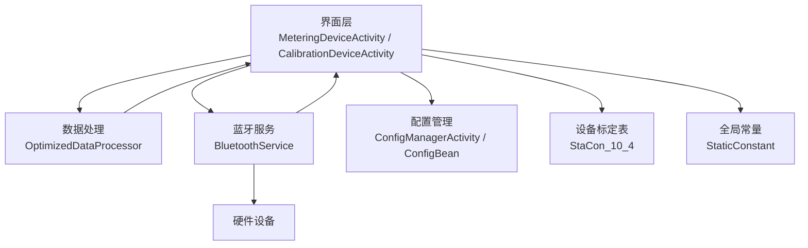
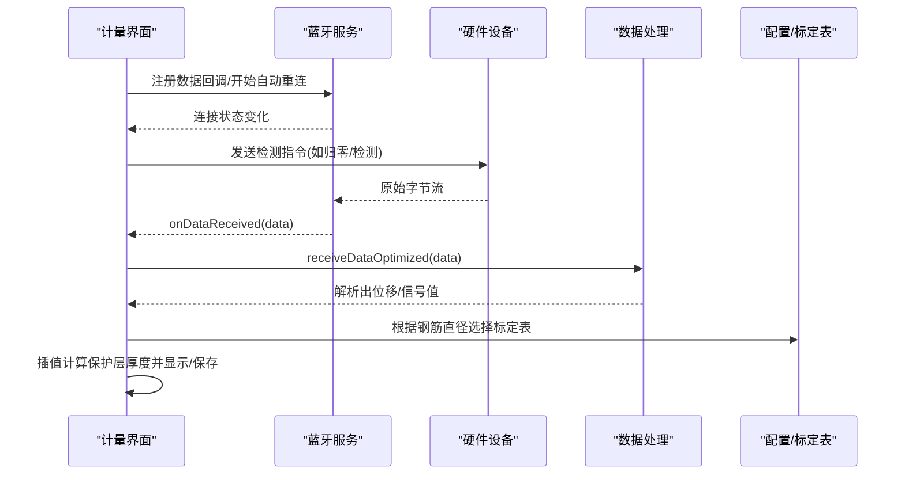
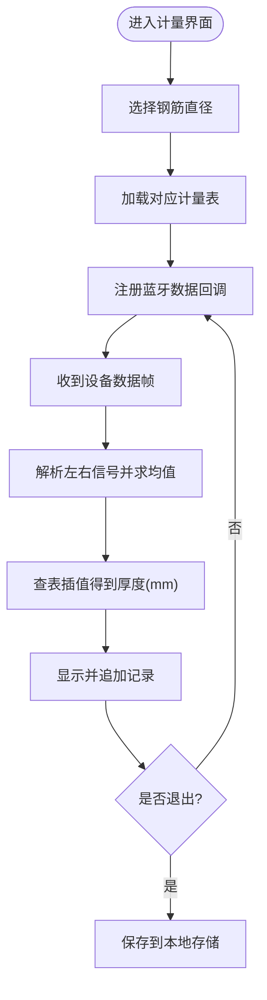
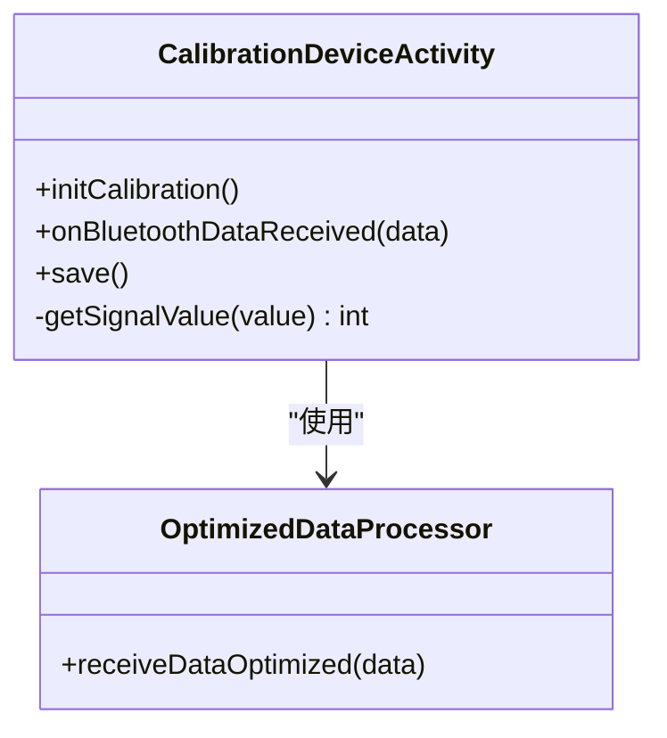
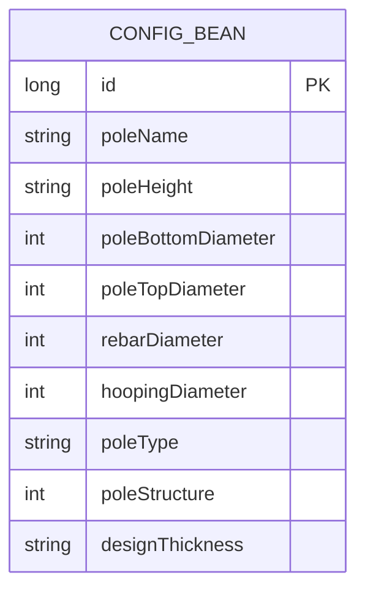
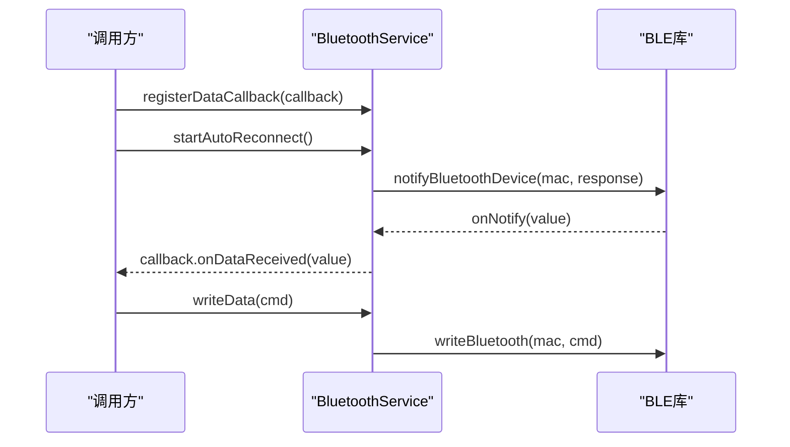
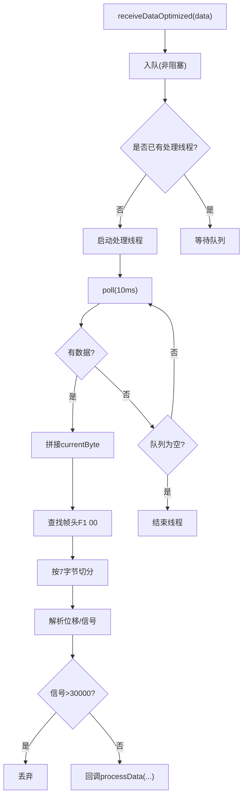
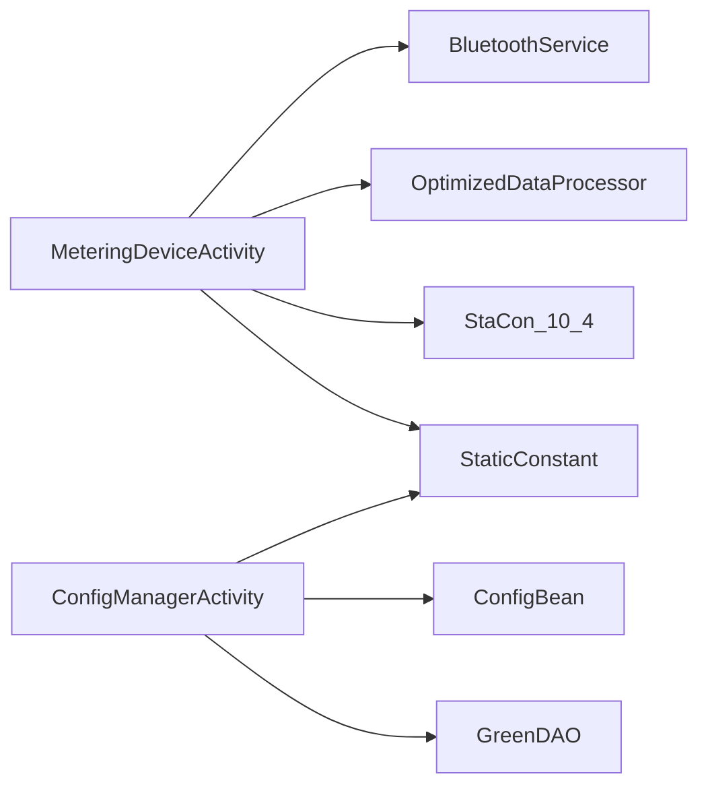

# 计量设备配置

<cite>
**本文引用的文件**
- [MeteringDeviceActivity.java](file://app/src/main/java/com/example/gtj_sd_dg240/activity/setting/MeteringDeviceActivity.java)
- [CalibrationDeviceActivity.java](file://app/src/main/java/com/example/gtj_sd_dg240/activity/setting/CalibrationDeviceActivity.java)
- [ConfigManagerActivity.java](file://app/src/main/java/com/example/gtj_sd_dg240/activity/testing/ConfigManagerActivity.java)
- [ConfigBean.java](file://app/src/main/java/com/example/gtj_sd_dg240/model/ConfigBean.java)
- [BluetoothService.java](file://app/src/main/java/com/example/gtj_sd_dg240/bluetooth/BluetoothService.java)
- [BleDataCallback.java](file://app/src/main/java/com/example/gtj_sd_dg240/bluetooth/BleDataCallback.java)
- [StaCon_10_4.java](file://app/src/main/java/com/example/gtj_sd_dg240/stacon/StaCon_10_4.java)
- [StaticConstant.java](file://app/src/main/java/com/example/gtj_sd_dg240/StaticConstant.java)
- [OptimizedDataProcessor.java](file://app/src/main/java/com/example/gtj_sd_dg240/utils/OptimizedDataProcessor.java)
- [DetectActivity.java](file://app/src/main/java/com/example/gtj_sd_dg240/activity/testing/DetectActivity.java)
- [DetectActivity2.java](file://app/src/main/java/com/example/gtj_sd_dg240/activity/testing/DetectActivity2.java)
</cite>

## 目录
1. [简介](#简介)
2. [项目结构](#项目结构)
3. [核心组件](#核心组件)
4. [架构总览](#架构总览)
5. [详细组件分析](#详细组件分析)
6. [依赖关系分析](#依赖关系分析)
7. [性能与可靠性](#性能与可靠性)
8. [故障排查指南](#故障排查指南)
9. [结论](#结论)
10. [附录：参数与协议要点](#附录：参数与协议要点)

## 简介
本文件面向GTJ-SD-DG240应用的“计量设备配置”能力，系统性说明设备类型识别、参数设置、通信协议配置、数据格式与单位转换、配置验证与兼容性检查、备份恢复、多设备管理、配置模板与批量操作、动态加载与状态监听、异常处理等。文档以代码为依据，提供可追溯的源码路径与图示，帮助开发者快速理解并扩展该模块。

## 项目结构
围绕计量设备配置的核心代码分布在以下包与类中：
- 设置与校准界面：MeteringDeviceActivity、CalibrationDeviceActivity
- 配置管理与模型：ConfigManagerActivity、ConfigBean
- 蓝牙通信与回调：BluetoothService、BleDataCallback
- 设备标定与信号表：StaCon_10_4（不同钢筋直径/间距的信号阈值）
- 常量与协议标识：StaticConstant（BLE服务/特征UUID、电杆类型、钢筋直径列表等）
- 数据处理流水线：OptimizedDataProcessor（生产者-消费者模式的高频数据解析）
- 检测流程中的配置使用：DetectActivity、DetectActivity2（读取配置、发送指令、预估直径）

图表来源
- [MeteringDeviceActivity.java:40-147](file://app/src/main/java/com/example/gtj_sd_dg240/activity/setting/MeteringDeviceActivity.java#L40-L147)
- [CalibrationDeviceActivity.java:52-382](file://app/src/main/java/com/example/gtj_sd_dg240/activity/setting/CalibrationDeviceActivity.java#L52-L382)
- [BluetoothService.java:20-312](file://app/src/main/java/com/example/gtj_sd_dg240/bluetooth/BluetoothService.java#L20-L312)
- [OptimizedDataProcessor.java:7-135](file://app/src/main/java/com/example/gtj_sd_dg240/utils/OptimizedDataProcessor.java#L7-L135)
- [ConfigManagerActivity.java:31-345](file://app/src/main/java/com/example/gtj_sd_dg240/activity/testing/ConfigManagerActivity.java#L31-L345)
- [StaCon_10_4.java:1-77](file://app/src/main/java/com/example/gtj_sd_dg240/stacon/StaCon_10_4.java#L1-L77)
- [StaticConstant.java:43-86](file://app/src/main/java/com/example/gtj_sd_dg240/StaticConstant.java#L43-L86)

章节来源
- [MeteringDeviceActivity.java:40-147](file://app/src/main/java/com/example/gtj_sd_dg240/activity/setting/MeteringDeviceActivity.java#L40-L147)
- [ConfigManagerActivity.java:31-345](file://app/src/main/java/com/example/gtj_sd_dg240/activity/testing/ConfigManagerActivity.java#L31-L345)
- [BluetoothService.java:20-312](file://app/src/main/java/com/example/gtj_sd_dg240/bluetooth/BluetoothService.java#L20-L312)
- [OptimizedDataProcessor.java:7-135](file://app/src/main/java/com/example/gtj_sd_dg240/utils/OptimizedDataProcessor.java#L7-L135)
- [StaCon_10_4.java:1-77](file://app/src/main/java/com/example/gtj_sd_dg240/stacon/StaCon_10_4.java#L1-L77)
- [StaticConstant.java:43-86](file://app/src/main/java/com/example/gtj_sd_dg240/StaticConstant.java#L43-L86)

## 核心组件
- 计量设备配置界面：负责选择钢筋直径、展示标准信号表、接收并解析设备返回的单点检测数据，计算保护层厚度并持久化结果。
- 校准设备界面：维护“标准值-实测值”映射，采集多次测量取平均，保存校准曲线参数到本地存储。
- 配置管理：按电杆类型组织配置项（名称、高度、根径、梢径、纵筋/螺旋筋直径、设计保护层厚度），支持创建、删除、批量选择。
- 蓝牙服务：单例管理连接、自动重连、数据通知注册与分发、写命令下发。
- 数据处理：基于阻塞队列的生产者-消费者模式，拼接帧、校验完整性、解析位移与信号值。
- 设备标定表：针对不同钢筋直径与箍筋间距组合，提供最小/最大信号范围与默认计量表。
- 常量定义：BLE服务/特征UUID、语言、电杆类型、钢筋直径列表等。

章节来源
- [MeteringDeviceActivity.java:40-147](file://app/src/main/java/com/example/gtj_sd_dg240/activity/setting/MeteringDeviceActivity.java#L40-L147)
- [CalibrationDeviceActivity.java:52-382](file://app/src/main/java/com/example/gtj_sd_dg240/activity/setting/CalibrationDeviceActivity.java#L52-L382)
- [ConfigManagerActivity.java:31-345](file://app/src/main/java/com/example/gtj_sd_dg240/activity/testing/ConfigManagerActivity.java#L31-L345)
- [BluetoothService.java:20-312](file://app/src/main/java/com/example/gtj_sd_dg240/bluetooth/BluetoothService.java#L20-L312)
- [OptimizedDataProcessor.java:7-135](file://app/src/main/java/com/example/gtj_sd_dg240/utils/OptimizedDataProcessor.java#L7-L135)
- [StaCon_10_4.java:1-77](file://app/src/main/java/com/example/gtj_sd_dg240/stacon/StaCon_10_4.java#L1-L77)
- [StaticConstant.java:43-86](file://app/src/main/java/com/example/gtj_sd_dg240/StaticConstant.java#L43-L86)

## 架构总览
计量设备配置采用“界面-服务-数据-设备”的分层架构：
- 界面层：MeteringDeviceActivity、CalibrationDeviceActivity、ConfigManagerActivity
- 服务层：BluetoothService（连接、重连、数据分发）、OptimizedDataProcessor（高频数据解析）
- 数据层：ConfigBean（配置实体）、SPUtils/GreenDAO（本地持久化）
- 设备层：通过BLE与硬件交互，遵循固定帧格式（如F1开头、7字节分段）

图表来源
- [BluetoothService.java:175-198](file://app/src/main/java/com/example/gtj_sd_dg240/bluetooth/BluetoothService.java#L175-L198)
- [OptimizedDataProcessor.java:34-133](file://app/src/main/java/com/example/gtj_sd_dg240/utils/OptimizedDataProcessor.java#L34-L133)
- [MeteringDeviceActivity.java:96-134](file://app/src/main/java/com/example/gtj_sd_dg240/activity/setting/MeteringDeviceActivity.java#L96-L134)
- [StaCon_10_4.java:1-77](file://app/src/main/java/com/example/gtj_sd_dg240/stacon/StaCon_10_4.java#L1-L77)

## 详细组件分析

### 计量设备配置界面（MeteringDeviceActivity）
- 设备类型识别：通过Spinner选择钢筋直径（10mm或14mm），动态切换对应的计量标准表（meteringList_10/meteringList_14）。
- 参数设置：选择直径后，更新标准信号表；界面显示当前信号值与计算的保护层厚度。
- 通信协议配置：注册蓝牙数据回调，解析设备返回的十六进制帧（F1开头，包含左右信号），计算平均值。
- 数据格式与单位：信号值为整型，厚度单位为毫米；结果保存在本地存储以便后续使用。
- 配置验证与兼容性：依据所选直径匹配对应标定表；若信号超出范围则无法插值。
- 多设备管理：当前实现为单设备BLE连接；可通过蓝牙MAC地址区分设备。
- 动态加载与状态监听：在onCreate中初始化蓝牙状态监听与数据回调；页面销毁时保存结果。

图表来源
- [MeteringDeviceActivity.java:46-71](file://app/src/main/java/com/example/gtj_sd_dg240/activity/setting/MeteringDeviceActivity.java#L46-L71)
- [MeteringDeviceActivity.java:96-134](file://app/src/main/java/com/example/gtj_sd_dg240/activity/setting/MeteringDeviceActivity.java#L96-L134)
- [StaCon_10_4.java:1-77](file://app/src/main/java/com/example/gtj_sd_dg240/stacon/StaCon_10_4.java#L1-L77)

章节来源
- [MeteringDeviceActivity.java:40-147](file://app/src/main/java/com/example/gtj_sd_dg240/activity/setting/MeteringDeviceActivity.java#L40-L147)

### 校准设备界面（CalibrationDeviceActivity）
- 校准数据采集：周期性采集信号，去抖与平均，记录最大值作为一次有效采样。
- 标定曲线维护：维护“标准值-实测值”映射，支持默认值与自定义输入。
- 保存与恢复：将标定数据序列化为JSON保存到本地存储，启动时恢复。
- 异常处理：采集超时清空缓冲，避免脏数据累积。

图表来源
- [CalibrationDeviceActivity.java:73-110](file://app/src/main/java/com/example/gtj_sd_dg240/activity/setting/CalibrationDeviceActivity.java#L73-L110)
- [CalibrationDeviceActivity.java:113-187](file://app/src/main/java/com/example/gtj_sd_dg240/activity/setting/CalibrationDeviceActivity.java#L113-L187)
- [CalibrationDeviceActivity.java:199-215](file://app/src/main/java/com/example/gtj_sd_dg240/activity/setting/CalibrationDeviceActivity.java#L199-L215)
- [CalibrationDeviceActivity.java:300-373](file://app/src/main/java/com/example/gtj_sd_dg240/activity/setting/CalibrationDeviceActivity.java#L300-L373)
- [OptimizedDataProcessor.java:34-133](file://app/src/main/java/com/example/gtj_sd_dg240/utils/OptimizedDataProcessor.java#L34-L133)

章节来源
- [CalibrationDeviceActivity.java:52-382](file://app/src/main/java/com/example/gtj_sd_dg240/activity/setting/CalibrationDeviceActivity.java#L52-L382)

### 配置管理（ConfigManagerActivity 与 ConfigBean）
- 配置项：电杆名称、长度、根径、梢径、纵筋直径、螺旋筋直径、设计保护层厚度、类型与结构。
- 多类型管理：按电杆类型分组展示，支持批量选择与删除。
- 创建与校验：必填字段校验、数值合法性检查、名称唯一性约束。
- 持久化：通过GreenDAO插入/查询配置；删除时跳过内置配置项。

图表来源
- [ConfigBean.java:13-151](file://app/src/main/java/com/example/gtj_sd_dg240/model/ConfigBean.java#L13-L151)
- [ConfigManagerActivity.java:214-286](file://app/src/main/java/com/example/gtj_sd_dg240/activity/testing/ConfigManagerActivity.java#L214-L286)
- [ConfigManagerActivity.java:288-331](file://app/src/main/java/com/example/gtj_sd_dg240/activity/testing/ConfigManagerActivity.java#L288-L331)

章节来源
- [ConfigManagerActivity.java:31-345](file://app/src/main/java/com/example/gtj_sd_dg240/activity/testing/ConfigManagerActivity.java#L31-L345)
- [ConfigBean.java:13-151](file://app/src/main/java/com/example/gtj_sd_dg240/model/ConfigBean.java#L13-L151)

### 蓝牙通信与数据回调（BluetoothService 与 BleDataCallback）
- 连接管理：单例模式，支持自动重连、连接状态监听、断开清理。
- 数据分发：注册BLE通知，将原始字节流分发给所有已注册的回调。
- 写命令：统一封装写操作，便于上层发送检测/归零等指令。
- 错误处理：通知注册失败时回调onNotifyRegisterFailed，供上层降级或提示。

图表来源
- [BluetoothService.java:175-198](file://app/src/main/java/com/example/gtj_sd_dg240/bluetooth/BluetoothService.java#L175-L198)
- [BluetoothService.java:280-287](file://app/src/main/java/com/example/gtj_sd_dg240/bluetooth/BluetoothService.java#L280-L287)
- [BleDataCallback.java:6-18](file://app/src/main/java/com/example/gtj_sd_dg240/bluetooth/BleDataCallback.java#L6-L18)

章节来源
- [BluetoothService.java:20-312](file://app/src/main/java/com/example/gtj_sd_dg240/bluetooth/BluetoothService.java#L20-L312)
- [BleDataCallback.java:6-18](file://app/src/main/java/com/example/gtj_sd_dg240/bluetooth/BleDataCallback.java#L6-L18)

### 数据处理流水线（OptimizedDataProcessor）
- 生产者-消费者：高频数据入队，后台线程消费，避免主线程阻塞。
- 帧拼接与校验：以F1 00为帧头标志，按7字节分段解析。
- 解析输出：提取位移与信号值，过滤异常信号（>30000丢弃）。
- 可扩展性：通过接口DataProcessor暴露处理结果，便于上层业务定制。

图表来源
- [OptimizedDataProcessor.java:34-133](file://app/src/main/java/com/example/gtj_sd_dg240/utils/OptimizedDataProcessor.java#L34-L133)

章节来源
- [OptimizedDataProcessor.java:7-135](file://app/src/main/java/com/example/gtj_sd_dg240/utils/OptimizedDataProcessor.java#L7-L135)

### 检测流程中的配置使用（DetectActivity / DetectActivity2）
- 配置读取：从数据库或本地存储获取当前项目配置（电杆尺寸、钢筋直径等）。
- 指令发送：发送归零/检测指令（如F2010000000000FF）触发设备工作。
- 预估直径：根据信号极差比例判断预估直径档位（10/14mm）。
- 实时刷新：定时任务处理垂直方向厚度，结合配置进行计算与展示。

章节来源
- [DetectActivity.java:831-855](file://app/src/main/java/com/example/gtj_sd_dg240/activity/testing/DetectActivity.java#L831-L855)
- [DetectActivity.java:878-907](file://app/src/main/java/com/example/gtj_sd_dg240/activity/testing/DetectActivity.java#L878-L907)
- [DetectActivity2.java:105-186](file://app/src/main/java/com/example/gtj_sd_dg240/activity/testing/DetectActivity2.java#L105-L186)

## 依赖关系分析
- 界面依赖：MeteringDeviceActivity依赖BluetoothService、OptimizedDataProcessor、StaCon_10_4、StaticConstant。
- 配置依赖：ConfigManagerActivity依赖GreenDAO与ConfigBean，受StaticConstant枚举约束。
- 通信依赖：BluetoothService依赖BLE库，向上提供稳定数据通道。
- 数据处理依赖：OptimizedDataProcessor依赖工具类进行字节拼接与分割。

图表来源
- [MeteringDeviceActivity.java:40-147](file://app/src/main/java/com/example/gtj_sd_dg240/activity/setting/MeteringDeviceActivity.java#L40-L147)
- [ConfigManagerActivity.java:31-345](file://app/src/main/java/com/example/gtj_sd_dg240/activity/testing/ConfigManagerActivity.java#L31-L345)
- [BluetoothService.java:20-312](file://app/src/main/java/com/example/gtj_sd_dg240/bluetooth/BluetoothService.java#L20-L312)
- [OptimizedDataProcessor.java:7-135](file://app/src/main/java/com/example/gtj_sd_dg240/utils/OptimizedDataProcessor.java#L7-L135)
- [StaCon_10_4.java:1-77](file://app/src/main/java/com/example/gtj_sd_dg240/stacon/StaCon_10_4.java#L1-L77)
- [StaticConstant.java:43-86](file://app/src/main/java/com/example/gtj_sd_dg240/StaticConstant.java#L43-L86)

章节来源
- [MeteringDeviceActivity.java:40-147](file://app/src/main/java/com/example/gtj_sd_dg240/activity/setting/MeteringDeviceActivity.java#L40-L147)
- [ConfigManagerActivity.java:31-345](file://app/src/main/java/com/example/gtj_sd_dg240/activity/testing/ConfigManagerActivity.java#L31-L345)
- [BluetoothService.java:20-312](file://app/src/main/java/com/example/gtj_sd_dg240/bluetooth/BluetoothService.java#L20-L312)
- [OptimizedDataProcessor.java:7-135](file://app/src/main/java/com/example/gtj_sd_dg240/utils/OptimizedDataProcessor.java#L7-L135)
- [StaCon_10_4.java:1-77](file://app/src/main/java/com/example/gtj_sd_dg240/stacon/StaCon_10_4.java#L1-L77)
- [StaticConstant.java:43-86](file://app/src/main/java/com/example/gtj_sd_dg240/StaticConstant.java#L43-L86)

## 性能与可靠性
- 高频数据处理：OptimizedDataProcessor使用阻塞队列与后台线程，降低主线程压力，提升吞吐。
- 帧完整性：以帧头定位与固定长度切分，减少误解析概率。
- 自动重连：BluetoothService支持定时重连，提高连接稳定性。
- 资源释放：页面销毁时停止定时器、释放播放器、清理回调，避免内存泄漏。
- 建议优化：
  - 对超长队列进行监控与告警，防止丢帧。
  - 增加数据校验（CRC/校验和）以提升鲁棒性。
  - 对BLE通知注册失败进行重试与降级策略。

[本节为通用指导，不直接分析具体文件]

## 故障排查指南
- 无数据回调：检查是否已注册数据回调、BLE是否成功连接、通知是否注册成功。
- 数据解析异常：确认帧头F1 00是否正确、帧长是否为7字节、信号值是否超过阈值被丢弃。
- 校准无效：检查标准值与实测值是否完整、是否保存成功、是否在检测流程中正确加载。
- 配置不可用：确认配置名称唯一性、必填字段是否填写、数值是否合法。
- 设备不响应：检查写命令格式、MAC地址是否正确、设备电量与距离。

章节来源
- [BluetoothService.java:175-198](file://app/src/main/java/com/example/gtj_sd_dg240/bluetooth/BluetoothService.java#L175-L198)
- [OptimizedDataProcessor.java:82-133](file://app/src/main/java/com/example/gtj_sd_dg240/utils/OptimizedDataProcessor.java#L82-L133)
- [CalibrationDeviceActivity.java:300-373](file://app/src/main/java/com/example/gtj_sd_dg240/activity/setting/CalibrationDeviceActivity.java#L300-L373)
- [ConfigManagerActivity.java:214-286](file://app/src/main/java/com/example/gtj_sd_dg240/activity/testing/ConfigManagerActivity.java#L214-L286)

## 结论
GTJ-SD-DG240的计量设备配置功能以清晰的模块化设计实现了设备类型识别、参数设置、通信协议配置、数据解析与单位转换、配置管理与校准等核心能力。通过蓝牙服务的稳定连接与数据处理的高效流水线，保障了在高频率数据场景下的可靠性与性能。建议在后续版本中增强数据校验、错误恢复与配置模板化能力，进一步提升用户体验与可维护性。

[本节为总结，不直接分析具体文件]

## 附录：参数与协议要点
- 设备类型识别：通过钢筋直径（10/14mm）选择对应计量表。
- 采样频率：由设备侧决定，应用侧通过回调接收；建议在上层做速率控制与缓存。
- 测量范围与精度：通过标定表与插值算法得到厚度（mm）；校准曲线影响精度。
- 通信协议：BLE服务/特征UUID在常量中定义；帧格式以F1开头、7字节分段。
- 数据格式：位移与信号值从帧中解析；异常信号（>30000）丢弃。
- 单位转换：厚度单位为毫米；如需其他单位可在上层转换。
- 配置验证：必填字段校验、数值合法性、名称唯一性。
- 兼容性检查：根据钢筋直径选择对应标定表；超出范围无法插值。
- 备份恢复：校准数据与计量结果以JSON形式保存到本地存储，启动时恢复。
- 多设备管理：当前为单设备BLE连接；可通过MAC区分设备。
- 配置模板：内置多种电杆配置；支持用户自定义与批量操作。
- 动态加载：页面启动时加载配置与标定表；运行时可更新。
- 状态监听：蓝牙连接状态变化回调，用于UI与流程控制。
- 异常处理：网络/蓝牙异常、数据解析异常、配置缺失等均有相应提示与处理。

章节来源
- [StaticConstant.java:43-86](file://app/src/main/java/com/example/gtj_sd_dg240/StaticConstant.java#L43-L86)
- [MeteringDeviceActivity.java:96-134](file://app/src/main/java/com/example/gtj_sd_dg240/activity/setting/MeteringDeviceActivity.java#L96-L134)
- [CalibrationDeviceActivity.java:73-110](file://app/src/main/java/com/example/gtj_sd_dg240/activity/setting/CalibrationDeviceActivity.java#L73-L110)
- [ConfigManagerActivity.java:214-286](file://app/src/main/java/com/example/gtj_sd_dg240/activity/testing/ConfigManagerActivity.java#L214-L286)
- [BluetoothService.java:20-312](file://app/src/main/java/com/example/gtj_sd_dg240/bluetooth/BluetoothService.java#L20-L312)
- [OptimizedDataProcessor.java:82-133](file://app/src/main/java/com/example/gtj_sd_dg240/utils/OptimizedDataProcessor.java#L82-L133)