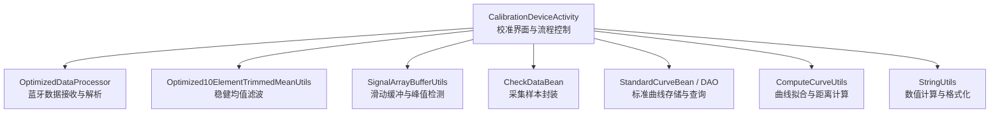
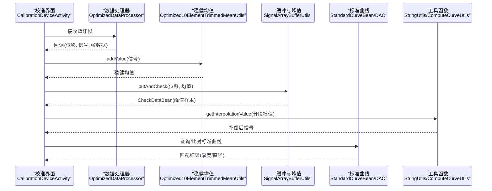
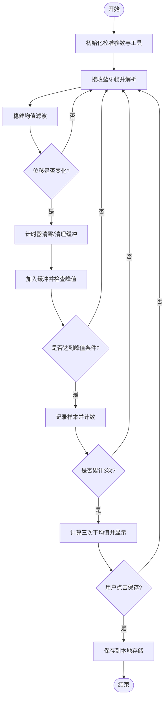
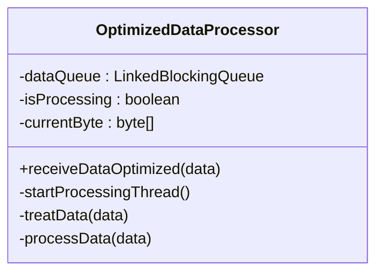
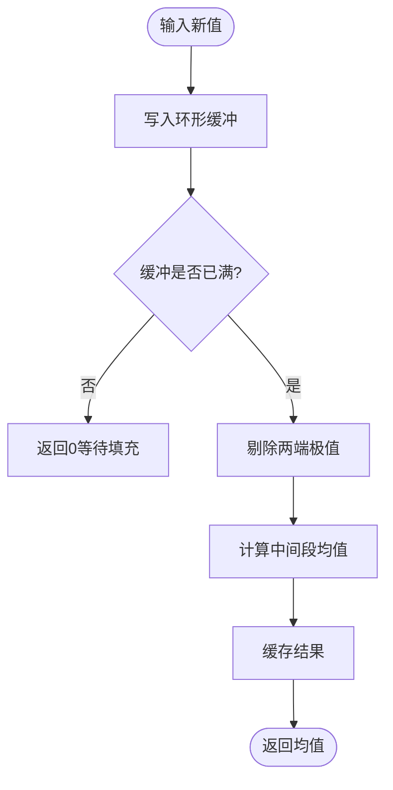
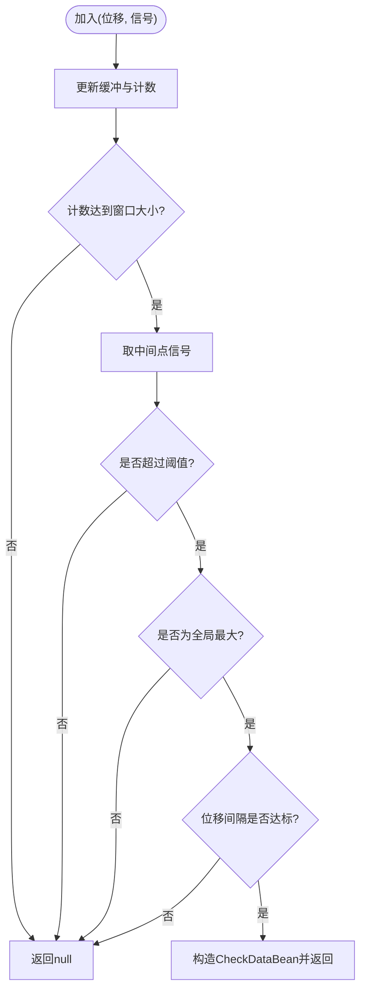
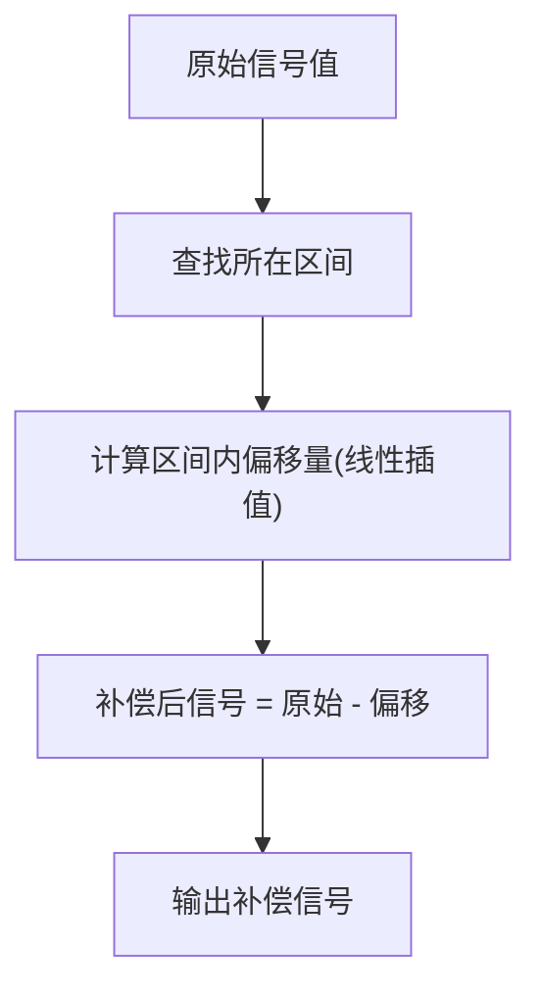
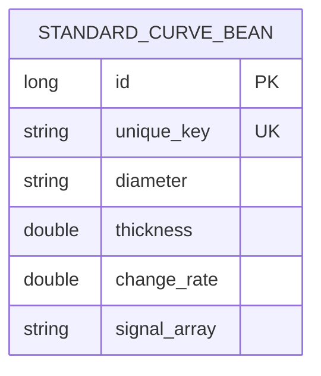
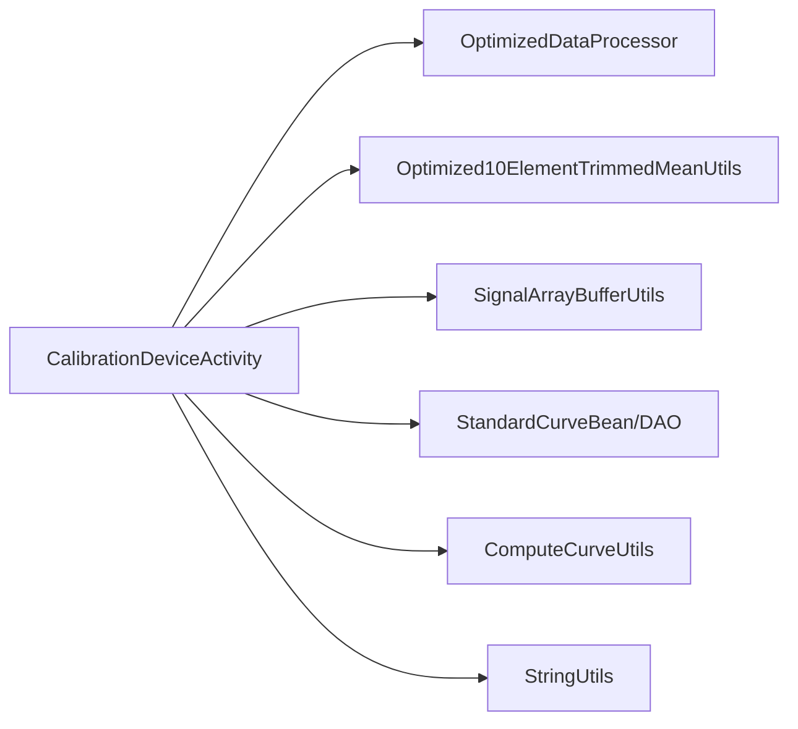

# 设备校准

<cite>
**本文引用的文件**
- [CalibrationDeviceActivity.java](file://app/src/main/java/com/example/gtj_sd_dg240/activity/setting/CalibrationDeviceActivity.java)
- [DetectActivity2.java](file://app/src/main/java/com/example/gtj_sd_dg240/activity/testing/DetectActivity2.java)
- [OptimizedDataProcessor.java](file://app/src/main/java/com/example/gtj_sd_dg240/utils/OptimizedDataProcessor.java)
- [Optimized10ElementTrimmedMeanUtils.java](file://app/src/main/java/com/example/gtj_sd_dg240/utils/Optimized10ElementTrimmedMeanUtils.java)
- [SignalArrayBufferUtils.java](file://app/src/main/java/com/example/gtj_sd_dg240/utils/SignalArrayBufferUtils.java)
- [CheckDataBean.java](file://app/src/main/java/com/example/gtj_sd_dg240/model/CheckDataBean.java)
- [StandardCurveBean.java](file://app/src/main/java/com/example/gtj_sd_dg240/model/StandardCurveBean.java)
- [StandardCurveBeanDao.java](file://app/src/main/java/com/example/gtj_sd_dg240/functions/database/greenDao/db/StandardCurveBeanDao.java)
- [ComputeCurveUtils.java](file://app/src/main/java/com/example/gtj_sd_dg240/utils/ComputeCurveUtils.java)
- [StringUtils.java](file://app/src/main/java/com/example/gtj_sd_dg240/utils/StringUtils.java)
</cite>

## 目录
1. [简介](#简介)
2. [项目结构](#项目结构)
3. [核心组件](#核心组件)
4. [架构总览](#架构总览)
5. [详细组件分析](#详细组件分析)
6. [依赖关系分析](#依赖关系分析)
7. [性能考量](#性能考量)
8. [故障排查指南](#故障排查指南)
9. [结论](#结论)
10. [附录](#附录)

## 简介
本文件面向GTJ-SD-DG240应用的“设备校准”功能，系统化阐述从校准准备、操作步骤、参数计算原理到结果存储与质量评估的完整流程。重点覆盖：
- 信号采集与处理（蓝牙帧解析、去噪、峰值检测）
- 校准算法实现（分段线性插值补偿、多窗口均值滤波）
- 不同型号设备的差异与标准曲线管理
- 校准结果的持久化与历史追溯
- 批量校准、历史记录与报告生成的扩展建议
- API使用方式（通过Activity回调与工具类接口进行状态获取、任务执行与结果处理）

## 项目结构
与设备校准直接相关的代码主要分布在以下模块：
- 设置页：CalibrationDeviceActivity（校准入口、参数输入、保存）
- 数据处理：OptimizedDataProcessor（高吞吐数据接收与解析）、Optimized10ElementTrimmedMeanUtils（稳健均值）、SignalArrayBufferUtils（滑动缓冲与峰值判定）
- 模型与数据库：CheckDataBean（单次采集样本）、StandardCurveBean/StandardCurveBeanDao（标准曲线表与DAO）
- 工具与算法：ComputeCurveUtils（曲线拟合与距离计算）、StringUtils（数值计算与格式化）

图表来源
- [CalibrationDeviceActivity.java:52-71](file://app/src/main/java/com/example/gtj_sd_dg240/activity/setting/CalibrationDeviceActivity.java#L52-L71)
- [OptimizedDataProcessor.java:34-75](file://app/src/main/java/com/example/gtj_sd_dg240/utils/OptimizedDataProcessor.java#L34-L75)
- [Optimized10ElementTrimmedMeanUtils.java:93-114](file://app/src/main/java/com/example/gtj_sd_dg240/utils/Optimized10ElementTrimmedMeanUtils.java#L93-L114)
- [SignalArrayBufferUtils.java:26-66](file://app/src/main/java/com/example/gtj_sd_dg240/utils/SignalArrayBufferUtils.java#L26-L66)
- [StandardCurveBean.java:16-33](file://app/src/main/java/com/example/gtj_sd_dg240/model/StandardCurveBean.java#L16-L33)
- [ComputeCurveUtils.java:15-45](file://app/src/main/java/com/example/gtj_sd_dg240/utils/ComputeCurveUtils.java#L15-L45)
- [StringUtils.java:186-246](file://app/src/main/java/com/example/gtj_sd_dg240/utils/StringUtils.java#L186-L246)

章节来源
- [CalibrationDeviceActivity.java:52-71](file://app/src/main/java/com/example/gtj_sd_dg240/activity/setting/CalibrationDeviceActivity.java#L52-L71)
- [OptimizedDataProcessor.java:34-75](file://app/src/main/java/com/example/gtj_sd_dg240/utils/OptimizedDataProcessor.java#L34-L75)

## 核心组件
- 校准界面与控制流：CalibrationDeviceActivity负责初始化蓝牙数据回调、启动定时任务、维护采集状态、显示实时结果并保存校准参数。
- 数据接收与解析：OptimizedDataProcessor采用生产者-消费者模式，将高频蓝牙数据入队，单线程消费并按固定帧长解析出位移与信号值。
- 信号去噪与稳定：Optimized10ElementTrimmedMeanUtils对连续信号做稳健均值（剔除极值后求平均），降低噪声影响。
- 峰值检测与采样：SignalArrayBufferUtils维护长度为64的循环缓冲区，当满足最小阈值、中间点为全局最大值且位移间隔达标时，输出一次有效采样。
- 校准参数与补偿：getSignalValue基于分段线性插值，将原始信号映射为标准信号，用于后续厚度或直径换算。
- 标准曲线与模型：StandardCurveBean及DAO提供按直径与厚度维度的标准信号波形存储；ComputeCurveUtils支持曲线拟合与距离序列生成。

章节来源
- [CalibrationDeviceActivity.java:73-110](file://app/src/main/java/com/example/gtj_sd_dg240/activity/setting/CalibrationDeviceActivity.java#L73-L110)
- [OptimizedDataProcessor.java:82-133](file://app/src/main/java/com/example/gtj_sd_dg240/utils/OptimizedDataProcessor.java#L82-L133)
- [Optimized10ElementTrimmedMeanUtils.java:25-85](file://app/src/main/java/com/example/gtj_sd_dg240/utils/Optimized10ElementTrimmedMeanUtils.java#L25-L85)
- [SignalArrayBufferUtils.java:26-66](file://app/src/main/java/com/example/gtj_sd_dg240/utils/SignalArrayBufferUtils.java#L26-L66)
- [CalibrationDeviceActivity.java:199-215](file://app/src/main/java/com/example/gtj_sd_dg240/activity/setting/CalibrationDeviceActivity.java#L199-L215)
- [StandardCurveBean.java:16-33](file://app/src/main/java/com/example/gtj_sd_dg240/model/StandardCurveBean.java#L16-L33)
- [ComputeCurveUtils.java:15-45](file://app/src/main/java/com/example/gtj_sd_dg240/utils/ComputeCurveUtils.java#L15-L45)

## 架构总览
校准数据流从蓝牙接收开始，经解析、去噪、峰值检测，得到稳定的信号样本，再通过校准补偿与标准曲线匹配，输出厚度或直径等物理量。

图表来源
- [CalibrationDeviceActivity.java:129-187](file://app/src/main/java/com/example/gtj_sd_dg240/activity/setting/CalibrationDeviceActivity.java#L129-L187)
- [OptimizedDataProcessor.java:82-133](file://app/src/main/java/com/example/gtj_sd_dg240/utils/OptimizedDataProcessor.java#L82-L133)
- [Optimized10ElementTrimmedMeanUtils.java:93-114](file://app/src/main/java/com/example/gtj_sd_dg240/utils/Optimized10ElementTrimmedMeanUtils.java#L93-L114)
- [SignalArrayBufferUtils.java:26-66](file://app/src/main/java/com/example/gtj_sd_dg240/utils/SignalArrayBufferUtils.java#L26-L66)
- [StandardCurveBean.java:16-33](file://app/src/main/java/com/example/gtj_sd_dg240/model/StandardCurveBean.java#L16-L33)
- [ComputeCurveUtils.java:15-45](file://app/src/main/java/com/example/gtj_sd_dg240/utils/ComputeCurveUtils.java#L15-L45)
- [StringUtils.java:228-246](file://app/src/main/java/com/example/gtj_sd_dg240/utils/StringUtils.java#L228-L246)

## 详细组件分析

### 校准界面与控制流（CalibrationDeviceActivity）
- 初始化：加载已保存的校准标准列表与实际测量列表，配置信号缓冲大小、均值滤波器、媒体播放器与定时器。
- 数据采集：注册蓝牙数据回调，调用数据处理器接收帧；在回调中更新UI并进入处理链路。
- 信号处理：提取信号值，计算稳健均值；若位移未变化则跳过；每2秒清空缓冲避免累积误差。
- 峰值判定：当缓冲满且中间点为最大值且位移间隔达标时，记录一次有效样本；累计3次取平均作为当前标定值。
- 参数保存：校验所有输入项非空后，写入本地偏好存储，供后续检测流程读取。

图表来源
- [CalibrationDeviceActivity.java:119-187](file://app/src/main/java/com/example/gtj_sd_dg240/activity/setting/CalibrationDeviceActivity.java#L119-L187)
- [CalibrationDeviceActivity.java:300-373](file://app/src/main/java/com/example/gtj_sd_dg240/activity/setting/CalibrationDeviceActivity.java#L300-L373)

章节来源
- [CalibrationDeviceActivity.java:52-71](file://app/src/main/java/com/example/gtj_sd_dg240/activity/setting/CalibrationDeviceActivity.java#L52-L71)
- [CalibrationDeviceActivity.java:119-187](file://app/src/main/java/com/example/gtj_sd_dg240/activity/setting/CalibrationDeviceActivity.java#L119-L187)
- [CalibrationDeviceActivity.java:300-373](file://app/src/main/java/com/example/gtj_sd_dg240/activity/setting/CalibrationDeviceActivity.java#L300-L373)

### 数据接收与解析（OptimizedDataProcessor）
- 高吞吐队列：使用有界阻塞队列缓存帧，避免UI卡顿。
- 帧拼接与定界：按固定帧长度（7字节）解析，定位帧头标志位以对齐数据。
- 字段提取：解析位移与信号值，过滤异常大值，回调给上层。

图表来源
- [OptimizedDataProcessor.java:7-27](file://app/src/main/java/com/example/gtj_sd_dg240/utils/OptimizedDataProcessor.java#L7-L27)
- [OptimizedDataProcessor.java:34-75](file://app/src/main/java/com/example/gtj_sd_dg240/utils/OptimizedDataProcessor.java#L34-L75)
- [OptimizedDataProcessor.java:82-133](file://app/src/main/java/com/example/gtj_sd_dg240/utils/OptimizedDataProcessor.java#L82-L133)

章节来源
- [OptimizedDataProcessor.java:34-75](file://app/src/main/java/com/example/gtj_sd_dg240/utils/OptimizedDataProcessor.java#L34-L75)
- [OptimizedDataProcessor.java:82-133](file://app/src/main/java/com/example/gtj_sd_dg240/utils/OptimizedDataProcessor.java#L82-L133)

### 稳健均值滤波（Optimized10ElementTrimmedMeanUtils）
- 设计目标：在短窗口内剔除极值，提高信号稳定性。
- 实现要点：固定窗口大小，维护索引与缓存；填充完成后计算修剪均值并缓存结果。

图表来源
- [Optimized10ElementTrimmedMeanUtils.java:25-85](file://app/src/main/java/com/example/gtj_sd_dg240/utils/Optimized10ElementTrimmedMeanUtils.java#L25-L85)
- [Optimized10ElementTrimmedMeanUtils.java:93-114](file://app/src/main/java/com/example/gtj_sd_dg240/utils/Optimized10ElementTrimmedMeanUtils.java#L93-L114)

章节来源
- [Optimized10ElementTrimmedMeanUtils.java:93-114](file://app/src/main/java/com/example/gtj_sd_dg240/utils/Optimized10ElementTrimmedMeanUtils.java#L93-L114)

### 峰值检测与采样（SignalArrayBufferUtils）
- 缓冲策略：循环数组记录最近N个位移与信号值。
- 峰值条件：中间点信号大于阈值、为全局最大值、与上次峰值位移间隔足够。
- 输出：构造CheckDataBean，包含位移、峰值信号与整段曲线。

图表来源
- [SignalArrayBufferUtils.java:26-66](file://app/src/main/java/com/example/gtj_sd_dg240/utils/SignalArrayBufferUtils.java#L26-L66)

章节来源
- [SignalArrayBufferUtils.java:26-66](file://app/src/main/java/com/example/gtj_sd_dg240/utils/SignalArrayBufferUtils.java#L26-L66)

### 校准参数与补偿（分段线性插值）
- 目的：将实际测量信号映射为标准信号，消除系统偏差。
- 方法：根据校准列表划分区间，利用相邻区间的端点差值进行线性插值，计算偏移量并从原始信号中扣除。

图表来源
- [CalibrationDeviceActivity.java:199-215](file://app/src/main/java/com/example/gtj_sd_dg240/activity/setting/CalibrationDeviceActivity.java#L199-L215)
- [StringUtils.java:228-246](file://app/src/main/java/com/example/gtj_sd_dg240/utils/StringUtils.java#L228-L246)

章节来源
- [CalibrationDeviceActivity.java:199-215](file://app/src/main/java/com/example/gtj_sd_dg240/activity/setting/CalibrationDeviceActivity.java#L199-L215)
- [StringUtils.java:228-246](file://app/src/main/java/com/example/gtj_sd_dg240/utils/StringUtils.java#L228-L246)

### 标准曲线与模型（StandardCurveBean/DAO）
- 数据结构：包含直径、厚度、变化率与信号数组，唯一键由直径与厚度组合生成。
- 存储访问：通过GreenDAO的StandardCurveBeanDao进行增删改查，支持按直径筛选与厚度排序。
- 用途：在校准或检测阶段，依据当前直径选择对应标准曲线，进行匹配与厚度反演。

图表来源
- [StandardCurveBean.java:16-33](file://app/src/main/java/com/example/gtj_sd_dg240/model/StandardCurveBean.java#L16-L33)
- [StandardCurveBeanDao.java:20-37](file://app/src/main/java/com/example/gtj_sd_dg240/functions/database/greenDao/db/StandardCurveBeanDao.java#L20-L37)

章节来源
- [StandardCurveBean.java:16-33](file://app/src/main/java/com/example/gtj_sd_dg240/model/StandardCurveBean.java#L16-L33)
- [StandardCurveBeanDao.java:20-37](file://app/src/main/java/com/example/gtj_sd_dg240/functions/database/greenDao/db/StandardCurveBeanDao.java#L20-L37)

### 曲线拟合与距离计算（ComputeCurveUtils）
- 功能：根据系数生成曲线Y值；根据电杆半径、钢筋半径与厚度计算行走距离序列。
- 应用：辅助校准过程中对信号与几何关系的建模与验证。

章节来源
- [ComputeCurveUtils.java:15-45](file://app/src/main/java/com/example/gtj_sd_dg240/utils/ComputeCurveUtils.java#L15-L45)

### 检测流程中的校准信号处理（DetectActivity2）
- 读取校准参数：从本地存储加载标准列表与实际列表。
- 数据回调：将蓝牙数据交给数据处理器，并在回调中调用校准信号处理逻辑。
- 分支处理：根据模式切换厚度检测或直径预测。

章节来源
- [DetectActivity2.java:156-186](file://app/src/main/java/com/example/gtj_sd_dg240/activity/testing/DetectActivity2.java#L156-L186)

## 依赖关系分析
- 低耦合：Activity仅依赖工具类与模型，不直接操作底层硬件。
- 高内聚：数据解析、滤波、峰值检测各自独立，便于测试与维护。
- 外部依赖：GreenDAO用于标准曲线持久化；蓝牙通信通过上层回调接入。

图表来源
- [CalibrationDeviceActivity.java:129-187](file://app/src/main/java/com/example/gtj_sd_dg240/activity/setting/CalibrationDeviceActivity.java#L129-L187)
- [OptimizedDataProcessor.java:34-75](file://app/src/main/java/com/example/gtj_sd_dg240/utils/OptimizedDataProcessor.java#L34-L75)
- [Optimized10ElementTrimmedMeanUtils.java:93-114](file://app/src/main/java/com/example/gtj_sd_dg240/utils/Optimized10ElementTrimmedMeanUtils.java#L93-L114)
- [SignalArrayBufferUtils.java:26-66](file://app/src/main/java/com/example/gtj_sd_dg240/utils/SignalArrayBufferUtils.java#L26-L66)
- [StandardCurveBean.java:16-33](file://app/src/main/java/com/example/gtj_sd_dg240/model/StandardCurveBean.java#L16-L33)
- [ComputeCurveUtils.java:15-45](file://app/src/main/java/com/example/gtj_sd_dg240/utils/ComputeCurveUtils.java#L15-L45)
- [StringUtils.java:228-246](file://app/src/main/java/com/example/gtj_sd_dg240/utils/StringUtils.java#L228-L246)

章节来源
- [CalibrationDeviceActivity.java:129-187](file://app/src/main/java/com/example/gtj_sd_dg240/activity/setting/CalibrationDeviceActivity.java#L129-L187)

## 性能考量
- 高吞吐数据接收：有界队列+单线程消费，避免UI阻塞与内存抖动。
- 稳健均值：小窗口快速排序/选择，减少CPU开销。
- 峰值检测：循环缓冲与常数时间插入，O(N)扫描判断最大值，整体复杂度可控。
- 插值计算：分段线性插值，时间复杂度O(K)，K为分段数（常量级）。
- 建议：
  - 合理设置缓冲大小与阈值，平衡灵敏度与稳定性。
  - 在大批量校准时，考虑异步任务与进度反馈，避免主线程压力。
  - 对异常帧与噪声进行日志记录，便于问题定位。

[本节为通用性能讨论，无需特定文件引用]

## 故障排查指南
- 无数据或数据为空：
  - 检查蓝牙连接与回调是否注册成功。
  - 确认数据处理器队列是否溢出（丢弃策略）。
- 峰值检测失败：
  - 调整中间点阈值与位移间隔参数。
  - 检查缓冲大小与清理时机。
- 校准结果不稳定：
  - 增加稳健均值窗口或调整剔除极值数量。
  - 检查环境干扰与传感器接触情况。
- 保存失败：
  - 校验输入完整性，确保所有必填项非空。
  - 检查本地存储权限与空间。

章节来源
- [CalibrationDeviceActivity.java:300-373](file://app/src/main/java/com/example/gtj_sd_dg240/activity/setting/CalibrationDeviceActivity.java#L300-L373)
- [OptimizedDataProcessor.java:34-75](file://app/src/main/java/com/example/gtj_sd_dg240/utils/OptimizedDataProcessor.java#L34-L75)
- [SignalArrayBufferUtils.java:26-66](file://app/src/main/java/com/example/gtj_sd_dg240/utils/SignalArrayBufferUtils.java#L26-L66)

## 结论
该设备校准功能通过高效的数据接收、稳健的信号滤波与可靠的峰值检测，结合分段线性插值补偿与标准曲线匹配，实现了高精度、可追溯的校准流程。界面友好、参数可配置、结果可持久化，具备良好的可扩展性，适用于不同型号设备的差异化校准需求。

[本节为总结性内容，无需特定文件引用]

## 附录

### 校准前准备工作
- 确保蓝牙设备连接正常，数据回调已注册。
- 准备标准样品或已知厚度的参考件，用于建立校准对照。
- 检查并填写校准标准列表与实际测量列表，保证数据完整。

章节来源
- [CalibrationDeviceActivity.java:52-71](file://app/src/main/java/com/example/gtj_sd_dg240/activity/setting/CalibrationDeviceActivity.java#L52-L71)
- [CalibrationDeviceActivity.java:73-110](file://app/src/main/java/com/example/gtj_sd_dg240/activity/setting/CalibrationDeviceActivity.java#L73-L110)

### 校准步骤操作
- 进入校准界面，观察实时信号与均值。
- 移动传感器至目标位置，等待峰值触发并记录。
- 重复至少三次，查看三次平均值。
- 确认无误后保存参数。

章节来源
- [CalibrationDeviceActivity.java:119-187](file://app/src/main/java/com/example/gtj_sd_dg240/activity/setting/CalibrationDeviceActivity.java#L119-L187)
- [CalibrationDeviceActivity.java:300-373](file://app/src/main/java/com/example/gtj_sd_dg240/activity/setting/CalibrationDeviceActivity.java#L300-L373)

### 参数计算原理
- 稳健均值：剔除极值后求平均，提升稳定性。
- 峰值检测：基于缓冲与阈值判断，确保采样可靠性。
- 分段线性插值：将原始信号映射为标准信号，消除系统偏差。

章节来源
- [Optimized10ElementTrimmedMeanUtils.java:25-85](file://app/src/main/java/com/example/gtj_sd_dg240/utils/Optimized10ElementTrimmedMeanUtils.java#L25-L85)
- [SignalArrayBufferUtils.java:26-66](file://app/src/main/java/com/example/gtj_sd_dg240/utils/SignalArrayBufferUtils.java#L26-L66)
- [CalibrationDeviceActivity.java:199-215](file://app/src/main/java/com/example/gtj_sd_dg240/activity/setting/CalibrationDeviceActivity.java#L199-L215)

### 不同型号设备的校准差异
- 通过标准曲线按直径维度区分，不同直径对应不同信号波形。
- 可在标准曲线表中新增或更新曲线，适配新设备或新材料。

章节来源
- [StandardCurveBean.java:16-33](file://app/src/main/java/com/example/gtj_sd_dg240/model/StandardCurveBean.java#L16-L33)
- [StandardCurveBeanDao.java:20-37](file://app/src/main/java/com/example/gtj_sd_dg240/functions/database/greenDao/db/StandardCurveBeanDao.java#L20-L37)

### 校准参数的物理意义
- 标准列表：代表各厚度对应的标准信号值。
- 实际列表：代表设备在当前状态下测得的信号值。
- 插值偏移：反映设备漂移与系统误差，用于补偿。

章节来源
- [CalibrationDeviceActivity.java:199-215](file://app/src/main/java/com/example/gtj_sd_dg240/activity/setting/CalibrationDeviceActivity.java#L199-L215)
- [CalibrationDeviceActivity.java:73-110](file://app/src/main/java/com/example/gtj_sd_dg240/activity/setting/CalibrationDeviceActivity.java#L73-L110)

### 校准结果的存储与管理
- 本地存储：校准参数以JSON形式保存在偏好存储中。
- 标准曲线：通过GreenDAO持久化，支持按直径与厚度查询。
- 建议：增加版本管理与备份机制，便于回滚与迁移。

章节来源
- [CalibrationDeviceActivity.java:300-373](file://app/src/main/java/com/example/gtj_sd_dg240/activity/setting/CalibrationDeviceActivity.java#L300-L373)
- [StandardCurveBeanDao.java:20-37](file://app/src/main/java/com/example/gtj_sd_dg240/functions/database/greenDao/db/StandardCurveBeanDao.java#L20-L37)

### 校准质量评估标准与误差分析
- 质量指标：三次采样的一致性、峰值稳定性、均值波动范围。
- 误差来源：传感器接触不良、环境干扰、参数设置不当。
- 分析方法：对比标准曲线匹配度、统计偏差分布、记录异常帧。

章节来源
- [SignalArrayBufferUtils.java:26-66](file://app/src/main/java/com/example/gtj_sd_dg240/utils/SignalArrayBufferUtils.java#L26-L66)
- [Optimized10ElementTrimmedMeanUtils.java:93-114](file://app/src/main/java/com/example/gtj_sd_dg240/utils/Optimized10ElementTrimmedMeanUtils.java#L93-L114)

### 批量校准、历史记录与报告生成（扩展建议）
- 批量校准：封装为后台任务，支持队列化执行与进度回调。
- 历史记录：为每次校准创建记录条目，包含时间、参数、结果与曲线快照。
- 报告生成：导出CSV/PDF，包含校准过程、关键指标与结论。

[本节为扩展建议，无需特定文件引用]

### API使用指南（开发场景）
- 获取校准状态：监听蓝牙回调与数据处理器状态，读取本地校准参数。
- 执行校准任务：调用数据处理器接收数据，触发峰值检测与均值计算。
- 处理校准结果：根据CheckDataBean与标准曲线匹配，输出厚度/直径并持久化。

章节来源
- [OptimizedDataProcessor.java:34-75](file://app/src/main/java/com/example/gtj_sd_dg240/utils/OptimizedDataProcessor.java#L34-L75)
- [CalibrationDeviceActivity.java:129-187](file://app/src/main/java/com/example/gtj_sd_dg240/activity/setting/CalibrationDeviceActivity.java#L129-L187)
- [CheckDataBean.java:1-33](file://app/src/main/java/com/example/gtj_sd_dg240/model/CheckDataBean.java#L1-L33)