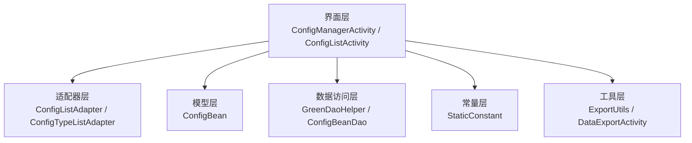
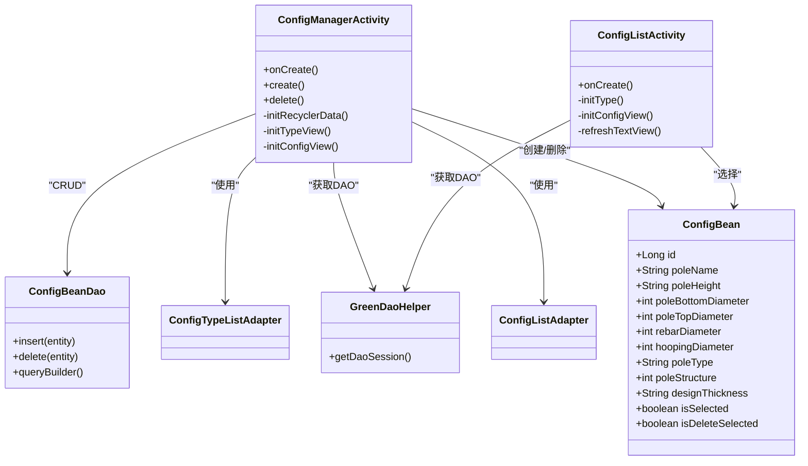
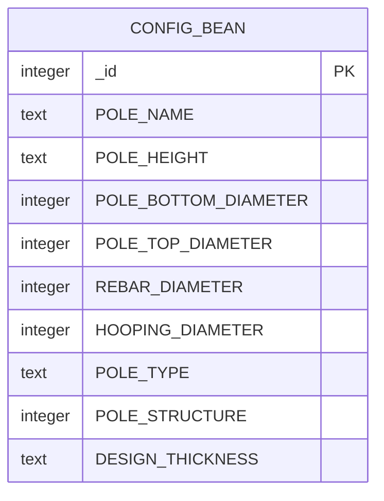
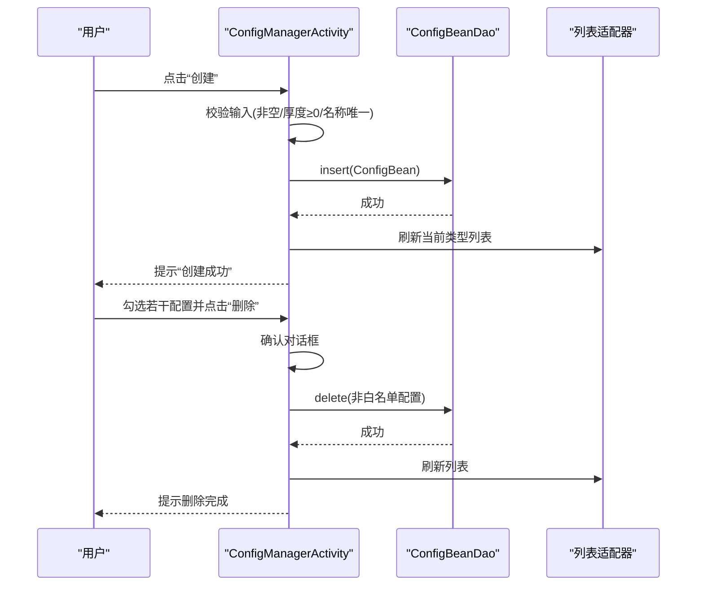
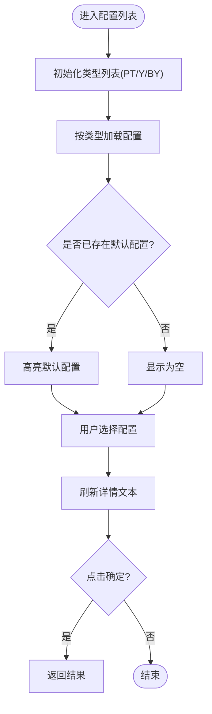
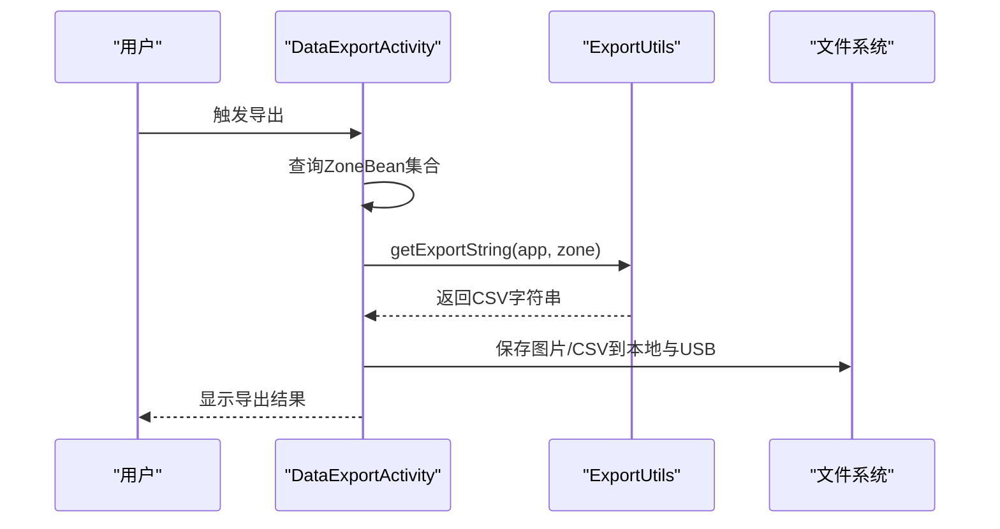
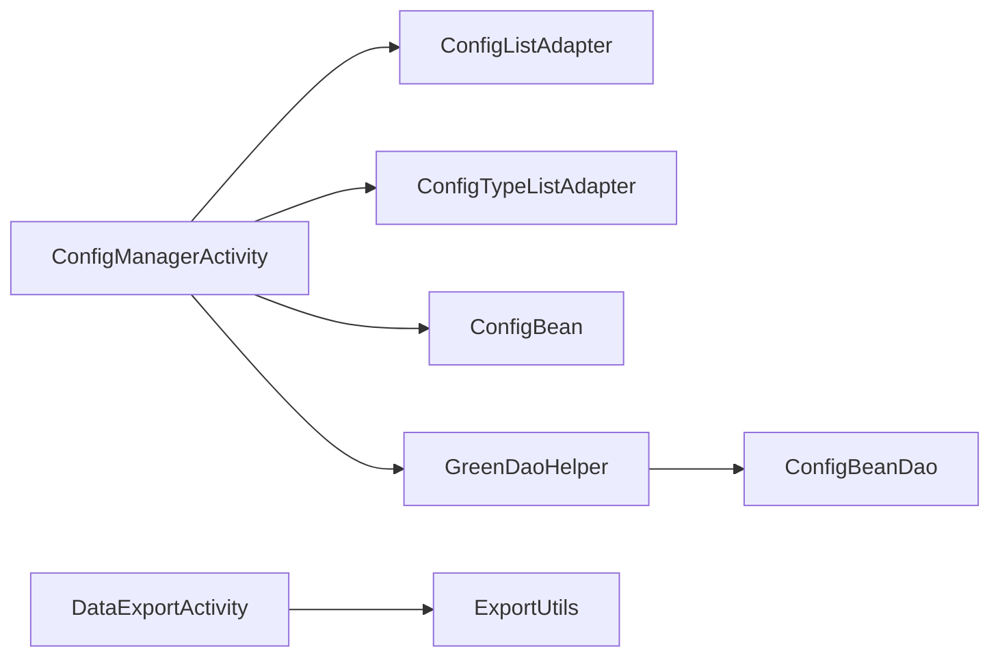

# 配置管理

<cite>
**本文引用的文件**
- [ConfigManagerActivity.java](file://app/src/main/java/com/example/gtj_sd_dg240/activity/testing/ConfigManagerActivity.java)
- [ConfigListActivity.java](file://app/src/main/java/com/example/gtj_sd_dg240/activity/testing/ConfigListActivity.java)
- [ConfigBean.java](file://app/src/main/java/com/example/gtj_sd_dg240/model/ConfigBean.java)
- [ConfigListAdapter.java](file://app/src/main/java/com/example/gtj_sd_dg240/adapter/ConfigListAdapter.java)
- [ConfigTypeListAdapter.java](file://app/src/main/java/com/example/gtj_sd_dg240/adapter/ConfigTypeListAdapter.java)
- [StaticConstant.java](file://app/src/main/java/com/example/gtj_sd_dg240/StaticConstant.java)
- [GreenDaoHelper.java](file://app/src/main/java/com/example/gtj_sd_dg240/storage/GreenDaoHelper.java)
- [ConfigBeanDao.java](file://app/src/main/java/com/example/gtj_sd_dg240/functions/database/greenDao/db/ConfigBeanDao.java)
- [DataExportActivity.java](file://app/src/main/java/com/example/gtj_sd_dg240/activity/data/DataExportActivity.java)
- [ExportUtils.java](file://app/src/main/java/com/example/gtj_sd_dg240/utils/ExportUtils.java)
- [DetectConfigActivity.java](file://app/src/main/java/com/example/gtj_sd_dg240/activity/testing/DetectConfigActivity.java)
</cite>

## 目录
1. [简介](#简介)
2. [项目结构](#项目结构)
3. [核心组件](#核心组件)
4. [架构总览](#架构总览)
5. [详细组件分析](#详细组件分析)
6. [依赖关系分析](#依赖关系分析)
7. [性能考虑](#性能考虑)
8. [故障排查指南](#故障排查指南)
9. [结论](#结论)
10. [附录](#附录)

## 简介
本文件面向GTJ-SD-DG240应用的“配置管理”功能，聚焦电杆配置的类型管理（PT型、Y型、BY型）、配置的CRUD与批量操作、数据导入导出、验证与完整性检查、持久化存储与查询优化等。文档同时给出架构图、流程图与调用时序图，帮助读者快速理解并扩展该模块。

## 项目结构
配置管理相关代码主要分布在以下位置：
- 界面层：配置管理页、配置选择页、检测参数设置页
- 模型层：电杆配置实体
- 适配器层：类型列表与配置列表的UI绑定
- 常量层：电杆类型、结构、直径等枚举与默认值
- 数据访问层：GreenDAO封装与DAO类
- 工具层：数据导出与CSV处理

图表来源
- [ConfigManagerActivity.java:48-89](file://app/src/main/java/com/example/gtj_sd_dg240/activity/testing/ConfigManagerActivity.java#L48-L89)
- [ConfigListActivity.java:67-128](file://app/src/main/java/com/example/gtj_sd_dg240/activity/testing/ConfigListActivity.java#L67-L128)
- [ConfigBean.java:13-36](file://app/src/main/java/com/example/gtj_sd_dg240/model/ConfigBean.java#L13-L36)
- [ConfigListAdapter.java:14-48](file://app/src/main/java/com/example/gtj_sd_dg240/adapter/ConfigListAdapter.java#L14-L48)
- [ConfigTypeListAdapter.java:14-48](file://app/src/main/java/com/example/gtj_sd_dg240/adapter/ConfigTypeListAdapter.java#L14-L48)
- [StaticConstant.java:43-65](file://app/src/main/java/com/example/gtj_sd_dg240/StaticConstant.java#L43-L65)
- [GreenDaoHelper.java:16-40](file://app/src/main/java/com/example/gtj_sd_dg240/storage/GreenDaoHelper.java#L16-L40)
- [ConfigBeanDao.java:48-62](file://app/src/main/java/com/example/gtj_sd_dg240/functions/database/greenDao/db/ConfigBeanDao.java#L48-L62)
- [DataExportActivity.java:346-472](file://app/src/main/java/com/example/gtj_sd_dg240/activity/data/DataExportActivity.java#L346-L472)
- [ExportUtils.java:25-66](file://app/src/main/java/com/example/gtj_sd_dg240/utils/ExportUtils.java#L25-L66)

章节来源
- [ConfigManagerActivity.java:48-89](file://app/src/main/java/com/example/gtj_sd_dg240/activity/testing/ConfigManagerActivity.java#L48-L89)
- [ConfigListActivity.java:67-128](file://app/src/main/java/com/example/gtj_sd_dg240/activity/testing/ConfigListActivity.java#L67-L128)
- [StaticConstant.java:43-65](file://app/src/main/java/com/example/gtj_sd_dg240/StaticConstant.java#L43-L65)

## 核心组件
- 配置实体：ConfigBean，包含电杆名称、长度、根径、梢径、纵筋直径、螺旋筋直径、类型、结构、设计保护层厚度等字段，以及用于UI状态的瞬态字段。
- 配置管理界面：ConfigManagerActivity，负责创建、删除、批量选择、按类型筛选配置。
- 配置选择界面：ConfigListActivity，用于在检测流程中选择已有配置。
- 适配器：ConfigListAdapter、ConfigTypeListAdapter，分别渲染配置项与类型项，支持多选与选中态。
- 常量：StaticConstant，集中定义电杆类型、结构、直径等选项及内置配置名白名单。
- 数据访问：GreenDaoHelper提供会话；ConfigBeanDao生成表结构与读写方法。
- 导出能力：DataExportActivity与ExportUtils，将检测结果导出为图片与CSV，便于归档与共享。

章节来源
- [ConfigBean.java:13-36](file://app/src/main/java/com/example/gtj_sd_dg240/model/ConfigBean.java#L13-L36)
- [ConfigManagerActivity.java:204-331](file://app/src/main/java/com/example/gtj_sd_dg240/activity/testing/ConfigManagerActivity.java#L204-L331)
- [ConfigListActivity.java:54-128](file://app/src/main/java/com/example/gtj_sd_dg240/activity/testing/ConfigListActivity.java#L54-L128)
- [ConfigListAdapter.java:14-48](file://app/src/main/java/com/example/gtj_sd_dg240/adapter/ConfigListAdapter.java#L14-L48)
- [ConfigTypeListAdapter.java:14-48](file://app/src/main/java/com/example/gtj_sd_dg240/adapter/ConfigTypeListAdapter.java#L14-L48)
- [StaticConstant.java:43-65](file://app/src/main/java/com/example/gtj_sd_dg240/StaticConstant.java#L43-L65)
- [GreenDaoHelper.java:16-40](file://app/src/main/java/com/example/gtj_sd_dg240/storage/GreenDaoHelper.java#L16-L40)
- [ConfigBeanDao.java:48-62](file://app/src/main/java/com/example/gtj_sd_dg240/functions/database/greenDao/db/ConfigBeanDao.java#L48-L62)
- [DataExportActivity.java:346-472](file://app/src/main/java/com/example/gtj_sd_dg240/activity/data/DataExportActivity.java#L346-L472)
- [ExportUtils.java:25-66](file://app/src/main/java/com/example/gtj_sd_dg240/utils/ExportUtils.java#L25-L66)

## 架构总览
配置管理采用“界面-适配器-模型-DAO”的分层结构，通过GreenDAO进行SQLite持久化。类型与配置分离展示，支持按类型筛选与批量操作。导出功能独立于配置管理，但复用相同的数据模型与常量。

图表来源
- [ConfigBean.java:13-36](file://app/src/main/java/com/example/gtj_sd_dg240/model/ConfigBean.java#L13-L36)
- [ConfigManagerActivity.java:48-331](file://app/src/main/java/com/example/gtj_sd_dg240/activity/testing/ConfigManagerActivity.java#L48-L331)
- [ConfigListActivity.java:54-128](file://app/src/main/java/com/example/gtj_sd_dg240/activity/testing/ConfigListActivity.java#L54-L128)
- [ConfigListAdapter.java:14-48](file://app/src/main/java/com/example/gtj_sd_dg240/adapter/ConfigListAdapter.java#L14-L48)
- [ConfigTypeListAdapter.java:14-48](file://app/src/main/java/com/example/gtj_sd_dg240/adapter/ConfigTypeListAdapter.java#L14-L48)
- [GreenDaoHelper.java:16-40](file://app/src/main/java/com/example/gtj_sd_dg240/storage/GreenDaoHelper.java#L16-L40)
- [ConfigBeanDao.java:48-62](file://app/src/main/java/com/example/gtj_sd_dg240/functions/database/greenDao/db/ConfigBeanDao.java#L48-L62)

## 详细组件分析

### 配置实体与数据库映射
- 实体字段覆盖电杆关键几何与材料参数，并通过注解声明唯一主键与列映射。
- DAO自动生成建表语句，确保表结构与实体一致。

图表来源
- [ConfigBeanDao.java:48-62](file://app/src/main/java/com/example/gtj_sd_dg240/functions/database/greenDao/db/ConfigBeanDao.java#L48-L62)
- [ConfigBean.java:13-36](file://app/src/main/java/com/example/gtj_sd_dg240/model/ConfigBean.java#L13-L36)

章节来源
- [ConfigBean.java:13-36](file://app/src/main/java/com/example/gtj_sd_dg240/model/ConfigBean.java#L13-L36)
- [ConfigBeanDao.java:48-62](file://app/src/main/java/com/example/gtj_sd_dg240/functions/database/greenDao/db/ConfigBeanDao.java#L48-L62)

### 配置管理界面（创建/删除/批量）
- 类型切换：PT型、Y型、BY型三类电杆，分别加载对应配置列表。
- 批量选择：支持全选/取消全选，实时统计待删数量。
- 创建校验：必填项非空、设计保护层厚度≥0、配置名称唯一性检查。
- 删除策略：仅允许删除用户自定义配置，内置配置名在白名单中不可删除。

图表来源
- [ConfigManagerActivity.java:204-331](file://app/src/main/java/com/example/gtj_sd_dg240/activity/testing/ConfigManagerActivity.java#L204-L331)
- [ConfigBeanDao.java:48-62](file://app/src/main/java/com/example/gtj_sd_dg240/functions/database/greenDao/db/ConfigBeanDao.java#L48-L62)

章节来源
- [ConfigManagerActivity.java:204-331](file://app/src/main/java/com/example/gtj_sd_dg240/activity/testing/ConfigManagerActivity.java#L204-L331)
- [StaticConstant.java:43-65](file://app/src/main/java/com/example/gtj_sd_dg240/StaticConstant.java#L43-L65)

### 配置选择界面（检测流程中使用）
- 根据传入的初始配置或空状态，初始化类型与配置列表。
- 选择某配置后，右侧显示详细信息，确认后返回上层。

图表来源
- [ConfigListActivity.java:67-128](file://app/src/main/java/com/example/gtj_sd_dg240/activity/testing/ConfigListActivity.java#L67-L128)

章节来源
- [ConfigListActivity.java:67-128](file://app/src/main/java/com/example/gtj_sd_dg240/activity/testing/ConfigListActivity.java#L67-L128)

### 适配器与UI交互
- ConfigTypeListAdapter：渲染类型项，支持单选与批量删除标记。
- ConfigListAdapter：渲染配置项，支持单选与批量删除标记，颜色与图标随状态变化。

章节来源
- [ConfigTypeListAdapter.java:14-48](file://app/src/main/java/com/example/gtj_sd_dg240/adapter/ConfigTypeListAdapter.java#L14-L48)
- [ConfigListAdapter.java:14-48](file://app/src/main/java/com/example/gtj_sd_dg240/adapter/ConfigListAdapter.java#L14-L48)

### 常量与类型管理
- 电杆类型：普通混凝土电杆(PT)、预应力混凝土电杆Y(Y)、部分预应力混凝土电杆BY(BY)。
- 电杆结构：锥形杆、法兰杆、等径杆。
- 直径与规范：纵筋直径、螺旋筋直径、适用规范列表。
- 内置配置白名单：限制删除，保证系统稳定性。

章节来源
- [StaticConstant.java:43-65](file://app/src/main/java/com/example/gtj_sd_dg240/StaticConstant.java#L43-L65)

### 数据导入导出
- 导出：DataExportActivity将检测结果生成图片与CSV，支持本地与USB路径保存。
- 导入：assets中的CSV可解析为RebarMinMaxBean列表，供后续处理。

图表来源
- [DataExportActivity.java:346-472](file://app/src/main/java/com/example/gtj_sd_dg240/activity/data/DataExportActivity.java#L346-L472)
- [ExportUtils.java:25-66](file://app/src/main/java/com/example/gtj_sd_dg240/utils/ExportUtils.java#L25-L66)

章节来源
- [DataExportActivity.java:346-472](file://app/src/main/java/com/example/gtj_sd_dg240/activity/data/DataExportActivity.java#L346-L472)
- [ExportUtils.java:25-66](file://app/src/main/java/com/example/gtj_sd_dg240/utils/ExportUtils.java#L25-L66)

### 检测参数设置与配置联动
- DetectConfigActivity在检测前加载配置，支持跳转到配置管理页进行新增或编辑。

章节来源
- [DetectConfigActivity.java:39-69](file://app/src/main/java/com/example/gtj_sd_dg240/activity/testing/DetectConfigActivity.java#L39-L69)

## 依赖关系分析
- 界面层依赖适配器与模型，通过GreenDaoHelper获取DAO实例，再调用ConfigBeanDao进行CRUD。
- 导出功能依赖ExportUtils进行数据序列化与文件写入。
- 常量集中管理业务枚举，降低耦合。

图表来源
- [ConfigManagerActivity.java:48-331](file://app/src/main/java/com/example/gtj_sd_dg240/activity/testing/ConfigManagerActivity.java#L48-L331)
- [ConfigListAdapter.java:14-48](file://app/src/main/java/com/example/gtj_sd_dg240/adapter/ConfigListAdapter.java#L14-L48)
- [ConfigTypeListAdapter.java:14-48](file://app/src/main/java/com/example/gtj_sd_dg240/adapter/ConfigTypeListAdapter.java#L14-L48)
- [ConfigBean.java:13-36](file://app/src/main/java/com/example/gtj_sd_dg240/model/ConfigBean.java#L13-L36)
- [GreenDaoHelper.java:16-40](file://app/src/main/java/com/example/gtj_sd_dg240/storage/GreenDaoHelper.java#L16-L40)
- [ConfigBeanDao.java:48-62](file://app/src/main/java/com/example/gtj_sd_dg240/functions/database/greenDao/db/ConfigBeanDao.java#L48-L62)
- [DataExportActivity.java:346-472](file://app/src/main/java/com/example/gtj_sd_dg240/activity/data/DataExportActivity.java#L346-L472)
- [ExportUtils.java:25-66](file://app/src/main/java/com/example/gtj_sd_dg240/utils/ExportUtils.java#L25-L66)

章节来源
- [ConfigManagerActivity.java:48-331](file://app/src/main/java/com/example/gtj_sd_dg240/activity/testing/ConfigManagerActivity.java#L48-L331)
- [DataExportActivity.java:346-472](file://app/src/main/java/com/example/gtj_sd_dg240/activity/data/DataExportActivity.java#L346-L472)

## 性能考虑
- 列表加载：按类型分片查询，减少单屏数据量，提升渲染性能。
- 批量删除：从后向前遍历删除，避免索引错乱。
- 导出流程：后台线程执行IO，UI线程更新进度与结果，避免卡顿。
- 建议：对频繁查询增加索引（如POLE_TYPE），必要时引入缓存以减少重复DB访问。

[本节为通用指导，不直接分析具体文件]

## 故障排查指南
- 创建失败
  - 现象：提示“请填写完整”或“设计保护层厚度需 ≥0mm”。
  - 排查：检查必填字段是否为空、数值格式是否正确。
  - 参考实现：创建逻辑与校验分支。
- 名称冲突
  - 现象：提示“配置名称不可重复”。
  - 排查：查询是否存在同名配置，修改名称后重试。
- 删除受限
  - 现象：无法删除某些配置。
  - 排查：这些配置属于内置白名单，不允许删除。
- 导出失败
  - 现象：提示“内存卡读写异常，无法导出”或“数据不完整，无法导出”。
  - 排查：检查存储权限、USB挂载状态、数据完整性。

章节来源
- [ConfigManagerActivity.java:214-286](file://app/src/main/java/com/example/gtj_sd_dg240/activity/testing/ConfigManagerActivity.java#L214-L286)
- [ConfigManagerActivity.java:288-331](file://app/src/main/java/com/example/gtj_sd_dg240/activity/testing/ConfigManagerActivity.java#L288-L331)
- [DataExportActivity.java:374-472](file://app/src/main/java/com/example/gtj_sd_dg240/activity/data/DataExportActivity.java#L374-L472)

## 结论
配置管理模块以清晰的层次划分实现了电杆配置的创建、删除、批量管理与选择，结合常量与DAO保证了数据的一致性与可维护性。导出能力为检测数据提供了便捷的归档方式。未来可在版本控制、权限管理、配置模板与对比分析方面进一步增强，以满足更复杂的工程场景。

[本节为总结，不直接分析具体文件]

## 附录

### 配置分类与技术参数说明
- PT型（普通混凝土电杆）：适用于常规混凝土电杆的检测与评估。
- Y型（预应力混凝土电杆Y）：针对预应力结构的电杆，关注其力学特性与保护层厚度。
- BY型（部分预应力混凝土电杆BY）：介于普通与全预应力之间，兼顾成本与性能。
- 技术参数：包括电杆长度、根径、梢径、纵筋直径、螺旋筋直径、设计保护层厚度等，均在ConfigBean中体现。

章节来源
- [StaticConstant.java:43-65](file://app/src/main/java/com/example/gtj_sd_dg240/StaticConstant.java#L43-L65)
- [ConfigBean.java:13-36](file://app/src/main/java/com/example/gtj_sd_dg240/model/ConfigBean.java#L13-L36)

### 配置验证规则与数据完整性检查
- 必填项：名称、长度、根径、梢径、类型、结构、纵筋直径、螺旋筋直径、设计保护层厚度。
- 数值约束：设计保护层厚度≥0。
- 唯一性：配置名称全局唯一。
- 完整性：导出时若数据不完整则跳过并记录原因。

章节来源
- [ConfigManagerActivity.java:214-286](file://app/src/main/java/com/example/gtj_sd_dg240/activity/testing/ConfigManagerActivity.java#L214-L286)
- [DataExportActivity.java:411-418](file://app/src/main/java/com/example/gtj_sd_dg240/activity/data/DataExportActivity.java#L411-L418)

### 冲突解决策略
- 名称冲突：拒绝创建，提示修改名称。
- 删除冲突：内置配置不可删除，防止系统不稳定。
- 导出冲突：文件存在时先删除旧文件再写入新数据。

章节来源
- [ConfigManagerActivity.java:238-242](file://app/src/main/java/com/example/gtj_sd_dg240/activity/testing/ConfigManagerActivity.java#L238-L242)
- [ConfigManagerActivity.java:296-325](file://app/src/main/java/com/example/gtj_sd_dg240/activity/testing/ConfigManagerActivity.java#L296-L325)
- [ExportUtils.java:100-116](file://app/src/main/java/com/example/gtj_sd_dg240/utils/ExportUtils.java#L100-L116)

### 配置模板与历史版本（规划建议）
- 模板管理：可将常用配置保存为模板，快速复用。
- 历史版本：为每次变更生成快照，支持回滚与对比。
- 对比分析：可视化差异，辅助决策。

[本节为概念性建议，不直接分析具体文件]

### API与监听（开发场景建议）
- API管理：可通过封装的DAO接口暴露增删改查能力，供其他模块调用。
- 变更监听：基于观察者模式或事件总线，监听配置变更并刷新相关视图。
- 同步机制：在云端或设备间同步配置，确保一致性。

[本节为概念性建议，不直接分析具体文件]

### 持久化存储与查询优化
- 存储方案：SQLite通过GreenDAO管理，表结构由DAO生成。
- 查询优化：按类型过滤查询，减少不必要的数据加载；可为高频查询字段建立索引。
- 事务操作：批量插入/删除建议使用事务，提高性能与一致性。

章节来源
- [GreenDaoHelper.java:16-40](file://app/src/main/java/com/example/gtj_sd_dg240/storage/GreenDaoHelper.java#L16-L40)
- [ConfigBeanDao.java:48-62](file://app/src/main/java/com/example/gtj_sd_dg240/functions/database/greenDao/db/ConfigBeanDao.java#L48-L62)