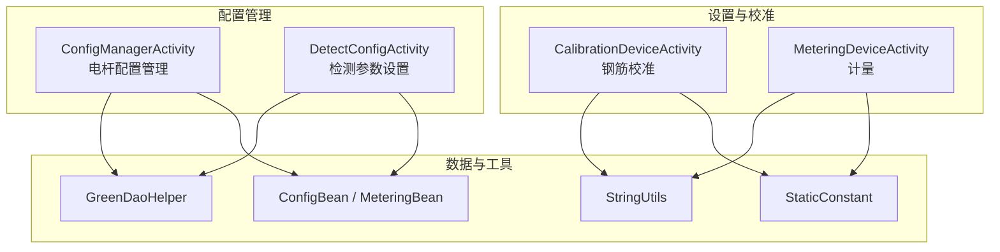
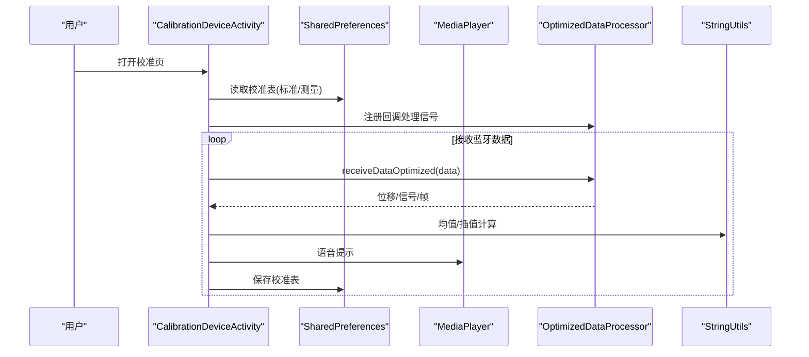
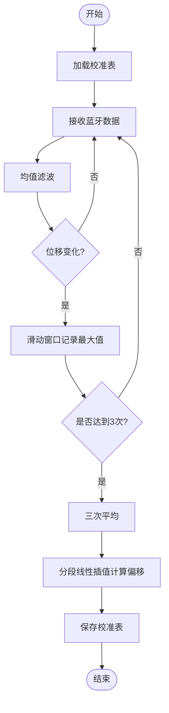
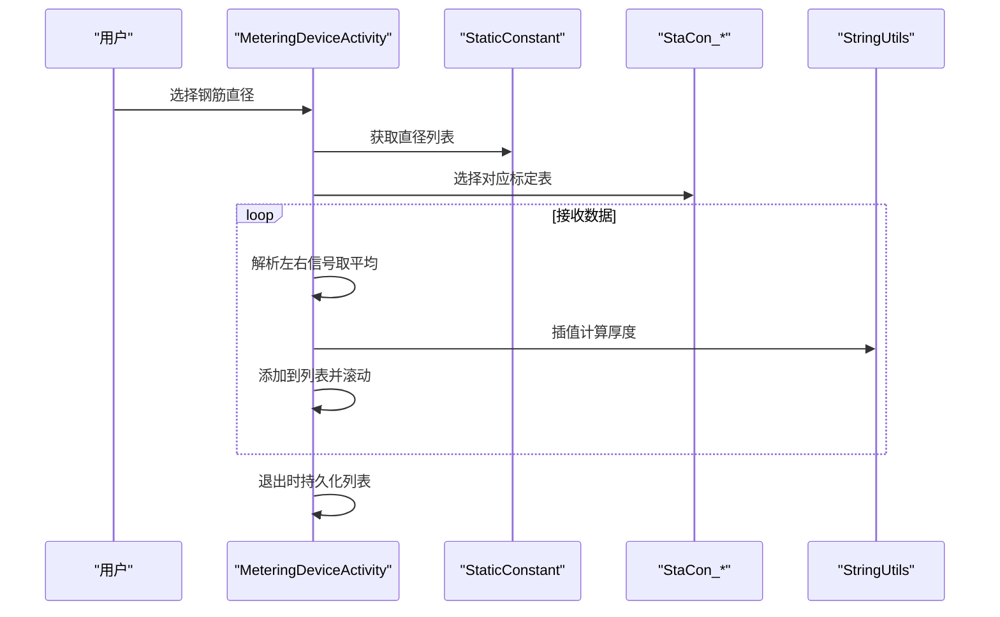
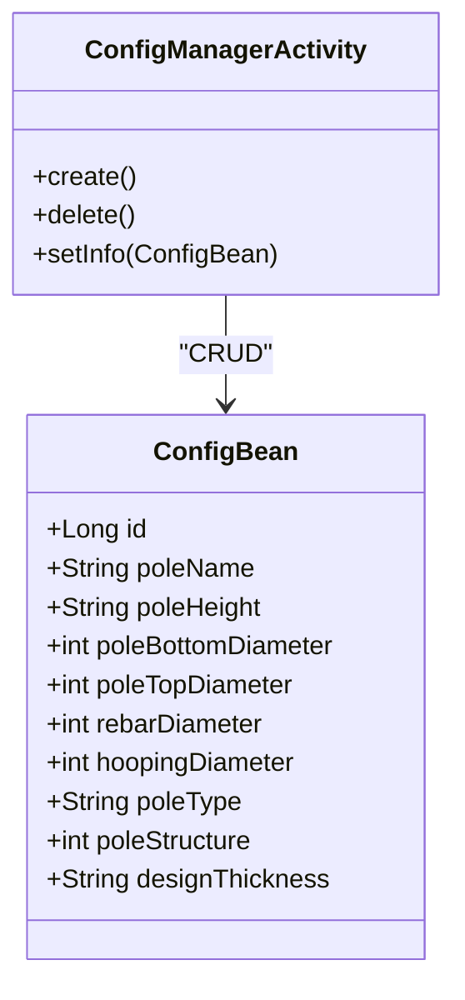
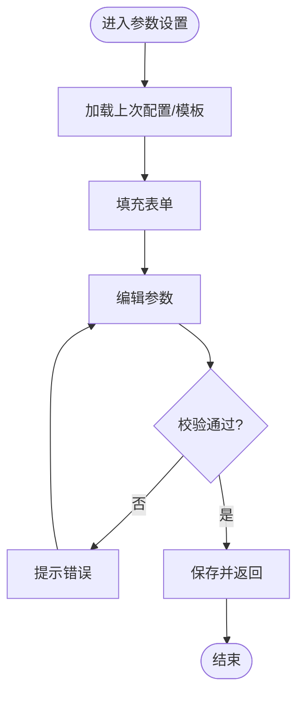
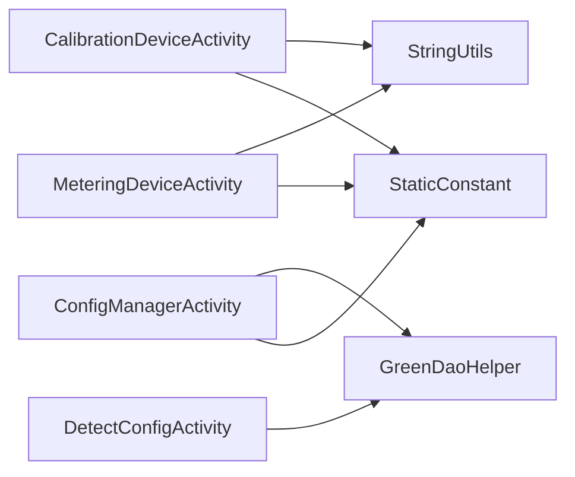

# 配置设置

<cite>
**本文引用的文件**
- [CalibrationDeviceActivity.java](file://app/src/main/java/com/example/gtj_sd_dg240/activity/setting/CalibrationDeviceActivity.java)
- [MeteringDeviceActivity.java](file://app/src/main/java/com/example/gtj_sd_dg240/activity/setting/MeteringDeviceActivity.java)
- [ConfigManagerActivity.java](file://app/src/main/java/com/example/gtj_sd_dg240/activity/testing/ConfigManagerActivity.java)
- [DetectConfigActivity.java](file://app/src/main/java/com/example/gtj_sd_dg240/activity/testing/DetectConfigActivity.java)
- [ConfigBean.java](file://app/src/main/java/com/example/gtj_sd_dg240/model/ConfigBean.java)
- [MeteringBean.java](file://app/src/main/java/com/example/gtj_sd_dg240/model/MeteringBean.java)
- [StaticConstant.java](file://app/src/main/java/com/example/gtj_sd_dg240/StaticConstant.java)
- [GreenDaoHelper.java](file://app/src/main/java/com/example/gtj_sd_dg240/storage/GreenDaoHelper.java)
- [StringUtils.java](file://app/src/main/java/com/example/gtj_sd_dg240/utils/StringUtils.java)
- [DataExportActivity.java](file://app/src/main/java/com/example/gtj_sd_dg240/activity/data/DataExportActivity.java)
</cite>

## 目录
1. [简介](#简介)
2. [项目结构](#项目结构)
3. [核心组件](#核心组件)
4. [架构总览](#架构总览)
5. [详细组件分析](#详细组件分析)
6. [依赖关系分析](#依赖关系分析)
7. [性能考虑](#性能考虑)
8. [故障排查指南](#故障排查指南)
9. [结论](#结论)
10. [附录](#附录)

## 简介
本文件面向GTJ-SD-DG240应用的“配置设置”能力，系统梳理并说明以下方面：
- 配置项管理、参数验证与默认值机制
- 设备校准流程、参数计算与精度调整
- 计量设备配置、检测参数设置、用户偏好管理
- 配置数据的持久化存储、版本兼容与迁移策略
- 配置导入导出、批量设置、模板管理
- 通过API动态修改配置、监听变更与热更新实现思路

## 项目结构
围绕配置与校准的核心代码分布在如下模块：
- 设置与校准界面：CalibrationDeviceActivity（钢筋校准）、MeteringDeviceActivity（计量）
- 配置管理：ConfigManagerActivity（电杆配置CRUD）、DetectConfigActivity（检测参数设置）
- 数据模型与常量：ConfigBean、MeteringBean、StaticConstant
- 数据访问：GreenDaoHelper（数据库会话封装）
- 工具类：StringUtils（数值处理、插值等）
- 数据导出：DataExportActivity（结果导出，间接体现配置在业务中的使用）

图表来源
- [CalibrationDeviceActivity.java:1-382](file://app/src/main/java/com/example/gtj_sd_dg240/activity/setting/CalibrationDeviceActivity.java#L1-L382)
- [MeteringDeviceActivity.java:1-147](file://app/src/main/java/com/example/gtj_sd_dg240/activity/setting/MeteringDeviceActivity.java#L1-L147)
- [ConfigManagerActivity.java:1-345](file://app/src/main/java/com/example/gtj_sd_dg240/activity/testing/ConfigManagerActivity.java#L1-L345)
- [DetectConfigActivity.java:1-376](file://app/src/main/java/com/example/gtj_sd_dg240/activity/testing/DetectConfigActivity.java#L1-L376)
- [ConfigBean.java:1-151](file://app/src/main/java/com/example/gtj_sd_dg240/model/ConfigBean.java#L1-L151)
- [MeteringBean.java:1-15](file://app/src/main/java/com/example/gtj_sd_dg240/model/MeteringBean.java#L1-L15)
- [StaticConstant.java:1-87](file://app/src/main/java/com/example/gtj_sd_dg240/StaticConstant.java#L1-L87)
- [GreenDaoHelper.java:1-42](file://app/src/main/java/com/example/gtj_sd_dg240/storage/GreenDaoHelper.java#L1-L42)
- [StringUtils.java:1-300](file://app/src/main/java/com/example/gtj_sd_dg240/utils/StringUtils.java#L1-L300)

章节来源
- [CalibrationDeviceActivity.java:1-382](file://app/src/main/java/com/example/gtj_sd_dg240/activity/setting/CalibrationDeviceActivity.java#L1-L382)
- [MeteringDeviceActivity.java:1-147](file://app/src/main/java/com/example/gtj_sd_dg240/activity/setting/MeteringDeviceActivity.java#L1-L147)
- [ConfigManagerActivity.java:1-345](file://app/src/main/java/com/example/gtj_sd_dg240/activity/testing/ConfigManagerActivity.java#L1-L345)
- [DetectConfigActivity.java:1-376](file://app/src/main/java/com/example/gtj_sd_dg240/activity/testing/DetectConfigActivity.java#L1-L376)

## 核心组件
- 钢筋校准（CalibrationDeviceActivity）
  - 负责采集信号、取均值、记录最大值、三次平均、保存校准表（标准值与测量值映射）
  - 使用SharedPreferences持久化校准表，支持一键恢复默认
- 计量（MeteringDeviceActivity）
  - 根据选择的钢筋直径选择对应标定表，将信号值转换为保护层厚度
  - 列表展示单次检测结果，退出时持久化
- 配置管理（ConfigManagerActivity）
  - 按电杆类型分组管理配置项，支持创建、删除、批量操作
  - 使用GreenDao持久化ConfigBean
- 检测参数设置（DetectConfigActivity）
  - 维护检测任务相关参数（工程、构件编号、尺寸、规范、设计保护层厚度等）
  - 校验必填项、唯一性，保存为ZoneBean并缓存最近一次配置
- 数据模型与常量
  - ConfigBean：电杆配置实体
  - MeteringBean：计量结果条目
  - StaticConstant：全局枚举、默认值、蓝牙特征等
- 工具与存储
  - StringUtils：四舍五入、插值、进制转换等
  - GreenDaoHelper：数据库会话封装

章节来源
- [CalibrationDeviceActivity.java:73-110](file://app/src/main/java/com/example/gtj_sd_dg240/activity/setting/CalibrationDeviceActivity.java#L73-L110)
- [MeteringDeviceActivity.java:64-134](file://app/src/main/java/com/example/gtj_sd_dg240/activity/setting/MeteringDeviceActivity.java#L64-L134)
- [ConfigManagerActivity.java:71-202](file://app/src/main/java/com/example/gtj_sd_dg240/activity/testing/ConfigManagerActivity.java#L71-L202)
- [DetectConfigActivity.java:71-127](file://app/src/main/java/com/example/gtj_sd_dg240/activity/testing/DetectConfigActivity.java#L71-L127)
- [ConfigBean.java:13-151](file://app/src/main/java/com/example/gtj_sd_dg240/model/ConfigBean.java#L13-L151)
- [MeteringBean.java:1-15](file://app/src/main/java/com/example/gtj_sd_dg240/model/MeteringBean.java#L1-L15)
- [StaticConstant.java:43-65](file://app/src/main/java/com/example/gtj_sd_dg240/StaticConstant.java#L43-L65)
- [GreenDaoHelper.java:16-40](file://app/src/main/java/com/example/gtj_sd_dg240/storage/GreenDaoHelper.java#L16-L40)
- [StringUtils.java:186-257](file://app/src/main/java/com/example/gtj_sd_dg240/utils/StringUtils.java#L186-L257)

## 架构总览
配置与校准的整体交互如下：
- 用户通过界面输入或选择参数
- 参数经校验后写入本地存储（SharedPreferences/GreenDao）
- 运行时读取配置用于信号到厚度的换算、检测流程控制
- 校准过程采用滑动窗口与均值滤波提升稳定性，并通过分段线性插值提高精度

图表来源
- [CalibrationDeviceActivity.java:112-188](file://app/src/main/java/com/example/gtj_sd_dg240/activity/setting/CalibrationDeviceActivity.java#L112-L188)
- [CalibrationDeviceActivity.java:300-373](file://app/src/main/java/com/example/gtj_sd_dg240/activity/setting/CalibrationDeviceActivity.java#L300-L373)
- [StringUtils.java:228-257](file://app/src/main/java/com/example/gtj_sd_dg240/utils/StringUtils.java#L228-L257)

## 详细组件分析

### 钢筋校准（CalibrationDeviceActivity）
- 功能要点
  - 从SharedPreferences加载校准表（标准值与测量值），填充UI
  - 接收蓝牙数据，进行去抖、均值滤波、最大值捕获
  - 三次采集取平均，降低随机误差
  - 基于分段线性插值计算偏移量，完成信号到真实值的校正
  - 提供默认值恢复与保存
- 关键算法
  - 均值滤波：使用优化后的截尾均值工具
  - 最大值捕获：滑动窗口内记录最大信号
  - 插值校正：根据当前信号落入的区间，利用相邻标定点线性插值得到偏移
- 错误处理与提示
  - 必填字段校验，未填全提示
  - 对话框确认重置默认值
  - 语音播报采集完成

图表来源
- [CalibrationDeviceActivity.java:129-188](file://app/src/main/java/com/example/gtj_sd_dg240/activity/setting/CalibrationDeviceActivity.java#L129-L188)
- [CalibrationDeviceActivity.java:199-215](file://app/src/main/java/com/example/gtj_sd_dg240/activity/setting/CalibrationDeviceActivity.java#L199-L215)
- [CalibrationDeviceActivity.java:300-373](file://app/src/main/java/com/example/gtj_sd_dg240/activity/setting/CalibrationDeviceActivity.java#L300-L373)

章节来源
- [CalibrationDeviceActivity.java:73-110](file://app/src/main/java/com/example/gtj_sd_dg240/activity/setting/CalibrationDeviceActivity.java#L73-L110)
- [CalibrationDeviceActivity.java:112-188](file://app/src/main/java/com/example/gtj_sd_dg240/activity/setting/CalibrationDeviceActivity.java#L112-L188)
- [CalibrationDeviceActivity.java:199-215](file://app/src/main/java/com/example/gtj_sd_dg240/activity/setting/CalibrationDeviceActivity.java#L199-L215)
- [CalibrationDeviceActivity.java:217-373](file://app/src/main/java/com/example/gtj_sd_dg240/activity/setting/CalibrationDeviceActivity.java#L217-L373)

### 计量设备（MeteringDeviceActivity）
- 功能要点
  - 根据选择的钢筋直径切换对应的标定表
  - 解析蓝牙数据，左右信号取平均得到信号值
  - 使用分段线性插值将信号值映射为保护层厚度
  - 列表展示结果，退出时持久化
- 精度调整
  - 通过不同直径的标定表与插值算法保证在不同信号范围内的精度

图表来源
- [MeteringDeviceActivity.java:64-134](file://app/src/main/java/com/example/gtj_sd_dg240/activity/setting/MeteringDeviceActivity.java#L64-L134)
- [MeteringDeviceActivity.java:136-145](file://app/src/main/java/com/example/gtj_sd_dg240/activity/setting/MeteringDeviceActivity.java#L136-L145)

章节来源
- [MeteringDeviceActivity.java:46-145](file://app/src/main/java/com/example/gtj_sd_dg240/activity/setting/MeteringDeviceActivity.java#L46-L145)

### 配置管理（ConfigManagerActivity）
- 功能要点
  - 按电杆类型分组显示配置，支持全选/单选删除
  - 创建新配置时进行完整性与合法性校验（如设计保护层厚度≥0）
  - 名称唯一性检查，避免重复
  - 使用GreenDao持久化ConfigBean
- 批量操作
  - 支持按类型批量勾选删除，减少重复操作

图表来源
- [ConfigBean.java:13-151](file://app/src/main/java/com/example/gtj_sd_dg240/model/ConfigBean.java#L13-L151)
- [ConfigManagerActivity.java:214-345](file://app/src/main/java/com/example/gtj_sd_dg240/activity/testing/ConfigManagerActivity.java#L214-L345)

章节来源
- [ConfigManagerActivity.java:71-202](file://app/src/main/java/com/example/gtj_sd_dg240/activity/testing/ConfigManagerActivity.java#L71-L202)
- [ConfigManagerActivity.java:214-345](file://app/src/main/java/com/example/gtj_sd_dg240/activity/testing/ConfigManagerActivity.java#L214-L345)

### 检测参数设置（DetectConfigActivity）
- 功能要点
  - 维护工程、构件编号、尺寸、规范、设计保护层厚度等
  - 自动同步等径杆上下径一致
  - 保存前进行必填项校验、唯一性校验
  - 将最近一次配置缓存至SharedPreferences，便于下次复用
- 与配置管理的联动
  - 可从配置管理页面选择模板回填参数

图表来源
- [DetectConfigActivity.java:71-127](file://app/src/main/java/com/example/gtj_sd_dg240/activity/testing/DetectConfigActivity.java#L71-L127)
- [DetectConfigActivity.java:281-367](file://app/src/main/java/com/example/gtj_sd_dg240/activity/testing/DetectConfigActivity.java#L281-L367)

章节来源
- [DetectConfigActivity.java:138-177](file://app/src/main/java/com/example/gtj_sd_dg240/activity/testing/DetectConfigActivity.java#L138-L177)
- [DetectConfigActivity.java:229-367](file://app/src/main/java/com/example/gtj_sd_dg240/activity/testing/DetectConfigActivity.java#L229-L367)

### 数据导出（DataExportActivity）
- 作用
  - 将检测数据与快照导出到本地与USB，便于归档与上报
  - 间接体现配置在业务中的使用（工程名、构件号、尺寸等）

章节来源
- [DataExportActivity.java:346-470](file://app/src/main/java/com/example/gtj_sd_dg240/activity/data/DataExportActivity.java#L346-L470)

## 依赖关系分析
- 配置与校准对工具类的依赖
  - StringUtils提供四舍五入、插值、进制转换等基础能力
- 配置持久化
  - SharedPreferences用于轻量配置（校准表、计量列表、语言等）
  - GreenDao用于结构化配置（ConfigBean）
- 常量与枚举
  - StaticConstant集中管理电杆类型、直径、规范等枚举与默认值

图表来源
- [CalibrationDeviceActivity.java:199-215](file://app/src/main/java/com/example/gtj_sd_dg240/activity/setting/CalibrationDeviceActivity.java#L199-L215)
- [MeteringDeviceActivity.java:64-134](file://app/src/main/java/com/example/gtj_sd_dg240/activity/setting/MeteringDeviceActivity.java#L64-L134)
- [ConfigManagerActivity.java:71-202](file://app/src/main/java/com/example/gtj_sd_dg240/activity/testing/ConfigManagerActivity.java#L71-L202)
- [DetectConfigActivity.java:138-177](file://app/src/main/java/com/example/gtj_sd_dg240/activity/testing/DetectConfigActivity.java#L138-L177)
- [StaticConstant.java:43-65](file://app/src/main/java/com/example/gtj_sd_dg240/StaticConstant.java#L43-L65)
- [GreenDaoHelper.java:16-40](file://app/src/main/java/com/example/gtj_sd_dg240/storage/GreenDaoHelper.java#L16-L40)

章节来源
- [StaticConstant.java:43-65](file://app/src/main/java/com/example/gtj_sd_dg240/StaticConstant.java#L43-L65)
- [GreenDaoHelper.java:16-40](file://app/src/main/java/com/example/gtj_sd_dg240/storage/GreenDaoHelper.java#L16-L40)

## 性能考虑
- 数据采集与处理
  - 使用线程池定时刷新计时器，避免阻塞UI
  - 滑动窗口与均值滤波降低噪声，减少无效更新
- 插值计算
  - 分段线性插值时间复杂度O(n)，n为标定点数量；合理控制标定点规模可保证实时性
- 存储I/O
  - 校准表与计量列表使用SharedPreferences，适合小体积高频读写
  - 配置管理使用GreenDao，适合结构化数据的高效查询与插入

[本节为通用指导，不直接分析具体文件]

## 故障排查指南
- 常见错误与提示
  - 校准表未填写完整：提示“请填写完整”，阻止保存
  - 设计保护层厚度非法：提示需≥0mm
  - 配置名称重复：提示不可重复
  - 构件编号重复：提示已存在同编号数据
- 恢复机制
  - 校准页提供“恢复默认”按钮，快速回退到内置默认值
  - 计量页退出时自动保存列表，异常退出后可恢复
- 建议
  - 在新增配置或校准前，先备份现有配置（可通过导出功能或手动复制SharedPreferences）
  - 对关键参数增加范围校验与单位提示，减少误操作

章节来源
- [CalibrationDeviceActivity.java:300-373](file://app/src/main/java/com/example/gtj_sd_dg240/activity/setting/CalibrationDeviceActivity.java#L300-L373)
- [ConfigManagerActivity.java:214-345](file://app/src/main/java/com/example/gtj_sd_dg240/activity/testing/ConfigManagerActivity.java#L214-L345)
- [DetectConfigActivity.java:281-367](file://app/src/main/java/com/example/gtj_sd_dg240/activity/testing/DetectConfigActivity.java#L281-L367)

## 结论
本应用通过清晰的界面与稳健的数据处理流程，实现了：
- 可靠的设备校准与计量能力
- 完善的配置管理与参数设置
- 基于SharedPreferences与GreenDao的持久化方案
- 合理的精度提升手段（均值滤波、分段线性插值）
后续可在以下方面增强：
- 配置版本化与迁移脚本
- 配置导入导出与模板库
- 配置变更监听与热更新机制

[本节为总结性内容，不直接分析具体文件]

## 附录

### 配置类型与用途
- 计量设备配置
  - 选择钢筋直径，切换标定表，实时显示保护层厚度
- 检测参数设置
  - 工程、构件编号、尺寸、规范、设计保护层厚度等
- 用户偏好管理
  - 语言、最近配置缓存等

章节来源
- [MeteringDeviceActivity.java:64-134](file://app/src/main/java/com/example/gtj_sd_dg240/activity/setting/MeteringDeviceActivity.java#L64-L134)
- [DetectConfigActivity.java:71-127](file://app/src/main/java/com/example/gtj_sd_dg240/activity/testing/DetectConfigActivity.java#L71-L127)
- [StaticConstant.java:43-65](file://app/src/main/java/com/example/gtj_sd_dg240/StaticConstant.java#L43-L65)

### 配置验证规则与错误提示
- 必填项校验：所有关键字段为空时提示“请填写完整”
- 数值合法性：设计保护层厚度≥0
- 唯一性约束：配置名称、构件编号不可重复
- 提示方式：Toast与对话框结合

章节来源
- [ConfigManagerActivity.java:214-254](file://app/src/main/java/com/example/gtj_sd_dg240/activity/testing/ConfigManagerActivity.java#L214-L254)
- [DetectConfigActivity.java:281-318](file://app/src/main/java/com/example/gtj_sd_dg240/activity/testing/DetectConfigActivity.java#L281-L318)
- [CalibrationDeviceActivity.java:300-373](file://app/src/main/java/com/example/gtj_sd_dg240/activity/setting/CalibrationDeviceActivity.java#L300-L373)

### 配置持久化与版本兼容
- 持久化位置
  - SharedPreferences：校准表、计量列表、语言等
  - GreenDao：ConfigBean等结构化配置
- 版本兼容与迁移
  - 建议在新增配置字段时引入版本号，并在启动时执行迁移逻辑
  - 对历史数据做兼容性判断，缺失字段赋予安全默认值

[本节为通用指导，不直接分析具体文件]

### 配置导入导出与模板管理
- 导出
  - 数据导出活动可将检测结果与快照导出到本地与USB
- 导入与模板
  - 可在配置管理中预设常用模板，新建检测时快速选择
  - 未来可扩展JSON/XML格式的导入导出以支持批量设置

章节来源
- [DataExportActivity.java:346-470](file://app/src/main/java/com/example/gtj_sd_dg240/activity/data/DataExportActivity.java#L346-L470)
- [ConfigManagerActivity.java:71-202](file://app/src/main/java/com/example/gtj_sd_dg240/activity/testing/ConfigManagerActivity.java#L71-L202)

### 动态修改配置、监听变更与热更新
- 动态修改
  - 通过SharedPreferences直接写入键值对，或在配置管理界面修改后保存
- 监听变更
  - 可在关键配置处增加监听器，当配置变化时刷新UI或重新计算标定表
- 热更新
  - 对于校准表与计量表，建议在内存中维护副本，配置变更后即时生效，无需重启

[本节为通用指导，不直接分析具体文件]