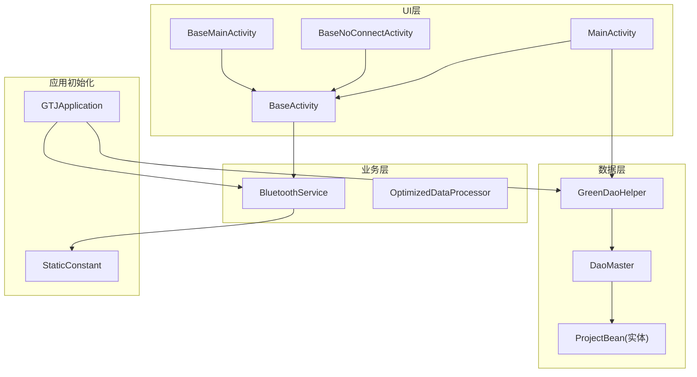
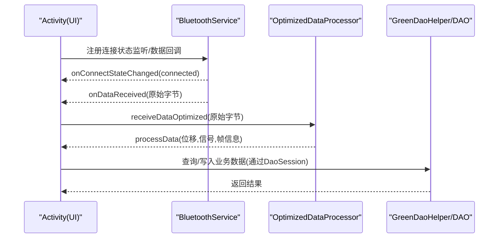
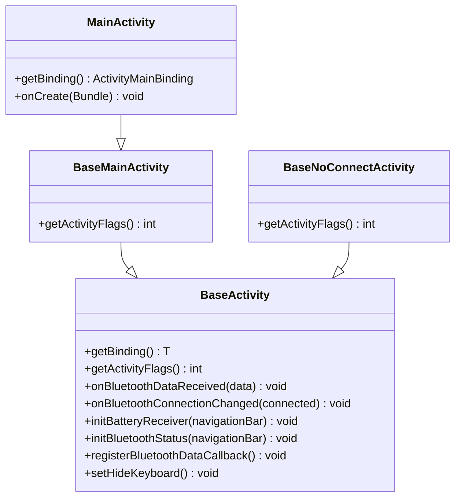
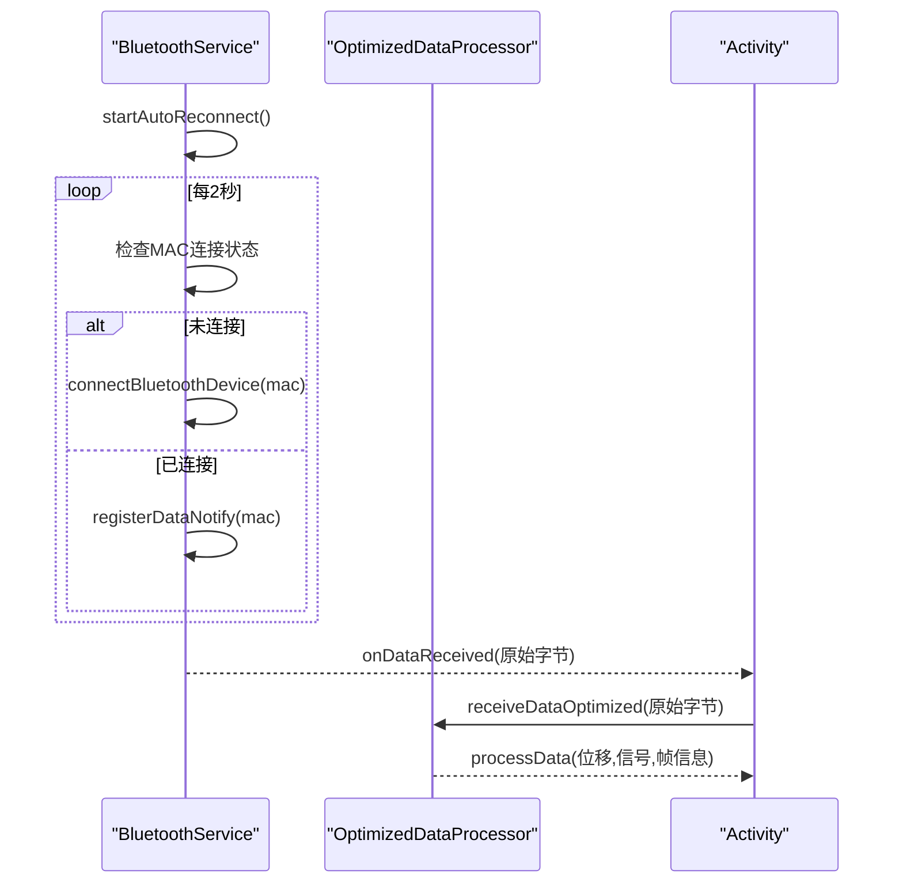
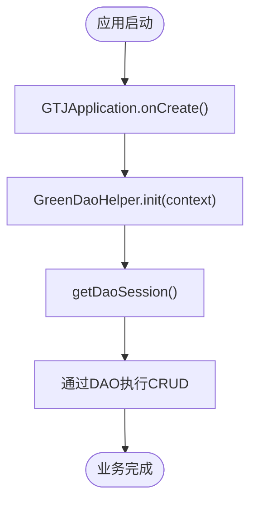
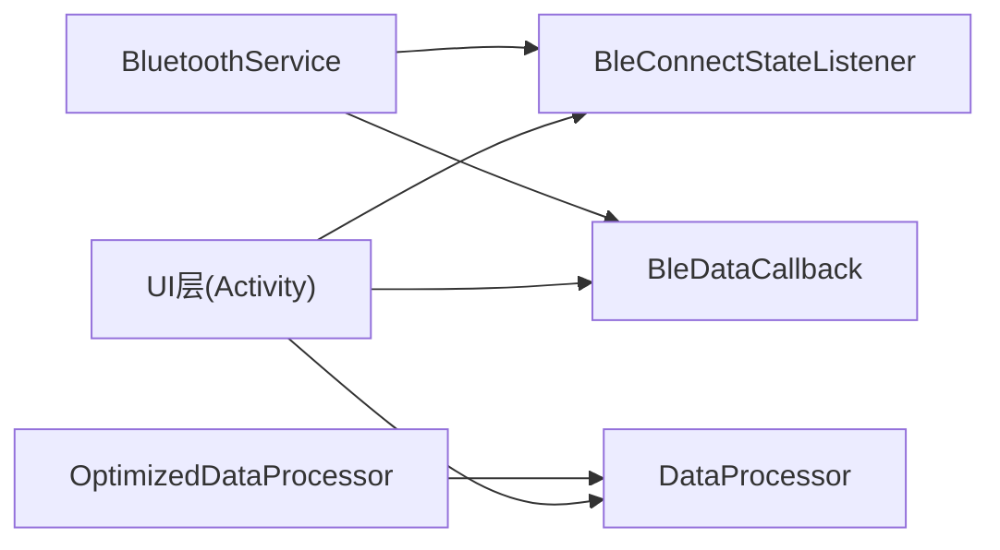
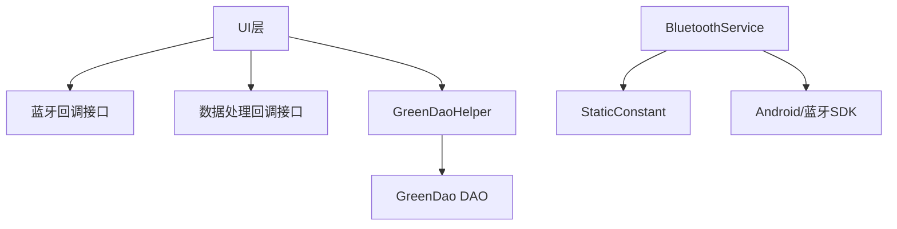

# 分层架构实现

<cite>
**本文引用的文件**
- [BaseActivity.java](file://app/src/main/java/com/example/gtj_sd_dg240/activity/start/BaseActivity.java)
- [BaseMainActivity.java](file://app/src/main/java/com/example/gtj_sd_dg240/activity/start/BaseMainActivity.java)
- [BaseNoConnectActivity.java](file://app/src/main/java/com/example/gtj_sd_dg240/activity/start/BaseNoConnectActivity.java)
- [MainActivity.java](file://app/src/main/java/com/example/gtj_sd_dg240/activity/MainActivity.java)
- [BluetoothService.java](file://app/src/main/java/com/example/gtj_sd_dg240/bluetooth/BluetoothService.java)
- [BleConnectStateListener.java](file://app/src/main/java/com/example/gtj_sd_dg240/bluetooth/BleConnectStateListener.java)
- [BleDataCallback.java](file://app/src/main/java/com/example/gtj_sd_dg240/bluetooth/BleDataCallback.java)
- [GreenDaoHelper.java](file://app/src/main/java/com/example/gtj_sd_dg240/storage/GreenDaoHelper.java)
- [DaoMaster.java](file://app/src/main/java/com/example/gtj_sd_dg240/functions/database/greenDao/db/DaoMaster.java)
- [ProjectBean.java](file://app/src/main/java/com/example/gtj_sd_dg240/model/ProjectBean.java)
- [GTJApplication.java](file://app/src/main/java/com/example/gtj_sd_dg240/GTJApplication.java)
- [StaticConstant.java](file://app/src/main/java/com/example/gtj_sd_dg240/StaticConstant.java)
- [OptimizedDataProcessor.java](file://app/src/main/java/com/example/gtj_sd_dg240/utils/OptimizedDataProcessor.java)
</cite>

## 目录
1. [简介](#简介)
2. [项目结构](#项目结构)
3. [核心组件](#核心组件)
4. [架构总览](#架构总览)
5. [详细组件分析](#详细组件分析)
6. [依赖关系分析](#依赖关系分析)
7. [性能考量](#性能考量)
8. [故障排查指南](#故障排查指南)
9. [结论](#结论)
10. [附录：典型使用模式与示例路径](#附录：典型使用模式与示例路径)

## 简介
本文件面向 GTJ-SD-DG240 应用的分层架构实现，聚焦以下目标：
- UI 层（Activity 基类体系）：统一窗口、状态栏、蓝牙接入、生命周期与通用能力封装。
- 业务逻辑层（蓝牙服务、数据处理）：单例蓝牙服务统一管理连接、重连、数据分发；高吞吐数据解析与处理。
- 数据访问层（GreenDao 封装）：统一的数据库会话获取与 DAO 操作入口。
- 分层通信机制：基于回调接口与事件式监听完成跨层解耦通信。
- 提供各层典型使用模式的代码路径参考，便于快速上手与扩展。

## 项目结构
本项目采用“UI层—业务层—数据层”的清晰分层组织方式：
- UI 层：以 BaseActivity 为根，派生出 BaseMainActivity、BaseNoConnectActivity，具体页面继承相应基类。
- 业务层：BluetoothService 负责蓝牙连接与数据分发；OptimizedDataProcessor 负责高频数据缓冲与解析。
- 数据层：GreenDaoHelper 封装 DaoMaster/DaoSession 的创建与复用；各实体模型通过注解生成 DAO。
- 应用初始化：GTJApplication 集中初始化蓝牙库、日志、崩溃收集、定位、Toast 等全局能力。

**图表来源**
- [BaseActivity.java:40-98](file://app/src/main/java/com/example/gtj_sd_dg240/activity/start/BaseActivity.java#L40-L98)
- [BaseMainActivity.java:9-15](file://app/src/main/java/com/example/gtj_sd_dg240/activity/start/BaseMainActivity.java#L9-L15)
- [BaseNoConnectActivity.java:9-15](file://app/src/main/java/com/example/gtj_sd_dg240/activity/start/BaseNoConnectActivity.java#L9-L15)
- [MainActivity.java:41-63](file://app/src/main/java/com/example/gtj_sd_dg240/activity/MainActivity.java#L41-L63)
- [BluetoothService.java:16-52](file://app/src/main/java/com/example/gtj_sd_dg240/bluetooth/BluetoothService.java#L16-L52)
- [GreenDaoHelper.java:10-40](file://app/src/main/java/com/example/gtj_sd_dg240/storage/GreenDaoHelper.java#L10-L40)
- [DaoMaster.java:19-65](file://app/src/main/java/com/example/gtj_sd_dg240/functions/database/greenDao/db/DaoMaster.java#L19-L65)
- [ProjectBean.java:14-38](file://app/src/main/java/com/example/gtj_sd_dg240/model/ProjectBean.java#L14-L38)
- [GTJApplication.java:18-41](file://app/src/main/java/com/example/gtj_sd_dg240/GTJApplication.java#L18-L41)
- [StaticConstant.java:67-70](file://app/src/main/java/com/example/gtj_sd_dg240/StaticConstant.java#L67-L70)

**章节来源**
- [BaseActivity.java:40-98](file://app/src/main/java/com/example/gtj_sd_dg240/activity/start/BaseActivity.java#L40-L98)
- [GTJApplication.java:18-41](file://app/src/main/java/com/example/gtj_sd_dg240/GTJApplication.java#L18-L41)

## 核心组件
- BaseActivity：统一窗口配置、状态栏适配、ViewBinding 注入、线程池与 Handler、电池电量监听、蓝牙自动重连与数据回调注册、软键盘隐藏策略、资源释放。
- BluetoothService：单例管理蓝牙连接状态、自动重连定时器、数据通知注册与分发、写数据与断开连接。
- GreenDaoHelper：懒加载 DaoMaster/DaoSession，屏蔽底层细节，提供统一 DAO 访问入口。
- OptimizedDataProcessor：生产者-消费者模式的高频数据缓冲与帧拼接解析，降低主线程压力。
- StaticConstant：全局常量（如蓝牙 Service/Character UUID、数据库名等）。

**章节来源**
- [BaseActivity.java:40-335](file://app/src/main/java/com/example/gtj_sd_dg240/activity/start/BaseActivity.java#L40-L335)
- [BluetoothService.java:16-312](file://app/src/main/java/com/example/gtj_sd_dg240/bluetooth/BluetoothService.java#L16-L312)
- [GreenDaoHelper.java:10-40](file://app/src/main/java/com/example/gtj_sd_dg240/storage/GreenDaoHelper.java#L10-L40)
- [OptimizedDataProcessor.java:7-135](file://app/src/main/java/com/example/gtj_sd_dg240/utils/OptimizedDataProcessor.java#L7-L135)
- [StaticConstant.java:28-30](file://app/src/main/java/com/example/gtj_sd_dg240/StaticConstant.java#L28-L30)

## 架构总览
分层职责与交互：
- UI 层通过 BaseActivity 暴露统一的生命周期与蓝牙接入能力，具体 Activity 仅关注业务展示与交互。
- 业务层由 BluetoothService 统一管理设备连接与数据流，向上提供连接状态与数据回调；数据处理通过 OptimizedDataProcessor 在子线程完成，避免阻塞 UI。
- 数据层通过 GreenDaoHelper 提供 DaoSession，DAO 由 GreenDao 自动生成，上层无需关心数据库版本与表结构。

**图表来源**
- [BaseActivity.java:188-282](file://app/src/main/java/com/example/gtj_sd_dg240/activity/start/BaseActivity.java#L188-L282)
- [BluetoothService.java:124-198](file://app/src/main/java/com/example/gtj_sd_dg240/bluetooth/BluetoothService.java#L124-L198)
- [OptimizedDataProcessor.java:29-133](file://app/src/main/java/com/example/gtj_sd_dg240/utils/OptimizedDataProcessor.java#L29-L133)
- [GreenDaoHelper.java:20-40](file://app/src/main/java/com/example/gtj_sd_dg240/storage/GreenDaoHelper.java#L20-L40)

## 详细组件分析

### UI 层：Activity 基类体系
- 设计要点
  - BaseActivity 抽象出 ViewBinding 注入、窗口全屏与虚拟按键控制、状态栏高度适配、电池电量监听、蓝牙自动重连开关、数据回调注册与注销、线程池与主线程 Handler、软键盘隐藏策略。
  - BaseMainActivity 默认启用自动重连但不隐藏虚拟按键；BaseNoConnectActivity 不启用自动重连但隐藏虚拟按键。
  - 具体 Activity 只需实现 getBinding()，并在 onCreate 中按需调用 initBatteryReceiver、initBluetoothStatus、registerBluetoothDataCallback 等。
- 生命周期与资源管理
  - onStart/onStop 维护 isShow 标志，确保仅在可见时处理蓝牙数据。
  - onDestroy 中统一注销广播、蓝牙监听器、关闭线程池、取消 Toast。
- 蓝牙集成
  - 通过 BluetoothService.getInstance() 获取单例并启动自动重连；可注册连接状态监听与数据回调。
  - 若未启用自动重连，则从 SP 读取 MAC 并检查连接状态，用于 UI 图标显示。

**图表来源**
- [BaseActivity.java:40-98](file://app/src/main/java/com/example/gtj_sd_dg240/activity/start/BaseActivity.java#L40-L98)
- [BaseMainActivity.java:9-15](file://app/src/main/java/com/example/gtj_sd_dg240/activity/start/BaseMainActivity.java#L9-L15)
- [BaseNoConnectActivity.java:9-15](file://app/src/main/java/com/example/gtj_sd_dg240/activity/start/BaseNoConnectActivity.java#L9-L15)
- [MainActivity.java:41-63](file://app/src/main/java/com/example/gtj_sd_dg240/activity/MainActivity.java#L41-L63)

**章节来源**
- [BaseActivity.java:40-335](file://app/src/main/java/com/example/gtj_sd_dg240/activity/start/BaseActivity.java#L40-L335)
- [BaseMainActivity.java:9-15](file://app/src/main/java/com/example/gtj_sd_dg240/activity/start/BaseMainActivity.java#L9-L15)
- [BaseNoConnectActivity.java:9-15](file://app/src/main/java/com/example/gtj_sd_dg240/activity/start/BaseNoConnectActivity.java#L9-L15)
- [MainActivity.java:41-63](file://app/src/main/java/com/example/gtj_sd_dg240/activity/MainActivity.java#L41-L63)

### 业务逻辑层：蓝牙服务与数据处理
- BluetoothService（单例）
  - 单例模式保证全局唯一实例，持有连接状态与已连接 MAC。
  - 自动重连：定时任务周期性尝试连接保存的 MAC；连接成功则注册数据通知，失败则继续重试。
  - 数据分发：通过 CopyOnWriteArrayList 维护多个 BleDataCallback，在主线程回调 onDataReceived。
  - 连接状态：维护 BleConnectStateListener 列表，连接变化时统一通知。
  - 写数据与断开：封装 writeData 与 disconnect，简化上层调用。
- OptimizedDataProcessor（高吞吐数据处理）
  - 生产者-消费者：使用 LinkedBlockingQueue 缓冲蓝牙帧片段，避免丢包与阻塞。
  - 帧拼接与完整性校验：按固定帧长分段解析，支持断点续拼。
  - 解析后通过 DataProcessor 接口回调到上层，包含位移、信号与帧信息。

**图表来源**
- [BluetoothService.java:76-122](file://app/src/main/java/com/example/gtj_sd_dg240/bluetooth/BluetoothService.java#L76-L122)
- [BluetoothService.java:172-224](file://app/src/main/java/com/example/gtj_sd_dg240/bluetooth/BluetoothService.java#L172-L224)
- [OptimizedDataProcessor.java:29-133](file://app/src/main/java/com/example/gtj_sd_dg240/utils/OptimizedDataProcessor.java#L29-L133)

**章节来源**
- [BluetoothService.java:16-312](file://app/src/main/java/com/example/gtj_sd_dg240/bluetooth/BluetoothService.java#L16-L312)
- [OptimizedDataProcessor.java:7-135](file://app/src/main/java/com/example/gtj_sd_dg240/utils/OptimizedDataProcessor.java#L7-L135)

### 数据访问层：GreenDao 封装
- GreenDaoHelper
  - 懒加载 DaoMaster 与 DaoSession，避免重复创建开销。
  - 对外仅暴露 getDaoSession()，上层通过 DAO 进行增删改查。
- DaoMaster
  - 由 GreenDao 生成，管理所有 DAO 的注册与 Session 创建。
  - 提供 createAllTables/dropAllTables 等工具方法。
- 实体模型
  - ProjectBean 等实体通过注解声明字段与索引，DAO 自动生成。

**图表来源**
- [GTJApplication.java:18-41](file://app/src/main/java/com/example/gtj_sd_dg240/GTJApplication.java#L18-L41)
- [GreenDaoHelper.java:10-40](file://app/src/main/java/com/example/gtj_sd_dg240/storage/GreenDaoHelper.java#L10-L40)
- [DaoMaster.java:19-65](file://app/src/main/java/com/example/gtj_sd_dg240/functions/database/greenDao/db/DaoMaster.java#L19-L65)

**章节来源**
- [GreenDaoHelper.java:10-40](file://app/src/main/java/com/example/gtj_sd_dg240/storage/GreenDaoHelper.java#L10-L40)
- [DaoMaster.java:19-65](file://app/src/main/java/com/example/gtj_sd_dg240/functions/database/greenDao/db/DaoMaster.java#L19-L65)
- [ProjectBean.java:14-38](file://app/src/main/java/com/example/gtj_sd_dg240/model/ProjectBean.java#L14-L38)

### 分层通信机制
- 回调接口
  - BleConnectStateListener：连接状态变化通知。
  - BleDataCallback：蓝牙数据到达与注册失败通知。
  - OptimizedDataProcessor.DataProcessor：数据处理结果回调。
- 事件总线替代方案
  - 当前采用“服务+回调”的轻量事件分发，避免引入额外依赖，保持低耦合。
- 解耦设计
  - UI 层只依赖接口，不感知底层实现；业务层通过接口向 UI 推送数据；数据层对 UI 透明。

**图表来源**
- [BleConnectStateListener.java:6-12](file://app/src/main/java/com/example/gtj_sd_dg240/bluetooth/BleConnectStateListener.java#L6-L12)
- [BleDataCallback.java:6-18](file://app/src/main/java/com/example/gtj_sd_dg240/bluetooth/BleDataCallback.java#L6-L18)
- [OptimizedDataProcessor.java:20-23](file://app/src/main/java/com/example/gtj_sd_dg240/utils/OptimizedDataProcessor.java#L20-L23)

**章节来源**
- [BleConnectStateListener.java:6-12](file://app/src/main/java/com/example/gtj_sd_dg240/bluetooth/BleConnectStateListener.java#L6-L12)
- [BleDataCallback.java:6-18](file://app/src/main/java/com/example/gtj_sd_dg240/bluetooth/BleDataCallback.java#L6-L18)
- [OptimizedDataProcessor.java:20-23](file://app/src/main/java/com/example/gtj_sd_dg240/utils/OptimizedDataProcessor.java#L20-L23)

## 依赖关系分析
- UI 层依赖业务层的回调接口，不直接依赖蓝牙 SDK；通过 BaseActivity 统一接入。
- 业务层依赖静态常量（蓝牙 UUID、数据库名等），并通过 Android 系统 API 与第三方蓝牙库交互。
- 数据层依赖 GreenDao 生成的 DAO，通过 Helper 统一获取会话。
- 应用初始化阶段集中装配全局依赖，避免分散初始化导致的状态不一致。

**图表来源**
- [BaseActivity.java:188-282](file://app/src/main/java/com/example/gtj_sd_dg240/activity/start/BaseActivity.java#L188-L282)
- [BluetoothService.java:54-74](file://app/src/main/java/com/example/gtj_sd_dg240/bluetooth/BluetoothService.java#L54-L74)
- [StaticConstant.java:67-70](file://app/src/main/java/com/example/gtj_sd_dg240/StaticConstant.java#L67-L70)
- [GreenDaoHelper.java:20-40](file://app/src/main/java/com/example/gtj_sd_dg240/storage/GreenDaoHelper.java#L20-L40)

**章节来源**
- [BaseActivity.java:188-282](file://app/src/main/java/com/example/gtj_sd_dg240/activity/start/BaseActivity.java#L188-L282)
- [BluetoothService.java:54-74](file://app/src/main/java/com/example/gtj_sd_dg240/bluetooth/BluetoothService.java#L54-L74)
- [StaticConstant.java:67-70](file://app/src/main/java/com/example/gtj_sd_dg240/StaticConstant.java#L67-L70)
- [GreenDaoHelper.java:20-40](file://app/src/main/java/com/example/gtj_sd_dg240/storage/GreenDaoHelper.java#L20-L40)

## 性能考量
- 蓝牙数据接收与处理分离：BluetoothService 在主线程分发数据，OptimizedDataProcessor 在子线程缓冲与解析，避免 UI 卡顿。
- 队列缓冲：使用有界阻塞队列防止内存溢出与背压问题。
- 线程安全：使用 CopyOnWriteArrayList 管理监听器集合，保证并发安全。
- 数据库批量操作：通过 DAO 的事务插入减少 I/O 次数。
- 建议
  - 在高负载场景下，合理调整队列容量与处理间隔。
  - 对频繁创建的临时对象进行复用或池化。
  - 监控蓝牙连接状态与重连频率，避免频繁连接造成耗电。

[本节为通用指导，不直接分析具体文件]

## 故障排查指南
- 蓝牙无法连接
  - 检查是否已保存 MAC；确认自动重连是否开启；查看连接状态监听回调。
  - 参考路径：[BluetoothService.startAutoReconnect:76-122](file://app/src/main/java/com/example/gtj_sd_dg240/bluetooth/BluetoothService.java#L76-L122)、[BluetoothService.registerInternalListener:124-159](file://app/src/main/java/com/example/gtj_sd_dg240/bluetooth/BluetoothService.java#L124-L159)。
- 数据未到达 UI
  - 确认是否注册了数据回调；检查是否在 Activity 可见时处理数据；核对帧解析逻辑。
  - 参考路径：[BaseActivity.registerBluetoothDataCallback:268-282](file://app/src/main/java/com/example/gtj_sd_dg240/activity/start/BaseActivity.java#L268-L282)、[OptimizedDataProcessor.treatData:77-115](file://app/src/main/java/com/example/gtj_sd_dg240/utils/OptimizedDataProcessor.java#L77-L115)。
- 数据库异常
  - 检查 GreenDaoHelper 初始化是否完成；确认 DAO 是否存在；查看事务插入是否成功。
  - 参考路径：[GTJApplication.onCreate 初始化:18-41](file://app/src/main/java/com/example/gtj_sd_dg240/GTJApplication.java#L18-L41)、[GreenDaoHelper.getDaoSession:20-40](file://app/src/main/java/com/example/gtj_sd_dg240/storage/GreenDaoHelper.java#L20-L40)。

**章节来源**
- [BluetoothService.java:76-159](file://app/src/main/java/com/example/gtj_sd_dg240/bluetooth/BluetoothService.java#L76-L159)
- [BaseActivity.java:268-282](file://app/src/main/java/com/example/gtj_sd_dg240/activity/start/BaseActivity.java#L268-L282)
- [OptimizedDataProcessor.java:77-115](file://app/src/main/java/com/example/gtj_sd_dg240/utils/OptimizedDataProcessor.java#L77-L115)
- [GTJApplication.java:18-41](file://app/src/main/java/com/example/gtj_sd_dg240/GTJApplication.java#L18-L41)
- [GreenDaoHelper.java:20-40](file://app/src/main/java/com/example/gtj_sd_dg240/storage/GreenDaoHelper.java#L20-L40)

## 结论
本分层架构通过清晰的职责划分与接口解耦，实现了：
- UI 层简洁稳定，专注于展示与交互。
- 业务层统一管理与设备通信，具备自动重连与高吞吐处理能力。
- 数据层封装数据库细节，提供一致的数据访问体验。
- 通过回调接口实现跨层通信，易于测试与扩展。
建议在后续迭代中持续优化数据处理算法与蓝牙连接策略，并结合日志与监控提升稳定性。

[本节为总结性内容，不直接分析具体文件]

## 附录：典型使用模式与示例路径
- UI 层基类使用
  - 继承 BaseActivity 或 BaseMainActivity/BaseNoConnectActivity，实现 getBinding()。
  - 在 onCreate 中调用 initBatteryReceiver、initBluetoothStatus、registerBluetoothDataCallback。
  - 参考路径：[BaseActivity.onCreate:91-98](file://app/src/main/java/com/example/gtj_sd_dg240/activity/start/BaseActivity.java#L91-L98)、[MainActivity.onCreate:47-63](file://app/src/main/java/com/example/gtj_sd_dg240/activity/MainActivity.java#L47-L63)。
- 蓝牙服务使用
  - 获取单例并启动自动重连；注册连接状态与数据回调；必要时发送数据或断开连接。
  - 参考路径：[BluetoothService.getInstance/startAutoReconnect/registerConnectListener/registerDataCallback/writeData/disconnect:43-52](file://app/src/main/java/com/example/gtj_sd_dg240/bluetooth/BluetoothService.java#L43-L52)、[BluetoothService.java:76-122](file://app/src/main/java/com/example/gtj_sd_dg240/bluetooth/BluetoothService.java#L76-L122)、[BluetoothService.java:236-299](file://app/src/main/java/com/example/gtj_sd_dg240/bluetooth/BluetoothService.java#L236-L299)。
- 数据处理使用
  - 将蓝牙原始数据传入 OptimizedDataProcessor.receiveDataOptimized，实现 DataProcessor.processData 获取解析结果。
  - 参考路径：[OptimizedDataProcessor.receiveDataOptimized/processData:29-133](file://app/src/main/java/com/example/gtj_sd_dg240/utils/OptimizedDataProcessor.java#L29-L133)。
- 数据访问使用
  - 在 Application 中初始化 GreenDaoHelper；通过 getDaoSession() 获取 DAO 进行 CRUD。
  - 参考路径：[GTJApplication.onCreate:18-41](file://app/src/main/java/com/example/gtj_sd_dg240/GTJApplication.java#L18-L41)、[GreenDaoHelper.getDaoSession:20-40](file://app/src/main/java/com/example/gtj_sd_dg240/storage/GreenDaoHelper.java#L20-L40)。

**章节来源**
- [BaseActivity.java:91-98](file://app/src/main/java/com/example/gtj_sd_dg240/activity/start/BaseActivity.java#L91-L98)
- [MainActivity.java:47-63](file://app/src/main/java/com/example/gtj_sd_dg240/activity/MainActivity.java#L47-L63)
- [BluetoothService.java:43-52](file://app/src/main/java/com/example/gtj_sd_dg240/bluetooth/BluetoothService.java#L43-L52)
- [BluetoothService.java:76-122](file://app/src/main/java/com/example/gtj_sd_dg240/bluetooth/BluetoothService.java#L76-L122)
- [BluetoothService.java:236-299](file://app/src/main/java/com/example/gtj_sd_dg240/bluetooth/BluetoothService.java#L236-L299)
- [OptimizedDataProcessor.java:29-133](file://app/src/main/java/com/example/gtj_sd_dg240/utils/OptimizedDataProcessor.java#L29-L133)
- [GTJApplication.java:18-41](file://app/src/main/java/com/example/gtj_sd_dg240/GTJApplication.java#L18-L41)
- [GreenDaoHelper.java:20-40](file://app/src/main/java/com/example/gtj_sd_dg240/storage/GreenDaoHelper.java#L20-L40)