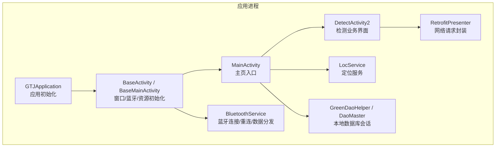
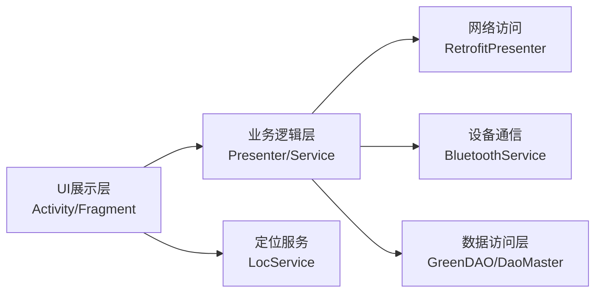
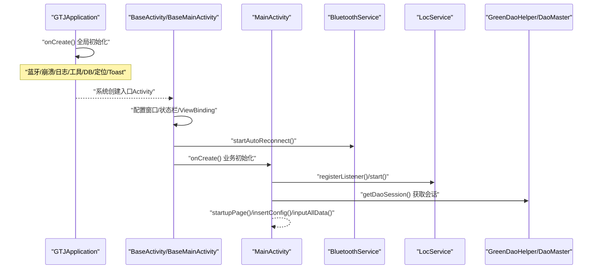
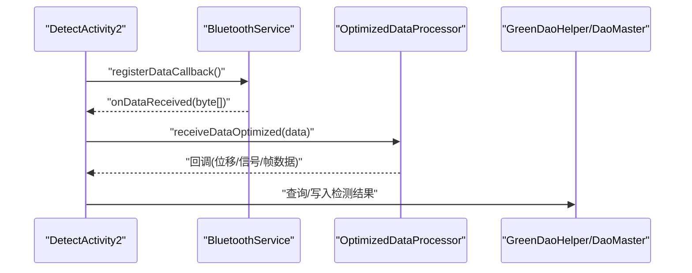
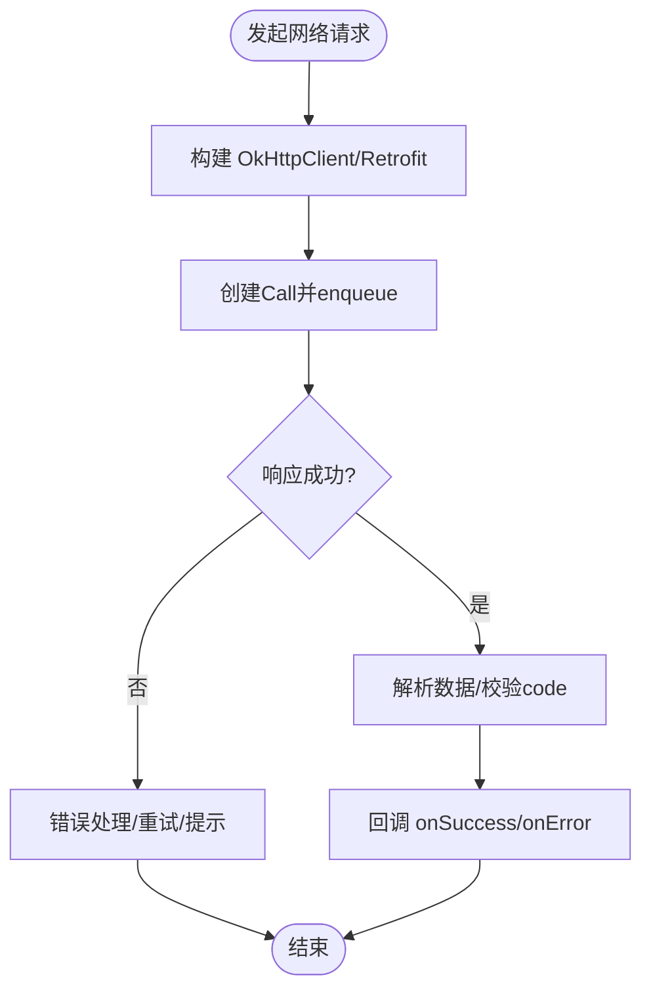
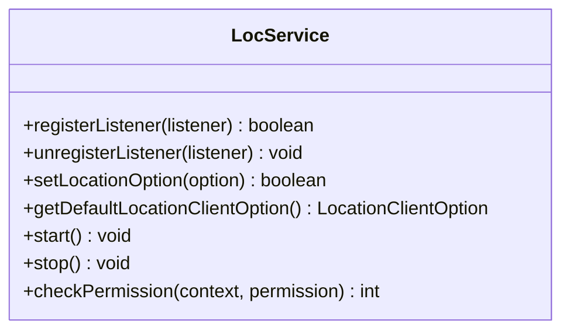
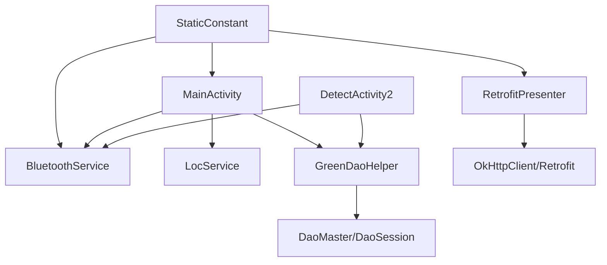

# 整体架构设计

<cite>
**本文引用的文件**
- [GTJApplication.java](file://app/src/main/java/com/example/gtj_sd_dg240/GTJApplication.java)
- [StaticConstant.java](file://app/src/main/java/com/example/gtj_sd_dg240/StaticConstant.java)
- [MainActivity.java](file://app/src/main/java/com/example/gtj_sd_dg240/activity/MainActivity.java)
- [BaseActivity.java](file://app/src/main/java/com/example/gtj_sd_dg240/activity/start/BaseActivity.java)
- [BaseMainActivity.java](file://app/src/main/java/com/example/gtj_sd_dg240/activity/start/BaseMainActivity.java)
- [BluetoothService.java](file://app/src/main/java/com/example/gtj_sd_dg240/bluetooth/BluetoothService.java)
- [GreenDaoHelper.java](file://app/src/main/java/com/example/gtj_sd_dg240/storage/GreenDaoHelper.java)
- [DaoMaster.java](file://app/src/main/java/com/example/gtj_sd_dg240/functions/database/greenDao/db/DaoMaster.java)
- [RetrofitPresenter.java](file://app/src/main/java/com/example/gtj_sd_dg240/net/RetrofitPresenter.java)
- [LocService.java](file://app/src/main/java/com/example/gtj_sd_dg240/utils/LocService.java)
- [DetectActivity2.java](file://app/src/main/java/com/example/gtj_sd_dg240/activity/testing/DetectActivity2.java)
- [BaseMvpActivity.java](file://utillibrary/src/main/java/com/blackhao/utillibrary/mvp/BaseMvpActivity.java)
- [BaseMvpPresenter.java](file://utillibrary/src/main/java/com/blackhao/utillibrary/mvp/BaseMvpPresenter.java)
</cite>

## 目录
1. [简介](#简介)
2. [项目结构](#项目结构)
3. [核心组件](#核心组件)
4. [架构总览](#架构总览)
5. [详细组件分析](#详细组件分析)
6. [依赖关系分析](#依赖关系分析)
7. [性能考虑](#性能考虑)
8. [故障排查指南](#故障排查指南)
9. [结论](#结论)
10. [附录](#附录)

## 简介
本文件为 GTJ-SD-DG240 应用的“整体架构设计”文档，围绕三层架构模式（UI展示层、业务逻辑层、数据访问层）展开，明确各层职责边界与通信机制；梳理应用启动流程（从 GTJApplication 初始化到 MainActivity 加载）；提供系统组件关系图与关键时序图，帮助开发者快速理解整体设计与数据流向。同时说明核心配置管理（StaticConstant 全局常量与应用级配置），并给出可操作的架构图与时序图以辅助理解。

## 项目结构
- UI展示层：以 Activity/Fragment 为主，封装界面渲染、用户交互与基础能力（如蓝牙状态显示、电量监听）。
- 业务逻辑层：通过 Presenter/Service 组织业务流程，协调网络请求、设备通信、数据处理等。
- 数据访问层：基于 GreenDAO 的 DAO/Session 与 Helper 统一管理本地数据库读写；网络通过 RetrofitPresenter 统一封装。

图表来源
- [GTJApplication.java:20-41](file://app/src/main/java/com/example/gtj_sd_dg240/GTJApplication.java#L20-L41)
- [BaseActivity.java:91-98](file://app/src/main/java/com/example/gtj_sd_dg240/activity/start/BaseActivity.java#L91-L98)
- [BaseMainActivity.java:11-15](file://app/src/main/java/com/example/gtj_sd_dg240/activity/start/BaseMainActivity.java#L11-L15)
- [MainActivity.java:47-63](file://app/src/main/java/com/example/gtj_sd_dg240/activity/MainActivity.java#L47-L63)
- [BluetoothService.java:77-109](file://app/src/main/java/com/example/gtj_sd_dg240/bluetooth/BluetoothService.java#L77-L109)
- [LocService.java:28-42](file://app/src/main/java/com/example/gtj_sd_dg240/utils/LocService.java#L28-L42)
- [GreenDaoHelper.java:16-40](file://app/src/main/java/com/example/gtj_sd_dg240/storage/GreenDaoHelper.java#L16-L40)
- [DaoMaster.java:19-65](file://app/src/main/java/com/example/gtj_sd_dg240/functions/database/greenDao/db/DaoMaster.java#L19-L65)
- [RetrofitPresenter.java:31-52](file://app/src/main/java/com/example/gtj_sd_dg240/net/RetrofitPresenter.java#L31-L52)

章节来源
- [GTJApplication.java:20-41](file://app/src/main/java/com/example/gtj_sd_dg240/GTJApplication.java#L20-L41)
- [BaseActivity.java:91-98](file://app/src/main/java/com/example/gtj_sd_dg240/activity/start/BaseActivity.java#L91-L98)
- [BaseMainActivity.java:11-15](file://app/src/main/java/com/example/gtj_sd_dg240/activity/start/BaseMainActivity.java#L11-L15)
- [MainActivity.java:47-63](file://app/src/main/java/com/example/gtj_sd_dg240/activity/MainActivity.java#L47-L63)

## 核心组件
- 应用初始化：在 Application 中完成蓝牙、崩溃收集、日志、工具库、数据库、定位、Toast 等全局初始化。
- 基类体系：BaseActivity 统一处理全屏、状态栏适配、ViewBinding、蓝牙自动重连、电池监听、软键盘控制等；BaseMainActivity 调整行为（不隐藏导航栏但保持自动重连）。
- 主界面：MainActivity 负责入口路由、权限、定位、默认配置注入、数据导入等。
- 蓝牙服务：BluetoothService 单例管理连接、重连、数据通知与回调分发。
- 数据访问：GreenDaoHelper 提供 DaoSession；DaoMaster 管理表结构与版本。
- 网络层：RetrofitPresenter 统一构建 OkHttpClient/Retrofit，封装常用接口调用与错误处理。
- 定位服务：LocService 封装百度定位客户端的初始化、参数设置、启停与权限检查。
- 检测业务：DetectActivity2 作为典型业务界面，接收蓝牙数据、进行信号处理与厚度计算，并与本地数据库交互。

章节来源
- [GTJApplication.java:20-41](file://app/src/main/java/com/example/gtj_sd_dg240/GTJApplication.java#L20-L41)
- [BaseActivity.java:91-98](file://app/src/main/java/com/example/gtj_sd_dg240/activity/start/BaseActivity.java#L91-L98)
- [BaseMainActivity.java:11-15](file://app/src/main/java/com/example/gtj_sd_dg240/activity/start/BaseMainActivity.java#L11-L15)
- [MainActivity.java:47-63](file://app/src/main/java/com/example/gtj_sd_dg240/activity/MainActivity.java#L47-L63)
- [BluetoothService.java:77-109](file://app/src/main/java/com/example/gtj_sd_dg240/bluetooth/BluetoothService.java#L77-L109)
- [GreenDaoHelper.java:16-40](file://app/src/main/java/com/example/gtj_sd_dg240/storage/GreenDaoHelper.java#L16-L40)
- [DaoMaster.java:19-65](file://app/src/main/java/com/example/gtj_sd_dg240/functions/database/greenDao/db/DaoMaster.java#L19-L65)
- [RetrofitPresenter.java:31-52](file://app/src/main/java/com/example/gtj_sd_dg240/net/RetrofitPresenter.java#L31-L52)
- [LocService.java:28-42](file://app/src/main/java/com/example/gtj_sd_dg240/utils/LocService.java#L28-L42)
- [DetectActivity2.java:77-116](file://app/src/main/java/com/example/gtj_sd_dg240/activity/testing/DetectActivity2.java#L77-L116)

## 架构总览
采用“UI展示层 - 业务逻辑层 - 数据访问层”的三层架构：
- UI展示层：Activity/Fragment，负责界面渲染与用户交互，调用业务层方法。
- 业务逻辑层：Presenter/Service，负责业务流程编排、跨层协调（蓝牙、网络、定位、计算）。
- 数据访问层：Repository/DAO，封装本地数据库与网络访问细节，向上提供稳定接口。

图表来源
- [RetrofitPresenter.java:31-52](file://app/src/main/java/com/example/gtj_sd_dg240/net/RetrofitPresenter.java#L31-L52)
- [BluetoothService.java:77-109](file://app/src/main/java/com/example/gtj_sd_dg240/bluetooth/BluetoothService.java#L77-L109)
- [GreenDaoHelper.java:16-40](file://app/src/main/java/com/example/gtj_sd_dg240/storage/GreenDaoHelper.java#L16-L40)
- [DaoMaster.java:19-65](file://app/src/main/java/com/example/gtj_sd_dg240/functions/database/greenDao/db/DaoMaster.java#L19-L65)
- [LocService.java:28-42](file://app/src/main/java/com/example/gtj_sd_dg240/utils/LocService.java#L28-L42)

## 详细组件分析

### 应用启动流程（从 GTJApplication 到 MainActivity）
- 进程启动后创建 GTJApplication，执行全局初始化（蓝牙、崩溃、日志、工具库、数据库、定位、Toast）。
- 系统加载入口 Activity（通常为 MainActivity），其继承自 BaseMainActivity/BaseActivity，完成窗口、状态栏、ViewBinding、蓝牙自动重连等初始化。
- MainActivity 在 onCreate 中执行页面跳转判断、定位初始化、默认配置注入与数据导入。

图表来源
- [GTJApplication.java:20-41](file://app/src/main/java/com/example/gtj_sd_dg240/GTJApplication.java#L20-L41)
- [BaseActivity.java:91-98](file://app/src/main/java/com/example/gtj_sd_dg240/activity/start/BaseActivity.java#L91-L98)
- [BaseMainActivity.java:11-15](file://app/src/main/java/com/example/gtj_sd_dg240/activity/start/BaseMainActivity.java#L11-L15)
- [MainActivity.java:47-63](file://app/src/main/java/com/example/gtj_sd_dg240/activity/MainActivity.java#L47-L63)
- [BluetoothService.java:77-109](file://app/src/main/java/com/example/gtj_sd_dg240/bluetooth/BluetoothService.java#L77-L109)
- [LocService.java:28-42](file://app/src/main/java/com/example/gtj_sd_dg240/utils/LocService.java#L28-L42)
- [GreenDaoHelper.java:16-40](file://app/src/main/java/com/example/gtj_sd_dg240/storage/GreenDaoHelper.java#L16-L40)
- [DaoMaster.java:19-65](file://app/src/main/java/com/example/gtj_sd_dg240/functions/database/greenDao/db/DaoMaster.java#L19-L65)

章节来源
- [GTJApplication.java:20-41](file://app/src/main/java/com/example/gtj_sd_dg240/GTJApplication.java#L20-L41)
- [MainActivity.java:47-63](file://app/src/main/java/com/example/gtj_sd_dg240/activity/MainActivity.java#L47-L63)

### 蓝牙数据接收与处理（DetectActivity2）
- DetectActivity2 继承 BaseActivity，注册蓝牙数据回调，接收原始数据后交由 OptimizedDataProcessor 处理。
- 处理结果用于厚度检测或直径预测，并通过本地数据库持久化检测结果。

图表来源
- [DetectActivity2.java:77-116](file://app/src/main/java/com/example/gtj_sd_dg240/activity/testing/DetectActivity2.java#L77-L116)
- [DetectActivity2.java:166-169](file://app/src/main/java/com/example/gtj_sd_dg240/activity/testing/DetectActivity2.java#L166-L169)
- [BluetoothService.java:175-198](file://app/src/main/java/com/example/gtj_sd_dg240/bluetooth/BluetoothService.java#L175-L198)
- [GreenDaoHelper.java:16-40](file://app/src/main/java/com/example/gtj_sd_dg240/storage/GreenDaoHelper.java#L16-L40)
- [DaoMaster.java:19-65](file://app/src/main/java/com/example/gtj_sd_dg240/functions/database/greenDao/db/DaoMaster.java#L19-L65)

章节来源
- [DetectActivity2.java:77-116](file://app/src/main/java/com/example/gtj_sd_dg240/activity/testing/DetectActivity2.java#L77-L116)
- [DetectActivity2.java:166-169](file://app/src/main/java/com/example/gtj_sd_dg240/activity/testing/DetectActivity2.java#L166-L169)
- [BluetoothService.java:175-198](file://app/src/main/java/com/example/gtj_sd_dg240/bluetooth/BluetoothService.java#L175-L198)

### 网络请求封装（RetrofitPresenter）
- 统一构建 OkHttpClient（含超时、重试、日志拦截器）与 Retrofit。
- 提供常用接口方法（如委托列表、分页列表、上传数据），对响应码与异常进行统一处理，并通过回调返回结果。

图表来源
- [RetrofitPresenter.java:31-52](file://app/src/main/java/com/example/gtj_sd_dg240/net/RetrofitPresenter.java#L31-L52)
- [RetrofitPresenter.java:61-86](file://app/src/main/java/com/example/gtj_sd_dg240/net/RetrofitPresenter.java#L61-L86)
- [RetrofitPresenter.java:88-113](file://app/src/main/java/com/example/gtj_sd_dg240/net/RetrofitPresenter.java#L88-L113)
- [RetrofitPresenter.java:115-141](file://app/src/main/java/com/example/gtj_sd_dg240/net/RetrofitPresenter.java#L115-L141)

章节来源
- [RetrofitPresenter.java:31-52](file://app/src/main/java/com/example/gtj_sd_dg240/net/RetrofitPresenter.java#L31-L52)
- [RetrofitPresenter.java:61-86](file://app/src/main/java/com/example/gtj_sd_dg240/net/RetrofitPresenter.java#L61-L86)
- [RetrofitPresenter.java:88-113](file://app/src/main/java/com/example/gtj_sd_dg240/net/RetrofitPresenter.java#L88-L113)
- [RetrofitPresenter.java:115-141](file://app/src/main/java/com/example/gtj_sd_dg240/net/RetrofitPresenter.java#L115-L141)

### 定位服务（LocService）
- 封装百度定位客户端的初始化、参数设置、启停、权限检查与辅助定位功能。
- 在 MainActivity 中注册监听并启动定位，生命周期结束时注销与停止。

图表来源
- [LocService.java:28-42](file://app/src/main/java/com/example/gtj_sd_dg240/utils/LocService.java#L28-L42)
- [LocService.java:51-64](file://app/src/main/java/com/example/gtj_sd_dg240/utils/LocService.java#L51-L64)
- [LocService.java:83-93](file://app/src/main/java/com/example/gtj_sd_dg240/utils/LocService.java#L83-L93)
- [LocService.java:119-138](file://app/src/main/java/com/example/gtj_sd_dg240/utils/LocService.java#L119-L138)
- [LocService.java:151-171](file://app/src/main/java/com/example/gtj_sd_dg240/utils/LocService.java#L151-L171)
- [LocService.java:187-199](file://app/src/main/java/com/example/gtj_sd_dg240/utils/LocService.java#L187-L199)

章节来源
- [LocService.java:28-42](file://app/src/main/java/com/example/gtj_sd_dg240/utils/LocService.java#L28-L42)
- [LocService.java:51-64](file://app/src/main/java/com/example/gtj_sd_dg240/utils/LocService.java#L51-L64)
- [LocService.java:83-93](file://app/src/main/java/com/example/gtj_sd_dg240/utils/LocService.java#L83-L93)
- [LocService.java:119-138](file://app/src/main/java/com/example/gtj_sd_dg240/utils/LocService.java#L119-L138)
- [LocService.java:151-171](file://app/src/main/java/com/example/gtj_sd_dg240/utils/LocService.java#L151-L171)
- [LocService.java:187-199](file://app/src/main/java/com/example/gtj_sd_dg240/utils/LocService.java#L187-L199)

### MVP 基类（可选扩展）
- 提供 BaseMvpActivity 与 BaseMvpPresenter 接口，便于后续将复杂界面按 MVP 模式拆分，解耦 View 与 Presenter。
- 当前工程 UI 层主要使用 BaseActivity 体系，MVP 基类可作为未来重构或新模块的参考。

章节来源
- [BaseMvpActivity.java:31-104](file://utillibrary/src/main/java/com/blackhao/utillibrary/mvp/BaseMvpActivity.java#L31-L104)
- [BaseMvpPresenter.java:8-32](file://utillibrary/src/main/java/com/blackhao/utillibrary/mvp/BaseMvpPresenter.java#L8-L32)

## 依赖关系分析
- UI 层依赖业务层与服务：MainActivity/DetectActivity2 依赖 BluetoothService、LocService、GreenDaoHelper。
- 业务层依赖数据访问层：RetrofitPresenter 依赖 OkHttp/Retrofit；GreenDaoHelper 依赖 DaoMaster/DaoSession。
- 全局配置：StaticConstant 提供蓝牙 UUID、HTTP 地址、数据库名、电杆类型等常量，被多处引用。

图表来源
- [StaticConstant.java:26-70](file://app/src/main/java/com/example/gtj_sd_dg240/StaticConstant.java#L26-L70)
- [MainActivity.java:47-63](file://app/src/main/java/com/example/gtj_sd_dg240/activity/MainActivity.java#L47-L63)
- [BluetoothService.java:77-109](file://app/src/main/java/com/example/gtj_sd_dg240/bluetooth/BluetoothService.java#L77-L109)
- [RetrofitPresenter.java:31-52](file://app/src/main/java/com/example/gtj_sd_dg240/net/RetrofitPresenter.java#L31-L52)
- [GreenDaoHelper.java:16-40](file://app/src/main/java/com/example/gtj_sd_dg240/storage/GreenDaoHelper.java#L16-L40)
- [DaoMaster.java:19-65](file://app/src/main/java/com/example/gtj_sd_dg240/functions/database/greenDao/db/DaoMaster.java#L19-L65)

章节来源
- [StaticConstant.java:26-70](file://app/src/main/java/com/example/gtj_sd_dg240/StaticConstant.java#L26-L70)
- [MainActivity.java:47-63](file://app/src/main/java/com/example/gtj_sd_dg240/activity/MainActivity.java#L47-L63)
- [BluetoothService.java:77-109](file://app/src/main/java/com/example/gtj_sd_dg240/bluetooth/BluetoothService.java#L77-L109)
- [RetrofitPresenter.java:31-52](file://app/src/main/java/com/example/gtj_sd_dg240/net/RetrofitPresenter.java#L31-L52)
- [GreenDaoHelper.java:16-40](file://app/src/main/java/com/example/gtj_sd_dg240/storage/GreenDaoHelper.java#L16-L40)
- [DaoMaster.java:19-65](file://app/src/main/java/com/example/gtj_sd_dg240/functions/database/greenDao/db/DaoMaster.java#L19-L65)

## 性能考虑
- 蓝牙数据流：使用线程池与 Handler 在主线程分发 UI 更新，避免阻塞；建议在高吞吐场景下对数据做批处理与降采样。
- 数据库操作：批量插入使用事务（如 insertOrReplaceInTx），减少 I/O 次数；合理索引与查询条件提升检索效率。
- 网络请求：统一超时与重试策略，避免频繁失败导致抖动；日志级别按需开启，生产环境关闭冗余日志。
- 定位服务：根据场景调整扫描间隔与定位模式，平衡精度与功耗。

[本节为通用指导，无需具体文件来源]

## 故障排查指南
- 蓝牙连接问题：检查是否已保存 MAC；确认自动重连已启用；查看连接状态回调与数据通知是否生效。
- 定位异常：检查权限是否授予；确认定位服务是否启动；查看诊断信息与定位类型。
- 网络请求失败：检查域名解析与网络连接；查看重试拦截器与日志输出；核对服务端返回码与消息。
- 数据库异常：确认数据库名称与版本；检查表创建与升级逻辑；验证 DAO 操作是否正确。

章节来源
- [BluetoothService.java:127-170](file://app/src/main/java/com/example/gtj_sd_dg240/bluetooth/BluetoothService.java#L127-L170)
- [LocService.java:187-199](file://app/src/main/java/com/example/gtj_sd_dg240/utils/LocService.java#L187-L199)
- [RetrofitPresenter.java:61-86](file://app/src/main/java/com/example/gtj_sd_dg240/net/RetrofitPresenter.java#L61-L86)
- [DaoMaster.java:74-105](file://app/src/main/java/com/example/gtj_sd_dg240/functions/database/greenDao/db/DaoMaster.java#L74-L105)

## 结论
本架构通过清晰的三层划分与稳定的基类体系，实现了 UI、业务与数据的解耦；借助 BluetoothService、LocService、GreenDaoHelper 与 RetrofitPresenter 等组件，构建了完整的设备通信、定位、本地存储与网络能力；StaticConstant 集中管理全局配置，降低耦合度。建议在后续迭代中逐步引入 MVP 模式进一步解耦复杂界面，并持续优化数据流与性能。

[本节为总结性内容，无需具体文件来源]

## 附录
- 核心配置管理（StaticConstant）要点：
  - 应用标识与版本切换：APP_DEFAULT 与各品牌常量。
  - 网络地址：httpUrl。
  - 数据库名：DB_NAME。
  - 蓝牙 UUID：USR_SERVICE、USR_CHARACTER_NOTIFY、USR_CHARACTER_WRITE。
  - 电杆类型、结构、规范、钢筋直径等枚举与列表。
  - 语言设置：languageType 存取。

章节来源
- [StaticConstant.java:16-85](file://app/src/main/java/com/example/gtj_sd_dg240/StaticConstant.java#L16-L85)