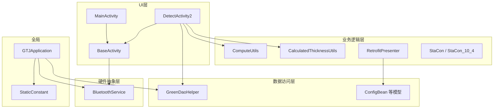
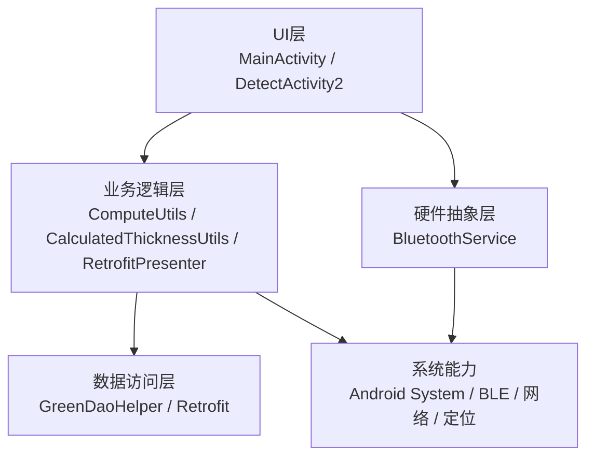
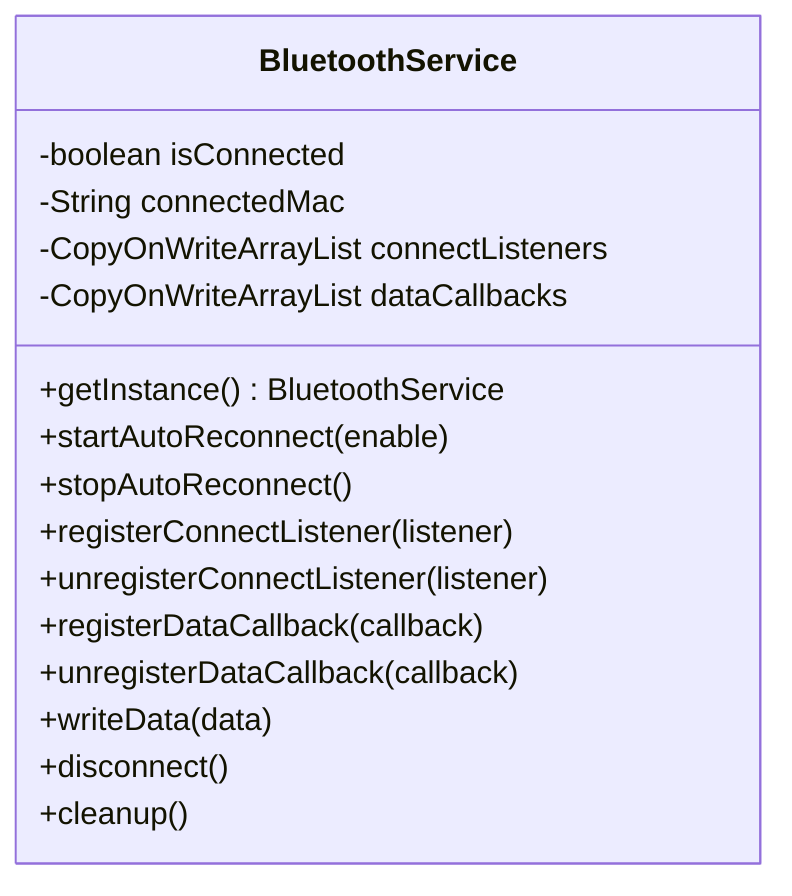
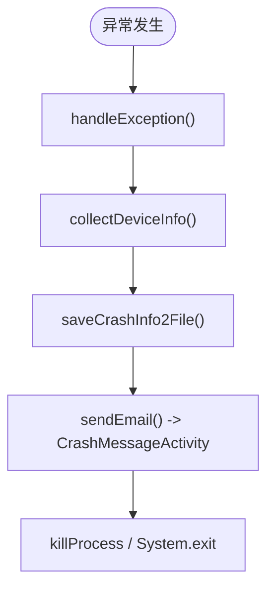
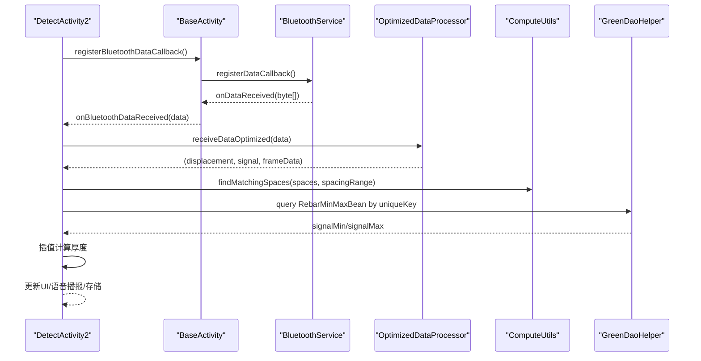
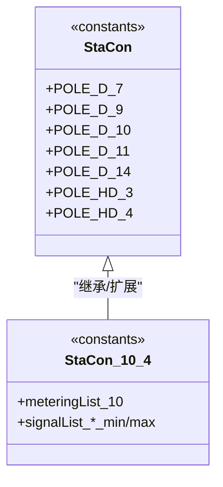
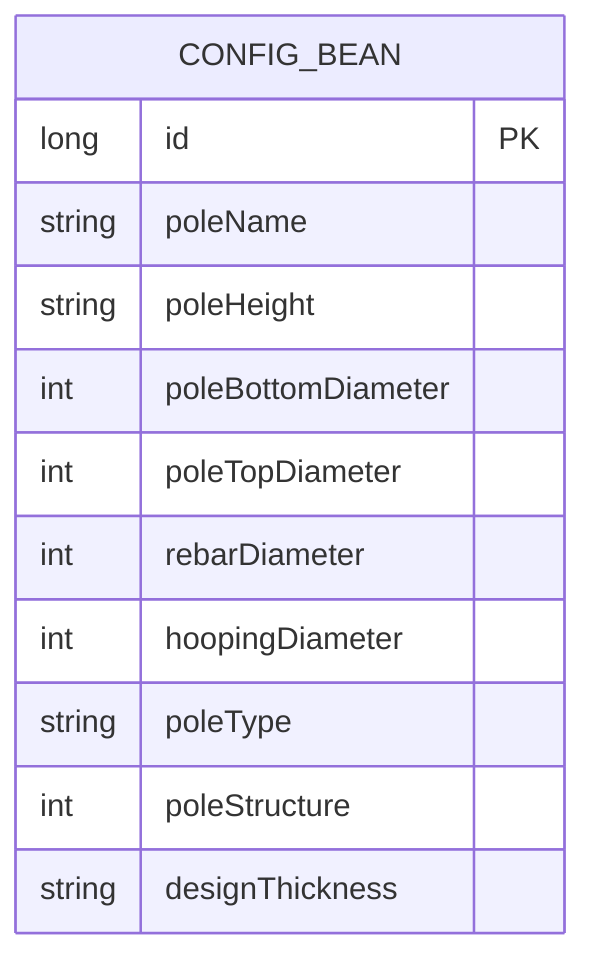
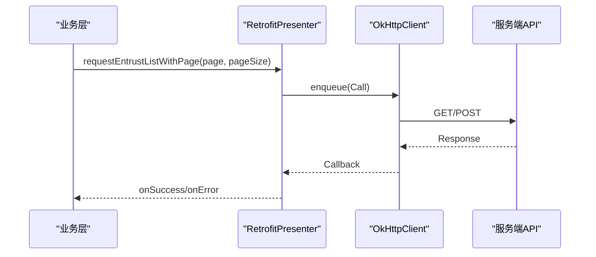
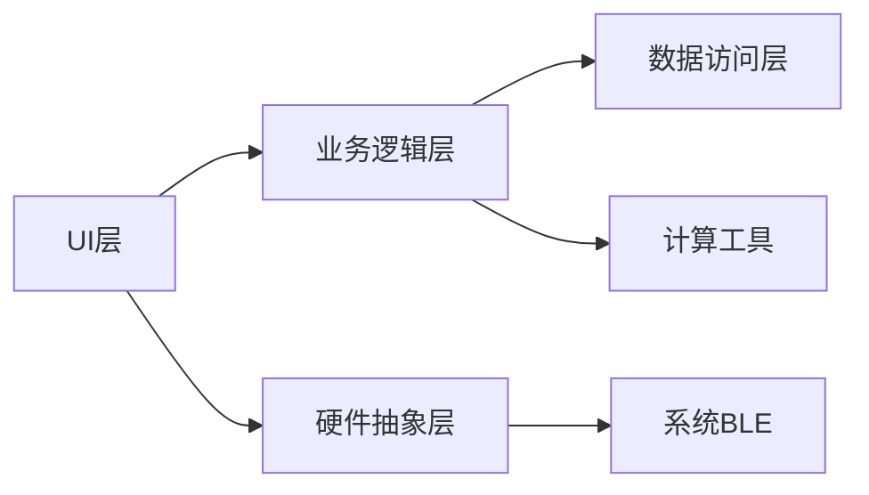
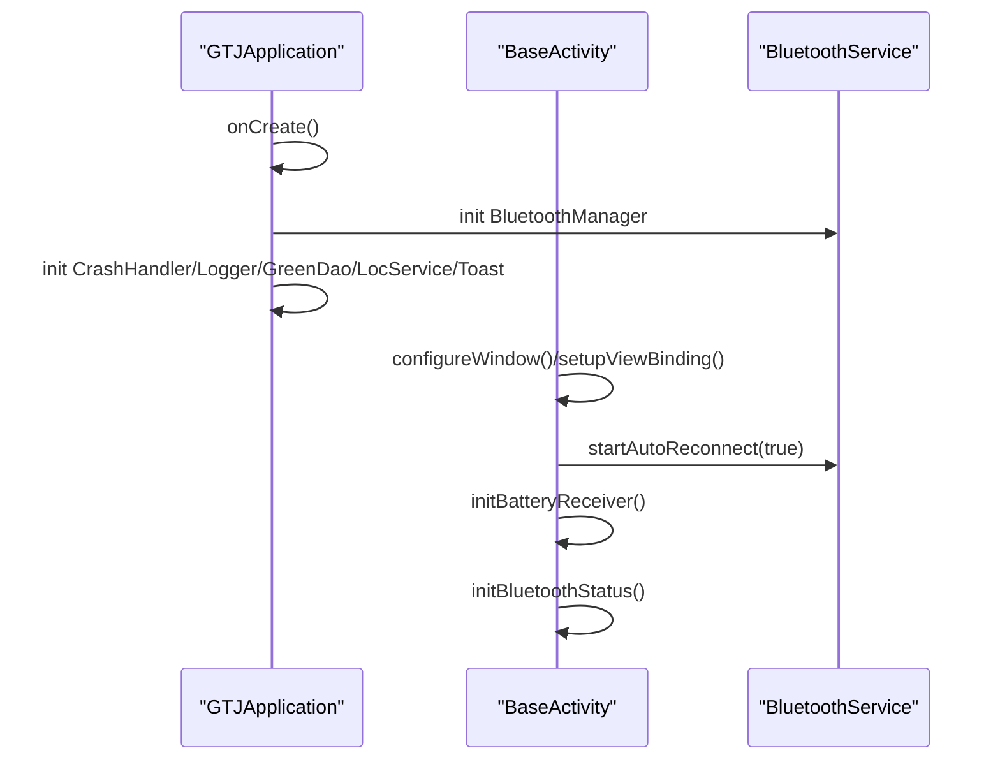

# 系统架构

<cite>
**本文引用的文件**
- [GTJApplication.java](file://app/src/main/java/com/example/gtj_sd_dg240/GTJApplication.java)
- [BaseActivity.java](file://app/src/main/java/com/example/gtj_sd_dg240/activity/start/BaseActivity.java)
- [MainActivity.java](file://app/src/main/java/com/example/gtj_sd_dg240/activity/MainActivity.java)
- [DetectActivity2.java](file://app/src/main/java/com/example/gtj_sd_dg240/activity/testing/DetectActivity2.java)
- [BluetoothService.java](file://app/src/main/java/com/example/gtj_sd_dg240/bluetooth/BluetoothService.java)
- [CrashHandler.java](file://app/src/main/java/com/example/gtj_sd_dg240/utils/CrashHandler.java)
- [GreenDaoHelper.java](file://app/src/main/java/com/example/gtj_sd_dg240/storage/GreenDaoHelper.java)
- [RetrofitPresenter.java](file://app/src/main/java/com/example/gtj_sd_dg240/net/RetrofitPresenter.java)
- [ComputeUtils.java](file://app/src/main/java/com/example/gtj_sd_dg240/utils/ComputeUtils.java)
- [CalculatedThicknessUtils.java](file://app/src/main/java/com/example/gtj_sd_dg240/utils/CalculatedThicknessUtils.java)
- [StaCon.java](file://app/src/main/java/com/example/gtj_sd_dg240/stacon/StaCon.java)
- [StaCon_10_4.java](file://app/src/main/java/com/example/gtj_sd_dg240/stacon/StaCon_10_4.java)
- [ConfigBean.java](file://app/src/main/java/com/example/gtj_sd_dg240/model/ConfigBean.java)
- [StaticConstant.java](file://app/src/main/java/com/example/gtj_sd_dg240/StaticConstant.java)
- [build.gradle](file://app/build.gradle)
</cite>

## 目录
1. [简介](#简介)
2. [项目结构](#项目结构)
3. [核心组件](#核心组件)
4. [架构总览](#架构总览)
5. [详细组件分析](#详细组件分析)
6. [依赖关系分析](#依赖关系分析)
7. [性能考量](#性能考量)
8. [故障排查指南](#故障排查指南)
9. [结论](#结论)
10. [附录](#附录)

## 简介
本架构文档面向 GTJ-SD-DG240 应用，围绕分层架构（UI层、业务逻辑层、数据访问层、硬件抽象层）进行系统化说明。文档重点阐述：
- 各层职责与通信机制
- 关键设计模式：单例（BluetoothService、CrashHandler）、观察者（蓝牙状态监听）、工厂（设备适配）
- 启动流程、生命周期管理、资源管理
- 扩展点与插件化方案
- 架构图、模块依赖图与时序图，覆盖关键业务流程

## 项目结构
应用采用 Android 工程结构，按功能域划分包：
- UI层：activity、view、adapter
- 业务逻辑层：utils、net、stacon（设备参数与算法）
- 数据访问层：storage（GreenDao封装）、functions/database/greenDao/db（DAO）
- 硬件抽象层：bluetooth（BLE服务封装）
- 全局初始化：GTJApplication、StaticConstant

图表来源
- [GTJApplication.java:20-41](file://app/src/main/java/com/example/gtj_sd_dg240/GTJApplication.java#L20-L41)
- [BaseActivity.java:91-198](file://app/src/main/java/com/example/gtj_sd_dg240/activity/start/BaseActivity.java#L91-L198)
- [DetectActivity2.java:165-203](file://app/src/main/java/com/example/gtj_sd_dg240/activity/testing/DetectActivity2.java#L165-L203)
- [GreenDaoHelper.java:16-40](file://app/src/main/java/com/example/gtj_sd_dg240/storage/GreenDaoHelper.java#L16-L40)
- [RetrofitPresenter.java:31-52](file://app/src/main/java/com/example/gtj_sd_dg240/net/RetrofitPresenter.java#L31-L52)

章节来源
- [build.gradle:79-84](file://app/build.gradle#L79-L84)
- [StaticConstant.java:67-70](file://app/src/main/java/com/example/gtj_sd_dg240/StaticConstant.java#L67-L70)

## 核心组件
- 全局初始化：GTJApplication 在 onCreate 中统一初始化蓝牙、崩溃处理、日志、数据库、定位、Toast等
- 活动基类：BaseActivity 提供统一的窗口配置、ViewBinding、电池电量监听、蓝牙自动重连与数据回调注册
- 蓝牙服务：BluetoothService 单例，负责连接状态管理、自动重连、数据通知分发、写数据
- 崩溃处理：CrashHandler 单例，捕获未捕获异常，收集设备信息并持久化日志
- 数据访问：GreenDaoHelper 封装 DaoMaster/DaoSession，提供线程安全的 DAO 访问
- 网络请求：RetrofitPresenter 封装 Retrofit/OkHttp，提供重试与日志拦截
- 计算工具：ComputeUtils、CalculatedThicknessUtils 实现厚度计算、匹配空间查找等
- 设备适配：StaCon 及具体型号类（如 StaCon_10_4）定义钢筋直径、信号范围等常量，作为设备适配的“工厂”数据源

章节来源
- [GTJApplication.java:20-41](file://app/src/main/java/com/example/gtj_sd_dg240/GTJApplication.java#L20-L41)
- [BaseActivity.java:188-198](file://app/src/main/java/com/example/gtj_sd_dg240/activity/start/BaseActivity.java#L188-L198)
- [BluetoothService.java:20-52](file://app/src/main/java/com/example/gtj_sd_dg240/bluetooth/BluetoothService.java#L20-L52)
- [CrashHandler.java:35-80](file://app/src/main/java/com/example/gtj_sd_dg240/utils/CrashHandler.java#L35-L80)
- [GreenDaoHelper.java:16-40](file://app/src/main/java/com/example/gtj_sd_dg240/storage/GreenDaoHelper.java#L16-L40)
- [RetrofitPresenter.java:31-52](file://app/src/main/java/com/example/gtj_sd_dg240/net/RetrofitPresenter.java#L31-L52)
- [ComputeUtils.java:36-61](file://app/src/main/java/com/example/gtj_sd_dg240/utils/ComputeUtils.java#L36-L61)
- [CalculatedThicknessUtils.java:22-59](file://app/src/main/java/com/example/gtj_sd_dg240/utils/CalculatedThicknessUtils.java#L22-L59)
- [StaCon.java:3-13](file://app/src/main/java/com/example/gtj_sd_dg240/stacon/StaCon.java#L3-L13)
- [StaCon_10_4.java:6-76](file://app/src/main/java/com/example/gtj_sd_dg240/stacon/StaCon_10_4.java#L6-L76)

## 架构总览
应用采用清晰的分层架构：
- UI层：Activity/Fragment 负责界面交互与事件分发
- 业务逻辑层：算法与策略（厚度计算、信号匹配、网络请求）
- 数据访问层：GreenDao 本地存储、Retrofit 远程接口
- 硬件抽象层：BluetoothService 屏蔽 BLE 细节，提供稳定连接与数据通道

图表来源
- [MainActivity.java:47-63](file://app/src/main/java/com/example/gtj_sd_dg240/activity/MainActivity.java#L47-L63)
- [DetectActivity2.java:165-203](file://app/src/main/java/com/example/gtj_sd_dg240/activity/testing/DetectActivity2.java#L165-L203)
- [BluetoothService.java:175-198](file://app/src/main/java/com/example/gtj_sd_dg240/bluetooth/BluetoothService.java#L175-L198)
- [RetrofitPresenter.java:61-86](file://app/src/main/java/com/example/gtj_sd_dg240/net/RetrofitPresenter.java#L61-L86)

## 详细组件分析

### 蓝牙服务（BluetoothService）
- 设计模式：单例（双重检查锁），观察者（连接状态监听列表、数据回调列表）
- 职责：统一管理 BLE 连接、自动重连、数据通知分发、写数据
- 关键点：
  - 通过 Handler(Looper.getMainLooper()) 在主线程分发状态与数据
  - 使用 CopyOnWriteArrayList 保证并发安全
  - 支持自动重连定时器，断开时取消通知，连接成功恢复通知

图表来源
- [BluetoothService.java:20-52](file://app/src/main/java/com/example/gtj_sd_dg240/bluetooth/BluetoothService.java#L20-L52)
- [BluetoothService.java:77-122](file://app/src/main/java/com/example/gtj_sd_dg240/bluetooth/BluetoothService.java#L77-L122)
- [BluetoothService.java:175-198](file://app/src/main/java/com/example/gtj_sd_dg240/bluetooth/BluetoothService.java#L175-L198)
- [BluetoothService.java:236-268](file://app/src/main/java/com/example/gtj_sd_dg240/bluetooth/BluetoothService.java#L236-L268)

章节来源
- [BluetoothService.java:20-52](file://app/src/main/java/com/example/gtj_sd_dg240/bluetooth/BluetoothService.java#L20-L52)
- [BluetoothService.java:175-198](file://app/src/main/java/com/example/gtj_sd_dg240/bluetooth/BluetoothService.java#L175-L198)
- [BluetoothService.java:236-268](file://app/src/main/java/com/example/gtj_sd_dg240/bluetooth/BluetoothService.java#L236-L268)

### 崩溃处理器（CrashHandler）
- 设计模式：单例
- 职责：捕获未捕获异常、收集设备信息、保存日志、提示用户并退出
- 关键点：
  - 设置默认 UncaughtExceptionHandler
  - 将堆栈与设备信息写入文件（可配置开关）
  - 启动 CrashMessageActivity 展示错误信息

图表来源
- [CrashHandler.java:85-123](file://app/src/main/java/com/example/gtj_sd_dg240/utils/CrashHandler.java#L85-L123)
- [CrashHandler.java:128-151](file://app/src/main/java/com/example/gtj_sd_dg240/utils/CrashHandler.java#L128-L151)
- [CrashHandler.java:156-199](file://app/src/main/java/com/example/gtj_sd_dg240/utils/CrashHandler.java#L156-L199)
- [CrashHandler.java:201-206](file://app/src/main/java/com/example/gtj_sd_dg240/utils/CrashHandler.java#L201-L206)

章节来源
- [CrashHandler.java:35-80](file://app/src/main/java/com/example/gtj_sd_dg240/utils/CrashHandler.java#L35-L80)
- [CrashHandler.java:85-123](file://app/src/main/java/com/example/gtj_sd_dg240/utils/CrashHandler.java#L85-L123)
- [CrashHandler.java:156-199](file://app/src/main/java/com/example/gtj_sd_dg240/utils/CrashHandler.java#L156-L199)

### 检测流程（DetectActivity2）
- 职责：接收蓝牙数据、校准信号、平均滤波、厚度计算、结果展示与存储
- 关键点：
  - 通过 BaseActivity 注册蓝牙数据回调
  - 使用 OptimizedDataProcessor 异步处理数据流
  - 调用 ComputeUtils.findMatchingSpaces 匹配主筋间距区间
  - 查询 RebarMinMaxBean 表获取信号阈值，插值计算厚度
  - 结果保存到 ZoneBean 并刷新UI

图表来源
- [BaseActivity.java:268-282](file://app/src/main/java/com/example/gtj_sd_dg240/activity/start/BaseActivity.java#L268-L282)
- [DetectActivity2.java:165-203](file://app/src/main/java/com/example/gtj_sd_dg240/activity/testing/DetectActivity2.java#L165-L203)
- [DetectActivity2.java:339-488](file://app/src/main/java/com/example/gtj_sd_dg240/activity/testing/DetectActivity2.java#L339-L488)
- [ComputeUtils.java:36-61](file://app/src/main/java/com/example/gtj_sd_dg240/utils/ComputeUtils.java#L36-L61)
- [GreenDaoHelper.java:32-40](file://app/src/main/java/com/example/gtj_sd_dg240/storage/GreenDaoHelper.java#L32-L40)

章节来源
- [DetectActivity2.java:165-203](file://app/src/main/java/com/example/gtj_sd_dg240/activity/testing/DetectActivity2.java#L165-L203)
- [DetectActivity2.java:339-488](file://app/src/main/java/com/example/gtj_sd_dg240/activity/testing/DetectActivity2.java#L339-L488)

### 设备适配（工厂模式）
- 设计模式：工厂（以静态常量类为“产品族”）
- 职责：定义不同电杆型号的钢筋直径、信号范围等参数，供业务层选择
- 关键点：
  - StaCon 定义通用常量（钢筋直径、螺旋筋直径）
  - StaCon_10_4 等子类提供具体型号的信号上下限列表
  - 业务层根据当前配置动态选择对应参数集合

图表来源
- [StaCon.java:3-13](file://app/src/main/java/com/example/gtj_sd_dg240/stacon/StaCon.java#L3-L13)
- [StaCon_10_4.java:6-76](file://app/src/main/java/com/example/gtj_sd_dg240/stacon/StaCon_10_4.java#L6-L76)

章节来源
- [StaCon.java:3-13](file://app/src/main/java/com/example/gtj_sd_dg240/stacon/StaCon.java#L3-L13)
- [StaCon_10_4.java:6-76](file://app/src/main/java/com/example/gtj_sd_dg240/stacon/StaCon_10_4.java#L6-L76)

### 数据模型与存储（GreenDao）
- 职责：本地持久化配置、检测结果等
- 关键点：
  - GreenDaoHelper 懒加载 DaoMaster/DaoSession
  - ConfigBean 等实体通过注解声明字段与约束
  - 批量插入/替换事务提升性能

图表来源
- [ConfigBean.java:13-33](file://app/src/main/java/com/example/gtj_sd_dg240/model/ConfigBean.java#L13-L33)
- [GreenDaoHelper.java:16-40](file://app/src/main/java/com/example/gtj_sd_dg240/storage/GreenDaoHelper.java#L16-L40)

章节来源
- [ConfigBean.java:13-33](file://app/src/main/java/com/example/gtj_sd_dg240/model/ConfigBean.java#L13-L33)
- [GreenDaoHelper.java:16-40](file://app/src/main/java/com/example/gtj_sd_dg240/storage/GreenDaoHelper.java#L16-L40)

### 网络请求（Retrofit）
- 职责：统一封装 HTTP 请求、重试、日志
- 关键点：
  - OkHttpClient 配置超时、重试、日志拦截器
  - 提供分页与上传接口
  - 错误消息标准化处理

图表来源
- [RetrofitPresenter.java:31-52](file://app/src/main/java/com/example/gtj_sd_dg240/net/RetrofitPresenter.java#L31-L52)
- [RetrofitPresenter.java:88-113](file://app/src/main/java/com/example/gtj_sd_dg240/net/RetrofitPresenter.java#L88-L113)
- [RetrofitPresenter.java:115-141](file://app/src/main/java/com/example/gtj_sd_dg240/net/RetrofitPresenter.java#L115-L141)

章节来源
- [RetrofitPresenter.java:31-52](file://app/src/main/java/com/example/gtj_sd_dg240/net/RetrofitPresenter.java#L31-L52)
- [RetrofitPresenter.java:88-113](file://app/src/main/java/com/example/gtj_sd_dg240/net/RetrofitPresenter.java#L88-L113)
- [RetrofitPresenter.java:115-141](file://app/src/main/java/com/example/gtj_sd_dg240/net/RetrofitPresenter.java#L115-L141)

## 依赖关系分析
- UI层依赖业务逻辑层与硬件抽象层
- 业务逻辑层依赖数据访问层与计算工具
- 硬件抽象层依赖系统 BLE 能力
- 全局初始化贯穿各层

图表来源
- [MainActivity.java:47-63](file://app/src/main/java/com/example/gtj_sd_dg240/activity/MainActivity.java#L47-L63)
- [DetectActivity2.java:165-203](file://app/src/main/java/com/example/gtj_sd_dg240/activity/testing/DetectActivity2.java#L165-L203)
- [BluetoothService.java:175-198](file://app/src/main/java/com/example/gtj_sd_dg240/bluetooth/BluetoothService.java#L175-L198)

章节来源
- [build.gradle:86-144](file://app/build.gradle#L86-L144)

## 性能考量
- 蓝牙数据回调在主线程分发，避免阻塞；大数据量建议在后端线程处理（DetectActivity2 已使用调度器）
- GreenDao 使用事务批量插入，减少 I/O 开销
- Retrofit 配置合理超时与重试，降低网络抖动影响
- 计算工具采用线性扫描匹配，若数据规模增大可考虑二分或索引优化

[本节为通用指导，不直接分析具体文件]

## 故障排查指南
- 崩溃日志：查看 SD 卡 gtj_anchorbolt_crash 目录下的 crash-*.txt 文件
- 蓝牙连接失败：检查 MAC 地址是否保存、是否启用自动重连、是否在系统设置中连接设备主机
- 定位异常：检查权限与网络状态，参考定位诊断信息
- 网络请求失败：查看 Retrofit 日志输出，确认服务器响应码与消息

章节来源
- [CrashHandler.java:156-199](file://app/src/main/java/com/example/gtj_sd_dg240/utils/CrashHandler.java#L156-L199)
- [MainActivity.java:106-129](file://app/src/main/java/com/example/gtj_sd_dg240/activity/MainActivity.java#L106-L129)
- [RetrofitPresenter.java:54-59](file://app/src/main/java/com/example/gtj_sd_dg240/net/RetrofitPresenter.java#L54-L59)

## 结论
GTJ-SD-DG240 采用清晰的分层架构与成熟的设计模式，实现了稳定的硬件通信、可靠的本地存储与高效的网络请求。通过单例与观察者模式保障服务一致性与解耦，通过工厂模式实现设备参数的灵活适配。整体架构具备良好的可扩展性，便于后续引入插件化与更多设备型号。

[本节为总结，不直接分析具体文件]

## 附录

### 启动流程与生命周期管理
- 应用启动：GTJApplication.onCreate 初始化蓝牙、崩溃处理、日志、数据库、定位、Toast
- Activity 生命周期：BaseActivity 统一配置全屏、隐藏导航栏、保持常亮、密度适配；在 onStart/onStop 维护显示状态；在 onDestroy 注销广播与蓝牙监听、关闭线程池

图表来源
- [GTJApplication.java:20-41](file://app/src/main/java/com/example/gtj_sd_dg240/GTJApplication.java#L20-L41)
- [BaseActivity.java:91-198](file://app/src/main/java/com/example/gtj_sd_dg240/activity/start/BaseActivity.java#L91-L198)
- [BaseActivity.java:218-238](file://app/src/main/java/com/example/gtj_sd_dg240/activity/start/BaseActivity.java#L218-L238)
- [BaseActivity.java:240-266](file://app/src/main/java/com/example/gtj_sd_dg240/activity/start/BaseActivity.java#L240-L266)

章节来源
- [GTJApplication.java:20-41](file://app/src/main/java/com/example/gtj_sd_dg240/GTJApplication.java#L20-L41)
- [BaseActivity.java:91-198](file://app/src/main/java/com/example/gtj_sd_dg240/activity/start/BaseActivity.java#L91-L198)
- [BaseActivity.java:218-238](file://app/src/main/java/com/example/gtj_sd_dg240/activity/start/BaseActivity.java#L218-L238)
- [BaseActivity.java:240-266](file://app/src/main/java/com/example/gtj_sd_dg240/activity/start/BaseActivity.java#L240-L266)

### 资源管理机制
- 线程池：BaseActivity 创建固定大小线程池，onDestroy 关闭
- 广播：电池电量监听在 onDestroy 注销
- 蓝牙：连接状态监听与数据回调在 onDestroy 注销
- 数据库：GreenDaoHelper 懒加载，避免重复创建

章节来源
- [BaseActivity.java:178-185](file://app/src/main/java/com/example/gtj_sd_dg240/activity/start/BaseActivity.java#L178-L185)
- [BaseActivity.java:309-334](file://app/src/main/java/com/example/gtj_sd_dg240/activity/start/BaseActivity.java#L309-L334)
- [GreenDaoHelper.java:16-40](file://app/src/main/java/com/example/gtj_sd_dg240/storage/GreenDaoHelper.java#L16-L40)

### 扩展点设计与插件化方案
- 设备适配扩展：新增型号只需添加 StaCon_* 类并提供信号范围常量，业务层按配置选择
- 算法扩展：在 utils 下新增计算工具类，通过接口或策略模式接入
- 网络扩展：在 net 下新增接口与服务，复用 RetrofitPresenter 的统一封装
- 插件化建议：
  - 基于反射+SPI 的动态加载：将设备适配与算法模块打包为独立 APK/AAR，运行时按需加载
  - 配置驱动：通过 StaticConstant 或配置文件决定加载哪些模块
  - 沙箱隔离：使用 ClassLoader 隔离插件，避免版本冲突

[本节为概念性内容，不直接分析具体文件]