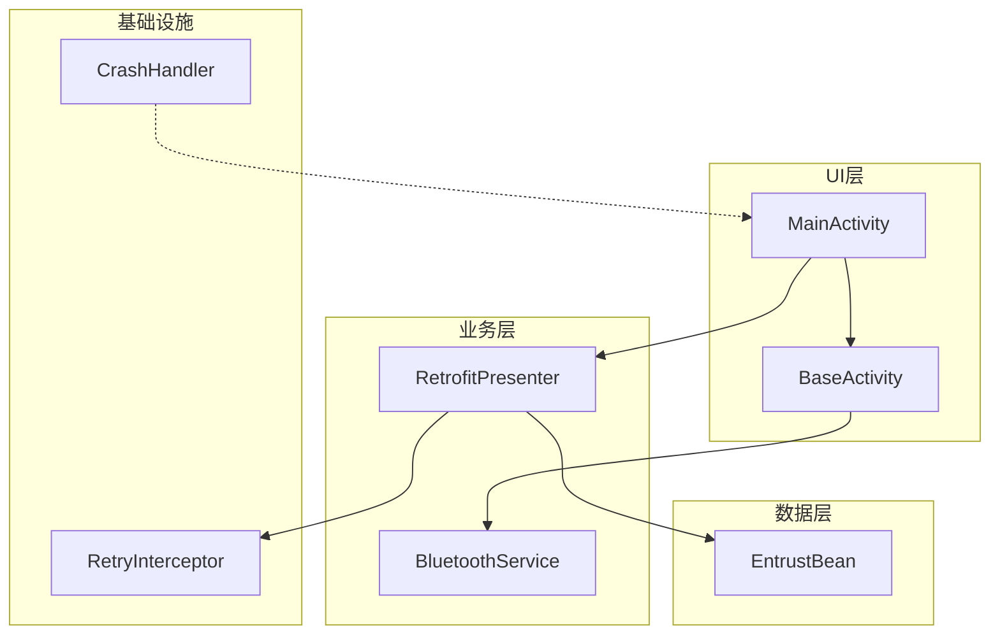
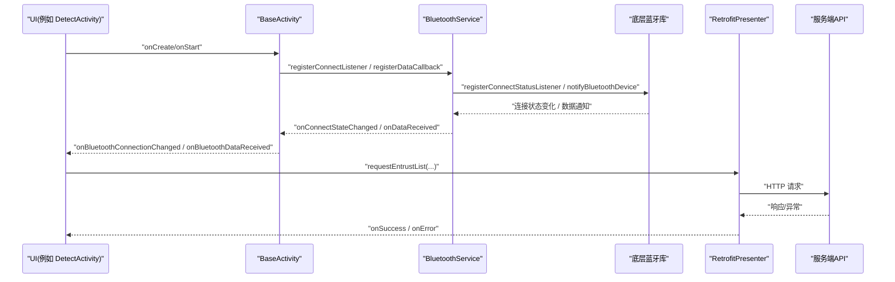
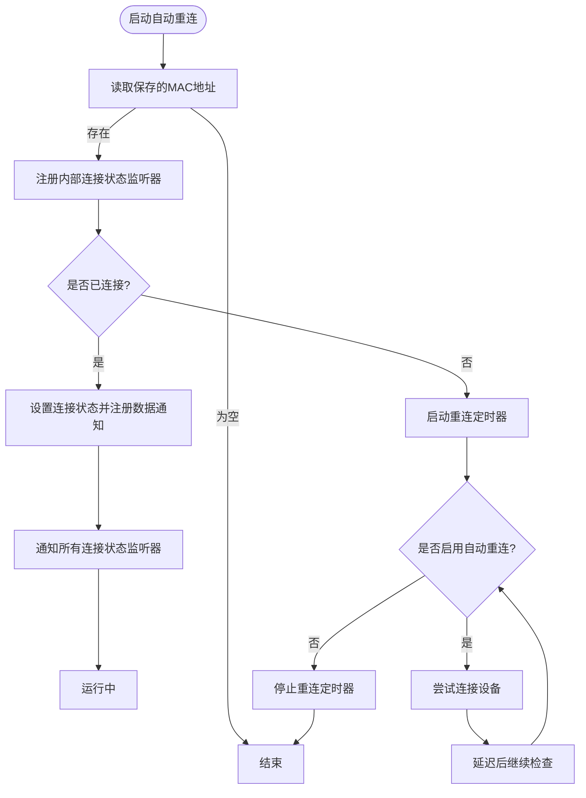
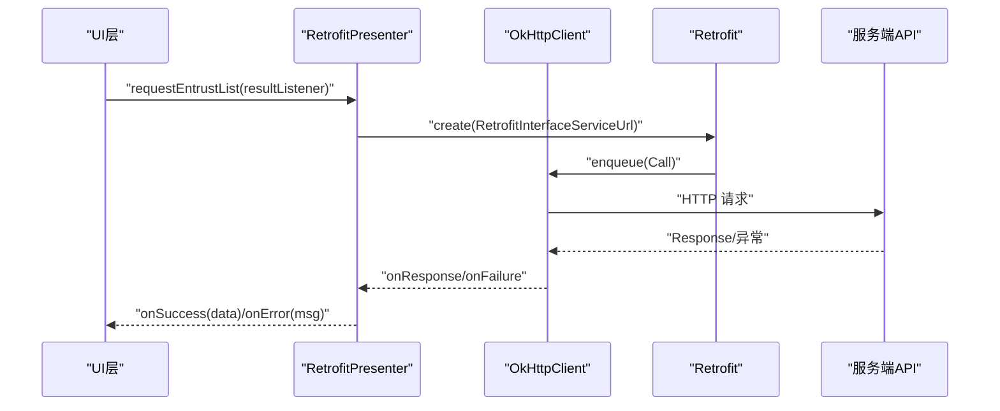
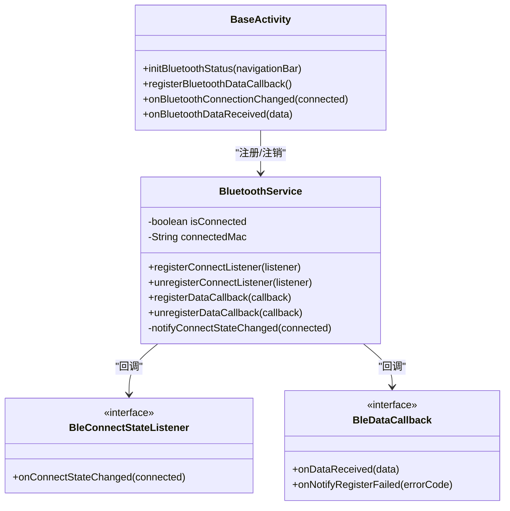
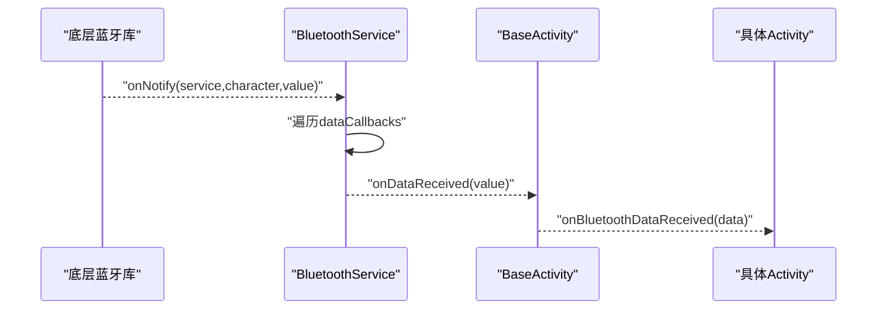
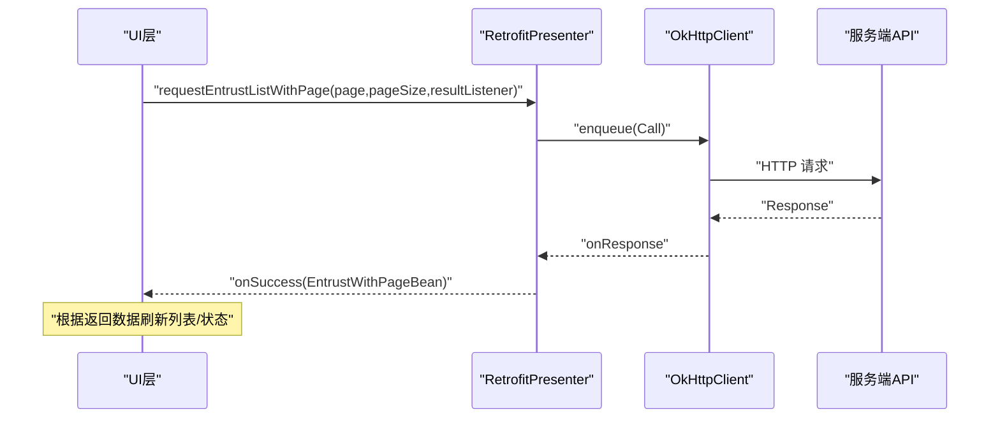
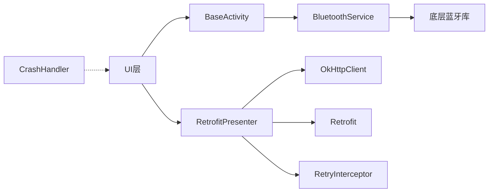

# 组件交互机制

<cite>
**本文引用的文件**
- [BluetoothService.java](file://app/src/main/java/com/example/gtj_sd_dg240/bluetooth/BluetoothService.java)
- [BleConnectStateListener.java](file://app/src/main/java/com/example/gtj_sd_dg240/bluetooth/BleConnectStateListener.java)
- [BleDataCallback.java](file://app/src/main/java/com/example/gtj_sd_dg240/bluetooth/BleDataCallback.java)
- [BaseActivity.java](file://app/src/main/java/com/example/gtj_sd_dg240/activity/start/BaseActivity.java)
- [MainActivity.java](file://app/src/main/java/com/example/gtj_sd_dg240/activity/MainActivity.java)
- [RetrofitPresenter.java](file://app/src/main/java/com/example/gtj_sd_dg240/net/RetrofitPresenter.java)
- [RetrofitPresenterResultListener.java](file://app/src/main/java/com/example/gtj_sd_dg240/net/RetrofitPresenterResultListener.java)
- [RetryInterceptor.java](file://app/src/main/java/com/example/gtj_sd_dg240/net/RetryInterceptor.java)
- [ApiException.java](file://app/src/main/java/com/example/gtj_sd_dg240/net/ApiException.java)
- [EntrustBean.java](file://app/src/main/java/com/example/gtj_sd_dg240/model/EntrustBean.java)
- [CrashHandler.java](file://app/src/main/java/com/example/gtj_sd_dg240/utils/CrashHandler.java)
</cite>

## 目录
1. [简介](#简介)
2. [项目结构](#项目结构)
3. [核心组件](#核心组件)
4. [架构总览](#架构总览)
5. [详细组件分析](#详细组件分析)
6. [依赖关系分析](#依赖关系分析)
7. [性能考虑](#性能考虑)
8. [故障排查指南](#故障排查指南)
9. [结论](#结论)
10. [附录](#附录)

## 简介
本文件面向GTJ-SD-DG240应用，系统化阐述各组件间的通信方式与数据流转过程。重点覆盖：
- 基于回调接口的异步通信机制（蓝牙连接状态监听与数据回调）
- 网络请求与UI层的交互模式（通过 RetrofitPresenter 封装的网络调用）
- 事件驱动架构在蓝牙连接状态管理中的应用
- 组件间解耦设计（接口抽象、单例服务、弱引用等）
- 关键业务流程的时序图与流程图
- 错误处理与异常传播机制

## 项目结构
围绕“蓝牙设备通信”和“网络数据交互”两条主线，应用采用分层与职责分离的组织方式：
- UI层：Activity/Fragment（如 MainActivity、BaseActivity）负责界面展示与用户交互
- 业务层：BluetoothService 统一管理蓝牙连接、重连、数据分发；RetrofitPresenter 统一封装网络请求
- 数据层：模型类（如 EntrustBean）、本地存储与数据库（GreenDao）
- 基础设施：重试拦截器、全局崩溃处理器、工具类等

图表来源
- [MainActivity.java:41-63](file://app/src/main/java/com/example/gtj_sd_dg240/activity/MainActivity.java#L41-L63)
- [BaseActivity.java:190-282](file://app/src/main/java/com/example/gtj_sd_dg240/activity/start/BaseActivity.java#L190-L282)
- [BluetoothService.java:20-31](file://app/src/main/java/com/example/gtj_sd_dg240/bluetooth/BluetoothService.java#L20-L31)
- [RetrofitPresenter.java:25-52](file://app/src/main/java/com/example/gtj_sd_dg240/net/RetrofitPresenter.java#L25-L52)
- [EntrustBean.java:5-31](file://app/src/main/java/com/example/gtj_sd_dg240/model/EntrustBean.java#L5-L31)
- [RetryInterceptor.java:13-59](file://app/src/main/java/com/example/gtj_sd_dg240/net/RetryInterceptor.java#L13-L59)
- [CrashHandler.java:39-100](file://app/src/main/java/com/example/gtj_sd_dg240/utils/CrashHandler.java#L39-L100)

章节来源
- [MainActivity.java:41-63](file://app/src/main/java/com/example/gtj_sd_dg240/activity/MainActivity.java#L41-L63)
- [BaseActivity.java:190-282](file://app/src/main/java/com/example/gtj_sd_dg240/activity/start/BaseActivity.java#L190-L282)
- [BluetoothService.java:20-31](file://app/src/main/java/com/example/gtj_sd_dg240/bluetooth/BluetoothService.java#L20-L31)
- [RetrofitPresenter.java:25-52](file://app/src/main/java/com/example/gtj_sd_dg240/net/RetrofitPresenter.java#L25-L52)
- [EntrustBean.java:5-31](file://app/src/main/java/com/example/gtj_sd_dg240/model/EntrustBean.java#L5-L31)
- [RetryInterceptor.java:13-59](file://app/src/main/java/com/example/gtj_sd_dg240/net/RetryInterceptor.java#L13-L59)
- [CrashHandler.java:39-100](file://app/src/main/java/com/example/gtj_sd_dg240/utils/CrashHandler.java#L39-L100)

## 核心组件
- BluetoothService：蓝牙单例服务，负责连接状态管理、自动重连、数据通知分发、写数据与断开控制
- BleConnectStateListener / BleDataCallback：定义蓝牙连接状态变化与数据接收的回调接口，实现UI与蓝牙服务的解耦
- BaseActivity：统一初始化蓝牙服务、注册/注销回调、提供扩展点供子类处理蓝牙数据与连接变化
- RetrofitPresenter：统一封装网络请求，使用 OkHttp + Retrofit，支持日志、超时、重试与结果回调
- RetryInterceptor：针对Socket超时进行指数退避重试，提升网络稳定性
- CrashHandler：全局未捕获异常处理，收集设备信息并引导至崩溃上报页面

章节来源
- [BluetoothService.java:20-312](file://app/src/main/java/com/example/gtj_sd_dg240/bluetooth/BluetoothService.java#L20-L312)
- [BleConnectStateListener.java:6-12](file://app/src/main/java/com/example/gtj_sd_dg240/bluetooth/BleConnectStateListener.java#L6-L12)
- [BleDataCallback.java:6-18](file://app/src/main/java/com/example/gtj_sd_dg240/bluetooth/BleDataCallback.java#L6-L18)
- [BaseActivity.java:44-336](file://app/src/main/java/com/example/gtj_sd_dg240/activity/start/BaseActivity.java#L44-L336)
- [RetrofitPresenter.java:25-142](file://app/src/main/java/com/example/gtj_sd_dg240/net/RetrofitPresenter.java#L25-L142)
- [RetryInterceptor.java:13-59](file://app/src/main/java/com/example/gtj_sd_dg240/net/RetryInterceptor.java#L13-L59)
- [CrashHandler.java:39-208](file://app/src/main/java/com/example/gtj_sd_dg240/utils/CrashHandler.java#L39-L208)

## 架构总览
应用采用“事件驱动 + 回调”的架构模式：
- 蓝牙侧：BluetoothService 作为中心节点，订阅底层蓝牙库的连接状态与数据通知，再广播给所有注册的监听器/回调
- UI侧：BaseActivity 在生命周期中注册/注销回调，将蓝牙事件转发到具体 Activity 的处理方法
- 网络侧：RetrofitPresenter 以静态方法暴露网络能力，通过 RetrofitPresenterResultListener 将成功/失败结果回传给调用方（通常是UI或Presenter）

图表来源
- [BaseActivity.java:244-282](file://app/src/main/java/com/example/gtj_sd_dg240/activity/start/BaseActivity.java#L244-L282)
- [BluetoothService.java:127-198](file://app/src/main/java/com/example/gtj_sd_dg240/bluetooth/BluetoothService.java#L127-L198)
- [RetrofitPresenter.java:61-142](file://app/src/main/java/com/example/gtj_sd_dg240/net/RetrofitPresenter.java#L61-L142)

## 详细组件分析

### 蓝牙连接状态管理与数据回调
- 连接状态监听：BluetoothService 维护内部 BleConnectStatusListener，当底层蓝牙库回调连接状态变化时，更新自身状态并通过主线程分发到所有已注册的 BleConnectStateListener
- 数据回调：连接成功后，BluetoothService 为设备注册数据通知，收到数据后在主线程遍历 dataCallbacks 并调用 onDataReceived
- 自动重连：通过 Handler 定时任务周期性检查连接状态并尝试重连，支持启用/禁用
- 解耦设计：UI 仅依赖 BleConnectStateListener 与 BleDataCallback 两个接口，不感知底层蓝牙实现细节

图表来源
- [BluetoothService.java:77-122](file://app/src/main/java/com/example/gtj_sd_dg240/bluetooth/BluetoothService.java#L77-L122)
- [BluetoothService.java:203-234](file://app/src/main/java/com/example/gtj_sd_dg240/bluetooth/BluetoothService.java#L203-L234)

章节来源
- [BluetoothService.java:127-198](file://app/src/main/java/com/example/gtj_sd_dg240/bluetooth/BluetoothService.java#L127-L198)
- [BluetoothService.java:237-277](file://app/src/main/java/com/example/gtj_sd_dg240/bluetooth/BluetoothService.java#L237-L277)
- [BleConnectStateListener.java:6-12](file://app/src/main/java/com/example/gtj_sd_dg240/bluetooth/BleConnectStateListener.java#L6-L12)
- [BleDataCallback.java:6-18](file://app/src/main/java/com/example/gtj_sd_dg240/bluetooth/BleDataCallback.java#L6-L18)

### 网络请求与UI层交互（RetrofitPresenter）
- 统一入口：RetrofitPresenter 提供静态方法封装常用网络请求（委托列表、分页列表、上传数据）
- 配置与拦截：OkHttpClient 配置读写超时、连接超时、日志输出、重试拦截器，并开启连接失败重试
- 结果回调：通过 RetrofitPresenterResultListener 将 onSuccess/onError 回传给调用方，UI层据此更新界面或提示错误
- 错误处理：对空响应、非200状态码进行统一处理；对网络异常进行友好消息转换

图表来源
- [RetrofitPresenter.java:31-52](file://app/src/main/java/com/example/gtj_sd_dg240/net/RetrofitPresenter.java#L31-L52)
- [RetrofitPresenter.java:61-86](file://app/src/main/java/com/example/gtj_sd_dg240/net/RetrofitPresenter.java#L61-L86)
- [RetrofitPresenter.java:88-113](file://app/src/main/java/com/example/gtj_sd_dg240/net/RetrofitPresenter.java#L88-L113)
- [RetrofitPresenter.java:115-142](file://app/src/main/java/com/example/gtj_sd_dg240/net/RetrofitPresenter.java#L115-L142)

章节来源
- [RetrofitPresenter.java:25-142](file://app/src/main/java/com/example/gtj_sd_dg240/net/RetrofitPresenter.java#L25-L142)
- [RetrofitPresenterResultListener.java:3-8](file://app/src/main/java/com/example/gtj_sd_dg240/net/RetrofitPresenterResultListener.java#L3-L8)

### 事件驱动架构在蓝牙连接状态管理中的应用
- 事件源：底层蓝牙库通过 BleConnectStatusListener 回调连接状态变化
- 事件总线：BluetoothService 作为事件中枢，维护监听器集合并在主线程分发事件
- 订阅者：UI层通过 BaseActivity 注册 BleConnectStateListener，实现连接状态驱动的界面更新（如蓝牙图标）

图表来源
- [BluetoothService.java:20-31](file://app/src/main/java/com/example/gtj_sd_dg240/bluetooth/BluetoothService.java#L20-L31)
- [BluetoothService.java:237-277](file://app/src/main/java/com/example/gtj_sd_dg240/bluetooth/BluetoothService.java#L237-L277)
- [BleConnectStateListener.java:6-12](file://app/src/main/java/com/example/gtj_sd_dg240/bluetooth/BleConnectStateListener.java#L6-L12)
- [BleDataCallback.java:6-18](file://app/src/main/java/com/example/gtj_sd_dg240/bluetooth/BleDataCallback.java#L6-L18)
- [BaseActivity.java:244-282](file://app/src/main/java/com/example/gtj_sd_dg240/activity/start/BaseActivity.java#L244-L282)

章节来源
- [BluetoothService.java:127-198](file://app/src/main/java/com/example/gtj_sd_dg240/bluetooth/BluetoothService.java#L127-L198)
- [BaseActivity.java:244-282](file://app/src/main/java/com/example/gtj_sd_dg240/activity/start/BaseActivity.java#L244-L282)

### 组件间解耦设计的实现方案
- 接口抽象：蓝牙通信通过 BleConnectStateListener 与 BleDataCallback 暴露最小必要能力，屏蔽底层实现差异
- 单例服务：BluetoothService 以单例形式集中管理蓝牙资源，避免多处重复创建与状态不一致
- 生命周期管理：BaseActivity 在 onStart/onDestroy 中完成回调的注册与注销，防止内存泄漏与无效回调
- 弱引用：MVP基类使用 WeakReference 持有 View 与 Context，降低内存泄漏风险（适用于通用MVP框架）

章节来源
- [BluetoothService.java:43-52](file://app/src/main/java/com/example/gtj_sd_dg240/bluetooth/BluetoothService.java#L43-L52)
- [BaseActivity.java:310-336](file://app/src/main/java/com/example/gtj_sd_dg240/activity/start/BaseActivity.java#L310-L336)
- [BaseMvpPresenterImpl.java:12-32](file://utillibrary/src/main/java/com/blackhao/utillibrary/mvp/BaseMvpPresenterImpl.java#L12-L32)

### 关键业务流程时序图

#### 蓝牙数据接收流程

图表来源
- [BluetoothService.java:175-198](file://app/src/main/java/com/example/gtj_sd_dg240/bluetooth/BluetoothService.java#L175-L198)
- [BaseActivity.java:272-282](file://app/src/main/java/com/example/gtj_sd_dg240/activity/start/BaseActivity.java#L272-L282)

#### 网络请求与UI更新流程

图表来源
- [RetrofitPresenter.java:88-113](file://app/src/main/java/com/example/gtj_sd_dg240/net/RetrofitPresenter.java#L88-L113)
- [EntrustBean.java:5-31](file://app/src/main/java/com/example/gtj_sd_dg240/model/EntrustBean.java#L5-L31)

## 依赖关系分析
- BluetoothService 依赖底层蓝牙库（inuker），并通过 CopyOnWriteArrayList 安全地维护监听器集合
- BaseActivity 依赖 BluetoothService 提供的回调接口，实现UI与蓝牙的松耦合
- RetrofitPresenter 依赖 OkHttp 与 Retrofit，并通过 RetryInterceptor 增强网络健壮性
- 全局崩溃处理 CrashHandler 独立于业务逻辑，仅在异常发生时介入

图表来源
- [BaseActivity.java:244-282](file://app/src/main/java/com/example/gtj_sd_dg240/activity/start/BaseActivity.java#L244-L282)
- [BluetoothService.java:127-198](file://app/src/main/java/com/example/gtj_sd_dg240/bluetooth/BluetoothService.java#L127-L198)
- [RetrofitPresenter.java:31-52](file://app/src/main/java/com/example/gtj_sd_dg240/net/RetrofitPresenter.java#L31-L52)
- [RetryInterceptor.java:13-59](file://app/src/main/java/com/example/gtj_sd_dg240/net/RetryInterceptor.java#L13-L59)
- [CrashHandler.java:39-100](file://app/src/main/java/com/example/gtj_sd_dg240/utils/CrashHandler.java#L39-L100)

章节来源
- [BaseActivity.java:244-282](file://app/src/main/java/com/example/gtj_sd_dg240/activity/start/BaseActivity.java#L244-L282)
- [BluetoothService.java:127-198](file://app/src/main/java/com/example/gtj_sd_dg240/bluetooth/BluetoothService.java#L127-L198)
- [RetrofitPresenter.java:31-52](file://app/src/main/java/com/example/gtj_sd_dg240/net/RetrofitPresenter.java#L31-L52)
- [RetryInterceptor.java:13-59](file://app/src/main/java/com/example/gtj_sd_dg240/net/RetryInterceptor.java#L13-L59)
- [CrashHandler.java:39-100](file://app/src/main/java/com/example/gtj_sd_dg240/utils/CrashHandler.java#L39-L100)

## 性能考虑
- 蓝牙数据分发：使用主线程 Handler 保证UI线程安全，避免频繁切换线程造成开销
- 自动重连：固定间隔轮询，避免高频连接导致功耗增加；可依据场景调整间隔
- 网络请求：合理设置超时时间，结合重试拦截器减少瞬时失败影响；日志级别在生产环境建议降级
- 内存管理：BaseActivity 在 onDestroy 中注销蓝牙回调，防止内存泄漏；MVP基类使用弱引用持有View与Context

[本节为通用指导，不直接分析具体文件]

## 故障排查指南
- 蓝牙连接失败
  - 检查 MAC 地址是否正确保存与可用
  - 确认自动重连是否启用，查看连接状态回调是否触发
  - 关注数据通知注册失败回调（onNotifyRegisterFailed）的错误码
- 网络请求失败
  - 检查服务器响应码与消息，定位业务错误
  - 观察重试拦截器是否生效，必要时调整最大重试次数与退避策略
  - 对于无主机名关联等网络异常，使用统一错误消息提示
- 崩溃与异常
  - 全局崩溃处理器会收集设备信息与堆栈，并跳转至崩溃上报页面
  - 建议在调试阶段开启崩溃日志输出以便快速定位问题

章节来源
- [BluetoothService.java:175-198](file://app/src/main/java/com/example/gtj_sd_dg240/bluetooth/BluetoothService.java#L175-L198)
- [RetrofitPresenter.java:54-86](file://app/src/main/java/com/example/gtj_sd_dg240/net/RetrofitPresenter.java#L54-L86)
- [RetryInterceptor.java:23-59](file://app/src/main/java/com/example/gtj_sd_dg240/net/RetryInterceptor.java#L23-L59)
- [CrashHandler.java:85-123](file://app/src/main/java/com/example/gtj_sd_dg240/utils/CrashHandler.java#L85-L123)

## 结论
GTJ-SD-DG240应用通过“事件驱动 + 回调”的架构实现了蓝牙与网络的稳定通信：
- BluetoothService 作为蓝牙事件中枢，提供连接状态与数据回调的统一分发
- BaseActivity 简化了UI层对蓝牙事件的接入与管理
- RetrofitPresenter 统一封装网络请求，结合重试与超时策略提升鲁棒性
- 接口抽象与单例模式有效降低了组件耦合度，便于扩展与维护
- 完善的错误处理与崩溃上报机制保障用户体验与问题定位效率

[本节为总结性内容，不直接分析具体文件]

## 附录
- 数据模型参考：EntrustBean 用于承载委托单相关字段，在网络请求中作为数据传输载体
- 回调接口参考：RetrofitPresenterResultListener 定义网络请求成功与失败的统一回调契约

章节来源
- [EntrustBean.java:5-31](file://app/src/main/java/com/example/gtj_sd_dg240/model/EntrustBean.java#L5-L31)
- [RetrofitPresenterResultListener.java:3-8](file://app/src/main/java/com/example/gtj_sd_dg240/net/RetrofitPresenterResultListener.java#L3-L8)