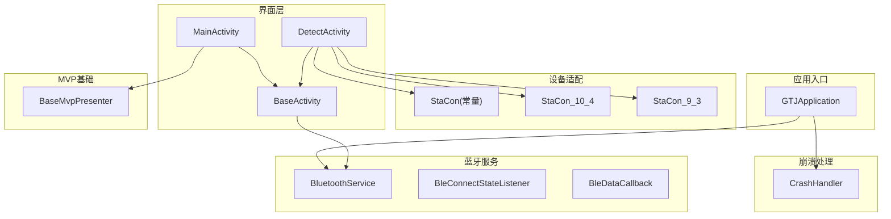
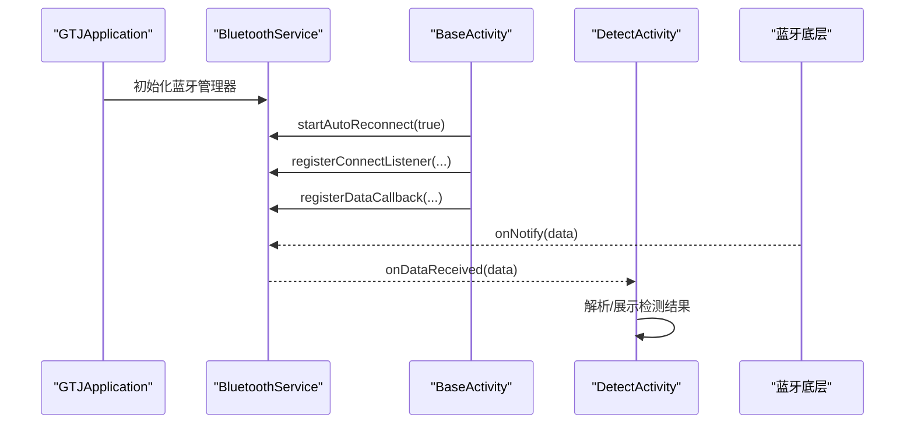
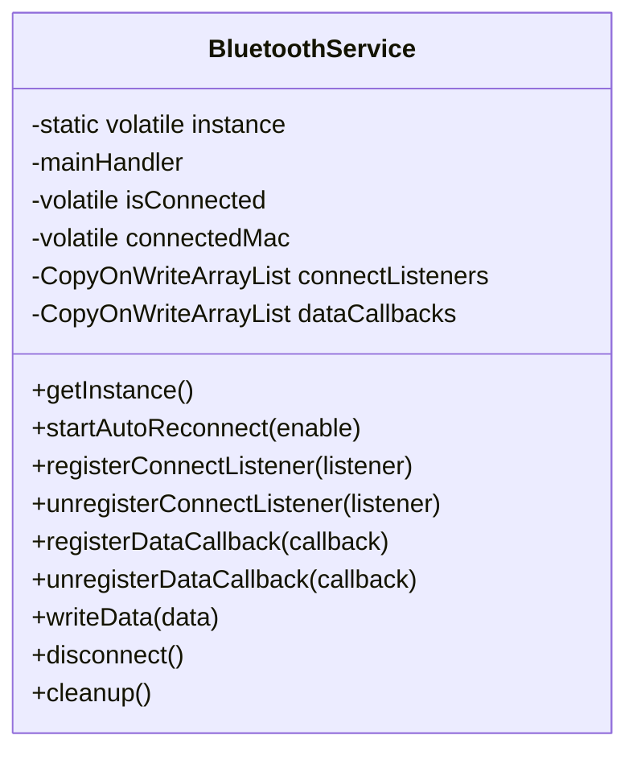
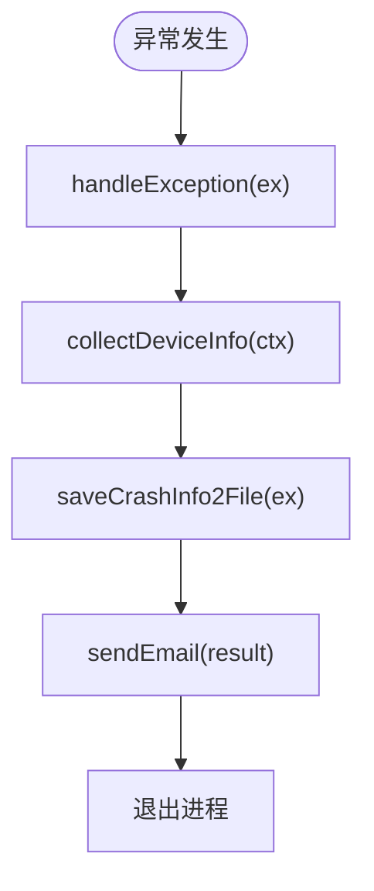
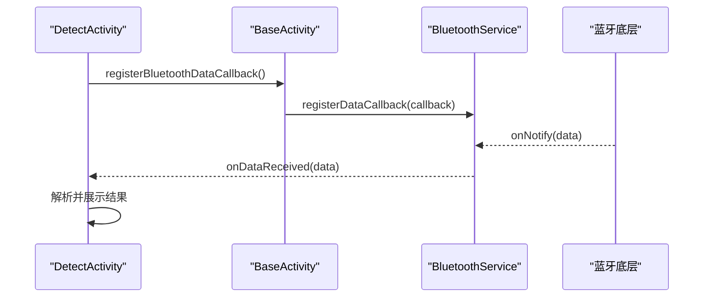
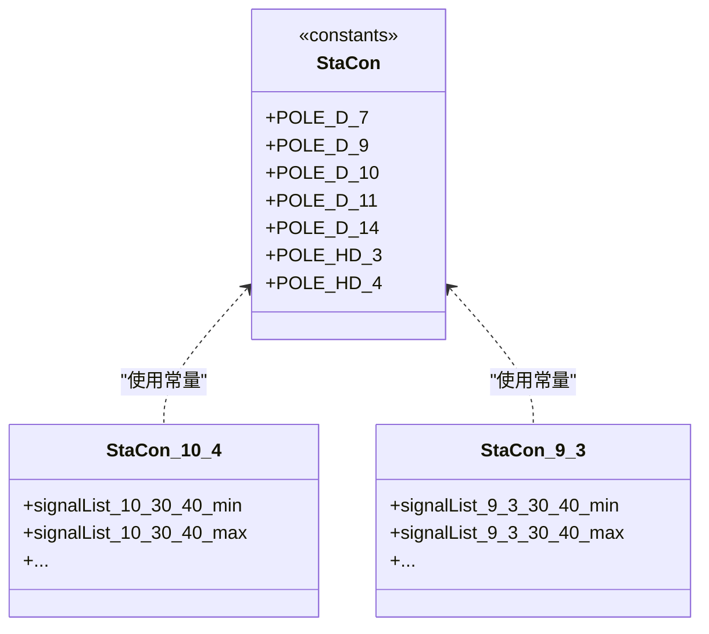
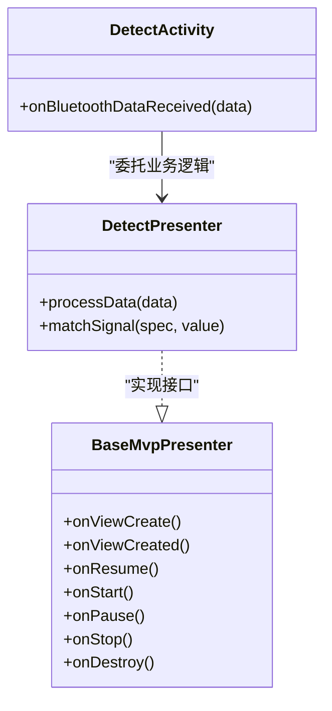
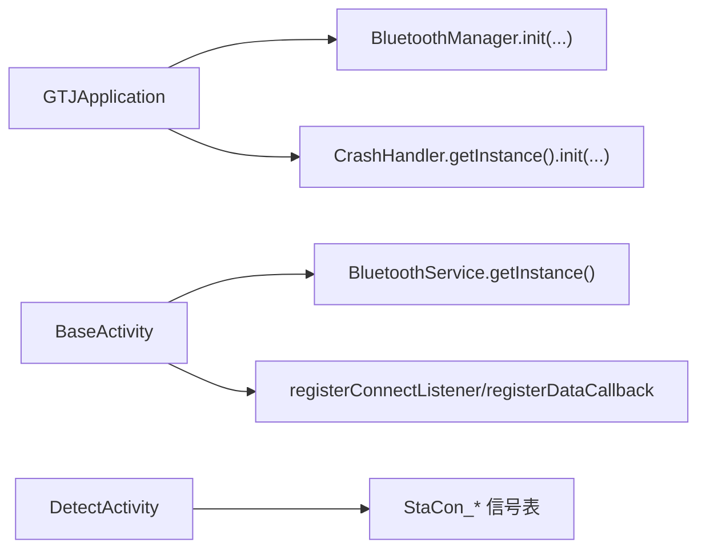

# 设计模式应用

<cite>
**本文引用的文件**
- [BluetoothService.java](file://app/src/main/java/com/example/gtj_sd_dg240/bluetooth/BluetoothService.java)
- [BleConnectStateListener.java](file://app/src/main/java/com/example/gtj_sd_dg240/bluetooth/BleConnectStateListener.java)
- [BleDataCallback.java](file://app/src/main/java/com/example/gtj_sd_dg240/bluetooth/BleDataCallback.java)
- [CrashHandler.java](file://app/src/main/java/com/example/gtj_sd_dg240/utils/CrashHandler.java)
- [StaCon.java](file://app/src/main/java/com/example/gtj_sd_dg240/stacon/StaCon.java)
- [StaCon_10_4.java](file://app/src/main/java/com/example/gtj_sd_dg240/stacon/StaCon_10_4.java)
- [StaCon_9_3.java](file://app/src/main/java/com/example/gtj_sd_dg240/stacon/StaCon_9_3.java)
- [BaseActivity.java](file://app/src/main/java/com/example/gtj_sd_dg240/activity/start/BaseActivity.java)
- [MainActivity.java](file://app/src/main/java/com/example/gtj_sd_dg240/activity/MainActivity.java)
- [DetectActivity.java](file://app/src/main/java/com/example/gtj_sd_dg240/activity/testing/DetectActivity.java)
- [GTJApplication.java](file://app/src/main/java/com/example/gtj_sd_dg240/GTJApplication.java)
- [BaseMvpPresenter.java](file://utillibrary/src/main/java/com/blackhao/utillibrary/mvp/BaseMvpPresenter.java)
</cite>

## 目录
1. [简介](#简介)
2. [项目结构](#项目结构)
3. [核心组件](#核心组件)
4. [架构总览](#架构总览)
5. [详细组件分析](#详细组件分析)
6. [依赖关系分析](#依赖关系分析)
7. [性能考量](#性能考量)
8. [故障排查指南](#故障排查指南)
9. [结论](#结论)
10. [附录](#附录)

## 简介
本文件聚焦 GTJ-SD-DG240 应用中已落地的设计模式，系统性说明单例模式、观察者模式、工厂模式与 MVP 架构的应用场景、实现要点与收益。重点覆盖：
- 单例模式在 BluetoothService、CrashHandler 等全局服务中的线程安全与内存管理
- 观察者模式在蓝牙状态监听与数据回调机制中的解耦与扩展性
- 工厂模式在设备适配（StaCon 系列）中的统一抽象与可扩展性
- MVP 架构在 Activity 与 Presenter 分离中的应用与生命周期管理

## 项目结构
项目采用分层与按功能域组织的方式：
- 蓝牙通信层：bluetooth 包提供连接、重连、数据通知分发
- 工具与系统层：utils 包提供崩溃处理、计算工具等
- 设备适配层：stacon 包提供不同规格设备的信号表与参数
- 界面层：activity 包承载 UI 与业务编排，通过 BaseActivity 统一蓝牙集成
- 基础库：utillibrary 提供通用 MVP 基类与工具

图表来源
- [GTJApplication.java:20-41](file://app/src/main/java/com/example/gtj_sd_dg240/GTJApplication.java#L20-L41)
- [BluetoothService.java:16-52](file://app/src/main/java/com/example/gtj_sd_dg240/bluetooth/BluetoothService.java#L16-L52)
- [BaseActivity.java:40-98](file://app/src/main/java/com/example/gtj_sd_dg240/activity/start/BaseActivity.java#L40-L98)
- [StaCon.java:1-14](file://app/src/main/java/com/example/gtj_sd_dg240/stacon/StaCon.java#L1-L14)
- [StaCon_10_4.java:1-77](file://app/src/main/java/com/example/gtj_sd_dg240/stacon/StaCon_10_4.java#L1-L77)
- [StaCon_9_3.java:1-76](file://app/src/main/java/com/example/gtj_sd_dg240/stacon/StaCon_9_3.java#L1-L76)
- [BaseMvpPresenter.java:1-32](file://utillibrary/src/main/java/com/blackhao/utillibrary/mvp/BaseMvpPresenter.java#L1-L32)

章节来源
- [GTJApplication.java:20-41](file://app/src/main/java/com/example/gtj_sd_dg240/GTJApplication.java#L20-L41)
- [BaseActivity.java:40-98](file://app/src/main/java/com/example/gtj_sd_dg240/activity/start/BaseActivity.java#L40-L98)

## 核心组件
- BluetoothService：蓝牙连接与数据分发的单例服务，提供自动重连、状态监听、数据回调注册与分发
- CrashHandler：全局异常捕获的单例处理器，负责收集设备信息、保存日志并引导用户查看
- StaCon 系列：设备规格与信号表的静态集合，作为设备适配的“配置型工厂”
- BaseActivity：统一的 Activity 基类，封装 ViewBinding、蓝牙集成、电池电量监听、UI 初始化等横切逻辑
- MainActivity/DetectActivity：具体业务页面，使用基类能力完成蓝牙数据接收与展示
- BaseMvpPresenter：MVP 中 Presenter 的生命周期接口，便于后续将业务逻辑从 Activity 抽离

章节来源
- [BluetoothService.java:16-52](file://app/src/main/java/com/example/gtj_sd_dg240/bluetooth/BluetoothService.java#L16-L52)
- [CrashHandler.java:35-80](file://app/src/main/java/com/example/gtj_sd_dg240/utils/CrashHandler.java#L35-L80)
- [StaCon.java:1-14](file://app/src/main/java/com/example/gtj_sd_dg240/stacon/StaCon.java#L1-L14)
- [BaseActivity.java:40-98](file://app/src/main/java/com/example/gtj_sd_dg240/activity/start/BaseActivity.java#L40-L98)
- [BaseMvpPresenter.java:1-32](file://utillibrary/src/main/java/com/blackhao/utillibrary/mvp/BaseMvpPresenter.java#L1-L32)

## 架构总览
整体采用“服务 + 观察者 + 适配 + 界面”的分层架构：
- 服务层：BluetoothService 提供稳定的蓝牙能力；CrashHandler 提供全局异常保障
- 适配层：StaCon 系列以静态配置形式暴露设备差异，便于上层按规格选择算法或阈值
- 界面层：BaseActivity 统一接入蓝牙与 UI 能力，具体 Activity 专注业务编排
- MVP：通过 BaseMvpPresenter 为后续将业务逻辑下沉到 Presenter 提供契约

图表来源
- [GTJApplication.java:20-41](file://app/src/main/java/com/example/gtj_sd_dg240/GTJApplication.java#L20-L41)
- [BluetoothService.java:77-109](file://app/src/main/java/com/example/gtj_sd_dg240/bluetooth/BluetoothService.java#L77-L109)
- [BaseActivity.java:187-198](file://app/src/main/java/com/example/gtj_sd_dg240/activity/start/BaseActivity.java#L187-L198)
- [BaseActivity.java:268-282](file://app/src/main/java/com/example/gtj_sd_dg240/activity/start/BaseActivity.java#L268-L282)
- [DetectActivity.java:171-191](file://app/src/main/java/com/example/gtj_sd_dg240/activity/testing/DetectActivity.java#L171-L191)

## 详细组件分析

### 单例模式：BluetoothService
- 应用场景：统一管理蓝牙连接、自动重连、数据通知分发，避免多处重复创建与管理
- 线程安全：
  - 使用双重检查锁保证实例唯一
  - 使用 volatile 修饰连接状态与 MAC 字段，确保多线程可见性
  - 监听器列表使用线程安全的 CopyOnWriteArrayList，避免并发修改问题
  - 所有 UI 相关回调通过主线程 Handler 派发，避免跨线程更新 UI
- 内存管理：
  - 提供 cleanup() 方法清理定时器、注销监听器、清空回调列表
  - BaseActivity 在 onDestroy 中主动注销监听器，防止内存泄漏
- 关键流程：
  - 启动自动重连：读取保存的 MAC，注册内部连接状态监听，若已连接则注册数据通知，并定时尝试连接
  - 数据分发：底层通知到达后，遍历 dataCallbacks 在主线程回调
  - 状态广播：连接状态变化时，遍历 connectListeners 通知所有订阅者

图表来源
- [BluetoothService.java:16-52](file://app/src/main/java/com/example/gtj_sd_dg240/bluetooth/BluetoothService.java#L16-L52)
- [BluetoothService.java:77-109](file://app/src/main/java/com/example/gtj_sd_dg240/bluetooth/BluetoothService.java#L77-L109)
- [BluetoothService.java:172-198](file://app/src/main/java/com/example/gtj_sd_dg240/bluetooth/BluetoothService.java#L172-L198)
- [BluetoothService.java:236-277](file://app/src/main/java/com/example/gtj_sd_dg240/bluetooth/BluetoothService.java#L236-L277)
- [BluetoothService.java:279-310](file://app/src/main/java/com/example/gtj_sd_dg240/bluetooth/BluetoothService.java#L279-L310)

章节来源
- [BluetoothService.java:16-52](file://app/src/main/java/com/example/gtj_sd_dg240/bluetooth/BluetoothService.java#L16-L52)
- [BluetoothService.java:77-109](file://app/src/main/java/com/example/gtj_sd_dg240/bluetooth/BluetoothService.java#L77-L109)
- [BluetoothService.java:172-198](file://app/src/main/java/com/example/gtj_sd_dg240/bluetooth/BluetoothService.java#L172-L198)
- [BluetoothService.java:236-277](file://app/src/main/java/com/example/gtj_sd_dg240/bluetooth/BluetoothService.java#L236-L277)
- [BluetoothService.java:279-310](file://app/src/main/java/com/example/gtj_sd_dg240/bluetooth/BluetoothService.java#L279-L310)

### 单例模式：CrashHandler
- 应用场景：全局未捕获异常接管，记录设备信息与堆栈，持久化日志并引导用户查看
- 线程安全：
  - 单例通过静态 final 实例保证唯一
  - 异常处理在新线程中执行 UI 提示，避免阻塞异常线程
- 内存管理：
  - 仅持有必要上下文引用，避免长生命周期对象导致泄漏
  - 日志写入完成后释放资源
- 关键流程：
  - 初始化：设置默认 UncaughtExceptionHandler
  - 捕获异常：收集设备信息、生成堆栈、保存文件、跳转至错误报告页

图表来源
- [CrashHandler.java:74-100](file://app/src/main/java/com/example/gtj_sd_dg240/utils/CrashHandler.java#L74-L100)
- [CrashHandler.java:105-123](file://app/src/main/java/com/example/gtj_sd_dg240/utils/CrashHandler.java#L105-L123)
- [CrashHandler.java:128-151](file://app/src/main/java/com/example/gtj_sd_dg240/utils/CrashHandler.java#L128-L151)
- [CrashHandler.java:156-199](file://app/src/main/java/com/example/gtj_sd_dg240/utils/CrashHandler.java#L156-L199)
- [CrashHandler.java:201-206](file://app/src/main/java/com/example/gtj_sd_dg240/utils/CrashHandler.java#L201-L206)

章节来源
- [CrashHandler.java:35-80](file://app/src/main/java/com/example/gtj_sd_dg240/utils/CrashHandler.java#L35-L80)
- [CrashHandler.java:105-123](file://app/src/main/java/com/example/gtj_sd_dg240/utils/CrashHandler.java#L105-L123)
- [CrashHandler.java:156-199](file://app/src/main/java/com/example/gtj_sd_dg240/utils/CrashHandler.java#L156-L199)

### 观察者模式：蓝牙状态监听与数据回调
- 应用场景：
  - 连接状态变化：多个 UI 需要感知连接状态（如导航栏图标），通过 BleConnectStateListener 统一通知
  - 数据回调：检测页面需要实时接收蓝牙数据，通过 BleDataCallback 解耦数据源与消费方
- 实现要点：
  - BluetoothService 维护监听器列表，支持动态注册/注销
  - 数据回调在主线程分发，保证 UI 安全
  - BaseActivity 提供便捷方法注册/注销，并在销毁时清理

图表来源
- [BaseActivity.java:268-282](file://app/src/main/java/com/example/gtj_sd_dg240/activity/start/BaseActivity.java#L268-L282)
- [BluetoothService.java:172-198](file://app/src/main/java/com/example/gtj_sd_dg240/bluetooth/BluetoothService.java#L172-L198)
- [DetectActivity.java:171-191](file://app/src/main/java/com/example/gtj_sd_dg240/activity/testing/DetectActivity.java#L171-L191)

章节来源
- [BleConnectStateListener.java:1-13](file://app/src/main/java/com/example/gtj_sd_dg240/bluetooth/BleConnectStateListener.java#L1-L13)
- [BleDataCallback.java:1-19](file://app/src/main/java/com/example/gtj_sd_dg240/bluetooth/BleDataCallback.java#L1-L19)
- [BaseActivity.java:240-282](file://app/src/main/java/com/example/gtj_sd_dg240/activity/start/BaseActivity.java#L240-L282)
- [BluetoothService.java:236-277](file://app/src/main/java/com/example/gtj_sd_dg240/bluetooth/BluetoothService.java#L236-L277)

### 工厂模式：设备适配（StaCon 系列）
- 应用场景：不同规格电杆设备（钢筋直径、间距组合）对应不同的信号阈值与计算策略
- 实现方式：
  - StaCon 定义设备规格常量（如 POLE_D_7、POLE_HD_3 等）
  - StaCon_10_4、StaCon_9_3 等类提供各规格的信号范围表（min/max）
  - 上层根据当前设备规格选择对应的信号表进行匹配与判断
- 优势：
  - 将设备差异收敛到独立类，新增规格只需新增类与数据，不影响既有逻辑
  - 通过常量与静态列表降低运行时开销，适合离线快速匹配

图表来源
- [StaCon.java:1-14](file://app/src/main/java/com/example/gtj_sd_dg240/stacon/StaCon.java#L1-L14)
- [StaCon_10_4.java:1-77](file://app/src/main/java/com/example/gtj_sd_dg240/stacon/StaCon_10_4.java#L1-L77)
- [StaCon_9_3.java:1-76](file://app/src/main/java/com/example/gtj_sd_dg240/stacon/StaCon_9_3.java#L1-L76)

章节来源
- [StaCon.java:1-14](file://app/src/main/java/com/example/gtj_sd_dg240/stacon/StaCon.java#L1-L14)
- [StaCon_10_4.java:1-77](file://app/src/main/java/com/example/gtj_sd_dg240/stacon/StaCon_10_4.java#L1-L77)
- [StaCon_9_3.java:1-76](file://app/src/main/java/com/example/gtj_sd_dg240/stacon/StaCon_9_3.java#L1-L76)

### MVP 架构模式：Activity 与 Presenter 分离
- 现状：
  - 提供了 BaseMvpPresenter 接口，定义了 onViewCreate/onViewCreated 及 Activity/Fragment 生命周期回调
  - 尚未在业务 Activity 中广泛落地，但为后续将业务逻辑从 Activity 抽离到 Presenter 提供了契约
- 建议实践：
  - 将 DetectActivity 中的数据处理、匹配逻辑迁移至 Presenter
  - Activity 仅负责 UI 绑定与事件转发，Presenter 负责业务编排与数据计算
  - 通过 BaseMvpPresenter 统一生命周期，避免内存泄漏与空指针

图表来源
- [BaseMvpPresenter.java:1-32](file://utillibrary/src/main/java/com/blackhao/utillibrary/mvp/BaseMvpPresenter.java#L1-L32)
- [DetectActivity.java:171-191](file://app/src/main/java/com/example/gtj_sd_dg240/activity/testing/DetectActivity.java#L171-L191)

章节来源
- [BaseMvpPresenter.java:1-32](file://utillibrary/src/main/java/com/blackhao/utillibrary/mvp/BaseMvpPresenter.java#L1-L32)
- [DetectActivity.java:171-191](file://app/src/main/java/com/example/gtj_sd_dg240/activity/testing/DetectActivity.java#L171-L191)

## 依赖关系分析
- Application 初始化顺序：
  - 初始化蓝牙管理器
  - 初始化 CrashHandler
  - 初始化 Logger、Utils、GreenDao、定位服务
- Activity 与 BluetoothService：
  - BaseActivity 在 onCreate 中初始化蓝牙服务（可选自动重连）
  - 在 onStart/onStop/onDestroy 中注册/注销监听器与回调
- 设备适配：
  - DetectActivity 根据当前设备规格选择 StaCon_* 中的信号表进行匹配

图表来源
- [GTJApplication.java:20-41](file://app/src/main/java/com/example/gtj_sd_dg240/GTJApplication.java#L20-L41)
- [BaseActivity.java:187-198](file://app/src/main/java/com/example/gtj_sd_dg240/activity/start/BaseActivity.java#L187-L198)
- [BaseActivity.java:268-282](file://app/src/main/java/com/example/gtj_sd_dg240/activity/start/BaseActivity.java#L268-L282)
- [DetectActivity.java:171-191](file://app/src/main/java/com/example/gtj_sd_dg240/activity/testing/DetectActivity.java#L171-L191)

章节来源
- [GTJApplication.java:20-41](file://app/src/main/java/com/example/gtj_sd_dg240/GTJApplication.java#L20-L41)
- [BaseActivity.java:187-198](file://app/src/main/java/com/example/gtj_sd_dg240/activity/start/BaseActivity.java#L187-L198)
- [BaseActivity.java:268-282](file://app/src/main/java/com/example/gtj_sd_dg240/activity/start/BaseActivity.java#L268-L282)

## 性能考量
- 蓝牙数据分发：
  - 使用 CopyOnWriteArrayList 保证并发安全，读多写少场景下性能良好
  - 数据回调在主线程派发，避免频繁切换线程带来的开销
- 自动重连：
  - 固定间隔重试，避免频繁连接造成资源浪费
  - 可考虑退避策略以提升弱网环境下的稳定性
- 设备适配：
  - 静态数组/列表预加载，减少运行时计算与分配
  - 匹配算法可进一步优化（如二分查找）以降低时间复杂度

[本节为通用指导，不直接分析具体文件]

## 故障排查指南
- 蓝牙连接失败：
  - 检查是否已保存 MAC 地址
  - 确认自动重连是否启用
  - 查看连接状态监听是否被正确注册与注销
- 数据未回调：
  - 确认是否调用 registerDataCallback
  - 检查是否在 onDestroy 中注销回调
- 崩溃日志：
  - 查看 CrashHandler 生成的日志文件路径
  - 结合设备信息与堆栈定位问题根因

章节来源
- [BluetoothService.java:77-109](file://app/src/main/java/com/example/gtj_sd_dg240/bluetooth/BluetoothService.java#L77-L109)
- [BaseActivity.java:309-334](file://app/src/main/java/com/example/gtj_sd_dg240/activity/start/BaseActivity.java#L309-L334)
- [CrashHandler.java:156-199](file://app/src/main/java/com/example/gtj_sd_dg240/utils/CrashHandler.java#L156-L199)

## 结论
本项目通过单例模式保障了全局服务的唯一性与一致性，通过观察者模式实现了蓝牙状态与数据的解耦分发，通过工厂模式（配置型）实现了设备规格的灵活适配，并通过 MVP 基础接口为后续的业务逻辑下沉提供了契约。这些模式的组合使用提升了代码的可维护性、可扩展性与稳定性，尤其适用于硬件交互频繁、设备规格多样的工业检测场景。

[本节为总结性内容，不直接分析具体文件]

## 附录
- 关键实现路径参考：
  - 单例：BluetoothService.getInstance、CrashHandler.getInstance
  - 观察者：BaseActivity.registerBluetoothDataCallback、BluetoothService.registerDataCallback
  - 工厂：StaCon 常量与 StaCon_* 信号表
  - MVP：BaseMvpPresenter 接口定义

[本节为索引性内容，不直接分析具体文件]