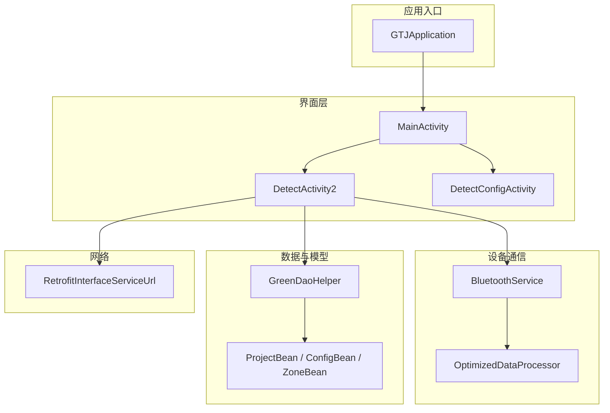
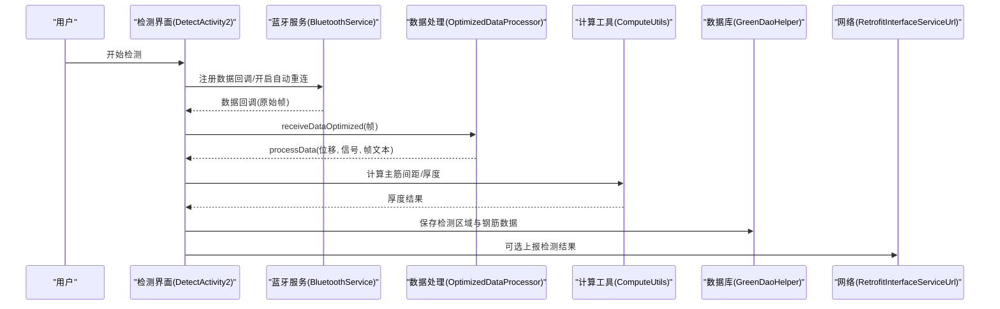
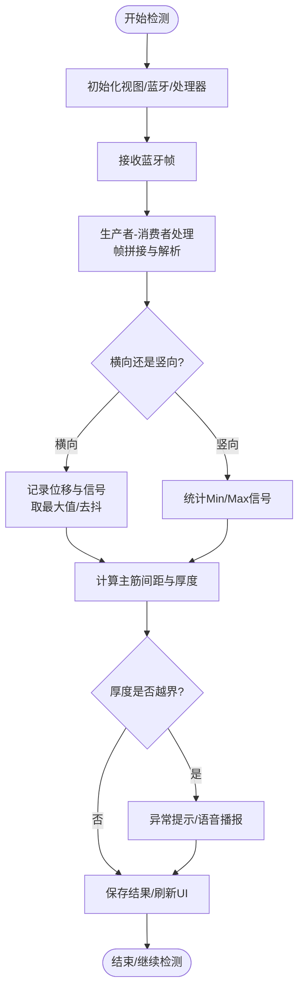
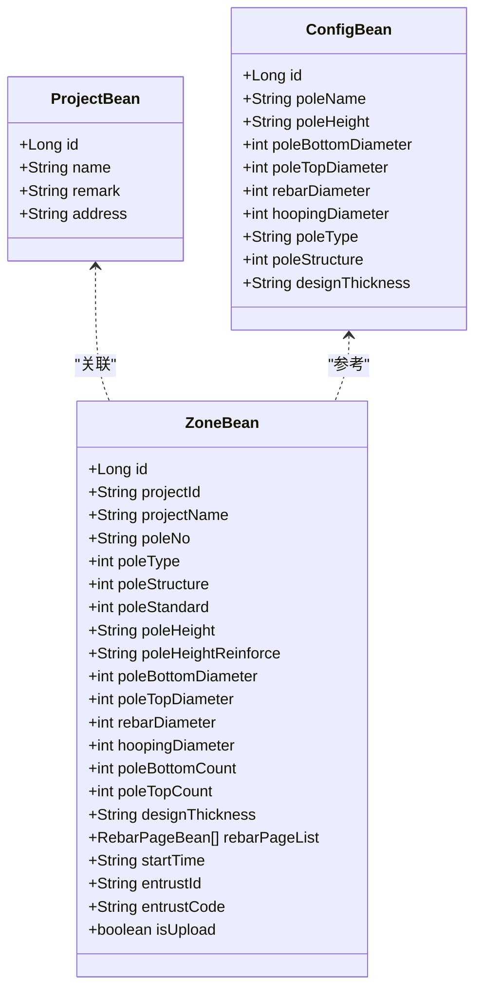
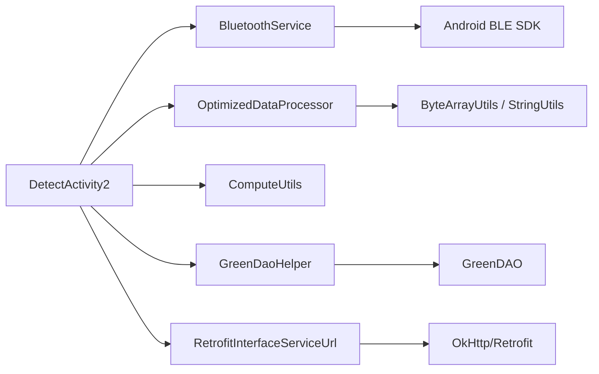

# 项目概述

<cite>
**本文引用的文件**
- [GTJApplication.java](file://app/src/main/java/com/example/gtj_sd_dg240/GTJApplication.java)
- [StaticConstant.java](file://app/src/main/java/com/example/gtj_sd_dg240/StaticConstant.java)
- [MainActivity.java](file://app/src/main/java/com/example/gtj_sd_dg240/activity/MainActivity.java)
- [DetectActivity2.java](file://app/src/main/java/com/example/gtj_sd_dg240/activity/testing/DetectActivity2.java)
- [DetectConfigActivity.java](file://app/src/main/java/com/example/gtj_sd_dg240/activity/testing/DetectConfigActivity.java)
- [BluetoothService.java](file://app/src/main/java/com/example/gtj_sd_dg240/bluetooth/BluetoothService.java)
- [OptimizedDataProcessor.java](file://app/src/main/java/com/example/gtj_sd_dg240/utils/OptimizedDataProcessor.java)
- [ComputeUtils.java](file://app/src/main/java/com/example/gtj_sd_dg240/utils/ComputeUtils.java)
- [RetrofitInterfaceServiceUrl.java](file://app/src/main/java/com/example/gtj_sd_dg240/net/RetrofitInterfaceServiceUrl.java)
- [ProjectBean.java](file://app/src/main/java/com/example/gtj_sd_dg240/model/ProjectBean.java)
- [ConfigBean.java](file://app/src/main/java/com/example/gtj_sd_dg240/model/ConfigBean.java)
- [ZoneBean.java](file://app/src/main/java/com/example/gtj_sd_dg240/model/ZoneBean.java)
- [GreenDaoHelper.java](file://app/src/main/java/com/example/gtj_sd_dg240/storage/GreenDaoHelper.java)
- [app/build.gradle](file://app/build.gradle)
</cite>

## 目录
1. [简介](#简介)
2. [项目结构](#项目结构)
3. [核心组件](#核心组件)
4. [架构总览](#架构总览)
5. [详细组件分析](#详细组件分析)
6. [依赖关系分析](#依赖关系分析)
7. [性能考量](#性能考量)
8. [故障排查指南](#故障排查指南)
9. [结论](#结论)
10. [附录](#附录)

## 简介
本应用面向混凝土电杆（环形混凝土电杆）现场检测场景，围绕“设备连接—数据采集—信号处理—厚度计算—结果存储与上报”的完整工作流设计。应用通过低功耗蓝牙与手持式钢筋仪主机通信，采集位移与信号数据，结合内置的标定表与几何补偿算法，实时计算保护层厚度并支持预估主筋直径；检测结果本地持久化并可上传至云端平台。

- 设计目标
  - 高可靠的数据采集与处理：在高吞吐蓝牙数据下保证稳定解析与低延迟显示。
  - 可配置的电杆参数与标定：支持多种电杆类型、结构与规范，内置默认配置便于快速上手。
  - 现场友好的人机交互：语音播报、异常提示、一键保存与导出。
  - 可追溯与可审计：定位信息、时间戳、委托单号等元数据记录。

- 支持的硬件设备类型
  - 通过低功耗蓝牙（BLE）连接的钢筋仪主机，使用自定义服务与特征进行通知与写入。
  - 设备MAC地址持久化，支持自动重连与状态监听。

- 数据处理流程概览
  - 蓝牙接收原始帧 → 生产者-消费者队列缓冲 → 帧拼接与分片解析 → 信号校准与均值滤波 → 厚度计算与结果展示 → 本地数据库存储 → 可选网络上报。

- 用户工作流
  - 启动应用 → 选择或新建工程与委托 → 设置电杆参数 → 进入检测界面 → 横向/竖向采集信号 → 计算并查看厚度 → 保存结果 → 导出数据或上传。

**章节来源**
- [GTJApplication.java:18-41](file://app/src/main/java/com/example/gtj_sd_dg240/GTJApplication.java#L18-L41)
- [StaticConstant.java:26-70](file://app/src/main/java/com/example/gtj_sd_dg240/StaticConstant.java#L26-L70)
- [MainActivity.java:106-129](file://app/src/main/java/com/example/gtj_sd_dg240/activity/MainActivity.java#L106-L129)

## 项目结构
应用采用分层模块化组织：
- 表现层（Activity/View）：入口与检测流程界面、参数配置界面、数据管理界面。
- 业务逻辑层：检测计算、数据预处理、设备通信封装。
- 数据层：GreenDAO 本地数据库、模型实体、工具类。
- 网络层：Retrofit API 接口定义。
- 基础设施：全局初始化、常量、日志、崩溃收集、定位服务等。

**图表来源**
- [GTJApplication.java:18-41](file://app/src/main/java/com/example/gtj_sd_dg240/GTJApplication.java#L18-L41)
- [MainActivity.java:47-63](file://app/src/main/java/com/example/gtj_sd_dg240/activity/MainActivity.java#L47-L63)
- [DetectActivity2.java:71-116](file://app/src/main/java/com/example/gtj_sd_dg240/activity/testing/DetectActivity2.java#L71-L116)
- [DetectConfigActivity.java:44-69](file://app/src/main/java/com/example/gtj_sd_dg240/activity/testing/DetectConfigActivity.java#L44-L69)
- [BluetoothService.java:16-52](file://app/src/main/java/com/example/gtj_sd_dg240/bluetooth/BluetoothService.java#L16-L52)
- [OptimizedDataProcessor.java:7-27](file://app/src/main/java/com/example/gtj_sd_dg240/utils/OptimizedDataProcessor.java#L7-L27)
- [GreenDaoHelper.java:10-40](file://app/src/main/java/com/example/gtj_sd_dg240/storage/GreenDaoHelper.java#L10-L40)
- [RetrofitInterfaceServiceUrl.java:16-29](file://app/src/main/java/com/example/gtj_sd_dg240/net/RetrofitInterfaceServiceUrl.java#L16-L29)

**章节来源**
- [app/build.gradle:1-145](file://app/build.gradle#L1-L145)

## 核心组件
- 应用初始化与全局配置
  - 蓝牙初始化、崩溃收集、日志、定位服务、Toast样式等统一在 Application 中完成。
- 主界面与导航
  - 提供检测、数据管理、设置入口，校验设备连接与标定后跳转检测界面。
- 检测界面与业务流程
  - 负责蓝牙数据回调、信号处理、厚度计算、结果展示与保存。
- 参数配置界面
  - 维护工程、委托、电杆类型/结构/规范、纵筋与螺旋筋直径等关键参数。
- 蓝牙服务
  - 单例管理连接、重连、数据通知注册与分发。
- 数据处理
  - 生产者-消费者模式的高吞吐数据处理器，负责帧拼接、分片解析与回调。
- 计算工具
  - 基于余弦定理的第三边计算与匹配空间查找，用于主筋间距推断与厚度映射。
- 数据模型与持久化
  - 项目、配置、检测区域（含钢筋分页数据）等实体，GreenDAO 生成 DAO 访问。
- 网络接口
  - Retrofit 接口定义，用于查询委托列表与上报检测结果。

**章节来源**
- [GTJApplication.java:18-41](file://app/src/main/java/com/example/gtj_sd_dg240/GTJApplication.java#L18-L41)
- [MainActivity.java:106-129](file://app/src/main/java/com/example/gtj_sd_dg240/activity/MainActivity.java#L106-L129)
- [DetectActivity2.java:166-203](file://app/src/main/java/com/example/gtj_sd_dg240/activity/testing/DetectActivity2.java#L166-L203)
- [DetectConfigActivity.java:229-367](file://app/src/main/java/com/example/gtj_sd_dg240/activity/testing/DetectConfigActivity.java#L229-L367)
- [BluetoothService.java:16-52](file://app/src/main/java/com/example/gtj_sd_dg240/bluetooth/BluetoothService.java#L16-L52)
- [OptimizedDataProcessor.java:29-47](file://app/src/main/java/com/example/gtj_sd_dg240/utils/OptimizedDataProcessor.java#L29-L47)
- [ComputeUtils.java:17-61](file://app/src/main/java/com/example/gtj_sd_dg240/utils/ComputeUtils.java#L17-L61)
- [ProjectBean.java:14-91](file://app/src/main/java/com/example/gtj_sd_dg240/model/ProjectBean.java#L14-L91)
- [ConfigBean.java:13-151](file://app/src/main/java/com/example/gtj_sd_dg240/model/ConfigBean.java#L13-L151)
- [ZoneBean.java:15-253](file://app/src/main/java/com/example/gtj_sd_dg240/model/ZoneBean.java#L15-L253)
- [RetrofitInterfaceServiceUrl.java:16-29](file://app/src/main/java/com/example/gtj_sd_dg240/net/RetrofitInterfaceServiceUrl.java#L16-L29)

## 架构总览
系统以“设备—处理—展示—存储—网络”为主线，采用事件驱动与异步处理提升响应性。

**图表来源**
- [DetectActivity2.java:166-203](file://app/src/main/java/com/example/gtj_sd_dg240/activity/testing/DetectActivity2.java#L166-L203)
- [BluetoothService.java:175-198](file://app/src/main/java/com/example/gtj_sd_dg240/bluetooth/BluetoothService.java#L175-L198)
- [OptimizedDataProcessor.java:82-133](file://app/src/main/java/com/example/gtj_sd_dg240/utils/OptimizedDataProcessor.java#L82-L133)
- [ComputeUtils.java:36-61](file://app/src/main/java/com/example/gtj_sd_dg240/utils/ComputeUtils.java#L36-L61)
- [GreenDaoHelper.java:32-40](file://app/src/main/java/com/example/gtj_sd_dg240/storage/GreenDaoHelper.java#L32-L40)
- [RetrofitInterfaceServiceUrl.java:16-29](file://app/src/main/java/com/example/gtj_sd_dg240/net/RetrofitInterfaceServiceUrl.java#L16-L29)

## 详细组件分析

### 检测界面（DetectActivity2）
- 职责
  - 管理检测流程：横向/竖向采集、信号平均、厚度计算、结果展示与保存。
  - 与蓝牙服务对接，注册数据回调，处理高频数据。
  - 调用计算工具与数据库，更新UI并触发语音提示。
- 关键流程
  - 初始化：视图绑定、电池与蓝牙状态监听、数据处理器与均值工具初始化。
  - 数据接收：onBluetoothDataReceived 将原始帧交给 OptimizedDataProcessor。
  - 信号处理：根据模式（横向/竖向）分别处理，累计有效样本并计算厚度。
  - 厚度计算：依据主筋直径、电杆半径与主筋间距，查表插值得到厚度。
  - 结果保存：将当前检测区域与钢筋数据持久化，支持删除与刷新。
- 错误与边界
  - 未设置参数或未添加检测部位时提示。
  - 信号值为0或超出范围时给出异常提示。
  - 厚度越界时弹窗提醒重复测量或剔凿验证。

**图表来源**
- [DetectActivity2.java:166-203](file://app/src/main/java/com/example/gtj_sd_dg240/activity/testing/DetectActivity2.java#L166-L203)
- [DetectActivity2.java:205-335](file://app/src/main/java/com/example/gtj_sd_dg240/activity/testing/DetectActivity2.java#L205-L335)
- [DetectActivity2.java:339-488](file://app/src/main/java/com/example/gtj_sd_dg240/activity/testing/DetectActivity2.java#L339-L488)
- [DetectActivity2.java:508-513](file://app/src/main/java/com/example/gtj_sd_dg240/activity/testing/DetectActivity2.java#L508-L513)

**章节来源**
- [DetectActivity2.java:71-116](file://app/src/main/java/com/example/gtj_sd_dg240/activity/testing/DetectActivity2.java#L71-L116)
- [DetectActivity2.java:166-203](file://app/src/main/java/com/example/gtj_sd_dg240/activity/testing/DetectActivity2.java#L166-L203)
- [DetectActivity2.java:205-335](file://app/src/main/java/com/example/gtj_sd_dg240/activity/testing/DetectActivity2.java#L205-L335)
- [DetectActivity2.java:339-488](file://app/src/main/java/com/example/gtj_sd_dg240/activity/testing/DetectActivity2.java#L339-L488)
- [DetectActivity2.java:508-513](file://app/src/main/java/com/example/gtj_sd_dg240/activity/testing/DetectActivity2.java#L508-L513)

### 参数配置（DetectConfigActivity）
- 职责
  - 管理工程、委托、电杆类型/结构/规范、尺寸与配筋参数。
  - 校验必填项与唯一性（同工程下电杆编号不重复）。
  - 保存并复用上次配置，简化重复作业。
- 关键流程
  - 加载上次配置或最近一次检测区域信息。
  - 绑定下拉数据源（结构、规范、钢筋直径等）。
  - 保存时进行完整性校验与查重，必要时持久化上一区域数据。

**章节来源**
- [DetectConfigActivity.java:44-69](file://app/src/main/java/com/example/gtj_sd_dg240/activity/testing/DetectConfigActivity.java#L44-L69)
- [DetectConfigActivity.java:229-367](file://app/src/main/java/com/example/gtj_sd_dg240/activity/testing/DetectConfigActivity.java#L229-L367)

### 蓝牙服务（BluetoothService）
- 职责
  - 单例管理BLE连接、自动重连、数据通知注册与分发。
  - 维护连接状态与MAC地址，提供写数据能力。
- 关键点
  - 使用 CopyOnWriteArrayList 线程安全地管理监听器与回调。
  - 定时任务周期性检查连接状态并重试。
  - 数据通知成功后向所有注册的回调分发字节数组。

**章节来源**
- [BluetoothService.java:16-52](file://app/src/main/java/com/example/gtj_sd_dg240/bluetooth/BluetoothService.java#L16-L52)
- [BluetoothService.java:175-198](file://app/src/main/java/com/example/gtj_sd_dg240/bluetooth/BluetoothService.java#L175-L198)
- [BluetoothService.java:200-234](file://app/src/main/java/com/example/gtj_sd_dg240/bluetooth/BluetoothService.java#L200-L234)

### 数据处理（OptimizedDataProcessor）
- 职责
  - 高吞吐蓝牙数据的缓冲、拼接与分片解析。
  - 按固定帧长度切分，提取位移与信号值，过滤异常值。
- 关键点
  - LinkedBlockingQueue 作为无锁高效队列，避免阻塞。
  - 帧头识别（F1 00）确保对齐，丢弃无效前缀。
  - 子线程处理，回调到上层进行业务计算。

**章节来源**
- [OptimizedDataProcessor.java:7-27](file://app/src/main/java/com/example/gtj_sd_dg240/utils/OptimizedDataProcessor.java#L7-L27)
- [OptimizedDataProcessor.java:29-47](file://app/src/main/java/com/example/gtj_sd_dg240/utils/OptimizedDataProcessor.java#L29-L47)
- [OptimizedDataProcessor.java:82-133](file://app/src/main/java/com/example/gtj_sd_dg240/utils/OptimizedDataProcessor.java#L82-L133)

### 计算工具（ComputeUtils）
- 职责
  - 基于余弦定理计算第三边，用于由角度推导弦长。
  - 根据输入的主筋间距区间匹配预设空间集合，返回匹配的空间索引。
- 关键点
  - isMatch 针对多组空间规则进行宽松匹配，适应现场误差。
  - findMatchingSpaces 返回所有匹配的空间，供厚度插值使用。

**章节来源**
- [ComputeUtils.java:17-26](file://app/src/main/java/com/example/gtj_sd_dg240/utils/ComputeUtils.java#L17-L26)
- [ComputeUtils.java:36-61](file://app/src/main/java/com/example/gtj_sd_dg240/utils/ComputeUtils.java#L36-L61)
- [ComputeUtils.java:63-150](file://app/src/main/java/com/example/gtj_sd_dg240/utils/ComputeUtils.java#L63-L150)

### 数据模型与持久化
- ProjectBean：工程信息（名称、备注、地址）。
- ConfigBean：电杆配置（类型、结构、规范、尺寸、配筋、设计厚度）。
- ZoneBean：检测区域（工程关联、电杆参数、钢筋分页数据、委托信息等）。
- GreenDaoHelper：数据库会话管理，提供 DaoSession 访问。

**图表来源**
- [ProjectBean.java:14-91](file://app/src/main/java/com/example/gtj_sd_dg240/model/ProjectBean.java#L14-L91)
- [ConfigBean.java:13-151](file://app/src/main/java/com/example/gtj_sd_dg240/model/ConfigBean.java#L13-L151)
- [ZoneBean.java:15-253](file://app/src/main/java/com/example/gtj_sd_dg240/model/ZoneBean.java#L15-L253)

**章节来源**
- [ProjectBean.java:14-91](file://app/src/main/java/com/example/gtj_sd_dg240/model/ProjectBean.java#L14-L91)
- [ConfigBean.java:13-151](file://app/src/main/java/com/example/gtj_sd_dg240/model/ConfigBean.java#L13-L151)
- [ZoneBean.java:15-253](file://app/src/main/java/com/example/gtj_sd_dg240/model/ZoneBean.java#L15-L253)
- [GreenDaoHelper.java:10-40](file://app/src/main/java/com/example/gtj_sd_dg240/storage/GreenDaoHelper.java#L10-L40)

### 网络集成
- 接口定义
  - 上报检测结果、查询委托列表（含分页）。
- 使用方式
  - 通过 Retrofit 发起请求，携带客户端标识与必要参数。

**章节来源**
- [RetrofitInterfaceServiceUrl.java:16-29](file://app/src/main/java/com/example/gtj_sd_dg240/net/RetrofitInterfaceServiceUrl.java#L16-L29)

## 依赖关系分析
- 模块耦合
  - 检测界面强依赖蓝牙服务与数据处理模块，同时与数据库和网络模块松耦合（通过接口与DAO）。
  - 蓝牙服务独立于界面，仅暴露连接与数据回调接口。
  - 数据处理模块对底层字节协议有直接依赖，但对上层仅暴露回调。
- 外部依赖
  - AndroidX、GreenDAO、Retrofit、OkHttp、Logger、UtilCodex 等。
  - 百度定位SDK用于获取位置信息。
- 潜在循环依赖
  - 未发现明显循环引用；界面→服务→处理器→工具→数据库/网络的单向依赖清晰。

**图表来源**
- [DetectActivity2.java:166-203](file://app/src/main/java/com/example/gtj_sd_dg240/activity/testing/DetectActivity2.java#L166-L203)
- [BluetoothService.java:175-198](file://app/src/main/java/com/example/gtj_sd_dg240/bluetooth/BluetoothService.java#L175-L198)
- [OptimizedDataProcessor.java:82-133](file://app/src/main/java/com/example/gtj_sd_dg240/utils/OptimizedDataProcessor.java#L82-L133)
- [ComputeUtils.java:36-61](file://app/src/main/java/com/example/gtj_sd_dg240/utils/ComputeUtils.java#L36-L61)
- [GreenDaoHelper.java:32-40](file://app/src/main/java/com/example/gtj_sd_dg240/storage/GreenDaoHelper.java#L32-L40)
- [RetrofitInterfaceServiceUrl.java:16-29](file://app/src/main/java/com/example/gtj_sd_dg240/net/RetrofitInterfaceServiceUrl.java#L16-L29)

**章节来源**
- [app/build.gradle:86-145](file://app/build.gradle#L86-L145)

## 性能考量
- 高吞吐数据处理
  - 使用 LinkedBlockingQueue 缓冲蓝牙帧，避免UI阻塞。
  - 子线程解析与主线程回调分离，降低卡顿风险。
- 信号质量优化
  - 十元素截尾均值滤波减少噪声影响。
  - 信号阈值过滤（如大于30000视为异常）提高鲁棒性。
- 内存与资源
  - 合理控制缓冲区大小（如信号数组缓冲64），及时清空过期数据。
  - 媒体播放器复用，避免频繁创建销毁。
- 网络与I/O
  - Retrofit+OkHttp 连接池与缓存策略（由库实现）。
  - 批量插入数据库（事务）提升写入效率。

[本节为通用性能建议，不直接分析具体文件]

## 故障排查指南
- 无法连接设备
  - 检查是否已保存设备MAC，确认蓝牙权限与定位权限。
  - 观察自动重连是否生效，查看连接状态回调。
- 数据为空或异常
  - 检查帧头识别与分片解析是否正确。
  - 确认信号值是否在合理范围，必要时重新标定。
- 厚度计算异常
  - 核对电杆参数（直径、高度、配筋）与检测部位距离。
  - 检查主筋间距匹配结果与插值逻辑。
- 保存失败
  - 检查数据库会话是否正常，是否存在唯一键冲突。
- 网络上报失败
  - 检查网络连通性与服务端接口状态，查看日志与错误码。

**章节来源**
- [MainActivity.java:106-129](file://app/src/main/java/com/example/gtj_sd_dg240/activity/MainActivity.java#L106-L129)
- [DetectActivity2.java:508-513](file://app/src/main/java/com/example/gtj_sd_dg240/activity/testing/DetectActivity2.java#L508-L513)
- [OptimizedDataProcessor.java:82-133](file://app/src/main/java/com/example/gtj_sd_dg240/utils/OptimizedDataProcessor.java#L82-L133)
- [RetrofitInterfaceServiceUrl.java:16-29](file://app/src/main/java/com/example/gtj_sd_dg240/net/RetrofitInterfaceServiceUrl.java#L16-L29)

## 结论
本应用围绕混凝土电杆现场检测的核心需求，构建了从设备通信、数据处理、算法计算到结果存储与上报的完整闭环。通过模块化设计与高性能数据处理机制，满足现场高可靠、低延迟的使用要求。未来可在以下方面持续优化：
- 增强标定自适应与在线学习，提升不同环境下的鲁棒性。
- 完善离线缓存与断点续传，改善弱网条件下的可靠性。
- 扩展更多电杆类型与规范的配置模板，覆盖更广的工程场景。

[本节为总结性内容，不直接分析具体文件]

## 附录
- 技术选型理由
  - BLE：低功耗、广泛兼容，适合手持设备通信。
  - GreenDAO：轻量、高效，适合移动端本地存储。
  - Retrofit+OkHttp：成熟稳定的网络栈，易于扩展与维护。
  - Logger/崩溃收集：便于问题定位与质量保障。
- 配置选项与使用模式
  - 设备MAC持久化、自动重连开关、标定表配置。
  - 检测模式（横向/竖向）、信号均值窗口大小、阈值过滤。
  - 工程与委托信息管理，支持分页查询与结果上报。

[本节为补充说明，不直接分析具体文件]