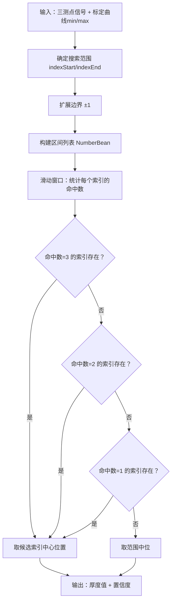
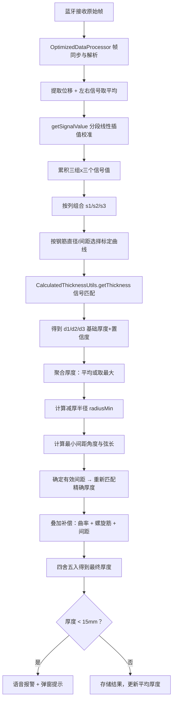

# 水泥杆保护层厚度计算算法实现原理

## 1. 概述

本文档描述 GTJ-SD-DG240 混凝土电杆检测设备中**保护层厚度计算算法**的实现原理。该算法通过蓝牙采集电磁感应信号，结合预标定曲线表进行信号-厚度映射，再经过多项几何补偿得到最终的保护层厚度值。

### 1.1 算法核心思路

```
原始信号 → 信号校准 → 标定曲线匹配(查表法) → 基础厚度 → 几何补偿 → 最终厚度
```

### 1.2 支持的钢筋规格

| 钢筋直径(mm) | 螺旋筋直径(mm) | 对应工具类 | 标定数据类 |
|:---:|:---:|:---|:---|
| 7 | 3 | `CalculatedThicknessUtils_7_3` | `StaCon_7_3` |
| 9 | 3 | `CalculatedThicknessUtils_9_3` | `StaCon_9_3` |
| 9 | 4 | `CalculatedThicknessUtils_9_4` | `StaCon_9_4` |
| 10 | 4 | `CalculatedThicknessUtils_10_4` | `StaCon_10_4` |
| 11 | 3 | `CalculatedThicknessUtils_11_3` | `StaCon_11_3` |
| 11 | 4 | `CalculatedThicknessUtils_11_4` | `StaCon_11_4` |
| 14 | 4 | `CalculatedThicknessUtils_14_4` | `StaCon_14_4` |

---

## 2. 数据采集与预处理

### 2.1 蓝牙帧协议

设备通过 BLE 发送 7 字节数据帧：

```
F1 | 位置高 | 位置低 | 左信号高 | 左信号低 | 右信号高 | 右信号低 | FF
```

- **帧头**：`F1 00`（用于帧同步）
- **位置**：2 字节十六进制 → 位移值（mm）
- **左/右信号**：各 2 字节十六进制 → 传感器信号值
- **合成信号**：`value = (signalLeft + signalRight) / 2`

### 2.2 数据处理流程（OptimizedDataProcessor）

采用**生产者-消费者模式**：

1. 蓝牙数据入队（`LinkedBlockingQueue`，容量 2000）
2. 单线程消费，帧同步定位（搜索 `F1 00` 起始标志）
3. 按 7 字节固定长度切分帧
4. 解析位移和信号值
5. 信号值 > 30000 视为异常，直接丢弃
6. 回调上层 `processData(displacement, signal, frameData)`

### 2.3 信号校准（getSignalValue）

使用持久化存储的校准表对原始信号进行**分段线性插值补偿**：

```java
calibrationList:         [实测值_0, 实测值_1, ..., 实测值_n]  // 降序排列
calibrationStandardList: [标准值_0, 标准值_1, ..., 标准值_n]

// 校准算法
offset = 线性插值(区间上端偏差, 区间下端偏差, 当前值在区间中的相对位置)
校准后信号 = value - offset
```

线性插值公式：

```
K = (y2 - y1) / (x2 - x1)
y = K * (x - x1) + y1
```

---

## 3. 三测点采集策略

### 3.1 数据结构

每次检测采集 **3 组 × 3 个** 信号值，组成 3×3 矩阵：

```
signalValue[0]: [Number(distance, signal), Number(...), Number(...)]  // 第1组
signalValue[1]: [Number(distance, signal), Number(...), Number(...)]  // 第2组
signalValue[2]: [Number(distance, signal), Number(...), Number(...)]  // 第3组
```

其中 `Number` 包含：
- `number`：信号值（校准后）
- `distance`：位移位置（mm）

### 3.2 组合方式

按列提取组成三测点输入序列：

```java
s1 = [signalValue[0][0], signalValue[1][0], signalValue[2][0]]  // 各组的第1个信号
s2 = [signalValue[0][1], signalValue[1][1], signalValue[2][1]]  // 各组的第2个信号
s3 = [signalValue[0][2], signalValue[1][2], signalValue[2][2]]  // 各组的第3个信号
```

每组 `s1/s2/s3` 分别独立计算厚度，得到 `d1[]`, `d2[]`, `d3[]`。

### 3.3 防重复采集

位移差 < 10mm 的数据帧被忽略（`Math.abs(distance - cuDistance) < 10`），避免同一位置重复采集。

---

## 4. 核心厚度计算算法

### 4.1 算法入口

`CalculatedThicknessUtils.getThickness(List<Integer> signalList0, List<Integer> signalList2, List<Number> numberList)`

### 4.2 算法输入

| 参数 | 类型 | 说明 |
|:---|:---|:---|
| `signalList0` | `List<Integer>` | 标定曲线最小信号序列（40个元素，对应厚度 1~40mm） |
| `signalList2` | `List<Integer>` | 标定曲线最大信号序列（40个元素，对应厚度 1~40mm） |
| `numberList` | `List<Number>` | 三测点信号值（3个元素，按信号值升序排列） |

### 4.3 标定曲线表结构

以 `StaCon_14_4` 为例：

```java
// 主筋间距30，箍筋间距40 的标定曲线
signalList_14_30_40_min = [10000, 9833, 8784, 7554, ..., 200]  // 40个值
signalList_14_30_40_max = [12408, 11594, 9508, 8313, ..., 204]  // 40个值
```

- **索引 i** 对应 **厚度 (i+1) mm**
- `min[i]`：该厚度下的最小信号阈值
- `max[i]`：该厚度下的最大信号阈值
- 信号值随厚度增加而**单调递减**（厚度越大，信号越弱）

### 4.4 算法步骤详解

#### 步骤1：确定搜索范围

```java
int indexStart = getIndexAscend(signalList0, numberList.get(0).number);
int indexEnd = getIndexDescend(signalList2, numberList.get(2).number);
```

- `getIndexAscend`：从最小信号序列头部开始，找到第一个 ≤ 最小测点信号值的位置
- `getIndexDescend`：从最大信号序列尾部开始，找到第一个 ≥ 最大测点信号值的位置
- 目的：缩小搜索区间，提高匹配效率

#### 步骤2：扩展搜索边界

```java
int max = Math.max(indexStart, indexEnd);
int min = Math.min(indexStart, indexEnd);
max = max < 39 ? max + 1 : max;  // 上界扩展1（不超过39）
min = min > 1 ? min - 1 : min;    // 下界扩展1（不低于1）
```

扩展边界以容许一定的测量误差。

#### 步骤3：构建信号区间列表

```java
List<NumberBean> signalList = new ArrayList<>();
for (int i = min; i <= max; i++) {
    signalList.add(new NumberBean(signalList0.get(i), signalList2.get(i)));
}
```

每个 `NumberBean` 包含 `[numberMin, numberMax]`，表示该厚度索引对应的信号有效区间。

#### 步骤4：滑动窗口命中计数

```java
List<Integer> markList = new ArrayList<>();
for (int i = 0; i < signalList.size(); i++) {
    int count = 0;
    for (Number bean : numberList) {
        if (bean.number >= signalList.get(i).numberMin &&
            bean.number <= signalList.get(i).numberMax) {
            count++;
        }
    }
    markList.add(count);
}
```

对搜索范围内的每个厚度索引，统计**三个测点信号中有多少个**落在该索引的 `[min, max]` 区间内。

#### 步骤5：优先级匹配确定最终厚度索引

```java
maxIndex = getMaxIndex(markList, 3);  // 优先：3个测点全部命中
if (maxIndex == -1)
    maxIndex = getMaxIndex(markList, 2);  // 次选：2个测点命中
if (maxIndex == -1)
    maxIndex = getMaxIndex(markList, 1);  // 最后：1个测点命中
```

**getMaxIndex 匹配策略**：

| 命中数 | 候选数=1 | 候选数≥2 |
|:---:|:---|:---|
| 3 | 直接取该索引 | 取首尾索引的平均值（保留1位小数） |
| 2 | 扩展搜索命中≥1的范围，再取平均 | 取首尾索引的平均值 |
| 1 | 若无候选取范围中位；1个直接取；多个取平均 | 取首尾索引的平均值 |

#### 步骤6：输出结果

```java
thickness[0] = maxIndex + min + 1;  // 最终厚度值（mm）
thickness[1] = count;               // 置信度（命中测点数：3/2/1）
```

- `maxIndex`：在截取区间内的相对位置
- `+ min`：还原为全局索引
- `+ 1`：索引从0开始，厚度从1mm开始
- `count`：置信度指标，3为最高可信度

### 4.5 算法流程图



---

## 5. 标定曲线选择逻辑

### 5.1 曲线选择维度

标定曲线的选择由以下参数决定：

1. **钢筋直径**（7/9/10/11/14 mm）
2. **螺旋筋直径**（3/4 mm）— 仅对 9mm 和 11mm 钢筋有效
3. **主筋间距**（30/40/50/60 mm）— 由有效间距推导
4. **箍筋间距**（40/50/60/70/120 mm）— 界面下拉选择
5. **检测位置**（根部/中部/梢部）— 仅对 14mm 钢筋有效

### 5.2 有效间距与主筋间距映射

```java
if (effectiveSpacing >= 60)      → 使用主筋间距60的曲线
else if (effectiveSpacing >= 50) → 使用主筋间距50的曲线
else if (effectiveSpacing >= 40) → 使用主筋间距40的曲线
else                             → 使用主筋间距30的曲线（默认）
```

当 `effectiveSpacing == 0` 时（首次粗测），默认使用主筋间距60的曲线。

### 5.3 14mm 钢筋的特殊处理

14mm 钢筋根据检测位置选择不同系列：

```java
if (currentDistance <= 1.5 || currentDistance >= poleHeight - 1.5)
    → signalList_14_70_min/max   // 根部或梢部（70系列）
else
    → signalList_14_120_min/max  // 中部（120系列）
```

### 5.4 箍筋间距路由

每个 `CalculatedThicknessUtils_*` 类通过 `switch(strInterval)` 分发：

```java
switch (strInterval) {
    case "40"  → getThickness(..._40_min, ..._40_max, numberList)
    case "50"  → getThickness(..._50_min, ..._50_max, numberList)
    case "60"  → getThickness(..._60_min, ..._60_max, numberList)
    case "120" → getThickness(..._120_min, ..._120_max, numberList)
    default    → getThickness(..._70_min, ..._70_max, numberList)  // 70为默认
}
```

---

## 6. 几何补偿体系

### 6.1 电杆曲率补偿（calibration）

由于电杆为圆锥形体，检测仪器滚轮（半径 22mm）在曲面上行走时会产生系统偏差。

**计算过程**：

```java
// 1. 根据当前位置插值得到电杆半径
radius = 线性插值(0, poleBottomDiameter, poleHeight, poleTopDiameter, currentDistance) / 2

// 2. 计算滚轮中心到电杆表面的几何关系
a1 = radius + 22         // 滚轮中心到电杆轴心距离
a2 = 52 / 2.0            // 半弦长（26mm）
a3 = √(a1² - a2²)       // 勾股定理求垂直距离
a4 = a3 - radius         // 滚轮最低点到电杆表面的距离

// 3. 补偿值
calibration = 22 - a4    // 保留2位小数
```

**几何模型示意**：

```
        滚轮(半径22mm)
           ○
          /|\
         / | \
   a2=26/  |a3  \
       /   |     \
      ─────┼─────── 电杆表面
           │
        radius
           │
        电杆轴心
```

### 6.2 螺旋筋直径补偿

直接叠加螺旋筋直径：

```java
rebarD2 = getThickness(...)[0] + zoneBean.hoopingDiameter + calibration
```

### 6.3 主筋间距补偿

#### 6.3.1 最小间距计算

通过三组测量点的位移差计算最小主筋间距：

```java
// 1. 每组内相邻测点的位移差
number1 = distance[1] - distance[0]  // 左侧间距
number2 = distance[2] - distance[1]  // 右侧间距
minNumber = min(number1, number2)    // 取较小值

// 2. 三组中取全局最小
minNumber = min(minNumber0, minNumber1, minNumber2)

// 3. 计算圆心角
angle = (minNumber / (2π × radius)) × 360 / 2

// 4. 计算弦长（最小间距）
radiusMin = radius - maxThickness
minSpacing = radiusMin × sin(angle转弧度) × 2

// 5. 中段修正系数（7/9/10/11mm钢筋）
tempSpacing = minSpacing × 0.95
```

#### 6.3.2 间距补偿查表（14mm 钢筋专用）

14mm 钢筋使用二维查表 + 线性插值：

```java
// 厚度分段阈值
spaceBetween = {10, 15, 20, 25, 30}

// 70系列（根部/梢部）
space_14_70_60 = {0, 0, 0, 0, 0}
space_14_70_50 = {0, 0, 0, 0, 0}
space_14_70_40 = {0, 0.5, 0.2, 0.3, 1}
space_14_70_30 = {1, 2.5, 2.5, 2.2, 3}
space_14_70_25 = {2, 2.3, 2.5, 2.8, 3.3}

// 120系列（中部）
space_14_120_60 = {0, 0, 0, 0, 0}
space_14_120_50 = {0, 0.4, 0.4, 0.6, 0.8}
space_14_120_40 = {0.4, 0.8, 0.8, 0.8, 1}
space_14_120_30 = {1, 1.6, 1.6, 1.7, 2}
```

**补偿计算**：

1. 根据当前厚度 `rebarD2` 确定 `betweenIndex`（厚度落在哪个区间）
2. 根据 `tempSpacing` 确定相邻两个间距档位
3. 查表获取两个间距档位对应 `betweenIndex` 的补偿值
4. **线性插值**得到精确补偿值

```java
compensation = 线性插值(spMin, space0, spMax, space1, tempSpacing)
```

#### 6.3.3 间距补偿（7/9/10/11mm 钢筋）

非14mm 钢筋采用简化规则：

```java
// 梢部（距顶部 ≤ 1.5m）
compensation = 0

// 中部/根部
if (rebarD2 >= 15) compensation = 0.5
else               compensation = 1
```

### 6.4 最终厚度合成

```java
rebarThickness = 中间测点厚度(d2[0]) + 螺旋筋直径 + 曲率补偿(calibration) + 间距补偿(compensation)
rThickness = 四舍五入(rebarThickness, 0)  // 取整用于存储
```

**完整公式**：

```
最终厚度 = 基础厚度(信号匹配) + 螺旋筋直径 + 电杆曲率补偿 + 间距补偿
```

---

## 7. 不同钢筋直径的厚度聚合策略

| 钢筋直径 | 聚合方式 | 说明 |
|:---:|:---|:---|
| 7/9/10/11 mm | 三测点**平均** | `maxThickness = (d1[0] + d2[0] + d3[0]) / 3` |
| 14 mm | 三测点**取最大** | `maxThickness = max(d1[0], d2[0], d3[0])` |

聚合后的 `maxThickness` 用于反推"减厚半径" `radiusMin`，进而计算最小间距和角度。

---

## 8. 质量控制与异常处理

### 8.1 厚度阈值报警

```java
if (rebarThickness < 15) {
    showErrorThickness();  // 语音提示 + 弹窗警告
}
```

设计厚度允许偏差：**+8mm / -2mm**

### 8.2 置信度评估

- `thickness[1] = 3`：高置信度，三测点全部命中标定区间
- `thickness[1] = 2`：中置信度，两个测点命中
- `thickness[1] = 1`：低置信度，仅一个测点命中，结果需谨慎采信

### 8.3 多次测量平均

同一检测部位支持多次测量，系统自动计算平均厚度：

```java
averageThickness = Σ(各次厚度) / 有效测量次数
```

---

## 9. 辅助计算工具

### 9.1 StringUtils 数值工具

| 方法 | 功能 |
|:---|:---|
| `getRounding(d, rate)` | BigDecimal 四舍五入，指定小数位数 |
| `getInterpolationValue(x1,y1,x2,y2,x)` | 线性插值 |
| `getInterpolationValueBBB(...)` | 带上限截断的线性插值 |

### 9.2 ComputeCurveUtils 几何工具

| 方法 | 功能 | 公式 |
|:---|:---|:---|
| `calculateAngleInDegrees(R, x)` | 行走夹角 | `∠c = (x × 0.54) / (2πR) × 360` |
| `calculateThirdSide(a, b, angle)` | 三角形第三边 | `c = √(a² + b² - 2ab·cos(C))` |
| `getCoefficient(x[], y[])` | 最小二乘法二次多项式拟合 | Apache Commons Math |

---

## 10. 完整算法流程



---

## 11. 代码文件索引

| 文件路径 | 职责 |
|:---|:---|
| `utils/CalculatedThicknessUtils.java` | 核心匹配算法 + 间距补偿表 |
| `utils/CalculatedThicknessUtils_7_3.java` | 7mm钢筋(螺旋筋3mm)曲线分发 |
| `utils/CalculatedThicknessUtils_9_3.java` | 9mm钢筋(螺旋筋3mm)曲线分发 |
| `utils/CalculatedThicknessUtils_9_4.java` | 9mm钢筋(螺旋筋4mm)曲线分发 |
| `utils/CalculatedThicknessUtils_10_4.java` | 10mm钢筋曲线分发 |
| `utils/CalculatedThicknessUtils_11_3.java` | 11mm钢筋(螺旋筋3mm)曲线分发 |
| `utils/CalculatedThicknessUtils_11_4.java` | 11mm钢筋(螺旋筋4mm)曲线分发 |
| `utils/CalculatedThicknessUtils_14_4.java` | 14mm钢筋曲线分发 |
| `stacon/StaCon_7_3.java` ~ `StaCon_14_4.java` | 各规格标定曲线数据 |
| `stacon/StaCon.java` | 钢筋/螺旋筋直径常量定义 |
| `utils/OptimizedDataProcessor.java` | 蓝牙数据帧解析 |
| `utils/StringUtils.java` | 四舍五入、线性插值 |
| `utils/ComputeCurveUtils.java` | 几何计算(角度、弦长、曲线拟合) |
| `activity/testing/DetectActivity.java` | 检测主界面，补偿计算入口 |
| `model/Number.java` | 信号值+位移数据模型 |
| `model/NumberBean.java` | 信号区间数据模型 |
| `model/PoleThicknessBean.java` | 厚度计算完整结果模型 |

---

## 12. 算法特点总结

1. **查表匹配法**：通过预标定的信号-厚度映射表实现非接触式厚度测量，避免复杂的物理建模
2. **三测点融合**：多次采样提高鲁棒性，命中计数作为置信度指标
3. **优先级降级**：3命中 → 2命中 → 1命中，确保总能给出结果
4. **多维补偿**：曲率补偿 + 螺旋筋补偿 + 间距补偿，系统性消除误差源
5. **分段标定**：按钢筋直径、间距、位置等多维度细分标定曲线，提高匹配精度
6. **实时校准**：支持现场校准表更新，适应设备漂移